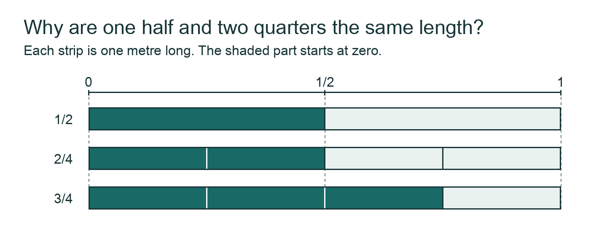
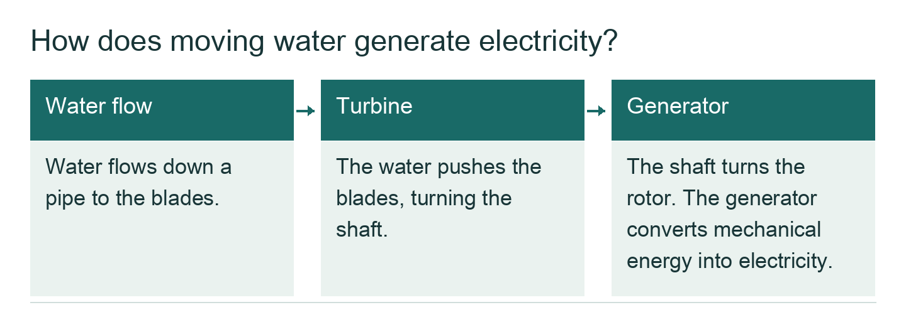
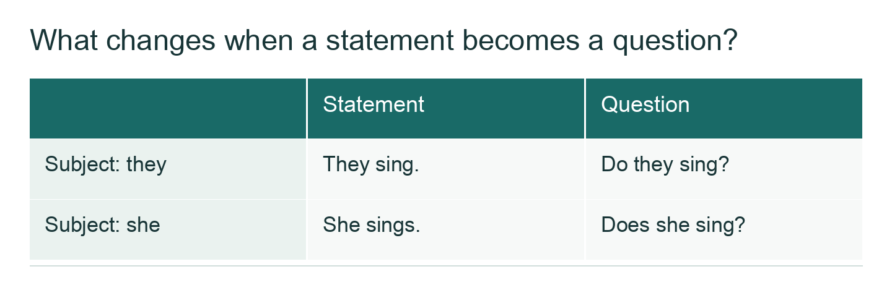
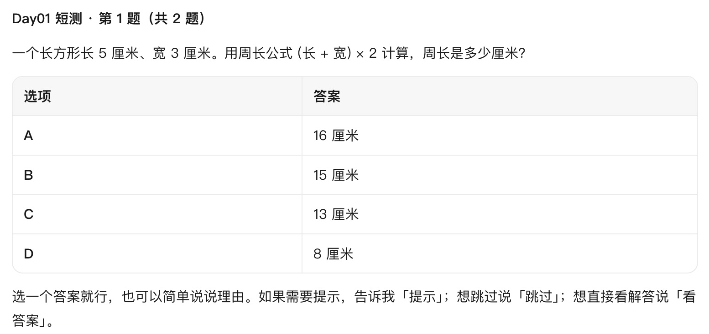
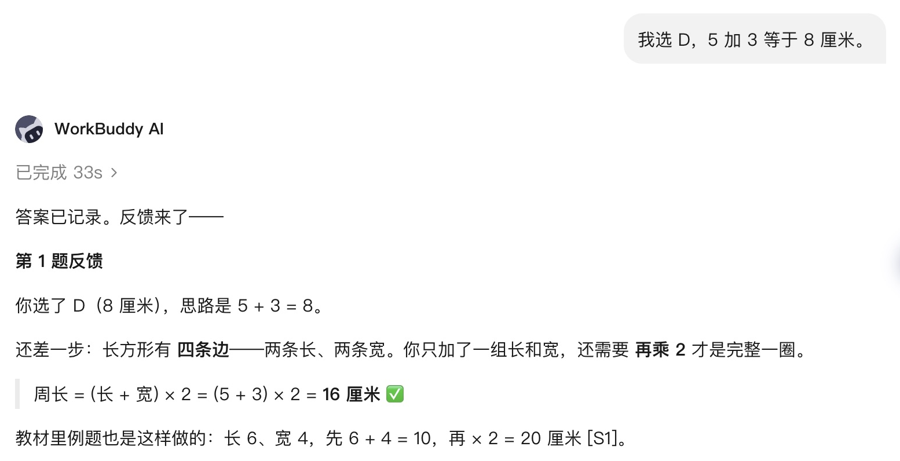
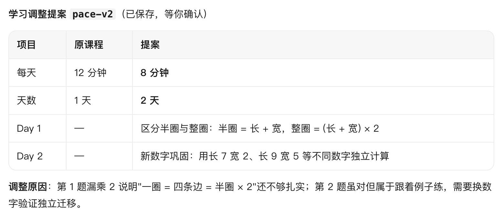

<div align="center">


# Omni Learning Anything

[](https://github.com/ShawnRen57/omni-learning-anything/releases/latest)
[](skills/omni-learning-anything/SKILL.md)
[](skills/omni-learning-anything/references/setup.md)
[](README.md#choose-your-learning-language)
[](skills/omni-learning-anything/references/setup.md)
[](LICENSE)
[](https://github.com/ShawnRen57/omni-learning-anything/releases)
[](https://github.com/ShawnRen57/omni-learning-anything/stargazers)
[](https://hits.sh/github.com/ShawnRen57/omni-learning-anything/)

[](#output-destinations)
[](#output-destinations)
[](#output-destinations)
[](#output-destinations)

[](#output-destinations)
[](#output-destinations)
[](#output-destinations)
[](#output-destinations)
[](#output-destinations)

[English](README.md) · [简体中文](docs/readme/README_zh.md) · [日本語](docs/readme/README_ja.md) · [한국어](docs/readme/README_ko.md) · [Español](docs/readme/README_es.md) · [Français](docs/readme/README_fr.md) · [Deutsch](docs/readme/README_de.md) · [Português](docs/readme/README_pt.md) · [Русский](docs/readme/README_ru.md) · [العربية](docs/readme/README_ar.md)

**[Download v5.0.0 Skill ZIP](https://github.com/ShawnRen57/omni-learning-anything/releases/download/v5.0.0/omni-learning-anything-skill-v5.0.0.zip)**

[skills.sh](https://skills.sh/shawnren57/omni-learning-anything/omni-learning-anything) · [Installation channels](docs/distribution-channels.md)

</div>

**Pick a lecture worth an hour, a book worth a month, or a language you want to speak. Turn it into a course you can study one lesson at a time.**

Turn “I want to learn…” into a plan you can follow. Start with a personal goal, a built-in course, a textbook or your own materials. Review the plan before lessons begin.

Try **“Teach me Japanese from zero in Chinese. I want to introduce myself on my first day in class.”** Or ask **“Find me a TED talk on storytelling and build a one-hour lesson around it.”**

| Feature | What it does |
| --- | --- |
| Personal learning path | Turn a broad interest or specific goal into a course matched to your background, purpose and time. |
| Built-in source library | Explore 135 entries. Choose one of 67 mapped pathways or search 68 additional sources, from university courses and academic books to in-depth articles and TED talks. [Browse the additions](docs/curated-learning-resources.md) |
| A foreign language from zero | Learn through your own language. Practice recognition and production with printable worksheets, separate answer keys and cumulative review. Listening can use a source recording or a compatible local voice. [Explore two sample courses](examples/languages/README.md) |
| Chinese school textbooks | Search 1,949 entries from primary through senior secondary. Ask for the latest edition or a specific year. When the index cannot verify the book, the agent checks the upstream repository and searches online. Study a chapter, concept or formula with original figures and page references when the textbook is available. |
| Your own materials | Study selected pages, chapters or timestamps in PDF, DOCX, EPUB, PPTX, HTML, Markdown, TXT, SRT or VTT. Choose whether to include outside sources. |
| Sources and further reading | Trace key claims to an original page, chapter or timestamp, or to cited web research with dates and links. |
| Plan before lessons | Review a day-by-day curriculum and estimated workload before approving lessons. |
| Reading a diagram | Each new illustration comes with a question, details to locate and a source. Compare aligned examples, follow arrows in a process, or examine a detail on an original textbook page. |
| Ten learning languages | Set the language of plans and lessons independently of your sources. Arabic uses right-to-left layout. |
| Four local formats | Save PDF, offline HTML with embedded images, DOCX or Markdown. |
| Connected destinations | Save to a local Obsidian Vault, or connect Notion, Feishu, DingTalk or Tencent Docs with authorized access. |
| Light checks | Ask for 1–3 questions after a lesson. Answer in chat or with supported cards, and ask for a hint, skip or resume. |
| Answer feedback | See what your answer got right, what it missed and one next step. Revise an answer or dispute a judgment. |
| Learning record and review | Review topics that need attention within your daily time budget. Request a recap, export your assessment record or remove it. |
| Plan iteration | Use your goals or answer evidence to propose future changes. Review them before creating a separate course version. |
| Anki export | Export selected review questions as a CSV for one-way import into Anki. |
| Continue or schedule | Pause, resume or pick up the earliest undelivered lesson. Optional scheduling uses your agent's native tools. |
| Install and update | Install in compatible agents, check discovery and update the skill while keeping course archives outside the installation. |

<a id="examples"></a>

## Sample lessons and practice

| Fractions · Read the scale | Hydropower · Follow the energy | English grammar · Find the change |
| --- | --- | --- |
| <a href="docs/assets/figures/equivalent-fractions-en.png"></a> | <a href="docs/assets/figures/hydropower-en.png"></a> | <a href="docs/assets/figures/present-simple-en.png"></a> |
| Which two shaded lengths end at the same mark? How much farther does the third reach? [OpenStax model](https://openstax.org/books/prealgebra-2e/pages/4-1-visualize-fractions) | Water turns the turbine. What does the shaft carry to the generator? [U.S. Department of Energy](https://www.energy.gov/cmei/water/how-hydropower-works) | Compare *She sings* with *Does she sing?* Which word now carries the third-person marking? [British Council](https://learnenglish.britishcouncil.org/free-resources/grammar/english-grammar-reference/present-simple) |

| Sample | Open the material and try it |
| --- | --- |
| **Language learning** | Learn Japanese through Chinese over [three days](examples/languages/zh-ja/plan.md), then try the [three-turn conversation](examples/languages/zh-ja/day03-task.md) before checking the [model responses](examples/languages/zh-ja/day03-task-key.md). For German through English, try the [first lesson](examples/languages/en-de/day01.md) and [two-way recall](examples/languages/en-de/worksheet.md). |
| Chinese school textbooks | Use the textbook’s own [rectangle diagram](examples/textbooks/primary-math/Day01.pdf) to explain why the perimeter formula doubles a sum. [Five textbook lessons](examples/textbooks/README.md) |
| University courses | Read Harvard’s [CS50x lesson in English](examples/university/cs50x-en/Day01.pdf) or Yale’s [Listening to Music in French](examples/university/listening-music-fr/Day01.pdf). [Six university samples](examples/university/README.md) |
| Read a diagram · Chinese lessons | [Screen flight quotes against a budget](examples/agent-product/pdf/Agent%E4%BA%A7%E5%93%81%E8%AE%BE%E8%AE%A1_%E6%AF%8F%E6%97%A5%E5%AD%A6%E4%B9%A0_Day01_%E4%BB%8E%E8%81%8A%E5%A4%A9%E5%9B%9E%E7%AD%94%E5%88%B0%E5%AE%8C%E6%88%90%E4%BB%BB%E5%8A%A1.pdf) · [Trace the agent’s feedback loop](examples/agent-product/pdf/Agent%E4%BA%A7%E5%93%81%E8%AE%BE%E8%AE%A1_%E6%AF%8F%E6%97%A5%E5%AD%A6%E4%B9%A0_Day02_%E5%B7%A5%E4%BD%9C%E6%B5%81%E4%B8%8EAgent%E5%A6%82%E4%BD%95%E9%80%89%E6%8B%A9.pdf) · [Compare a Ming painting with its museum record](examples/ming-history/pdf/%E6%98%8E%E6%9C%9D%E5%8E%86%E5%8F%B2_%E6%AF%8F%E6%97%A5%E5%AD%A6%E4%B9%A0_Day01_%E6%97%B6%E9%97%B4%E7%BA%BF%E4%B8%8E%E5%8F%B2%E6%96%99%E5%A6%82%E4%BD%95%E4%BD%BF%E7%94%A8.pdf) · [Follow a phone’s scan request](examples/technology/pdf/%E7%A7%91%E6%8A%80%E9%80%9A%E8%AF%86_%E6%AF%8F%E6%97%A5%E5%AD%A6%E4%B9%A0_Day01_%E4%BB%8E%E6%89%8B%E6%9C%BA%E7%9C%8B%E6%8A%80%E6%9C%AF%E7%B3%BB%E7%BB%9F.pdf) · [Compare two groups’ willingness to return](examples/university/positive-psychology-zh/Day01.pdf) |

<a href="examples/README.md"></a>

<a id="versions"></a>
## Version guide

| Version | What it brings to your learning |
| --- | --- |
| **[v5.0.0](docs/product-scope-v5.md)** | Start a foreign language through your own language, learn to read explanatory diagrams, and choose from 68 new sources. |
| **[v4.2.0](skills/omni-learning-anything/references/textbooks.md)** | Find the requested textbook edition by year or ask for the latest. The agent searches beyond the index for a verifiable original. |
| **[v4.1.0](skills/omni-learning-anything/references/assessment.md)** | Check whether you can apply what you learned to a new example, with each question reviewed against the original source. |
| **[v4.0.0](skills/omni-learning-anything/references/textbooks.md)** | Study mainland Chinese school textbooks with age-specific lessons, exact page references and original illustrations. |
| **v3.0.0** | Choose a university pathway, see the source edition, and preview real multilingual learning documents. |
| **v2.3–v2.6** | Ask for light checks, study your own sources, review what needs attention and install or update more easily. |
| **v2** | Study in ten languages, choose four local formats, or keep your course in connected documents. |
| **v1** | Approve a personal plan and receive illustrated PDF lessons with practice and further reading. |

<a id="university-courses"></a>
## Browse the built-in courses and resources

Search by title, subject or provider. Try **“Find a TED talk about language”** or **“Build me a plan for Yale’s Modern Poetry.”** Choose a chapter, lecture or talk, a study language and the time you have. Review the proposed plan before starting.

Each title opens the original source. For books with only a publisher listing, use chapters you have access to. [Course editions and instructors](docs/course-catalog-sources.md) · [Resource access notes](docs/curated-learning-resources.md)

<!-- catalog:start -->

| University, publisher or creator | Courses and resources (135) |
| --- | --- |
| Tsinghua University | **Courses** [中国建筑史——史前至两宋辽金](https://higher.smartedu.cn/course/687eb7bf16c43a09c0e58c23) · [文物精品与文化中国](https://higher.smartedu.cn/course/6a5e9b52b44e493c768f8c9c) · [中国建筑史（下）（自主模式）](https://v1-www.xuetangx.com/courses/course-v1%3ATsinghuaX%2B80000901X_2%2Bsp/about) · [艺术的启示](https://higher.smartedu.cn/course/6786ec4c225d72705e5dc29e) · [校园风物与大学文化——以清华大学为例](https://higher.smartedu.cn/course/6a5e9b60b44e493c768f8cba) · [数据结构(上)](https://www.xuetangx.com/course/THU08091000384/) · [大学历史与文化](https://next.xuetangx.com/course/THU04011000284/29592783)<br>**Open references** [人工智能通识教育红皮书](https://aige.cs.tsinghua.edu.cn/redbook/) |
| Peking University | **Courses** [经典昆曲欣赏](https://www.icourse163.org/course/PKU-1470426173?tid=1474265476) · [人工智能与信息社会](https://www.icourse163.org/course/PKU-1003471009?tid=1476756462) · [西方音乐欣赏](https://www.icourse163.org/course/PKU-1207132813?tid=1207476216) · [人工智能原理](https://www.icourse163.org/course/PKU-1002188003?tid=1472399493) · [语言学概论](https://www.icourse163.org/course/PKU-1205727813) · [古代汉语](https://www.icourse163.org/course/PKU-1205726807) · [生理学（上）](https://www.icourse163.org/course/PKU-1205915814) |
| Fudan University | **Courses** [人工智能，语言与伦理](https://www.icourse163.org/course/FUDAN-1205951803?tid=1475942449) · [比较文化研究](https://umoocs.unipus.cn/course/7944/tasks) · [深度学习及其应用](https://higher.smartedu.cn/course/622ac9f0bee70ef79f419877) · [中华优秀传统文化](https://higher.smartedu.cn/course/63ffd464af1f1b5d3ecfd579) · [政治学原理](https://www.icourse163.org/course/FUDAN-1461787179?tid=1462604462) · [古典诗词鉴赏](https://www.icourse163.org/course/FUDAN-1205950804) |
| Shanghai Jiao Tong University | **Courses** [唐诗宋词人文解读](https://higher.smartedu.cn/course/69b0942995df98bb27ba19b4) · [数学的天空](https://higher.smartedu.cn/course/690530295345b68214577952) · [机器的征途：空天科技](https://higher.smartedu.cn/course/62354d7a9906eace0490b2aa) · [经济法](https://higher.smartedu.cn/course/67c2473d225d72705e7bb8c8) · [关爱生命——急救与自救技能](https://higher.smartedu.cn/course/69b0942695df98bb27ba19a1) · [建筑物理](https://www.icourse163.org/course/SJTU-1472028164) · [造型基础—设计素描](https://www.icourse163.org/course/SJTU-1206432804) · [设计创新的艺术](https://www.icourse163.org/course/SJTU-1207170808) |
| Zhejiang University | **Courses** [唐诗经典](https://higher.smartedu.cn/course/6982720195df98bb27cadb06) |
| Beijing Normal University | **Courses** [书法欣赏](https://www.icourse163.org/course/BNU-1003240002?tid=1488313456) |
| Harvard University | **Courses** [Positive Psychology](https://ppc.sas.upenn.edu/sites/default/files/ppsyllabusschachar.pdf) · [CS50’s Introduction to Computer Science](https://cs50.harvard.edu/x/2026/syllabus/) · [Justice](https://sandel.scholars.harvard.edu/justice) · [Rhetoric: The Art of Persuasive Writing and Public Speaking](https://pll.harvard.edu/course/rhetoric-art-persuasive-writing-and-public-speaking) · [CS50’s Introduction to Artificial Intelligence with Python](https://cs50.harvard.edu/ai/) · [Masterpieces of World Literature](https://www.edx.org/learn/literature/harvard-university-masterpieces-of-world-literature) · [Pyramids of Giza: Ancient Egyptian Art and Archaeology](https://giza.fas.harvard.edu/videos/) |
| Yale University | **Courses** [Introduction to Psychology](https://oyc.yale.edu/introduction-psychology/psyc-110) · [Financial Markets](https://oyc.yale.edu/economics/econ-252) · [Game Theory](https://oyc.yale.edu/economics/econ-159) · [Death](https://oyc.yale.edu/death/phil-176) · [Listening to Music](https://oyc.yale.edu/music/musi-112/lecture-1) · [Roman Architecture](https://oyc.yale.edu/history-of-art/hsar-252) · [Introduction to Theory of Literature](https://oyc.yale.edu/english/engl-300) · [The Atmosphere, the Ocean, and Environmental Change](https://oyc.yale.edu/geology-and-geophysics/gg-140) · [European Civilization, 1648-1945](https://oyc.yale.edu/history/hist-202) · [Philosophy and the Science of Human Nature](https://oyc.yale.edu/philosophy/phil-181) · [Principles of Evolution, Ecology and Behavior](https://oyc.yale.edu/ecology-and-evolutionary-biology/eeb-122) · [Introduction to Ancient Greek History](https://oyc.yale.edu/classics/clcv-205) · [The American Revolution](https://oyc.yale.edu/history/hist-116) · [Modern Poetry](https://oyc.yale.edu/english/engl-310) · [Capitalism: Success, Crisis, and Reform](https://oyc.yale.edu/political-science/plsc-270) · [Frontiers and Controversies in Astrophysics](https://oyc.yale.edu/astronomy/astr-160) · [Fundamentals of Physics I](https://oyc.yale.edu/physics/phys-200) · [Frontiers of Biomedical Engineering](https://oyc.yale.edu/biomedical-engineering/beng-100) · [The Psychology, Biology and Politics of Food](https://oyc.yale.edu/psychology/psyc-123) · [Milton](https://oyc.yale.edu/english/engl-220) |
| MIT | **Courses** [Introduction to Computer Science and Programming in Python](https://ocw.mit.edu/courses/6-0001-introduction-to-computer-science-and-programming-in-python-fall-2016/video_galleries/lecture-videos/) · [Linear Algebra](https://ocw.mit.edu/courses/18-06-linear-algebra-spring-2010/pages/calendar/) · [Classical Mechanics](https://ocw.mit.edu/courses/8-01sc-classical-mechanics-fall-2016/) · [Introduction to Art History](https://ocw.mit.edu/courses/4-601-introduction-to-art-history-fall-2018/pages/calendar/) · [Principles of Microeconomics](https://ocw.mit.edu/courses/14-01-principles-of-microeconomics-fall-2023/pages/calendar/) · [Art Since 1940](https://ocw.mit.edu/courses/4-651-art-since-1940-fall-2010/pages/lecture-notes/) · [Philosophy of Film](https://ocw.mit.edu/courses/24-213-philosophy-of-film-fall-2004/pages/calendar/) · [Introduction to Deep Learning](https://introtodeeplearning.com/2026/index.html) · [Introduction to Sustainable Energy](https://ocw.mit.edu/courses/22-081j-introduction-to-sustainable-energy-fall-2010/pages/calendar/)<br>**Academic books · MIT Press** [Deep Learning](https://www.deeplearningbook.org/) · [Probabilistic Machine Learning: An Introduction](https://probml.github.io/pml-book/book1.html) · [Reinforcement Learning: An Introduction](https://mitpress.mit.edu/9780262039246/reinforcement-learning/) |
| Stanford University | **Courses** [Machine Learning](https://cs229.stanford.edu/syllabus-autumn2018.html) · [Deep Learning for Computer Vision](https://cs231n.stanford.edu/2026/schedule.html)<br>**Academic books** [Speech and Language Processing](https://web.stanford.edu/~jurafsky/slp3/) · [Convex Optimization](https://web.stanford.edu/~boyd/cvxbook/) · [Introduction to Applied Linear Algebra – Vectors, Matrices, and Least Squares](https://web.stanford.edu/~boyd/vmls/)<br>**Articles · Stanford Encyclopedia of Philosophy** [Aesthetic Judgment](https://plato.stanford.edu/entries/aesthetic-judgment/) · [Scientific Method](https://plato.stanford.edu/entries/scientific-method/) · [Personal Identity](https://plato.stanford.edu/entries/identity-personal/) · [Justice](https://plato.stanford.edu/entries/justice/) · [Chinese Ethics](https://plato.stanford.edu/entries/ethics-chinese/) · [The Philosophy of Music](https://plato.stanford.edu/entries/music/) |
| University of Helsinki & MinnaLearn | **Courses** [Elements of AI: Introduction to AI](https://opin.fi/en/study-options/HY/elements-of-ai-introduction-to-ai/89eb0e79-873e-4d2a-aec5-d694d7762118) · [Elements of AI: Building AI](https://buildingai.elementsofai.com/) |
| OpenAI Academy | **Courses** [AI Foundations](https://academy.openai.com/public/courses/ai-foundations-dnq5w) · [Applied AI Foundations](https://academy.openai.com/public/courses/applied-ai-foundations-szsmv) · [Agents and Workflows](https://academy.openai.com/public/courses/agents-and-workflows-y0qoc) · [AI for College Students](https://academy.openai.com/public/courses/ai-for-college-students-gxgmr) |
| Anthropic · Claude Academy | **Courses** [AI Fluency: Framework and foundations](https://academy.claude.com/courses/ai-fluency-framework-foundations) · [AI Fluency for students](https://academy.claude.com/courses/ai-fluency-for-students) · [AI Fluency for educators](https://academy.claude.com/courses/ai-fluency-for-educators) |
| Hugging Face | **Courses** [AI Agents Course](https://huggingface.co/learn/agents-course/unit0/introduction) |
| UC Berkeley | **Courses** [Introduction to Artificial Intelligence](https://inst.eecs.berkeley.edu/~cs188/sp26/) |
| DeepLearning.AI | **Courses** [AI For Everyone](https://www.coursera.org/learn/ai-for-everyone/) · [Generative AI for Everyone](https://www.coursera.org/learn/generative-ai-for-everyone/) |
| Microsoft | **Courses** [Generative AI for Beginners](https://github.com/microsoft/generative-ai-for-beginners/blob/79a4334e158147d4f36c27d805e0cb163c1e445b/README.md#-lessons) |
| Google | **Courses** [Google AI Essentials](https://grow.google/ai-essentials/) |
| Smarthistory | **Open references** [Reframing Art History](https://smarthistory.org/reframing-art-history/) |
| Rice University · OpenStax | **Textbooks** [Astronomy 2e](https://openstax.org/books/astronomy-2e/pages/preface) · [Biology 2e](https://openstax.org/books/biology-2e/pages/preface) · [Psychology 2e](https://openstax.org/books/psychology-2e/pages/preface) · [Introduction to Sociology 3e](https://openstax.org/books/introduction-sociology-3e/pages/preface) · [Principles of Economics 3e](https://openstax.org/books/principles-economics-3e/pages/preface) · [Chemistry 2e](https://openstax.org/books/chemistry-2e/pages/preface) · [University Physics Volume 1](https://openstax.org/books/university-physics-volume-1/pages/preface) · [Calculus Volume 1](https://openstax.org/books/calculus-volume-1/pages/preface) · [World History Volume 1, to 1500](https://openstax.org/books/world-history-volume-1/pages/preface) · [Introduction to Philosophy](https://openstax.org/books/introduction-philosophy/pages/preface) · [Introductory Statistics 2e](https://openstax.org/books/introductory-statistics-2e/pages/preface) · [Entrepreneurship](https://openstax.org/books/entrepreneurship/pages/preface) · [Business Ethics](https://openstax.org/books/business-ethics/pages/preface) |
| Dive into Deep Learning authors | **Academic books** [动手学深度学习](https://zh.d2l.ai/) |
| O’Reilly | **Academic books** [R for Data Science (2e)](https://r4ds.hadley.nz/) |
| Distill | **Articles** [Attention and Augmented Recurrent Neural Networks](https://distill.pub/2016/augmented-rnns/) · [How to Use t-SNE Effectively](https://distill.pub/2016/misread-tsne/) · [Feature Visualization](https://distill.pub/2017/feature-visualization/) · [Why Momentum Really Works](https://distill.pub/2017/momentum/) · [Deconvolution and Checkerboard Artifacts](https://distill.pub/2016/deconv-checkerboard/) · [A Gentle Introduction to Graph Neural Networks](https://distill.pub/2021/gnn-intro/) · [Computing Receptive Fields of Convolutional Neural Networks](https://distill.pub/2019/computing-receptive-fields/) · [A Visual Exploration of Gaussian Processes](https://distill.pub/2019/visual-exploration-gaussian-processes/) |
| Caltech | **Lecture series** [The Feynman Lectures on Physics, Volume I](https://www.feynmanlectures.caltech.edu/I_toc.html) · [The Feynman Lectures on Physics, Volume II](https://www.feynmanlectures.caltech.edu/II_toc.html) · [The Feynman Lectures on Physics, Volume III](https://www.feynmanlectures.caltech.edu/III_toc.html) |
| The Royal Institution | **Lecture series** [The truth about AI](https://www.rigb.org/christmas-lectures/watch-2023-christmas-lectures)<br>**Talks** [Growing up in the universe – Waking up in the universe (1991)](https://www.rigb.org/explore-science/explore/video/growing-universe-waking-universe-1991) |
| TED | **Talks** [How language shapes the way we think](https://www.ted.com/talks/lera_boroditsky_how_language_shapes_the_way_we_think) · [The danger of a single story](https://www.ted.com/talks/chimamanda_ngozi_adichie_the_danger_of_a_single_story) · [The best stats you’ve ever seen](https://www.ted.com/talks/hans_rosling_the_best_stats_you_ve_ever_seen) · [Do schools kill creativity?](https://www.ted.com/talks/sir_ken_robinson_do_schools_kill_creativity) · [The power of introverts](https://www.ted.com/talks/susan_cain_the_power_of_introverts) · [Inside the mind of a master procrastinator](https://www.ted.com/talks/tim_urban_inside_the_mind_of_a_master_procrastinator) · [10 ways to have a better conversation](https://www.ted.com/talks/celeste_headlee_10_ways_to_have_a_better_conversation) · [How to speak so that people want to listen](https://www.ted.com/talks/julian_treasure_how_to_speak_so_that_people_want_to_listen) · [The power of vulnerability](https://www.ted.com/talks/brene_brown_the_power_of_vulnerability) · [We should all be feminists](https://www.ted.com/talks/chimamanda_ngozi_adichie_we_should_all_be_feminists) |

<!-- catalog:end -->

A 10-minute session covers a small learning step, not an entire original lecture or course. Original workload remains visible; longer readings, exercises and projects need their own time. Course sources and availability may change. These are independent learning pathways based on public course sources. Complete lecture content is not bundled; no university endorsement or certificate is implied.

## Bring your own materials

Use PDF, TXT, Markdown, HTML, DOCX, EPUB, PPTX, SRT or VTT. Choose chapters, pages or timestamps and whether outside supplements are allowed. Explanations and checks trace back to the selected source locations. Legacy DOC and RTF need trusted conversion first.

A rough goal works too: “I want to learn a little economics.” The agent suggests useful directions, explains its assumptions and asks only questions that affect the plan. A specific goal goes straight to planning.

<a id="choose-your-learning-language"></a>
## Choose your learning language

**English · 简体中文 · 日本語 · 한국어 · Español · Français · Deutsch · Português · Русский · العربية**

Plans and lessons support all ten languages listed above, independently of the source language or the language of this page. Arabic documents use right-to-left layout.

<a id="output-destinations"></a>
## Choose where to keep your course

| Destination | How it works |
| --- | --- |
| PDF · HTML · DOCX · Markdown | Choose a folder and PDF, HTML, DOCX or Markdown. HTML keeps its illustration in one offline file; external source links need internet. |
| Notion | Connect a parent page through the official `ntn` CLI. |
| Obsidian | Choose an existing local Vault and course folder; no Obsidian API is used. |
| Feishu / 飞书 | Connect a document folder through the official `lark` CLI and user authorization. |
| DingTalk / 钉钉 | Connect a folder through the official `dws` CLI; organization approval may be required. |
| Tencent Docs / 腾讯文档 | Choose a root or folder and complete official OAuth/MCP authorization. |

Tell the agent where to save your course. It checks existing access, guides missing setup and reuses your named connection. Do not paste passwords or tokens into chat.

<a id="quick-start"></a>
## Install and start

Ask your agent to install the latest release and verify that this client can discover the skill. Keep existing courses and connections when updating. With Node.js, run:

```sh
npx skills@latest add ShawnRen57/omni-learning-anything --skill omni-learning-anything -g
```

In Claude Code, use the plugin installer:

```text
/plugin install omni-learning-anything --marketplace ShawnRen57/omni-learning-anything
```

Without Node.js, download the ZIP above and use your client’s skill upload or agent-assisted installation. `skills.sh` is live; the SkillHub listing is currently v2.6.0. Check the channel guide for version availability.

## Try your first course

```text
Show me built-in courses. Use Harvard CS50x 2026 as the source.
I am a beginner. Teach me in English, 20 minutes a day.
Preserve the original unit order and show the original workload.
Save offline HTML in my course folder. Show me the plan first.
```

Or try: “Teach me the first two chapters of my EPUB in 15-minute sessions,” or “Use Yale Financial Markets 2011 to help me understand financial institutions.”

Review and approve the plan, then ask for the first lesson. To resume, say “Continue from my earliest undelivered lesson.” Ask to pause when needed. Scheduling works only when your host supports it and you agree a time and timezone; generation begins at that time, with delivery after research and review.

## Checks, feedback and review

When you want a check, request 1–3 short questions as cards or plain text. Ask for a new scenario, a mistake to diagnose, or a quick recall question. The agent chooses a question that fits the lesson, checks its original source and works through the answer before showing the prompt. Try “Test me on Day01 with a new example that uses only what the lesson taught.” Your responses inform the learning record and feedback.

Ask “What should I review today?” for a small review within your existing time budget, or “What have my answers shown this week?” for an evidence-based recap. Correct a judgment, skip a topic, or choose a new lesson. Review creates no extra automatic quiz or timer.

Approve changes to future lessons before a revised course version starts; the old plan and history remain available. Anki cards are an optional one-way CSV export, without automatic synchronization.

<a id="workbuddy-demo"></a>
### Short checks and plan revision in WorkBuddy

In this WorkBuddy AI 5.8.4 demo, a simulated learner answers a rectangle-perimeter question. WorkBuddy records the answer, explains that adding one length and one width gives half the perimeter, and proposes two shorter follow-up sessions based on the error. The accepted proposal creates a separate plan for review with the same textbook figure. The textbook revision uses the fix in this repository.

**1. Start a short check**



**2. Get feedback on the answer**



**3. Review the adjusted plan**



## Guides and requirements

[Installation and updates](skills/omni-learning-anything/references/install.md) · [Formats and fonts](skills/omni-learning-anything/references/setup.md) · [Document connections](skills/omni-learning-anything/references/onboarding.md) · [Channel status](docs/distribution-channels.md) · [v4.0.0 release validation](docs/release-validation-v4.0.0.md)

This Agent Skill uses the research, document and scheduling tools available in your host. PDF requires XeLaTeX; other output formats do not. Cloud access, cross-device sync and unattended delivery depend on your host, account and authorization. Support is checked for the current client; availability on every platform is not assumed.

[MIT](LICENSE) · [Changelog](CHANGELOG.md) · [Attribution](ATTRIBUTION.md)
