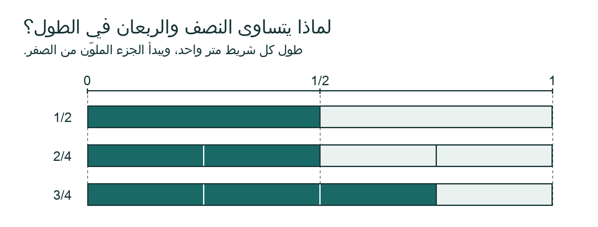
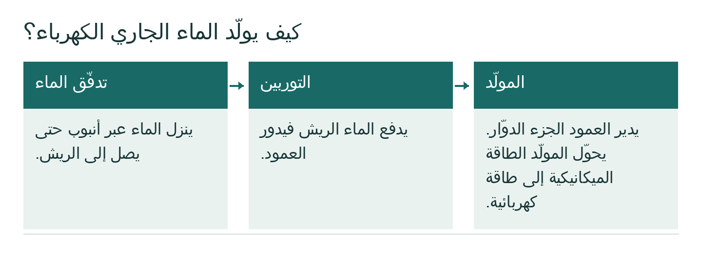
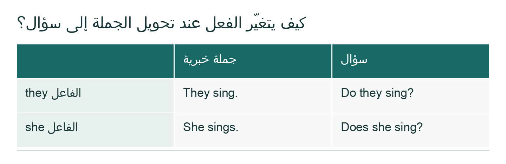

<div dir="rtl">

<div align="center">


# Omni Learning Anything

[](https://github.com/ShawnRen57/omni-learning-anything/releases/latest)
[](../../skills/omni-learning-anything/SKILL.md)
[](../../skills/omni-learning-anything/references/setup.md)
[](../../README.md#choose-your-learning-language)
[](../../skills/omni-learning-anything/references/setup.md)
[](../../LICENSE)
[](https://github.com/ShawnRen57/omni-learning-anything/releases)
[](https://github.com/ShawnRen57/omni-learning-anything/stargazers)

[](#output-destinations)
[](#output-destinations)
[](#output-destinations)
[](#output-destinations)

[](#output-destinations)
[](#output-destinations)
[](#output-destinations)
[](#output-destinations)
[](#output-destinations)

[English](../../README.md) · [简体中文](README_zh.md) · [日本語](README_ja.md) · [한국어](README_ko.md) · [Español](README_es.md) · [Français](README_fr.md) · [Deutsch](README_de.md) · [Português](README_pt.md) · [Русский](README_ru.md) · [العربية](README_ar.md)

**[تنزيل ZIP للمهارة v5.0.0](https://github.com/ShawnRen57/omni-learning-anything/releases/download/v5.0.0/omni-learning-anything-skill-v5.0.0.zip)**

[skills.sh](https://skills.sh/shawnren57/omni-learning-anything/omni-learning-anything) · [قنوات التثبيت](../../docs/distribution-channels.md)

</div>

**v5.0** · اختر من بين 135 مصدرًا تعليميًا. تعلّم لغة أجنبية بشروح بلغتك الأم، مع تمارين وإجابات في ملف منفصل. يرافق كل رسم توضيحي جديد سؤال يوجّه انتباهك إلى التفاصيل المهمة. [دليل المصادر](../curated-learning-resources.md) · [أمثلة لتعلّم اللغات](../../examples/languages/README.md)

**اختر مقرراً جامعياً أو ابدأ بكتبك وأبحاثك. تعلّم بالوتيرة المناسبة لك، مع أسئلة قصيرة وملاحظات مفيدة ومراجعة، واحفظ دروسك في ملفات محلية أو مستندات سحابية.**

اختر مقررا مفتوحا أو كتابا أو مقالا أو محاضرة، أو ابدأ بموادك الخاصة. حدد هدفك والوقت المتاح وراجع الخطة قبل الدرس الأول.

ابدأ بعبارة **«أريد دراسة علم النفس الإيجابي في هارفارد»**. يحدد الوكيل المقرر الأصلي، ويستخدم المعلومات التي قدمتها، ويسأل فقط عن التفاصيل اللازمة للخطة.

| الميزة | الوصف |
| --- | --- |
| مسار شخصي | يحوّل اهتمامك أو هدفك إلى مقرر يناسب مستواك ووقتك. |
| دليل المصادر | يضم 67 مسارا دراسيا و68 مصدرا إضافيا. يمكنك الرجوع إلى أصل كل مقرر أو كتاب أو مقال أو محاضرة ومعرفة شروط الوصول إليه. |
| لغة أجنبية من الصفر | تعلّم عبارات تناسب موقفا محددا وتدرّب على تذكرها في الاتجاهين. تحصل على أوراق مراجعة تراكمية وملف مستقل للإجابات. |
| كتب مدرسية صينية | ابحث في 1949 مدخلاً من الابتدائي إلى الثانوي. اختر كتاباً أو فصلاً أو مفهوماً أو صيغة، مع شرح مناسب للعمر ورسوم من الكتاب. |
| موادك الخاصة | اختر الصفحات أو الفصول أو المقاطع الزمنية في PDF أو DOCX أو EPUB أو PPTX أو HTML أو Markdown أو TXT أو SRT أو VTT. |
| المصادر والقراءات | ارجع إلى الصفحة أو الفصل أو التوقيت أو المصدر الموثق على الويب. |
| اعتماد الخطة | راجع موضوعات الأيام والوقت المتوقع قبل بدء الدروس. |
| قراءة الرسوم | أجب عن السؤال بقراءة التدريج أو تتبع سهم أو مقارنة مثالين متقابلين. لكل رسم مصدر يمكن الرجوع إليه. |
| عشر لغات | اختر لغة التعلّم بشكل مستقل عن لغة المصدر. يدعم العربية من اليمين إلى اليسار. |
| صيغ محلية | PDF وHTML للاستخدام دون اتصال وDOCX وMarkdown. |
| أماكن الحفظ | خزنة Obsidian محلية أو اتصال مرخّص مع Notion وFeishu وDingTalk وTencent Docs. |
| أسئلة قصيرة | أجب عن سؤال إلى ثلاثة في المحادثة أو البطاقات المدعومة. يمكنك طلب تلميح أو التجاوز أو الاستئناف. |
| ملاحظات على الإجابات | احصل على ملاحظات مستندة إلى المصادر، وعدّل إجابتك أو صحّح التقييم. |
| سجل التعلّم والمراجعة | راجع ضمن الوقت المتاح، واطلب ملخصاً أو صدّر الإجابات أو احذفها. |
| تعديل الخطة | راجع التغييرات المقترحة وفق أهدافك أو إجاباتك قبل إنشاء نسخة جديدة من المقرر. |
| Anki | صدّر أسئلة المراجعة بصيغة CSV لاستيرادها إلى Anki. |
| المتابعة والجدولة | استأنف من الدرس التالي. تستخدم الجدولة أدوات الوكيل المضيف. |
| التثبيت والتحديث | ثبّت المهارة وتحقق من اكتشافها في الوكلاء المتوافقين، واحفظ المقررات في مجلد منفصل. |

<a id="examples"></a>

## نماذج من المواد التعليمية

| الكسور المتكافئة | توليد الكهرباء من الماء | السؤال في الإنجليزية |
| --- | --- | --- |
| <a href="../assets/figures/equivalent-fractions-ar.png"></a> | <a href="../assets/figures/hydropower-ar.png"></a> | <a href="../assets/figures/present-simple-ar.png"></a> |
| في أي شريطين ينتهي الجزء الملوّن عند النقطة نفسها؟ | تتبّع الأسهم من اليسار إلى اليمين. ما الذي ينقله التوربين إلى المولّد؟ | ماذا يحدث للحرف s في She sings عندما نحوّل الجملة إلى سؤال؟ |
| [OpenStax](https://openstax.org/books/prealgebra-2e/pages/4-1-visualize-fractions) | [وزارة الطاقة الأمريكية](https://www.energy.gov/cmei/water/how-hydropower-works) | [British Council](https://learnenglish.britishcouncil.org/free-resources/grammar/english-grammar-reference/present-simple) |

| المجال | مواد للتجربة |
| --- | --- |
| تعلّم اللغات | [اليابانية بشرح صيني، خطة لثلاثة أيام](../../examples/languages/zh-ja/plan.md) · [مهمة الحوار الختامية](../../examples/languages/zh-ja/day03-task.md) · [الدرس الأول في الألمانية بشرح إنجليزي](../../examples/languages/en-de/day01.md) · [ورقة التمارين](../../examples/languages/en-de/worksheet.md) |
| المدرسة والجامعة | [خمسة دروس بالصينية من كتب مدرسية](../../examples/textbooks/README.md) · [ست دورات بلغات مختلفة](../../examples/university/README.md) · [محاضرة ييل عن الموت (PDF بالعربية)](../../examples/university/death-ar/Day01.pdf) · [جميع النماذج](../../examples/README.md) |

<a href="../../examples/README.md"></a>

<a id="versions"></a>
## دليل الإصدارات

| الإصدار | فائدته للتعلّم |
| --- | --- |
| **v5.0.0** | دروس لغات بالاستعانة باللغة الأم، ورسوم مع أسئلة ومصادر، ودليل يضم 135 مصدرا. |
| **v4.0–4.2** | البحث عن كتاب مدرسي بسنة إصدار محددة أو بأحدث طبعة، ودراسة رسومه الأصلية وتطبيق المفاهيم في مواقف جديدة. |
| **v3.0.0** | اختيار مسار جامعي، ومعرفة نسخة المصدر، ومعاينة مستندات فعلية متعددة اللغات. |
| **v2.3–v2.6** | أسئلة قصيرة، ومواد شخصية، ومراجعة، وتثبيت وتحديث أسهل. |
| **v2** | عشر لغات وأربع صيغ محلية ومستندات متصلة. |
| **v1** | اعتماد خطة شخصية وتلقّي PDF مصوّر مع تمارين وقراءات إضافية. |

<a id="university-courses"></a>
## استكشف الدورات والمواد التعليمية

ابحث بالعنوان أو الموضوع أو اسم الجهة. جرّب **«ابحث عن محاضرة TED عن اللغة»** أو **«ضع لي خطة لدراسة مقرر Modern Poetry في جامعة ييل»**. اختر الفصل أو المحاضرة وحدّد لغة الدراسة والوقت المتاح، ثم راجع الخطة قبل البدء.

يفتح كل عنوان المصدر الأصلي. إذا أتاح الناشر البيانات الببليوغرافية فقط، يمكنك الدراسة من الفصول التي يحق لك الاطلاع عليها. [إصدارات المقررات والمدرّسون](../course-catalog-sources.md) · [إتاحة المواد التعليمية](../curated-learning-resources.md)

<!-- catalog:start -->

| الجامعة أو المؤسسة أو المؤلفون | الدورات والمواد التعليمية (135) |
| --- | --- |
| جامعة تسينغهوا | **دورات** [中国建筑史——史前至两宋辽金](https://higher.smartedu.cn/course/687eb7bf16c43a09c0e58c23) · [文物精品与文化中国](https://higher.smartedu.cn/course/6a5e9b52b44e493c768f8c9c) · [中国建筑史（下）（自主模式）](https://v1-www.xuetangx.com/courses/course-v1%3ATsinghuaX%2B80000901X_2%2Bsp/about) · [艺术的启示](https://higher.smartedu.cn/course/6786ec4c225d72705e5dc29e) · [校园风物与大学文化——以清华大学为例](https://higher.smartedu.cn/course/6a5e9b60b44e493c768f8cba) · [数据结构(上)](https://www.xuetangx.com/course/THU08091000384/) · [大学历史与文化](https://next.xuetangx.com/course/THU04011000284/29592783)<br>**مراجع مفتوحة** [人工智能通识教育红皮书](https://aige.cs.tsinghua.edu.cn/redbook/) |
| جامعة بكين | **دورات** [经典昆曲欣赏](https://www.icourse163.org/course/PKU-1470426173?tid=1474265476) · [人工智能与信息社会](https://www.icourse163.org/course/PKU-1003471009?tid=1476756462) · [西方音乐欣赏](https://www.icourse163.org/course/PKU-1207132813?tid=1207476216) · [人工智能原理](https://www.icourse163.org/course/PKU-1002188003?tid=1472399493) · [语言学概论](https://www.icourse163.org/course/PKU-1205727813) · [古代汉语](https://www.icourse163.org/course/PKU-1205726807) · [生理学（上）](https://www.icourse163.org/course/PKU-1205915814) |
| جامعة فودان | **دورات** [人工智能，语言与伦理](https://www.icourse163.org/course/FUDAN-1205951803?tid=1475942449) · [比较文化研究](https://umoocs.unipus.cn/course/7944/tasks) · [深度学习及其应用](https://higher.smartedu.cn/course/622ac9f0bee70ef79f419877) · [中华优秀传统文化](https://higher.smartedu.cn/course/63ffd464af1f1b5d3ecfd579) · [政治学原理](https://www.icourse163.org/course/FUDAN-1461787179?tid=1462604462) · [古典诗词鉴赏](https://www.icourse163.org/course/FUDAN-1205950804) |
| جامعة شنغهاي جياو تونغ | **دورات** [唐诗宋词人文解读](https://higher.smartedu.cn/course/69b0942995df98bb27ba19b4) · [数学的天空](https://higher.smartedu.cn/course/690530295345b68214577952) · [机器的征途：空天科技](https://higher.smartedu.cn/course/62354d7a9906eace0490b2aa) · [经济法](https://higher.smartedu.cn/course/67c2473d225d72705e7bb8c8) · [关爱生命——急救与自救技能](https://higher.smartedu.cn/course/69b0942695df98bb27ba19a1) · [建筑物理](https://www.icourse163.org/course/SJTU-1472028164) · [造型基础—设计素描](https://www.icourse163.org/course/SJTU-1206432804) · [设计创新的艺术](https://www.icourse163.org/course/SJTU-1207170808) |
| جامعة تشجيانغ | **دورات** [唐诗经典](https://higher.smartedu.cn/course/6982720195df98bb27cadb06) |
| جامعة بكين للمعلمين | **دورات** [书法欣赏](https://www.icourse163.org/course/BNU-1003240002?tid=1488313456) |
| جامعة هارفارد | **دورات** [Positive Psychology](https://ppc.sas.upenn.edu/sites/default/files/ppsyllabusschachar.pdf) · [CS50’s Introduction to Computer Science](https://cs50.harvard.edu/x/2026/syllabus/) · [Justice](https://sandel.scholars.harvard.edu/justice) · [Rhetoric: The Art of Persuasive Writing and Public Speaking](https://pll.harvard.edu/course/rhetoric-art-persuasive-writing-and-public-speaking) · [CS50’s Introduction to Artificial Intelligence with Python](https://cs50.harvard.edu/ai/) · [Masterpieces of World Literature](https://www.edx.org/learn/literature/harvard-university-masterpieces-of-world-literature) · [Pyramids of Giza: Ancient Egyptian Art and Archaeology](https://giza.fas.harvard.edu/videos/) |
| جامعة ييل | **دورات** [Introduction to Psychology](https://oyc.yale.edu/introduction-psychology/psyc-110) · [Financial Markets](https://oyc.yale.edu/economics/econ-252) · [Game Theory](https://oyc.yale.edu/economics/econ-159) · [Death](https://oyc.yale.edu/death/phil-176) · [Listening to Music](https://oyc.yale.edu/music/musi-112/lecture-1) · [Roman Architecture](https://oyc.yale.edu/history-of-art/hsar-252) · [Introduction to Theory of Literature](https://oyc.yale.edu/english/engl-300) · [The Atmosphere, the Ocean, and Environmental Change](https://oyc.yale.edu/geology-and-geophysics/gg-140) · [European Civilization, 1648-1945](https://oyc.yale.edu/history/hist-202) · [Philosophy and the Science of Human Nature](https://oyc.yale.edu/philosophy/phil-181) · [Principles of Evolution, Ecology and Behavior](https://oyc.yale.edu/ecology-and-evolutionary-biology/eeb-122) · [Introduction to Ancient Greek History](https://oyc.yale.edu/classics/clcv-205) · [The American Revolution](https://oyc.yale.edu/history/hist-116) · [Modern Poetry](https://oyc.yale.edu/english/engl-310) · [Capitalism: Success, Crisis, and Reform](https://oyc.yale.edu/political-science/plsc-270) · [Frontiers and Controversies in Astrophysics](https://oyc.yale.edu/astronomy/astr-160) · [Fundamentals of Physics I](https://oyc.yale.edu/physics/phys-200) · [Frontiers of Biomedical Engineering](https://oyc.yale.edu/biomedical-engineering/beng-100) · [The Psychology, Biology and Politics of Food](https://oyc.yale.edu/psychology/psyc-123) · [Milton](https://oyc.yale.edu/english/engl-220) |
| معهد ماساتشوستس للتكنولوجيا | **دورات** [Introduction to Computer Science and Programming in Python](https://ocw.mit.edu/courses/6-0001-introduction-to-computer-science-and-programming-in-python-fall-2016/video_galleries/lecture-videos/) · [Linear Algebra](https://ocw.mit.edu/courses/18-06-linear-algebra-spring-2010/pages/calendar/) · [Classical Mechanics](https://ocw.mit.edu/courses/8-01sc-classical-mechanics-fall-2016/) · [Introduction to Art History](https://ocw.mit.edu/courses/4-601-introduction-to-art-history-fall-2018/pages/calendar/) · [Principles of Microeconomics](https://ocw.mit.edu/courses/14-01-principles-of-microeconomics-fall-2023/pages/calendar/) · [Art Since 1940](https://ocw.mit.edu/courses/4-651-art-since-1940-fall-2010/pages/lecture-notes/) · [Philosophy of Film](https://ocw.mit.edu/courses/24-213-philosophy-of-film-fall-2004/pages/calendar/) · [Introduction to Deep Learning](https://introtodeeplearning.com/2026/index.html) · [Introduction to Sustainable Energy](https://ocw.mit.edu/courses/22-081j-introduction-to-sustainable-energy-fall-2010/pages/calendar/)<br>**كتب أكاديمية · MIT Press** [Deep Learning](https://www.deeplearningbook.org/) · [Probabilistic Machine Learning: An Introduction](https://probml.github.io/pml-book/book1.html) · [Reinforcement Learning: An Introduction](https://mitpress.mit.edu/9780262039246/reinforcement-learning/) |
| جامعة ستانفورد | **دورات** [Machine Learning](https://cs229.stanford.edu/syllabus-autumn2018.html) · [Deep Learning for Computer Vision](https://cs231n.stanford.edu/2026/schedule.html)<br>**كتب أكاديمية** [Speech and Language Processing](https://web.stanford.edu/~jurafsky/slp3/) · [Convex Optimization](https://web.stanford.edu/~boyd/cvxbook/) · [Introduction to Applied Linear Algebra – Vectors, Matrices, and Least Squares](https://web.stanford.edu/~boyd/vmls/)<br>**مقالات · Stanford Encyclopedia of Philosophy** [Aesthetic Judgment](https://plato.stanford.edu/entries/aesthetic-judgment/) · [Scientific Method](https://plato.stanford.edu/entries/scientific-method/) · [Personal Identity](https://plato.stanford.edu/entries/identity-personal/) · [Justice](https://plato.stanford.edu/entries/justice/) · [Chinese Ethics](https://plato.stanford.edu/entries/ethics-chinese/) · [The Philosophy of Music](https://plato.stanford.edu/entries/music/) |
| جامعة هلسنكي وMinnaLearn | **دورات** [Elements of AI: Introduction to AI](https://opin.fi/en/study-options/HY/elements-of-ai-introduction-to-ai/89eb0e79-873e-4d2a-aec5-d694d7762118) · [Elements of AI: Building AI](https://buildingai.elementsofai.com/) |
| OpenAI Academy | **دورات** [AI Foundations](https://academy.openai.com/public/courses/ai-foundations-dnq5w) · [Applied AI Foundations](https://academy.openai.com/public/courses/applied-ai-foundations-szsmv) · [Agents and Workflows](https://academy.openai.com/public/courses/agents-and-workflows-y0qoc) · [AI for College Students](https://academy.openai.com/public/courses/ai-for-college-students-gxgmr) |
| Anthropic · Claude Academy | **دورات** [AI Fluency: Framework and foundations](https://academy.claude.com/courses/ai-fluency-framework-foundations) · [AI Fluency for students](https://academy.claude.com/courses/ai-fluency-for-students) · [AI Fluency for educators](https://academy.claude.com/courses/ai-fluency-for-educators) |
| Hugging Face | **دورات** [AI Agents Course](https://huggingface.co/learn/agents-course/unit0/introduction) |
| جامعة كاليفورنيا في بركلي | **دورات** [Introduction to Artificial Intelligence](https://inst.eecs.berkeley.edu/~cs188/sp26/) |
| DeepLearning.AI | **دورات** [AI For Everyone](https://www.coursera.org/learn/ai-for-everyone/) · [Generative AI for Everyone](https://www.coursera.org/learn/generative-ai-for-everyone/) |
| Microsoft | **دورات** [Generative AI for Beginners](https://github.com/microsoft/generative-ai-for-beginners/blob/79a4334e158147d4f36c27d805e0cb163c1e445b/README.md#-lessons) |
| Google | **دورات** [Google AI Essentials](https://grow.google/ai-essentials/) |
| Smarthistory | **مراجع مفتوحة** [Reframing Art History](https://smarthistory.org/reframing-art-history/) |
| جامعة رايس · OpenStax | **كتب دراسية** [Astronomy 2e](https://openstax.org/books/astronomy-2e/pages/preface) · [Biology 2e](https://openstax.org/books/biology-2e/pages/preface) · [Psychology 2e](https://openstax.org/books/psychology-2e/pages/preface) · [Introduction to Sociology 3e](https://openstax.org/books/introduction-sociology-3e/pages/preface) · [Principles of Economics 3e](https://openstax.org/books/principles-economics-3e/pages/preface) · [Chemistry 2e](https://openstax.org/books/chemistry-2e/pages/preface) · [University Physics Volume 1](https://openstax.org/books/university-physics-volume-1/pages/preface) · [Calculus Volume 1](https://openstax.org/books/calculus-volume-1/pages/preface) · [World History Volume 1, to 1500](https://openstax.org/books/world-history-volume-1/pages/preface) · [Introduction to Philosophy](https://openstax.org/books/introduction-philosophy/pages/preface) · [Introductory Statistics 2e](https://openstax.org/books/introductory-statistics-2e/pages/preface) · [Entrepreneurship](https://openstax.org/books/entrepreneurship/pages/preface) · [Business Ethics](https://openstax.org/books/business-ethics/pages/preface) |
| مؤلفو Dive into Deep Learning | **كتب أكاديمية** [动手学深度学习](https://zh.d2l.ai/) |
| O’Reilly | **كتب أكاديمية** [R for Data Science (2e)](https://r4ds.hadley.nz/) |
| Distill | **مقالات** [Attention and Augmented Recurrent Neural Networks](https://distill.pub/2016/augmented-rnns/) · [How to Use t-SNE Effectively](https://distill.pub/2016/misread-tsne/) · [Feature Visualization](https://distill.pub/2017/feature-visualization/) · [Why Momentum Really Works](https://distill.pub/2017/momentum/) · [Deconvolution and Checkerboard Artifacts](https://distill.pub/2016/deconv-checkerboard/) · [A Gentle Introduction to Graph Neural Networks](https://distill.pub/2021/gnn-intro/) · [Computing Receptive Fields of Convolutional Neural Networks](https://distill.pub/2019/computing-receptive-fields/) · [A Visual Exploration of Gaussian Processes](https://distill.pub/2019/visual-exploration-gaussian-processes/) |
| معهد كاليفورنيا للتكنولوجيا | **سلاسل محاضرات** [The Feynman Lectures on Physics, Volume I](https://www.feynmanlectures.caltech.edu/I_toc.html) · [The Feynman Lectures on Physics, Volume II](https://www.feynmanlectures.caltech.edu/II_toc.html) · [The Feynman Lectures on Physics, Volume III](https://www.feynmanlectures.caltech.edu/III_toc.html) |
| المؤسسة الملكية البريطانية | **سلاسل محاضرات** [The truth about AI](https://www.rigb.org/christmas-lectures/watch-2023-christmas-lectures)<br>**محاضرات منفردة** [Growing up in the universe – Waking up in the universe (1991)](https://www.rigb.org/explore-science/explore/video/growing-universe-waking-universe-1991) |
| TED | **محاضرات منفردة** [How language shapes the way we think](https://www.ted.com/talks/lera_boroditsky_how_language_shapes_the_way_we_think) · [The danger of a single story](https://www.ted.com/talks/chimamanda_ngozi_adichie_the_danger_of_a_single_story) · [The best stats you’ve ever seen](https://www.ted.com/talks/hans_rosling_the_best_stats_you_ve_ever_seen) · [Do schools kill creativity?](https://www.ted.com/talks/sir_ken_robinson_do_schools_kill_creativity) · [The power of introverts](https://www.ted.com/talks/susan_cain_the_power_of_introverts) · [Inside the mind of a master procrastinator](https://www.ted.com/talks/tim_urban_inside_the_mind_of_a_master_procrastinator) · [10 ways to have a better conversation](https://www.ted.com/talks/celeste_headlee_10_ways_to_have_a_better_conversation) · [How to speak so that people want to listen](https://www.ted.com/talks/julian_treasure_how_to_speak_so_that_people_want_to_listen) · [The power of vulnerability](https://www.ted.com/talks/brene_brown_the_power_of_vulnerability) · [We should all be feminists](https://www.ted.com/talks/chimamanda_ngozi_adichie_we_should_all_be_feminists) |

<!-- catalog:end -->

جلسة مدتها عشر دقائق تغطي خطوة صغيرة، ولا تعادل محاضرة أصلية كاملة أو المقرر كله. يظل عبء الدراسة الأصلي موضحاً؛ وتحتاج القراءات الطويلة والتمارين والمشروعات إلى وقت إضافي. قد تتغير المصادر وإمكانية الوصول إليها. هذه مسارات تعلّم مستقلة تعتمد على مصادر مقررات عامة، ولا تتضمن محتوى المحاضرات كاملاً، ولا تعني اعتماداً من الجامعات أو منح شهادة.

## تعلّم من موادك الخاصة

استخدم PDF أو TXT أو Markdown أو HTML أو DOCX أو EPUB أو PPTX أو SRT أو VTT. اختر الفصول أو الصفحات أو الطوابع الزمنية، وحدد السماح بالمراجع الإضافية. ترتبط الشروح والأسئلة بمواضعها الأصلية. تحتاج ملفات DOC وRTF القديمة إلى تحويل مسبق بأدوات موثوقة.

يمكنك البدء بفكرة عامة مثل «أريد فهم بعض الاقتصاد». يقترح الوكيل اتجاهات ويوضح افتراضاته ويسأل فقط عما يؤثر في الخطة. أما الهدف المحدد فينتقل مباشرة إلى التخطيط.

<a id="choose-your-learning-language"></a>
## اختر لغة التعلّم

**English · 简体中文 · 日本語 · 한국어 · Español · Français · Deutsch · Português · Русский · العربية**

تدعم الخطط والدروس اللغات العشر أعلاه، بصرف النظر عن لغة المصدر أو هذه الصفحة. تُنسّق المستندات العربية من اليمين إلى اليسار.

<a id="output-destinations"></a>
## اختر مكان حفظ المقرر

| الوجهة | طريقة الاستخدام |
| --- | --- |
| PDF · HTML · DOCX · Markdown | اختر مجلداً وصيغة PDF أو HTML أو DOCX أو Markdown. يضم HTML الرسم في ملف واحد يعمل دون اتصال؛ الروابط الخارجية تحتاج إلى الإنترنت. |
| Notion | اربط صفحة رئيسية عبر أداة `ntn` الرسمية لسطر الأوامر. |
| Obsidian | اختر Vault محلياً موجوداً ومجلداً للمقرر؛ لا تُستخدم واجهة API لـ Obsidian. |
| Feishu / 飞书 | اربط مجلد مستندات عبر أداة `lark` الرسمية وتفويض المستخدم. |
| DingTalk / 钉钉 | اربط مجلداً عبر أداة `dws` الرسمية؛ قد تلزم موافقة المؤسسة. |
| Tencent Docs / 腾讯文档 | اختر الجذر أو مجلداً وأكمل التفويض الرسمي عبر OAuth/MCP. |

أخبر الوكيل أين تريد الحفظ. يتحقق من صلاحيات الوصول، ويرشدك إلى الإعداد الناقص، ويعيد استخدام اتصالك المسمّى. لا تلصق كلمات المرور أو الرموز السرية في المحادثة.

<a id="quick-start"></a>
## التثبيت والبدء

اطلب من الوكيل تثبيت أحدث إصدار والتحقق من أن العميل الحالي يستطيع اكتشاف المهارة. احتفظ بالمقررات والاتصالات عند التحديث. إذا كان Node.js مثبتاً، نفّذ:

```sh
npx skills@latest add ShawnRen57/omni-learning-anything --skill omni-learning-anything -g
```

في Claude Code، استخدم مثبّت الإضافات:

```text
/plugin install omni-learning-anything --marketplace ShawnRen57/omni-learning-anything
```

دون Node.js، نزّل ملف ZIP أعلاه وارفعه عبر عميلك أو اطلب مساعدة الوكيل. قناة `skills.sh` متاحة؛ والإصدار المنشور حالياً في SkillHub هو v2.6.0. راجع دليل القنوات لمعرفة الإصدارات المتاحة.

## جرّب مقررك الأول

```text
اعرض المقررات المدمجة. استخدم مقرر Yale Death، ربيع 2007، مصدراً.
أنا مبتدئ. علّمني بالعربية لمدة 20 دقيقة يومياً.
حافظ على ترتيب الوحدات وأظهر عبء الدراسة الأصلي.
احفظ بصيغة HTML دون اتصال، واعرض الخطة أولاً.
```

أو جرّب: «علّمني أول فصلين من كتابي بصيغة EPUB في جلسات من 15 دقيقة»، أو «ساعدني على فهم المؤسسات المالية من Yale Financial Markets 2011».

راجع الخطة ووافق عليها ثم اطلب الدرس الأول. للاستئناف قل «تابع من أقدم درس لم يصلني بعد». يمكنك الإيقاف المؤقت. تتطلب الجدولة دعماً من المضيف واتفاقاً على الوقت والمنطقة الزمنية؛ يبدأ الإنشاء في الموعد، ويصل الدرس بعد البحث والمراجعة.

## الأسئلة والملاحظات والمراجعة

اطلب عند الحاجة من سؤال إلى ثلاثة أسئلة قصيرة على هيئة بطاقات أو نص. احصل على ملاحظات وتلميحات مستندة إلى المصادر؛ ويمكن طلب اختبار أطول. تُحدَّث سجلات التعلّم في الخلفية كي لا تقطع القراءة.

اسأل «ماذا أراجع اليوم؟» لمراجعة قصيرة ضمن وقتك المحدد، أو «ماذا تُظهر إجاباتي هذا الأسبوع؟» لملخص تدعمه الأدلة. يمكنك تصحيح تقييم أو استبعاد موضوع أو تفضيل درس جديد. لا تُنشئ المراجعة اختبارات تلقائية أو مؤقتات إضافية.

وافق على تعديلات الدروس المقبلة قبل بدء نسخة جديدة؛ تبقى الخطة السابقة والسجل متاحين. يمكنك تصدير بطاقات Anki بصيغة CSV باتجاه واحد، دون مزامنة تلقائية.

[عرض للأسئلة والملاحظات وتعديل الخطة في WorkBuddy](../../README.md#workbuddy-demo)

## الأدلة والمتطلبات

[التثبيت والتحديث](../../skills/omni-learning-anything/references/install.md) · [الصيغ والخطوط](../../skills/omni-learning-anything/references/setup.md) · [ربط المستندات](../../skills/omni-learning-anything/references/onboarding.md) · [حالة قنوات التوزيع](../../docs/distribution-channels.md) · [التحقق من v3.0.0](../../docs/release-validation-v3.0.0.md)

تستخدم مهارة Agent Skill أدوات البحث والمستندات والجدولة التي يوفرها مضيفك. تحتاج صيغة PDF وحدها إلى XeLaTeX. يعتمد الوصول السحابي والمزامنة بين الأجهزة والتسليم دون تدخل على المضيف والحساب والصلاحيات. تُفحص إمكانات العميل الحالي ولا يُفترض دعم جميع المنصات.

[MIT](../../LICENSE) · [Changelog](../../CHANGELOG.md) · [Attribution](../../ATTRIBUTION.md)

</div>
