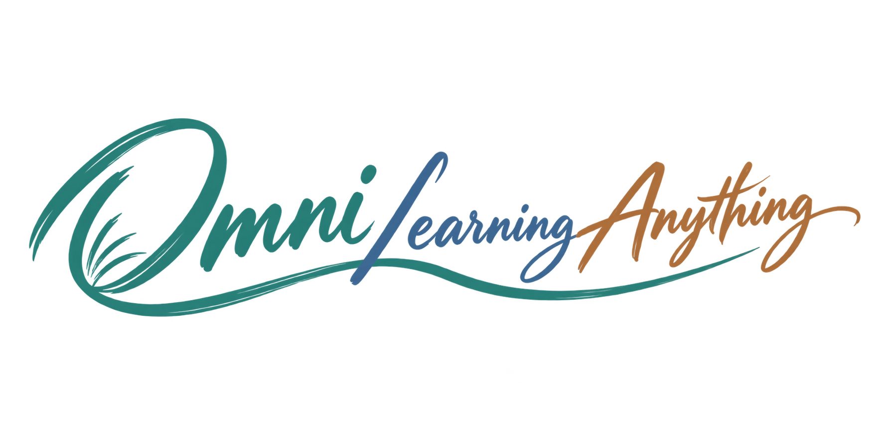

<div dir="rtl">

<div align="center">



# Omni Learning Anything

[](https://github.com/ShawnRen57/omni-learning-anything/releases) [](../../LICENSE)

[English](../../README.md) · [简体中文](README_zh.md) · [日本語](README_ja.md) · [한국어](README_ko.md) · [Español](README_es.md) · [Français](README_fr.md) · [Deutsch](README_de.md) · [Português](README_pt.md) · [Русский](README_ru.md) · [العربية](README_ar.md)

**[تنزيل Skill ZIP](https://github.com/ShawnRen57/omni-learning-anything/releases/latest/download/omni-learning-anything-skill-v2.2.1.zip)**

</div>

**حوّل «أريد أن أتعلم…» إلى مسار تستطيع متابعته كل يوم.**

أخبر وكيلك بهدفك وخبرتك والوقت المتاح. يُعدّ Omni خطة ثم دروسًا يومية تتضمن صورًا ومصادر وتمارين وتقييمًا ذاتيًا.

## دليل الإصدارات

| الإصدار | ما الذي يمكنك فعله؟ |
| --- | --- |
| **v1** | الحصول على دورة شخصية بصيغة PDF: وافق على الخطة أولًا، ثم اقرأ دروسًا مصورة مع تمارين وقراءات إضافية. |
| **v2** | حفظ الدورة في ملفات محلية أو في Notion أو Obsidian أو Feishu أو DingTalk أو Tencent Docs. يرشدك الوكيل إلى الاتصال ويتذكر المكان الذي اخترته. |
| **v2.2.0** | قراءة HTML دون اتصال، وإنشاء دورات بعشر لغات، وربط DingTalk وTencent Docs من خلال التفويض الرسمي بإرشاد الوكيل. |
| **v2.2.1** | ابدأ بفكرة عامة: يساعدك الوكيل على تحديد الاتجاه وترتيب المعارف التمهيدية واقتراح مسار منظم، ويتحقق من إمكانات بيئتك. |

يمكنك أن تقول فقط: «أريد أن أتعلم قليلًا من الاقتصاد». يقترح Omni اتجاهات وتسلسلًا مترابطًا، ويوضح افتراضاته ويسأل فقط عما يغيّر المسار. إذا كان هدفك واضحًا، ينتقل مباشرة إلى التخطيط.

## تعلّم وفق هدفك ووقتك

- أنشئ مسارًا للسفر أو مشروع عمل أو مقابلة أو اهتمام شخصي.
- حدّد وقتًا يوميًا مناسبًا للشروحات والصور والتمارين وإرشادات الإجابة.
- راجع الاستشهادات داخل النص وخمسة روابط إضافية مشروحة على الأقل في كل مستند.
- راجع الخطة قبل البدء، وبعد الانقطاع استأنف من أول درس لم يصلك بعد.

## لغات الدورة

**English · 简体中文 · 日本語 · 한국어 · Español · Français · Deutsch · Português · Русский · العربية**

يمكن إعداد الخطط والدروس بهذه اللغات. لغة الدورة مستقلة عن الموضوع ولغة المصادر وREADME. تدعم العربية التنسيق من اليمين إلى اليسار.

## اختر مكان حفظ الدورة

| المكان | ما الذي تخبر به الوكيل؟ |
| --- | --- |
| PDF · HTML · DOCX · Markdown | مجلد الدورة والصيغة. يتضمن HTML الصورة في ملف واحد للقراءة دون اتصال؛ تحتاج الروابط الخارجية إلى الإنترنت. |
| Notion | رابط الصفحة الأم ومساحة العمل. |
| Obsidian | Vault محلي موجود ومجلد فرعي للدورة. لا يلزم مفتاح API. |
| Feishu | رابط مجلد الدورة؛ أكمِل إعداد التطبيق الرسمي وتفويض المستخدم عند الحاجة. |
| DingTalk | مجلد المستندات والمؤسسة. قد يحتاج المسؤول إلى تفعيل وصول CLI. |
| Tencent Docs | جذر الصفحة الرئيسية أو رابط مجلد شخصي؛ سجّل الدخول وراجع الأذونات على الصفحة الرسمية. |

يتحقق الوكيل من الوصول المتاح ويسأل فقط عن المعلومات الناقصة ويشرح الخطوات. لا تحتاج إلى البحث عن معرّفات العناصر أو كتابة ملفات إعداد. لا ترسل كلمات المرور أو الرموز السرية في المحادثة. قد تتطلب موافقات المؤسسة خطوات إضافية.

## ابدأ بالمحادثة

<div dir="rtl">

```text
ثبّت Skill ZIP من أحدث Release في https://github.com/ShawnRen57/omni-learning-anything.
احتفظ بالمجلد كاملًا وتحقق من أن الوكيل يستطيع اكتشاف المهارة.
```

```text
استخدم omni-learning-anything لتعليمي تاريخ العمارة من أجل السفر.
أنا مبتدئ. أريد 30 يومًا، 15 دقيقة يوميًا، باللغة العربية.
احفظ الدورة بصيغة HTML للقراءة دون اتصال في مجلدي. اعرض الخطة أولًا.
```

</div>

راجع الخطة ووافق عليها. إذا كان وكيلك يدعم الجدولة، اتفق على الوقت والمنطقة الزمنية؛ وإلا فاطلب المتابعة عندما تكون مستعدًا. يبدأ الإنشاء في الوقت المتفق عليه، ويأتي التسليم بعد البحث والمراجعة.

```text
تابع من أول درس لم يُسلَّم بعد.
أوقف هذه الدورة وجدولها مؤقتًا.
احتفظ بالدورة القديمة واقترح خطة لهدفي الجديد.
```

## استكشف أمثلة الدورات

تصفّح الخطط وملفات PDF اليومية في التقنية والاقتصاد والموسيقى وتصميم منتجات Agent والعمارة وتاريخ أسرة مينغ. تحتفظ الأرشيفات بالتواريخ الأصلية للتحقق من المصادر.

| Technology | Economics | Music |
| :---: | :---: | :---: |
| [](../../examples/technology/) | [](../../examples/economics/) | [](../../examples/music/) |

| Agent products | Architecture | Ming history |
| :---: | :---: | :---: |
| [](../../examples/agent-product/) | [](../../examples/architecture/) | [](../../examples/ming-history/) |

## التثبيت والأدلة

[التثبيت في وكيلك](../../skills/omni-learning-anything/references/install.md) · [إعداد الصيغ والخطوط](../../skills/omni-learning-anything/references/setup.md) · [ربط المستندات](../../skills/omni-learning-anything/references/onboarding.md) · [التحقق من الإصدار](../../docs/release-validation-v2.2.1.md)

هذه Agent Skill تستخدم أدوات البحث والمستندات والجدولة في وكيلك. يحتاج PDF فقط إلى XeLaTeX. تستخدم المستندات السحابية واجهات API/CLI الرسمية، بينما يكتب Obsidian في Vault المحلي. تعتمد المزامنة والعمل دون إشراف على المضيف والحساب.

[MIT](../../LICENSE) · [Changelog](../../CHANGELOG.md)

</div>
