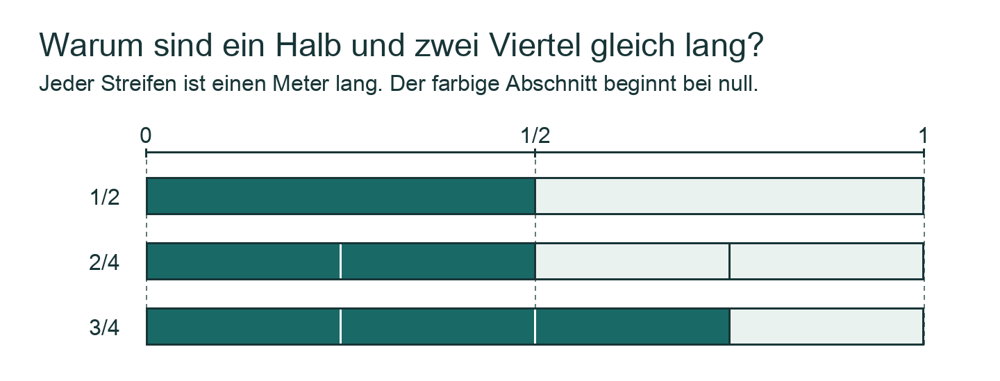
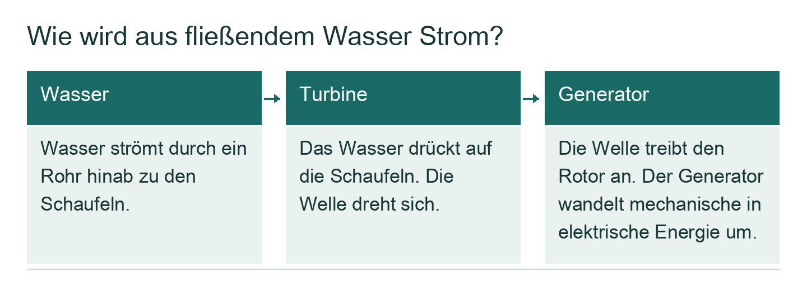
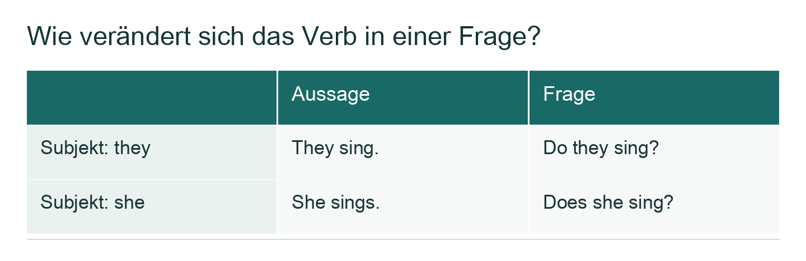

<div align="center">


# Omni Learning Anything

[](https://github.com/ShawnRen57/omni-learning-anything/releases/latest)
[](../../skills/omni-learning-anything/SKILL.md)
[](../../skills/omni-learning-anything/references/setup.md)
[](../../README.md#choose-your-learning-language)
[](../../skills/omni-learning-anything/references/setup.md)
[](../../LICENSE)
[](https://github.com/ShawnRen57/omni-learning-anything/releases)
[](https://github.com/ShawnRen57/omni-learning-anything/stargazers)

[](#output-destinations)
[](#output-destinations)
[](#output-destinations)
[](#output-destinations)

[](#output-destinations)
[](#output-destinations)
[](#output-destinations)
[](#output-destinations)
[](#output-destinations)

[English](../../README.md) · [简体中文](README_zh.md) · [日本語](README_ja.md) · [한국어](README_ko.md) · [Español](README_es.md) · [Français](README_fr.md) · [Deutsch](README_de.md) · [Português](README_pt.md) · [Русский](README_ru.md) · [العربية](README_ar.md)

**[Skill-ZIP v5.0.0 herunterladen](https://github.com/ShawnRen57/omni-learning-anything/releases/download/v5.0.0/omni-learning-anything-skill-v5.0.0.zip)**

[skills.sh](https://skills.sh/shawnren57/omni-learning-anything/omni-learning-anything) · [Installationswege](../../docs/distribution-channels.md)

</div>

**v5.0** · Wähle aus 135 Lernquellen. Lerne eine Fremdsprache mit Erklärungen in deiner Muttersprache, Übungen und getrennten Lösungen. Zu jeder neuen Abbildung gibt es eine Frage, die den Blick auf wichtige Details lenkt. [Quellenverzeichnis](../curated-learning-resources.md) · [Sprachlernbeispiele](../../examples/languages/README.md)

**Wähle einen Universitätskurs oder bring eigene Bücher und Fachartikel mit. Lerne in deinem Tempo, mit kurzen Verständnisfragen, hilfreichen Rückmeldungen und Wiederholungen – in lokalen Dateien oder Cloud-Dokumenten.**

Wähle einen offenen Kurs, ein Buch, einen Fachartikel oder einen Vortrag. Du kannst auch mit eigenen Unterlagen beginnen. Gib dein Ziel und deine verfügbare Zeit an und prüfe den Plan vor der ersten Lektion.

Beginne mit **„Ich möchte Harvards Positive Psychologie lernen.“** Der Agent findet den ursprünglichen Kurs, nutzt bereits genannte Angaben und fragt nur nach Details, die für den Lernplan wichtig sind.

| Funktion | Beschreibung |
| --- | --- |
| Persönlicher Lernweg | Erstellt aus einem Interesse oder Ziel einen Kurs für deinen Kenntnisstand und Zeitrahmen. |
| Quellenkatalog | 67 Lernpfade und 68 weitere Quellen. Zu Kursen, Büchern, Artikeln und Vorträgen findest du das Original und Hinweise zum Zugang. |
| Fremdsprachen für Anfänger | Lerne Wendungen für eine konkrete Situation und übe in beiden Sprachrichtungen. Für die Wiederholung erhältst du ein Arbeitsblatt und getrennte Lösungen. |
| Chinesische Schulbücher | Durchsuche 1.949 Einträge von der Grundschule bis zur Oberstufe. Wähle Band, Kapitel, Begriff oder Formel, mit altersgerechter Erklärung und Originalabbildung. |
| Eigene Unterlagen | Wähle Seiten, Kapitel oder Zeitabschnitte in PDF, DOCX, EPUB, PPTX, HTML, Markdown, TXT, SRT oder VTT. |
| Quellen und Vertiefung | Gehe zur Originalseite, zum Kapitel, zur Zeitmarke oder zur geprüften Webquelle. |
| Planfreigabe | Prüfe Tagesplan und Zeitbedarf, bevor Lektionen beginnen. |
| Schaubilder lesen | Beantworte eine Frage anhand einer Skala, folge einem Pfeil oder vergleiche zwei ausgerichtete Beispiele. Jede Abbildung nennt ihre Quelle. |
| Zehn Lernsprachen | Wähle die Lernsprache unabhängig von der Quelle. Arabisch wird von rechts nach links gesetzt. |
| Lokale Formate | PDF, Offline-HTML, DOCX und Markdown. |
| Speicherorte | Lokaler Obsidian-Tresor oder autorisierte Verbindung mit Notion, Feishu, DingTalk und Tencent Docs. |
| Kurze Lernfragen | Beantworte ein bis drei Fragen im Chat oder mit unterstützten Karten. Fordere Tipps an, überspringe oder setze fort. |
| Feedback | Erhalte begründete Rückmeldung, überarbeite eine Antwort oder korrigiere eine Bewertung. |
| Lernverlauf und Wiederholung | Wiederhole innerhalb deines Zeitbudgets, frage nach einer Übersicht und exportiere oder lösche Antworten. |
| Plananpassung | Prüfe Änderungen auf Grundlage deiner Ziele oder Antworten vor einer neuen Kursversion. |
| Anki | Exportiere Wiederholungsfragen als CSV für Anki. |
| Fortsetzen und planen | Setze bei der nächsten Lektion fort. Geplante Zustellung nutzt Funktionen des Agenten. |
| Installation und Updates | Installiere den Skill in kompatiblen Agenten und überprüfe die Erkennung. Kurse liegen in einem eigenen Ordner. |

<a id="examples"></a>

## Einblick in die Lernmaterialien

| Gleichwertige Brüche | Wasserkraft | Englische Fragesätze |
| --- | --- | --- |
| <a href="../assets/figures/equivalent-fractions-de.png"></a> | <a href="../assets/figures/hydropower-de.png"></a> | <a href="../assets/figures/present-simple-de.png"></a> |
| Bei welchen Balken endet die farbige Fläche an derselben Stelle? | Was überträgt die Turbine auf den Generator? | Was passiert beim Fragen mit dem -s in She sings? |
| [OpenStax](https://openstax.org/books/prealgebra-2e/pages/4-1-visualize-fractions) | [US-Energieministerium](https://www.energy.gov/cmei/water/how-hydropower-works) | [British Council](https://learnenglish.britishcouncil.org/free-resources/grammar/english-grammar-reference/present-simple) |

| Lernbereich | Materialien zum Ausprobieren |
| --- | --- |
| Fremdsprachen | [Japanisch mit chinesischen Erklärungen, Dreitagesplan](../../examples/languages/zh-ja/plan.md) · [Abschließende Gesprächsaufgabe](../../examples/languages/zh-ja/day03-task.md) · [Erste Deutschlektion mit englischen Erklärungen](../../examples/languages/en-de/day01.md) · [Arbeitsblatt](../../examples/languages/en-de/worksheet.md) |
| Schule und Hochschule | [Fünf Schulbuchlektionen auf Chinesisch](../../examples/textbooks/README.md) · [Sechs Hochschulkursbeispiele in mehreren Sprachen](../../examples/university/README.md) · [Erste Lektion aus Harvards CS50x (englisches PDF)](../../examples/university/cs50x-en/Day01.pdf) · [Alle Beispiele](../../examples/README.md) |
| Schaubilder lesen · Lektionen auf Chinesisch | [Flugangebote mit einem Budget abgleichen](../../examples/agent-product/pdf/Agent%E4%BA%A7%E5%93%81%E8%AE%BE%E8%AE%A1_%E6%AF%8F%E6%97%A5%E5%AD%A6%E4%B9%A0_Day01_%E4%BB%8E%E8%81%8A%E5%A4%A9%E5%9B%9E%E7%AD%94%E5%88%B0%E5%AE%8C%E6%88%90%E4%BB%BB%E5%8A%A1.pdf) · [Die Rückkopplung im Agenten verfolgen](../../examples/agent-product/pdf/Agent%E4%BA%A7%E5%93%81%E8%AE%BE%E8%AE%A1_%E6%AF%8F%E6%97%A5%E5%AD%A6%E4%B9%A0_Day02_%E5%B7%A5%E4%BD%9C%E6%B5%81%E4%B8%8EAgent%E5%A6%82%E4%BD%95%E9%80%89%E6%8B%A9.pdf) · [Eine Ming-Malerei mit dem Museumseintrag vergleichen](../../examples/ming-history/pdf/%E6%98%8E%E6%9C%9D%E5%8E%86%E5%8F%B2_%E6%AF%8F%E6%97%A5%E5%AD%A6%E4%B9%A0_Day01_%E6%97%B6%E9%97%B4%E7%BA%BF%E4%B8%8E%E5%8F%B2%E6%96%99%E5%A6%82%E4%BD%95%E4%BD%BF%E7%94%A8.pdf) · [Die Anfrage nach einem Handy-Scan verfolgen](../../examples/technology/pdf/%E7%A7%91%E6%8A%80%E9%80%9A%E8%AF%86_%E6%AF%8F%E6%97%A5%E5%AD%A6%E4%B9%A0_Day01_%E4%BB%8E%E6%89%8B%E6%9C%BA%E7%9C%8B%E6%8A%80%E6%9C%AF%E7%B3%BB%E7%BB%9F.pdf) · [Die Bereitschaft zweier Gruppen zur weiteren Teilnahme vergleichen](../../examples/university/positive-psychology-zh/Day01.pdf) |

<a href="../../examples/README.md"></a>

<a id="versions"></a>
## Versionsübersicht

| Version | Nutzen beim Lernen |
| --- | --- |
| **v5.0.0** | Sprachkurse mit Erklärungen in deiner Muttersprache, Schaubilder mit Leitfragen und Quellen sowie ein Katalog mit 135 Einträgen. |
| **v4.0–4.2** | Suche Schulbücher nach Jahr oder neuester Ausgabe, arbeite mit den Originalabbildungen und erprobe das Gelernte in neuen Situationen. |
| **v3.0.0** | Universitären Lernpfad wählen, Quellenausgabe prüfen und echte mehrsprachige Dokumente ansehen. |
| **v2.3–v2.6** | Kurze Verständnisfragen, eigene Quellen, gezielte Wiederholung und einfachere Installation. |
| **v2** | Zehn Sprachen, vier lokale Formate und angebundene Dokumentdienste. |
| **v1** | Persönlichen Plan bestätigen und illustrierte PDFs mit Übungen und Lesetipps erhalten. |

<a id="university-courses"></a>
## Kurse und Lernmaterial im Katalog finden

Suche nach Titel, Thema oder Anbieter. Probiere **„Finde einen TED-Vortrag zum Thema Sprache“** oder **„Erstelle mir einen Lernplan für den Yale-Kurs Modern Poetry“**. Wähle ein Kapitel, eine Vorlesung oder einen Vortrag und gib deine Lernsprache sowie dein Zeitbudget an. Prüfe den Plan, bevor du beginnst.

Jeder Titel führt zur Originalquelle. Zeigt der Verlag nur den Katalogeintrag, kannst du mit den Kapiteln lernen, auf die du Zugriff hast. [Kursausgaben und Lehrende](../course-catalog-sources.md) · [Zugang zu den Materialien](../curated-learning-resources.md)

<!-- catalog:start -->

| Hochschule, Organisation oder Autorenteam | Kurse und Lernmaterialien (135) |
| --- | --- |
| Tsinghua-Universität | **Kurse** [中国建筑史——史前至两宋辽金](https://higher.smartedu.cn/course/687eb7bf16c43a09c0e58c23) · [文物精品与文化中国](https://higher.smartedu.cn/course/6a5e9b52b44e493c768f8c9c) · [中国建筑史（下）（自主模式）](https://v1-www.xuetangx.com/courses/course-v1%3ATsinghuaX%2B80000901X_2%2Bsp/about) · [艺术的启示](https://higher.smartedu.cn/course/6786ec4c225d72705e5dc29e) · [校园风物与大学文化——以清华大学为例](https://higher.smartedu.cn/course/6a5e9b60b44e493c768f8cba) · [数据结构(上)](https://www.xuetangx.com/course/THU08091000384/) · [大学历史与文化](https://next.xuetangx.com/course/THU04011000284/29592783)<br>**Offene Nachschlagewerke** [人工智能通识教育红皮书](https://aige.cs.tsinghua.edu.cn/redbook/) |
| Universität Peking | **Kurse** [经典昆曲欣赏](https://www.icourse163.org/course/PKU-1470426173?tid=1474265476) · [人工智能与信息社会](https://www.icourse163.org/course/PKU-1003471009?tid=1476756462) · [西方音乐欣赏](https://www.icourse163.org/course/PKU-1207132813?tid=1207476216) · [人工智能原理](https://www.icourse163.org/course/PKU-1002188003?tid=1472399493) · [语言学概论](https://www.icourse163.org/course/PKU-1205727813) · [古代汉语](https://www.icourse163.org/course/PKU-1205726807) · [生理学（上）](https://www.icourse163.org/course/PKU-1205915814) |
| Fudan-Universität | **Kurse** [人工智能，语言与伦理](https://www.icourse163.org/course/FUDAN-1205951803?tid=1475942449) · [比较文化研究](https://umoocs.unipus.cn/course/7944/tasks) · [深度学习及其应用](https://higher.smartedu.cn/course/622ac9f0bee70ef79f419877) · [中华优秀传统文化](https://higher.smartedu.cn/course/63ffd464af1f1b5d3ecfd579) · [政治学原理](https://www.icourse163.org/course/FUDAN-1461787179?tid=1462604462) · [古典诗词鉴赏](https://www.icourse163.org/course/FUDAN-1205950804) |
| Jiaotong-Universität Shanghai | **Kurse** [唐诗宋词人文解读](https://higher.smartedu.cn/course/69b0942995df98bb27ba19b4) · [数学的天空](https://higher.smartedu.cn/course/690530295345b68214577952) · [机器的征途：空天科技](https://higher.smartedu.cn/course/62354d7a9906eace0490b2aa) · [经济法](https://higher.smartedu.cn/course/67c2473d225d72705e7bb8c8) · [关爱生命——急救与自救技能](https://higher.smartedu.cn/course/69b0942695df98bb27ba19a1) · [建筑物理](https://www.icourse163.org/course/SJTU-1472028164) · [造型基础—设计素描](https://www.icourse163.org/course/SJTU-1206432804) · [设计创新的艺术](https://www.icourse163.org/course/SJTU-1207170808) |
| Zhejiang-Universität | **Kurse** [唐诗经典](https://higher.smartedu.cn/course/6982720195df98bb27cadb06) |
| Pädagogische Universität Peking | **Kurse** [书法欣赏](https://www.icourse163.org/course/BNU-1003240002?tid=1488313456) |
| Harvard University | **Kurse** [Positive Psychology](https://ppc.sas.upenn.edu/sites/default/files/ppsyllabusschachar.pdf) · [CS50’s Introduction to Computer Science](https://cs50.harvard.edu/x/2026/syllabus/) · [Justice](https://sandel.scholars.harvard.edu/justice) · [Rhetoric: The Art of Persuasive Writing and Public Speaking](https://pll.harvard.edu/course/rhetoric-art-persuasive-writing-and-public-speaking) · [CS50’s Introduction to Artificial Intelligence with Python](https://cs50.harvard.edu/ai/) · [Masterpieces of World Literature](https://www.edx.org/learn/literature/harvard-university-masterpieces-of-world-literature) · [Pyramids of Giza: Ancient Egyptian Art and Archaeology](https://giza.fas.harvard.edu/videos/) |
| Yale University | **Kurse** [Introduction to Psychology](https://oyc.yale.edu/introduction-psychology/psyc-110) · [Financial Markets](https://oyc.yale.edu/economics/econ-252) · [Game Theory](https://oyc.yale.edu/economics/econ-159) · [Death](https://oyc.yale.edu/death/phil-176) · [Listening to Music](https://oyc.yale.edu/music/musi-112/lecture-1) · [Roman Architecture](https://oyc.yale.edu/history-of-art/hsar-252) · [Introduction to Theory of Literature](https://oyc.yale.edu/english/engl-300) · [The Atmosphere, the Ocean, and Environmental Change](https://oyc.yale.edu/geology-and-geophysics/gg-140) · [European Civilization, 1648-1945](https://oyc.yale.edu/history/hist-202) · [Philosophy and the Science of Human Nature](https://oyc.yale.edu/philosophy/phil-181) · [Principles of Evolution, Ecology and Behavior](https://oyc.yale.edu/ecology-and-evolutionary-biology/eeb-122) · [Introduction to Ancient Greek History](https://oyc.yale.edu/classics/clcv-205) · [The American Revolution](https://oyc.yale.edu/history/hist-116) · [Modern Poetry](https://oyc.yale.edu/english/engl-310) · [Capitalism: Success, Crisis, and Reform](https://oyc.yale.edu/political-science/plsc-270) · [Frontiers and Controversies in Astrophysics](https://oyc.yale.edu/astronomy/astr-160) · [Fundamentals of Physics I](https://oyc.yale.edu/physics/phys-200) · [Frontiers of Biomedical Engineering](https://oyc.yale.edu/biomedical-engineering/beng-100) · [The Psychology, Biology and Politics of Food](https://oyc.yale.edu/psychology/psyc-123) · [Milton](https://oyc.yale.edu/english/engl-220) |
| MIT | **Kurse** [Introduction to Computer Science and Programming in Python](https://ocw.mit.edu/courses/6-0001-introduction-to-computer-science-and-programming-in-python-fall-2016/video_galleries/lecture-videos/) · [Linear Algebra](https://ocw.mit.edu/courses/18-06-linear-algebra-spring-2010/pages/calendar/) · [Classical Mechanics](https://ocw.mit.edu/courses/8-01sc-classical-mechanics-fall-2016/) · [Introduction to Art History](https://ocw.mit.edu/courses/4-601-introduction-to-art-history-fall-2018/pages/calendar/) · [Principles of Microeconomics](https://ocw.mit.edu/courses/14-01-principles-of-microeconomics-fall-2023/pages/calendar/) · [Art Since 1940](https://ocw.mit.edu/courses/4-651-art-since-1940-fall-2010/pages/lecture-notes/) · [Philosophy of Film](https://ocw.mit.edu/courses/24-213-philosophy-of-film-fall-2004/pages/calendar/) · [Introduction to Deep Learning](https://introtodeeplearning.com/2026/index.html) · [Introduction to Sustainable Energy](https://ocw.mit.edu/courses/22-081j-introduction-to-sustainable-energy-fall-2010/pages/calendar/)<br>**Fachbücher · MIT Press** [Deep Learning](https://www.deeplearningbook.org/) · [Probabilistic Machine Learning: An Introduction](https://probml.github.io/pml-book/book1.html) · [Reinforcement Learning: An Introduction](https://mitpress.mit.edu/9780262039246/reinforcement-learning/) |
| Stanford University | **Kurse** [Machine Learning](https://cs229.stanford.edu/syllabus-autumn2018.html) · [Deep Learning for Computer Vision](https://cs231n.stanford.edu/2026/schedule.html)<br>**Fachbücher** [Speech and Language Processing](https://web.stanford.edu/~jurafsky/slp3/) · [Convex Optimization](https://web.stanford.edu/~boyd/cvxbook/) · [Introduction to Applied Linear Algebra – Vectors, Matrices, and Least Squares](https://web.stanford.edu/~boyd/vmls/)<br>**Fachartikel · Stanford Encyclopedia of Philosophy** [Aesthetic Judgment](https://plato.stanford.edu/entries/aesthetic-judgment/) · [Scientific Method](https://plato.stanford.edu/entries/scientific-method/) · [Personal Identity](https://plato.stanford.edu/entries/identity-personal/) · [Justice](https://plato.stanford.edu/entries/justice/) · [Chinese Ethics](https://plato.stanford.edu/entries/ethics-chinese/) · [The Philosophy of Music](https://plato.stanford.edu/entries/music/) |
| Universität Helsinki und MinnaLearn | **Kurse** [Elements of AI: Introduction to AI](https://opin.fi/en/study-options/HY/elements-of-ai-introduction-to-ai/89eb0e79-873e-4d2a-aec5-d694d7762118) · [Elements of AI: Building AI](https://buildingai.elementsofai.com/) |
| OpenAI Academy | **Kurse** [AI Foundations](https://academy.openai.com/public/courses/ai-foundations-dnq5w) · [Applied AI Foundations](https://academy.openai.com/public/courses/applied-ai-foundations-szsmv) · [Agents and Workflows](https://academy.openai.com/public/courses/agents-and-workflows-y0qoc) · [AI for College Students](https://academy.openai.com/public/courses/ai-for-college-students-gxgmr) |
| Anthropic · Claude Academy | **Kurse** [AI Fluency: Framework and foundations](https://academy.claude.com/courses/ai-fluency-framework-foundations) · [AI Fluency for students](https://academy.claude.com/courses/ai-fluency-for-students) · [AI Fluency for educators](https://academy.claude.com/courses/ai-fluency-for-educators) |
| Hugging Face | **Kurse** [AI Agents Course](https://huggingface.co/learn/agents-course/unit0/introduction) |
| University of California, Berkeley | **Kurse** [Introduction to Artificial Intelligence](https://inst.eecs.berkeley.edu/~cs188/sp26/) |
| DeepLearning.AI | **Kurse** [AI For Everyone](https://www.coursera.org/learn/ai-for-everyone/) · [Generative AI for Everyone](https://www.coursera.org/learn/generative-ai-for-everyone/) |
| Microsoft | **Kurse** [Generative AI for Beginners](https://github.com/microsoft/generative-ai-for-beginners/blob/79a4334e158147d4f36c27d805e0cb163c1e445b/README.md#-lessons) |
| Google | **Kurse** [Google AI Essentials](https://grow.google/ai-essentials/) |
| Smarthistory | **Offene Nachschlagewerke** [Reframing Art History](https://smarthistory.org/reframing-art-history/) |
| Rice University · OpenStax | **Lehrbücher** [Astronomy 2e](https://openstax.org/books/astronomy-2e/pages/preface) · [Biology 2e](https://openstax.org/books/biology-2e/pages/preface) · [Psychology 2e](https://openstax.org/books/psychology-2e/pages/preface) · [Introduction to Sociology 3e](https://openstax.org/books/introduction-sociology-3e/pages/preface) · [Principles of Economics 3e](https://openstax.org/books/principles-economics-3e/pages/preface) · [Chemistry 2e](https://openstax.org/books/chemistry-2e/pages/preface) · [University Physics Volume 1](https://openstax.org/books/university-physics-volume-1/pages/preface) · [Calculus Volume 1](https://openstax.org/books/calculus-volume-1/pages/preface) · [World History Volume 1, to 1500](https://openstax.org/books/world-history-volume-1/pages/preface) · [Introduction to Philosophy](https://openstax.org/books/introduction-philosophy/pages/preface) · [Introductory Statistics 2e](https://openstax.org/books/introductory-statistics-2e/pages/preface) · [Entrepreneurship](https://openstax.org/books/entrepreneurship/pages/preface) · [Business Ethics](https://openstax.org/books/business-ethics/pages/preface) |
| Autorenteam von Dive into Deep Learning | **Fachbücher** [动手学深度学习](https://zh.d2l.ai/) |
| O’Reilly | **Fachbücher** [R for Data Science (2e)](https://r4ds.hadley.nz/) |
| Distill | **Fachartikel** [Attention and Augmented Recurrent Neural Networks](https://distill.pub/2016/augmented-rnns/) · [How to Use t-SNE Effectively](https://distill.pub/2016/misread-tsne/) · [Feature Visualization](https://distill.pub/2017/feature-visualization/) · [Why Momentum Really Works](https://distill.pub/2017/momentum/) · [Deconvolution and Checkerboard Artifacts](https://distill.pub/2016/deconv-checkerboard/) · [A Gentle Introduction to Graph Neural Networks](https://distill.pub/2021/gnn-intro/) · [Computing Receptive Fields of Convolutional Neural Networks](https://distill.pub/2019/computing-receptive-fields/) · [A Visual Exploration of Gaussian Processes](https://distill.pub/2019/visual-exploration-gaussian-processes/) |
| Caltech | **Vortragsreihen** [The Feynman Lectures on Physics, Volume I](https://www.feynmanlectures.caltech.edu/I_toc.html) · [The Feynman Lectures on Physics, Volume II](https://www.feynmanlectures.caltech.edu/II_toc.html) · [The Feynman Lectures on Physics, Volume III](https://www.feynmanlectures.caltech.edu/III_toc.html) |
| Royal Institution | **Vortragsreihen** [The truth about AI](https://www.rigb.org/christmas-lectures/watch-2023-christmas-lectures)<br>**Vorträge** [Growing up in the universe – Waking up in the universe (1991)](https://www.rigb.org/explore-science/explore/video/growing-universe-waking-universe-1991) |
| TED | **Vorträge** [How language shapes the way we think](https://www.ted.com/talks/lera_boroditsky_how_language_shapes_the_way_we_think) · [The danger of a single story](https://www.ted.com/talks/chimamanda_ngozi_adichie_the_danger_of_a_single_story) · [The best stats you’ve ever seen](https://www.ted.com/talks/hans_rosling_the_best_stats_you_ve_ever_seen) · [Do schools kill creativity?](https://www.ted.com/talks/sir_ken_robinson_do_schools_kill_creativity) · [The power of introverts](https://www.ted.com/talks/susan_cain_the_power_of_introverts) · [Inside the mind of a master procrastinator](https://www.ted.com/talks/tim_urban_inside_the_mind_of_a_master_procrastinator) · [10 ways to have a better conversation](https://www.ted.com/talks/celeste_headlee_10_ways_to_have_a_better_conversation) · [How to speak so that people want to listen](https://www.ted.com/talks/julian_treasure_how_to_speak_so_that_people_want_to_listen) · [The power of vulnerability](https://www.ted.com/talks/brene_brown_the_power_of_vulnerability) · [We should all be feminists](https://www.ted.com/talks/chimamanda_ngozi_adichie_we_should_all_be_feminists) |

<!-- catalog:end -->

Zehn Minuten reichen für einen kleinen Lernschritt, nicht für eine ganze Originalvorlesung oder den gesamten Kurs. Der ursprüngliche Arbeitsaufwand bleibt sichtbar; längere Texte, Aufgaben und Projekte benötigen zusätzliche Zeit. Quellen und Verfügbarkeit können sich ändern. Es handelt sich um unabhängige Lernpfade auf Basis öffentlicher Kursquellen. Vollständige Vorlesungsinhalte sind nicht enthalten; eine Anerkennung durch Universitäten oder Zertifikate sind damit nicht verbunden.

## Mit eigenen Unterlagen lernen

Nutze PDF, TXT, Markdown, HTML, DOCX, EPUB, PPTX, SRT oder VTT. Wähle Kapitel, Seiten oder Zeitmarken und entscheide, ob externe Ergänzungen erlaubt sind. Erklärungen und Fragen verweisen auf die ausgewählten Originalstellen. Ältere DOC- und RTF-Dateien müssen zuerst mit vertrauenswürdigen Werkzeugen konvertiert werden.

Auch „Ich möchte etwas über Wirtschaft lernen“ genügt. Der Agent schlägt Richtungen vor, nennt Annahmen und fragt nur nach Dingen, die den Plan beeinflussen. Bei einem konkreten Ziel geht es direkt zur Planung.

<a id="choose-your-learning-language"></a>
## Lernsprache wählen

**English · 简体中文 · 日本語 · 한국어 · Español · Français · Deutsch · Português · Русский · العربية**

Pläne und Lektionen unterstützen die genannten zehn Sprachen, unabhängig von der Quellensprache oder dieser Seite. Arabische Dokumente verwenden eine Schreibrichtung von rechts nach links.

<a id="output-destinations"></a>
## Speicherort für den Kurs wählen

| Speicherort | Vorgehen |
| --- | --- |
| PDF · HTML · DOCX · Markdown | Wähle Ordner und PDF, HTML, DOCX oder Markdown. HTML enthält die Illustration in einer Offline-Datei; externe Links benötigen Internet. |
| Notion | Verbinde eine übergeordnete Seite über die offizielle `ntn`-CLI. |
| Obsidian | Wähle einen vorhandenen lokalen Vault und Kursordner; es wird keine Obsidian-API verwendet. |
| Feishu / 飞书 | Verbinde einen Dokumentordner über die offizielle `lark`-CLI und Nutzerfreigabe. |
| DingTalk / 钉钉 | Verbinde einen Ordner über die offizielle `dws`-CLI; eventuell ist eine Organisationsfreigabe nötig. |
| Tencent Docs / 腾讯文档 | Wähle Stammverzeichnis oder Ordner und durchlaufe die offizielle OAuth/MCP-Autorisierung. |

Nenne den gewünschten Speicherort. Der Agent prüft bestehende Zugriffe, führt durch fehlende Einrichtungsschritte und nutzt deine benannte Verbindung erneut. Passwörter und Tokens gehören nicht in den Chat.

<a id="quick-start"></a>
## Installieren und starten

Bitte den Agenten, die neueste Version zu installieren und zu prüfen, ob dieser Client den Skill findet. Bestehende Kurse und Verbindungen bleiben beim Update erhalten. Mit Node.js ausführbar:

```sh
npx skills@latest add ShawnRen57/omni-learning-anything --skill omni-learning-anything -g
```

Verwende in Claude Code den Plugin-Installer:

```text
/plugin install omni-learning-anything --marketplace ShawnRen57/omni-learning-anything
```

Ohne Node.js kannst du die ZIP oben im Client hochladen oder den Agenten um Hilfe bitten. `skills.sh` ist verfügbar; der SkillHub-Eintrag steht derzeit auf v2.6.0. Verfügbare Versionen stehen in der Kanalübersicht.

## Den ersten Kurs ausprobieren

```text
Zeig mir die integrierten Kurse. Nutze Harvard CS50x 2026 als Quelle.
Ich bin Anfänger. Unterrichte mich auf Deutsch, 20 Minuten täglich.
Behalte die Reihenfolge bei und zeige den ursprünglichen Arbeitsaufwand.
Speichere als Offline-HTML und zeige mir zuerst den Plan.
```

Oder: „Bearbeite mit mir die ersten zwei Kapitel meines EPUB in 15-Minuten-Einheiten“ oder „Erkläre mir Finanzinstitutionen anhand von Yale Financial Markets 2011“.

Prüfe und bestätige den Plan und fordere die erste Lektion an. Zum Fortsetzen: „Mach bei der frühesten noch nicht gelieferten Lektion weiter.“ Pausen sind möglich. Zeitpläne erfordern einen geeigneten Host und vereinbarte Uhrzeit samt Zeitzone. Dann beginnt die Erstellung; die Lieferung folgt nach Recherche und Prüfung.

## Verständnisfragen, Rückmeldungen und Wiederholung

Fordere bei Bedarf 1–3 kurze Fragen als Karten oder Text an. Du erhältst quellenbasierte Rückmeldungen und Hinweise; längere Tests gibt es auf Wunsch. Die Lernaufzeichnung wird im Hintergrund aktualisiert und unterbricht den Lesefluss nicht.

„Was sollte ich heute wiederholen?“ ergibt eine kurze Wiederholung im vorhandenen Zeitbudget. „Was zeigen meine Antworten diese Woche?“ liefert einen belegten Rückblick. Korrigiere Einschätzungen, überspringe Themen oder bevorzuge eine neue Lektion. Es entstehen keine zusätzlichen automatischen Tests oder Timer.

Änderungen künftiger Lektionen bestätigst du vor einer neuen Kursversion; alter Plan und Verlauf bleiben zugänglich. Anki-Karten lassen sich optional als CSV in eine Richtung exportieren, ohne automatische Synchronisierung.

[Lernfragen, Feedback und Plananpassung in WorkBuddy](../../README.md#workbuddy-demo)

## Anleitungen und Voraussetzungen

[Installation und Updates](../../skills/omni-learning-anything/references/install.md) · [Formate und Schriften](../../skills/omni-learning-anything/references/setup.md) · [Dokumente verbinden](../../skills/omni-learning-anything/references/onboarding.md) · [Kanalstatus](../../docs/distribution-channels.md) · [Validierung von v3.0.0](../../docs/release-validation-v3.0.0.md)

Dieser Agent Skill nutzt die Recherche-, Dokument- und Zeitplanwerkzeuge des Hosts. Nur PDF erfordert XeLaTeX. Cloudzugriff, geräteübergreifende Synchronisierung und unbeaufsichtigte Lieferung hängen von Host, Konto und Freigaben ab. Die Fähigkeiten des aktuellen Clients werden geprüft; allgemeine Plattformunterstützung wird nicht vorausgesetzt.

[MIT](../../LICENSE) · [Changelog](../../CHANGELOG.md) · [Attribution](../../ATTRIBUTION.md)
