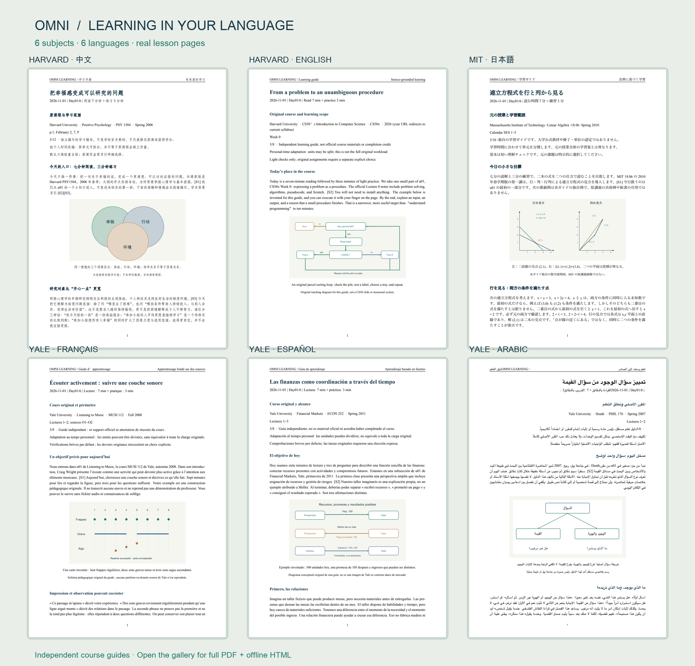
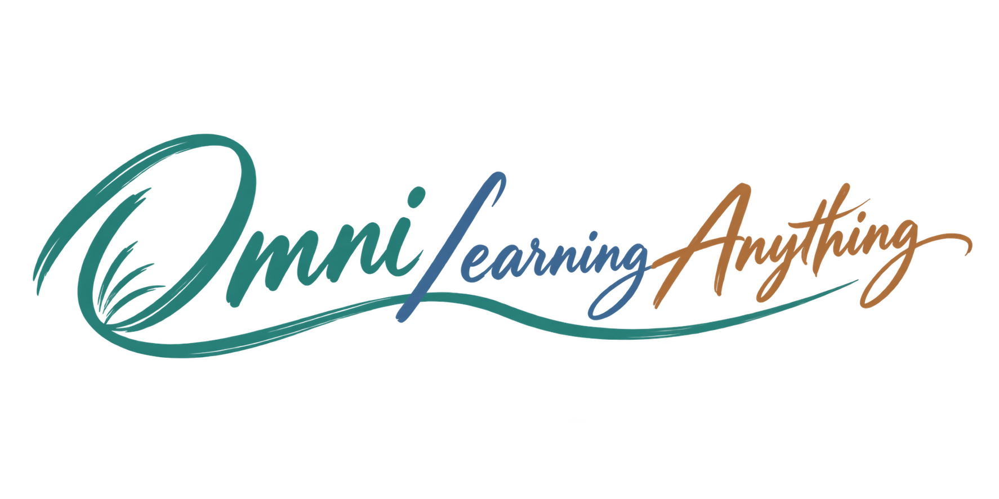

<a href="../../examples/university/README.md"></a>

<div align="center">



# Omni Learning Anything

[](https://github.com/ShawnRen57/omni-learning-anything/releases/latest)
[](../../skills/omni-learning-anything/SKILL.md)
[](../../skills/omni-learning-anything/references/setup.md)
[](../../README.md#choose-your-learning-language)
[](../../skills/omni-learning-anything/references/setup.md)
[](../../LICENSE)
[](https://github.com/ShawnRen57/omni-learning-anything/releases)
[](https://github.com/ShawnRen57/omni-learning-anything/stargazers)

[English](../../README.md) · [简体中文](README_zh.md) · [日本語](README_ja.md) · [한국어](README_ko.md) · [Español](README_es.md) · [Français](README_fr.md) · [Deutsch](README_de.md) · [Português](README_pt.md) · [Русский](README_ru.md) · [العربية](README_ar.md)

**[Skill-ZIP v3.0.0 herunterladen](https://github.com/ShawnRen57/omni-learning-anything/releases/latest/download/omni-learning-anything-skill-v3.0.0.zip)**

[skills.sh](https://skills.sh/shawnren57/omni-learning-anything/omni-learning-anything) · [Installationswege](../../docs/distribution-channels.md)

</div>

**Wähle einen Universitätskurs oder bring eigene Bücher und Fachartikel mit. Lerne in deinem Tempo, mit kurzen Verständnisfragen, hilfreichen Rückmeldungen und Wiederholungen – in lokalen Dateien oder Cloud-Dokumenten.**

Aus „Ich möchte lernen …“ wird ein Plan, dem du folgen kannst. Beginne mit einem von 12 Lernpfaden auf Basis öffentlicher Universitätsquellen, einem eigenen Ziel oder deinen Unterlagen. Bestätige den Plan, bevor die Lektionen beginnen.

Beginne mit **„Ich möchte Harvards Positive Psychologie lernen.“** Der Agent findet den ursprünglichen Kurs, nutzt bereits genannte Angaben und fragt nur nach Details, die für den Lernplan wichtig sind.

## Neu in v3.0.0

- **12 universitäre Lernpfade:** Nutze Kursquellen von Harvard, Yale, MIT und Stanford, ohne selbst einen Lehrplan entwerfen zu müssen.
- **Ein machbares Tempo:** Die ursprüngliche Reihenfolge und Quellenzuordnung bleiben erhalten; die Lerneinheiten passen sich deinem Zeitbudget an.
- **Echte mehrsprachige Beispiele:** Sieh dir Pläne und erste Lektionen aus sechs Sprachen und Fachgebieten als PDF und HTML an.
- **Ein leichter Einstieg:** Nach der Installation oder beim ersten Aufruf kann der Host-Agent im aktuellen Chat Kurse vorstellen, wenn dein Thema noch offen ist. Der Skill kann selbst keinen neuen Chat öffnen.

<a id="university-courses"></a>
## Einen integrierten Universitätskurs wählen

Bitte um **„Zeig mir die integrierten Kurse“**. Wähle Kurs, Sprache und Zeitbudget; der Agent schlägt einen Plan mit Quellenzuordnung vor. Es handelt sich um unabhängige Lernpfade auf Basis öffentlicher Kursquellen. Vollständige Vorlesungsinhalte sind nicht enthalten; eine Anerkennung durch Universitäten oder Zertifikate sind damit nicht verbunden.

| Universität | Kurs und Originaltitel | Quellenausgabe |
| --- | --- | --- |
| Harvard | [Positive Psychologie / Positive Psychology](https://ppc.sas.upenn.edu/sites/default/files/ppsyllabusschachar.pdf) | PSY 1504 · Frühjahr 2006 · Tal Ben-Shahar |
| Harvard | [Einführung in die Informatik / CS50x: Introduction to Computer Science](https://cs50.harvard.edu/x/2026/syllabus/) | CS50x · 2026 · David Malan |
| Harvard | [Gerechtigkeit / Justice](https://sandel.scholars.harvard.edu/justice) | öffentliche Reihe mit 24 Vorlesungen · Michael Sandel |
| Yale | [Einführung in die Psychologie / Introduction to Psychology](https://oyc.yale.edu/introduction-psychology/psyc-110) | PSYC 110 · Frühjahr 2007 · Paul Bloom |
| Yale | [Finanzmärkte / Financial Markets](https://oyc.yale.edu/economics/econ-252) | ECON 252 · Frühjahr 2011 · Robert Shiller |
| Yale | [Spieltheorie / Game Theory](https://oyc.yale.edu/economics/econ-159) | ECON 159 · Herbst 2007 · Ben Polak |
| Yale | [Der Tod / Death](https://oyc.yale.edu/death/phil-176) | PHIL 176 · Frühjahr 2007 · Shelly Kagan |
| Yale | [Musik hören / Listening to Music](https://oyc.yale.edu/music/musi-112) | MUSI 112 · Herbst 2008 · Craig Wright |
| MIT | [Einführung in Informatik und Programmierung mit Python / Introduction to Computer Science and Programming in Python](https://ocw.mit.edu/courses/6-0001-introduction-to-computer-science-and-programming-in-python-fall-2016/) | 6.0001 · Herbst 2016 |
| MIT | [Lineare Algebra / Linear Algebra](https://ocw.mit.edu/courses/18-06-linear-algebra-spring-2010/) | 18.06 · Frühjahr 2010 · Gilbert Strang |
| MIT | [Klassische Mechanik / Classical Mechanics](https://ocw.mit.edu/courses/8-01sc-classical-mechanics-fall-2016/) | 8.01SC · Herbst 2016 |
| Stanford | [Maschinelles Lernen / Machine Learning](https://cs229.stanford.edu/syllabus-autumn2018.html) | CS229 · Herbst 2018 |

Zehn Minuten reichen für einen kleinen Lernschritt, nicht für eine ganze Originalvorlesung oder den gesamten Kurs. Der ursprüngliche Arbeitsaufwand bleibt sichtbar; längere Texte, Aufgaben und Projekte benötigen zusätzliche Zeit. Quellen und Verfügbarkeit können sich ändern.

## Mit eigenen Unterlagen lernen

Nutze PDF, TXT, Markdown, HTML, DOCX, EPUB, PPTX, SRT oder VTT. Wähle Kapitel, Seiten oder Zeitmarken und entscheide, ob externe Ergänzungen erlaubt sind. Erklärungen und Fragen verweisen auf die ausgewählten Originalstellen. Ältere DOC- und RTF-Dateien müssen zuerst mit vertrauenswürdigen Werkzeugen konvertiert werden.

Auch „Ich möchte etwas über Wirtschaft lernen“ genügt. Der Agent schlägt Richtungen vor, nennt Annahmen und fragt nur nach Dingen, die den Plan beeinflussen. Bei einem konkreten Ziel geht es direkt zur Planung.

<a id="choose-your-learning-language"></a>
## Lernsprache wählen

**English · 简体中文 · 日本語 · 한국어 · Español · Français · Deutsch · Português · Русский · العربية**

Pläne und Lektionen unterstützen die genannten zehn Sprachen, unabhängig von der Quellensprache oder dieser Seite. Arabische Dokumente verwenden eine Schreibrichtung von rechts nach links.

## Speicherort für den Kurs wählen

| Speicherort | Vorgehen |
| --- | --- |
| PDF · HTML · DOCX · Markdown | Wähle Ordner und PDF, HTML, DOCX oder Markdown. HTML enthält die Illustration in einer Offline-Datei; externe Links benötigen Internet. |
| Notion | Verbinde eine übergeordnete Seite über die offizielle `ntn`-CLI. |
| Obsidian | Wähle einen vorhandenen lokalen Vault und Kursordner; es wird keine Obsidian-API verwendet. |
| Feishu / 飞书 | Verbinde einen Dokumentordner über die offizielle `lark`-CLI und Nutzerfreigabe. |
| DingTalk / 钉钉 | Verbinde einen Ordner über die offizielle `dws`-CLI; eventuell ist eine Organisationsfreigabe nötig. |
| Tencent Docs / 腾讯文档 | Wähle Stammverzeichnis oder Ordner und durchlaufe die offizielle OAuth/MCP-Autorisierung. |

Nenne den gewünschten Speicherort. Der Agent prüft bestehende Zugriffe, führt durch fehlende Einrichtungsschritte und nutzt deine benannte Verbindung erneut. Passwörter und Tokens gehören nicht in den Chat.

<a id="quick-start"></a>
## Installieren und starten

Bitte den Agenten, die neueste Version zu installieren und zu prüfen, ob dieser Client den Skill findet. Bestehende Kurse und Verbindungen bleiben beim Update erhalten. Mit Node.js ausführbar:

```sh
npx skills@latest add ShawnRen57/omni-learning-anything --skill omni-learning-anything -g
```

Verwende in Claude Code den Plugin-Installer:

```text
/plugin install omni-learning-anything --marketplace ShawnRen57/omni-learning-anything
```

Ohne Node.js kannst du die ZIP oben im Client hochladen oder den Agenten um Hilfe bitten. `skills.sh` ist verfügbar; der SkillHub-Eintrag steht derzeit auf v2.6.0. Verfügbare Versionen stehen in der Kanalübersicht.

## Den ersten Kurs ausprobieren

```text
Zeig mir die integrierten Kurse. Nutze Harvard CS50x 2026 als Quelle.
Ich bin Anfänger. Unterrichte mich auf Deutsch, 20 Minuten täglich.
Behalte die Reihenfolge bei und zeige den ursprünglichen Arbeitsaufwand.
Speichere als Offline-HTML und zeige mir zuerst den Plan.
```

Oder: „Bearbeite mit mir die ersten zwei Kapitel meines EPUB in 15-Minuten-Einheiten“ oder „Erkläre mir Finanzinstitutionen anhand von Yale Financial Markets 2011“.

Prüfe und bestätige den Plan und fordere die erste Lektion an. Zum Fortsetzen: „Mach bei der frühesten noch nicht gelieferten Lektion weiter.“ Pausen sind möglich. Zeitpläne erfordern einen geeigneten Host und vereinbarte Uhrzeit samt Zeitzone. Dann beginnt die Erstellung; die Lieferung folgt nach Recherche und Prüfung.

## Verständnisfragen, Rückmeldungen und Wiederholung

Fordere bei Bedarf 1–3 kurze Fragen als Karten oder Text an. Du erhältst quellenbasierte Rückmeldungen und Hinweise; längere Tests gibt es auf Wunsch. Die Lernaufzeichnung wird im Hintergrund aktualisiert und unterbricht den Lesefluss nicht.

„Was sollte ich heute wiederholen?“ ergibt eine kurze Wiederholung im vorhandenen Zeitbudget. „Was zeigen meine Antworten diese Woche?“ liefert einen belegten Rückblick. Korrigiere Einschätzungen, überspringe Themen oder bevorzuge eine neue Lektion. Es entstehen keine zusätzlichen automatischen Tests oder Timer.

Änderungen künftiger Lektionen bestätigst du vor einer neuen Kursversion; alter Plan und Verlauf bleiben zugänglich. Anki-Karten lassen sich optional als CSV in eine Richtung exportieren, ohne automatische Synchronisierung.

<a id="examples"></a>
## Echte Beispiele in sechs Sprachen

Das Bild oben verlinkt sechs echte Beispielsätze. Jeder enthält einen Teilplan für sechs Tage und einen eigenständig lesbaren Day-01-Lernleitfaden als PDF und HTML. Sie zeigen Form und Vorgehen, keine vollständigen Universitätskurse oder offiziellen Lehrtexte.

| Sprache | Beispielthema |
| --- | --- |
| Chinesisch · 简体中文 | Harvard: Positive Psychologie |
| Englisch · English | Harvard CS50 |
| Japanisch · 日本語 | MIT: Lineare Algebra |
| Französisch · Français | Yale: Musik hören |
| Spanisch · Español | Yale: Finanzmärkte |
| Arabisch · العربية | Yale: Der Tod |

[Katalog und Beispieldateien öffnen](../../examples/university/README.md)

Die bisherigen PDF-Beispiele bleiben verfügbar:

[Technologie](../../examples/technology/) · [Wirtschaft](../../examples/economics/) · [Musik](../../examples/music/) · [Agentenprodukte](../../examples/agent-product/) · [Architektur](../../examples/architecture/) · [Ming-Geschichte](../../examples/ming-history/)

<a id="versions"></a>
## Versionsübersicht

| Version | Nutzen beim Lernen |
| --- | --- |
| **v3.0.0** | Universitären Lernpfad wählen, Quellenausgabe prüfen und echte mehrsprachige Dokumente ansehen. |
| **v2.3–v2.6** | Kurze Verständnisfragen, eigene Quellen, gezielte Wiederholung und einfachere Installation. |
| **v2** | Zehn Sprachen, vier lokale Formate und angebundene Dokumentdienste. |
| **v1** | Persönlichen Plan bestätigen und illustrierte PDFs mit Übungen und Lesetipps erhalten. |

## Anleitungen und Voraussetzungen

[Installation und Updates](../../skills/omni-learning-anything/references/install.md) · [Formate und Schriften](../../skills/omni-learning-anything/references/setup.md) · [Dokumente verbinden](../../skills/omni-learning-anything/references/onboarding.md) · [Kanalstatus](../../docs/distribution-channels.md) · [Validierung von v3.0.0](../../docs/release-validation-v3.0.0.md)

Dieser Agent Skill nutzt die Recherche-, Dokument- und Zeitplanwerkzeuge des Hosts. Nur PDF erfordert XeLaTeX. Cloudzugriff, geräteübergreifende Synchronisierung und unbeaufsichtigte Lieferung hängen von Host, Konto und Freigaben ab. Die Fähigkeiten des aktuellen Clients werden geprüft; allgemeine Plattformunterstützung wird nicht vorausgesetzt.

[MIT](../../LICENSE) · [Changelog](../../CHANGELOG.md) · [Attribution](../../ATTRIBUTION.md)
