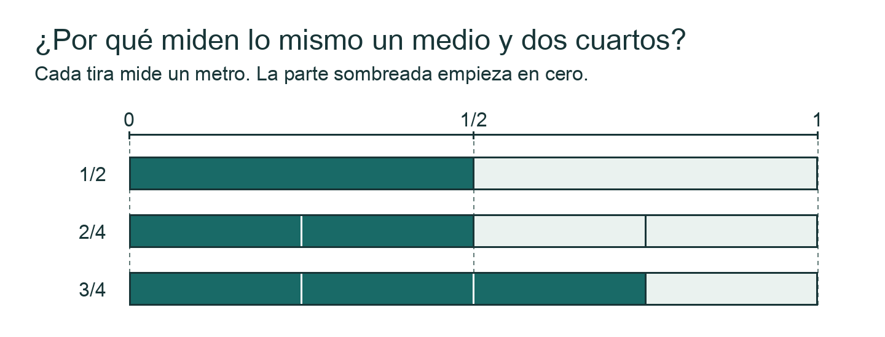
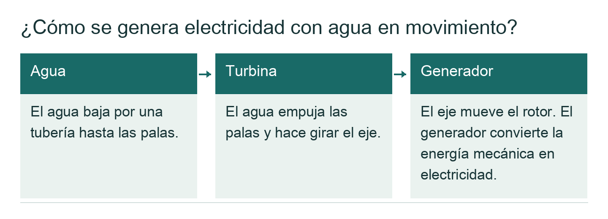
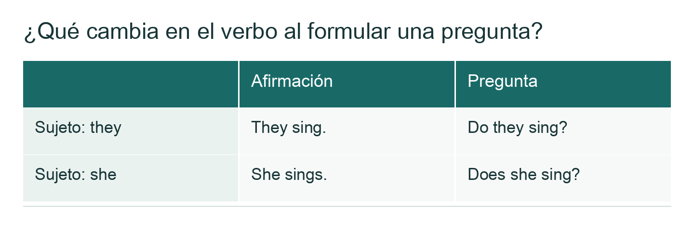
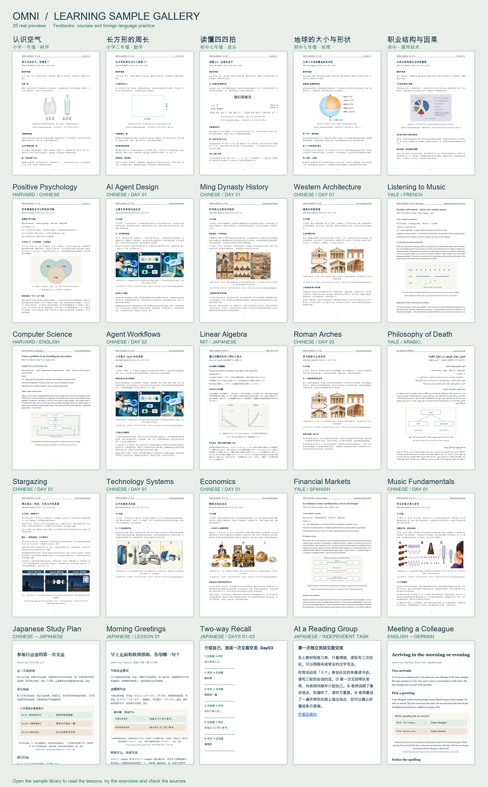

<div align="center">


# Omni Learning Anything

[](https://github.com/ShawnRen57/omni-learning-anything/releases/latest)
[](../../skills/omni-learning-anything/SKILL.md)
[](../../skills/omni-learning-anything/references/setup.md)
[](../../README.md#choose-your-learning-language)
[](../../skills/omni-learning-anything/references/setup.md)
[](../../LICENSE)
[](https://github.com/ShawnRen57/omni-learning-anything/releases)
[](https://github.com/ShawnRen57/omni-learning-anything/stargazers)

[](#output-destinations)
[](#output-destinations)
[](#output-destinations)
[](#output-destinations)

[](#output-destinations)
[](#output-destinations)
[](#output-destinations)
[](#output-destinations)
[](#output-destinations)

[English](../../README.md) · [简体中文](README_zh.md) · [日本語](README_ja.md) · [한국어](README_ko.md) · [Español](README_es.md) · [Français](README_fr.md) · [Deutsch](README_de.md) · [Português](README_pt.md) · [Русский](README_ru.md) · [العربية](README_ar.md)

**[Descargar ZIP de la habilidad v5.0.0](https://github.com/ShawnRen57/omni-learning-anything/releases/download/v5.0.0/omni-learning-anything-skill-v5.0.0.zip)**

[skills.sh](https://skills.sh/shawnren57/omni-learning-anything/omni-learning-anything) · [Canales de instalación](../../docs/distribution-channels.md)

</div>

**v5.0** · Elige entre 135 recursos. Aprende un idioma extranjero en tu lengua materna con ejercicios y un solucionario aparte. Cada nueva ilustración incluye una pregunta que orienta su lectura. [Catálogo](../curated-learning-resources.md) · [Ejemplos de idiomas](../../examples/languages/README.md)

**Elige un curso universitario o trae tus libros y artículos. Aprende a tu ritmo, con preguntas breves, comentarios útiles y repaso, en archivos locales o documentos en la nube.**

Elige una clase abierta, un libro, un artículo o una charla, o empieza con tus propios materiales. Indica tu objetivo y el tiempo disponible y revisa el plan antes de la primera lección.

Prueba **«Quiero estudiar Psicología Positiva de Harvard»**. El agente identifica el curso, reutiliza lo que ya le has contado y solo pregunta lo necesario para preparar el plan.

| Función | Qué hace |
| --- | --- |
| Ruta personalizada | Convierte un interés o un objetivo en un curso ajustado a tu nivel y tiempo. |
| Catálogo de fuentes | Reúne 67 itinerarios y 68 fuentes adicionales. Consulta la procedencia y las condiciones de acceso de los cursos, libros, artículos y charlas. |
| Idiomas desde cero | Aprende expresiones para una situación concreta y practícalas en ambos sentidos. Recibe fichas de repaso acumulativo y un solucionario aparte. |
| Libros escolares chinos | Busca 1.949 entradas de primaria y secundaria. Estudia un tomo, capítulo, concepto o fórmula con explicaciones adecuadas a la edad e ilustraciones del original. |
| Materiales propios | Elige páginas, capítulos o tramos en PDF, DOCX, EPUB, PPTX, HTML, Markdown, TXT, SRT o VTT. |
| Fuentes y lecturas | Remite a las páginas, capítulos, marcas de tiempo o fuentes web verificadas. |
| Aprobación del plan | Revisa la secuencia diaria y el tiempo estimado antes de empezar. |
| Lectura de diagramas | Responde una pregunta observando una escala, siguiendo una flecha o comparando ejemplos alineados. Cada figura remite a su fuente. |
| Diez idiomas | Elige el idioma de aprendizaje. El árabe se compone de derecha a izquierda. |
| Formatos locales | PDF, HTML sin conexión, DOCX y Markdown. |
| Destinos | Obsidian local o conexiones autorizadas con Notion, Feishu, DingTalk y Tencent Docs. |
| Preguntas breves | Responde de una a tres preguntas por chat o tarjeta compatible. Pide pistas, salta o continúa. |
| Comentarios | Recibe explicaciones con fuentes, revisa tu respuesta o corrige una evaluación. |
| Registro y repaso | Repasa en el tiempo disponible, pide un resumen y exporta o elimina respuestas. |
| Revisión del plan | Revisa cambios según tu objetivo o tus respuestas antes de crear otra versión del curso. |
| Anki | Exporta preguntas de repaso a CSV para importarlas en Anki. |
| Continuidad y horario | Pausa y retoma desde la siguiente lección. La entrega programada depende del agente. |
| Instalación y actualización | Instala y verifica la detección en agentes compatibles, con los cursos en un directorio aparte. |

<a id="examples"></a>

## Ejemplos de materiales de estudio

| Fracciones equivalentes | Energía hidroeléctrica | Preguntas en inglés |
| --- | --- | --- |
| <a href="../assets/figures/equivalent-fractions-es.png"></a> | <a href="../assets/figures/hydropower-es.png"></a> | <a href="../assets/figures/present-simple-es.png"></a> |
| ¿Qué dos barras tienen la misma longitud sombreada? | ¿Qué transmite la turbina al generador? | ¿Qué ocurre con la -s de She sings al formular una pregunta? |
| [OpenStax](https://openstax.org/books/prealgebra-2e/pages/4-1-visualize-fractions) | [Departamento de Energía de EE. UU.](https://www.energy.gov/cmei/water/how-hydropower-works) | [British Council](https://learnenglish.britishcouncil.org/free-resources/grammar/english-grammar-reference/present-simple) |

| Qué estudiar | Material para probar |
| --- | --- |
| Idiomas | [Japonés en chino, plan de tres días](../../examples/languages/zh-ja/plan.md) · [Tarea final de conversación](../../examples/languages/zh-ja/day03-task.md) · [Primera lección de alemán en inglés](../../examples/languages/en-de/day01.md) · [Ficha de ejercicios](../../examples/languages/en-de/worksheet.md) |
| Escuela y universidad | [Cinco lecciones en chino basadas en libros escolares](../../examples/textbooks/README.md) · [Seis cursos en varios idiomas](../../examples/university/README.md) · [Mercados financieros de Yale (PDF en español)](../../examples/university/financial-markets-es/Day01.pdf) · [Todos los ejemplos](../../examples/README.md) |

<a href="../../examples/README.md"></a>

<a id="versions"></a>
## Guía de versiones

| Versión | Qué aporta al aprendizaje |
| --- | --- |
| **v5.0.0** | Cursos de idiomas con explicaciones en tu lengua, diagramas con preguntas y fuentes, y un catálogo de 135 recursos. |
| **v4.0–4.2** | Busca libros escolares por año o edición más reciente, estudia sus ilustraciones originales y aplica lo aprendido a situaciones nuevas. |
| **v3.0.0** | Elige una ruta universitaria, identifica su edición y consulta documentos multilingües reales. |
| **v2.3–v2.6** | Preguntas breves, materiales propios, repaso y una instalación y actualización más sencillas. |
| **v2** | Diez idiomas, cuatro formatos locales y documentos conectados. |
| **v1** | Aprueba un plan personal y recibe PDF ilustrados con ejercicios y lecturas. |

<a id="university-courses"></a>
## Explora los cursos y recursos del catálogo

Busca por título, tema o institución. Prueba **«Encuentra una charla TED sobre el lenguaje»** o **«Prepara un plan con Modern Poetry de Yale»**. Elige un capítulo, una clase o una charla, el idioma de estudio y el tiempo disponible. Revisa el plan antes de empezar.

Cada título enlaza con la fuente original. Si la editorial solo ofrece la ficha del libro, puedes trabajar con los capítulos a los que tengas acceso. [Ediciones y docentes](../course-catalog-sources.md) · [Acceso a los recursos](../curated-learning-resources.md)

<!-- catalog:start -->

| Universidad, entidad o autoría | Cursos y recursos (135) |
| --- | --- |
| Universidad Tsinghua | **Cursos** [中国建筑史——史前至两宋辽金](https://higher.smartedu.cn/course/687eb7bf16c43a09c0e58c23) · [文物精品与文化中国](https://higher.smartedu.cn/course/6a5e9b52b44e493c768f8c9c) · [中国建筑史（下）（自主模式）](https://v1-www.xuetangx.com/courses/course-v1%3ATsinghuaX%2B80000901X_2%2Bsp/about) · [艺术的启示](https://higher.smartedu.cn/course/6786ec4c225d72705e5dc29e) · [校园风物与大学文化——以清华大学为例](https://higher.smartedu.cn/course/6a5e9b60b44e493c768f8cba) · [数据结构(上)](https://www.xuetangx.com/course/THU08091000384/) · [大学历史与文化](https://next.xuetangx.com/course/THU04011000284/29592783)<br>**Referencias abiertas** [人工智能通识教育红皮书](https://aige.cs.tsinghua.edu.cn/redbook/) |
| Universidad de Pekín | **Cursos** [经典昆曲欣赏](https://www.icourse163.org/course/PKU-1470426173?tid=1474265476) · [人工智能与信息社会](https://www.icourse163.org/course/PKU-1003471009?tid=1476756462) · [西方音乐欣赏](https://www.icourse163.org/course/PKU-1207132813?tid=1207476216) · [人工智能原理](https://www.icourse163.org/course/PKU-1002188003?tid=1472399493) · [语言学概论](https://www.icourse163.org/course/PKU-1205727813) · [古代汉语](https://www.icourse163.org/course/PKU-1205726807) · [生理学（上）](https://www.icourse163.org/course/PKU-1205915814) |
| Universidad Fudan | **Cursos** [人工智能，语言与伦理](https://www.icourse163.org/course/FUDAN-1205951803?tid=1475942449) · [比较文化研究](https://umoocs.unipus.cn/course/7944/tasks) · [深度学习及其应用](https://higher.smartedu.cn/course/622ac9f0bee70ef79f419877) · [中华优秀传统文化](https://higher.smartedu.cn/course/63ffd464af1f1b5d3ecfd579) · [政治学原理](https://www.icourse163.org/course/FUDAN-1461787179?tid=1462604462) · [古典诗词鉴赏](https://www.icourse163.org/course/FUDAN-1205950804) |
| Universidad Jiao Tong de Shanghái | **Cursos** [唐诗宋词人文解读](https://higher.smartedu.cn/course/69b0942995df98bb27ba19b4) · [数学的天空](https://higher.smartedu.cn/course/690530295345b68214577952) · [机器的征途：空天科技](https://higher.smartedu.cn/course/62354d7a9906eace0490b2aa) · [经济法](https://higher.smartedu.cn/course/67c2473d225d72705e7bb8c8) · [关爱生命——急救与自救技能](https://higher.smartedu.cn/course/69b0942695df98bb27ba19a1) · [建筑物理](https://www.icourse163.org/course/SJTU-1472028164) · [造型基础—设计素描](https://www.icourse163.org/course/SJTU-1206432804) · [设计创新的艺术](https://www.icourse163.org/course/SJTU-1207170808) |
| Universidad de Zhejiang | **Cursos** [唐诗经典](https://higher.smartedu.cn/course/6982720195df98bb27cadb06) |
| Universidad Normal de Pekín | **Cursos** [书法欣赏](https://www.icourse163.org/course/BNU-1003240002?tid=1488313456) |
| Universidad de Harvard | **Cursos** [Positive Psychology](https://ppc.sas.upenn.edu/sites/default/files/ppsyllabusschachar.pdf) · [CS50’s Introduction to Computer Science](https://cs50.harvard.edu/x/2026/syllabus/) · [Justice](https://sandel.scholars.harvard.edu/justice) · [Rhetoric: The Art of Persuasive Writing and Public Speaking](https://pll.harvard.edu/course/rhetoric-art-persuasive-writing-and-public-speaking) · [CS50’s Introduction to Artificial Intelligence with Python](https://cs50.harvard.edu/ai/) · [Masterpieces of World Literature](https://www.edx.org/learn/literature/harvard-university-masterpieces-of-world-literature) · [Pyramids of Giza: Ancient Egyptian Art and Archaeology](https://giza.fas.harvard.edu/videos/) |
| Universidad de Yale | **Cursos** [Introduction to Psychology](https://oyc.yale.edu/introduction-psychology/psyc-110) · [Financial Markets](https://oyc.yale.edu/economics/econ-252) · [Game Theory](https://oyc.yale.edu/economics/econ-159) · [Death](https://oyc.yale.edu/death/phil-176) · [Listening to Music](https://oyc.yale.edu/music/musi-112/lecture-1) · [Roman Architecture](https://oyc.yale.edu/history-of-art/hsar-252) · [Introduction to Theory of Literature](https://oyc.yale.edu/english/engl-300) · [The Atmosphere, the Ocean, and Environmental Change](https://oyc.yale.edu/geology-and-geophysics/gg-140) · [European Civilization, 1648-1945](https://oyc.yale.edu/history/hist-202) · [Philosophy and the Science of Human Nature](https://oyc.yale.edu/philosophy/phil-181) · [Principles of Evolution, Ecology and Behavior](https://oyc.yale.edu/ecology-and-evolutionary-biology/eeb-122) · [Introduction to Ancient Greek History](https://oyc.yale.edu/classics/clcv-205) · [The American Revolution](https://oyc.yale.edu/history/hist-116) · [Modern Poetry](https://oyc.yale.edu/english/engl-310) · [Capitalism: Success, Crisis, and Reform](https://oyc.yale.edu/political-science/plsc-270) · [Frontiers and Controversies in Astrophysics](https://oyc.yale.edu/astronomy/astr-160) · [Fundamentals of Physics I](https://oyc.yale.edu/physics/phys-200) · [Frontiers of Biomedical Engineering](https://oyc.yale.edu/biomedical-engineering/beng-100) · [The Psychology, Biology and Politics of Food](https://oyc.yale.edu/psychology/psyc-123) · [Milton](https://oyc.yale.edu/english/engl-220) |
| MIT | **Cursos** [Introduction to Computer Science and Programming in Python](https://ocw.mit.edu/courses/6-0001-introduction-to-computer-science-and-programming-in-python-fall-2016/video_galleries/lecture-videos/) · [Linear Algebra](https://ocw.mit.edu/courses/18-06-linear-algebra-spring-2010/pages/calendar/) · [Classical Mechanics](https://ocw.mit.edu/courses/8-01sc-classical-mechanics-fall-2016/) · [Introduction to Art History](https://ocw.mit.edu/courses/4-601-introduction-to-art-history-fall-2018/pages/calendar/) · [Principles of Microeconomics](https://ocw.mit.edu/courses/14-01-principles-of-microeconomics-fall-2023/pages/calendar/) · [Art Since 1940](https://ocw.mit.edu/courses/4-651-art-since-1940-fall-2010/pages/lecture-notes/) · [Philosophy of Film](https://ocw.mit.edu/courses/24-213-philosophy-of-film-fall-2004/pages/calendar/) · [Introduction to Deep Learning](https://introtodeeplearning.com/2026/index.html) · [Introduction to Sustainable Energy](https://ocw.mit.edu/courses/22-081j-introduction-to-sustainable-energy-fall-2010/pages/calendar/)<br>**Libros académicos · MIT Press** [Deep Learning](https://www.deeplearningbook.org/) · [Probabilistic Machine Learning: An Introduction](https://probml.github.io/pml-book/book1.html) · [Reinforcement Learning: An Introduction](https://mitpress.mit.edu/9780262039246/reinforcement-learning/) |
| Universidad de Stanford | **Cursos** [Machine Learning](https://cs229.stanford.edu/syllabus-autumn2018.html) · [Deep Learning for Computer Vision](https://cs231n.stanford.edu/2026/schedule.html)<br>**Libros académicos** [Speech and Language Processing](https://web.stanford.edu/~jurafsky/slp3/) · [Convex Optimization](https://web.stanford.edu/~boyd/cvxbook/) · [Introduction to Applied Linear Algebra – Vectors, Matrices, and Least Squares](https://web.stanford.edu/~boyd/vmls/)<br>**Artículos · Stanford Encyclopedia of Philosophy** [Aesthetic Judgment](https://plato.stanford.edu/entries/aesthetic-judgment/) · [Scientific Method](https://plato.stanford.edu/entries/scientific-method/) · [Personal Identity](https://plato.stanford.edu/entries/identity-personal/) · [Justice](https://plato.stanford.edu/entries/justice/) · [Chinese Ethics](https://plato.stanford.edu/entries/ethics-chinese/) · [The Philosophy of Music](https://plato.stanford.edu/entries/music/) |
| Universidad de Helsinki y MinnaLearn | **Cursos** [Elements of AI: Introduction to AI](https://opin.fi/en/study-options/HY/elements-of-ai-introduction-to-ai/89eb0e79-873e-4d2a-aec5-d694d7762118) · [Elements of AI: Building AI](https://buildingai.elementsofai.com/) |
| OpenAI Academy | **Cursos** [AI Foundations](https://academy.openai.com/public/courses/ai-foundations-dnq5w) · [Applied AI Foundations](https://academy.openai.com/public/courses/applied-ai-foundations-szsmv) · [Agents and Workflows](https://academy.openai.com/public/courses/agents-and-workflows-y0qoc) · [AI for College Students](https://academy.openai.com/public/courses/ai-for-college-students-gxgmr) |
| Anthropic · Claude Academy | **Cursos** [AI Fluency: Framework and foundations](https://academy.claude.com/courses/ai-fluency-framework-foundations) · [AI Fluency for students](https://academy.claude.com/courses/ai-fluency-for-students) · [AI Fluency for educators](https://academy.claude.com/courses/ai-fluency-for-educators) |
| Hugging Face | **Cursos** [AI Agents Course](https://huggingface.co/learn/agents-course/unit0/introduction) |
| Universidad de California en Berkeley | **Cursos** [Introduction to Artificial Intelligence](https://inst.eecs.berkeley.edu/~cs188/sp26/) |
| DeepLearning.AI | **Cursos** [AI For Everyone](https://www.coursera.org/learn/ai-for-everyone/) · [Generative AI for Everyone](https://www.coursera.org/learn/generative-ai-for-everyone/) |
| Microsoft | **Cursos** [Generative AI for Beginners](https://github.com/microsoft/generative-ai-for-beginners/blob/79a4334e158147d4f36c27d805e0cb163c1e445b/README.md#-lessons) |
| Google | **Cursos** [Google AI Essentials](https://grow.google/ai-essentials/) |
| Smarthistory | **Referencias abiertas** [Reframing Art History](https://smarthistory.org/reframing-art-history/) |
| Universidad Rice · OpenStax | **Libros de texto** [Astronomy 2e](https://openstax.org/books/astronomy-2e/pages/preface) · [Biology 2e](https://openstax.org/books/biology-2e/pages/preface) · [Psychology 2e](https://openstax.org/books/psychology-2e/pages/preface) · [Introduction to Sociology 3e](https://openstax.org/books/introduction-sociology-3e/pages/preface) · [Principles of Economics 3e](https://openstax.org/books/principles-economics-3e/pages/preface) · [Chemistry 2e](https://openstax.org/books/chemistry-2e/pages/preface) · [University Physics Volume 1](https://openstax.org/books/university-physics-volume-1/pages/preface) · [Calculus Volume 1](https://openstax.org/books/calculus-volume-1/pages/preface) · [World History Volume 1, to 1500](https://openstax.org/books/world-history-volume-1/pages/preface) · [Introduction to Philosophy](https://openstax.org/books/introduction-philosophy/pages/preface) · [Introductory Statistics 2e](https://openstax.org/books/introductory-statistics-2e/pages/preface) · [Entrepreneurship](https://openstax.org/books/entrepreneurship/pages/preface) · [Business Ethics](https://openstax.org/books/business-ethics/pages/preface) |
| Autores de Dive into Deep Learning | **Libros académicos** [动手学深度学习](https://zh.d2l.ai/) |
| O’Reilly | **Libros académicos** [R for Data Science (2e)](https://r4ds.hadley.nz/) |
| Distill | **Artículos** [Attention and Augmented Recurrent Neural Networks](https://distill.pub/2016/augmented-rnns/) · [How to Use t-SNE Effectively](https://distill.pub/2016/misread-tsne/) · [Feature Visualization](https://distill.pub/2017/feature-visualization/) · [Why Momentum Really Works](https://distill.pub/2017/momentum/) · [Deconvolution and Checkerboard Artifacts](https://distill.pub/2016/deconv-checkerboard/) · [A Gentle Introduction to Graph Neural Networks](https://distill.pub/2021/gnn-intro/) · [Computing Receptive Fields of Convolutional Neural Networks](https://distill.pub/2019/computing-receptive-fields/) · [A Visual Exploration of Gaussian Processes](https://distill.pub/2019/visual-exploration-gaussian-processes/) |
| Caltech | **Ciclos de conferencias** [The Feynman Lectures on Physics, Volume I](https://www.feynmanlectures.caltech.edu/I_toc.html) · [The Feynman Lectures on Physics, Volume II](https://www.feynmanlectures.caltech.edu/II_toc.html) · [The Feynman Lectures on Physics, Volume III](https://www.feynmanlectures.caltech.edu/III_toc.html) |
| Royal Institution | **Ciclos de conferencias** [The truth about AI](https://www.rigb.org/christmas-lectures/watch-2023-christmas-lectures)<br>**Charlas** [Growing up in the universe – Waking up in the universe (1991)](https://www.rigb.org/explore-science/explore/video/growing-universe-waking-universe-1991) |
| TED | **Charlas** [How language shapes the way we think](https://www.ted.com/talks/lera_boroditsky_how_language_shapes_the_way_we_think) · [The danger of a single story](https://www.ted.com/talks/chimamanda_ngozi_adichie_the_danger_of_a_single_story) · [The best stats you’ve ever seen](https://www.ted.com/talks/hans_rosling_the_best_stats_you_ve_ever_seen) · [Do schools kill creativity?](https://www.ted.com/talks/sir_ken_robinson_do_schools_kill_creativity) · [The power of introverts](https://www.ted.com/talks/susan_cain_the_power_of_introverts) · [Inside the mind of a master procrastinator](https://www.ted.com/talks/tim_urban_inside_the_mind_of_a_master_procrastinator) · [10 ways to have a better conversation](https://www.ted.com/talks/celeste_headlee_10_ways_to_have_a_better_conversation) · [How to speak so that people want to listen](https://www.ted.com/talks/julian_treasure_how_to_speak_so_that_people_want_to_listen) · [The power of vulnerability](https://www.ted.com/talks/brene_brown_the_power_of_vulnerability) · [We should all be feminists](https://www.ted.com/talks/chimamanda_ngozi_adichie_we_should_all_be_feminists) |

<!-- catalog:end -->

Una sesión de 10 minutos cubre un pequeño paso, no una clase original completa ni todo el curso. La carga original sigue visible; las lecturas largas, los ejercicios y los proyectos requieren tiempo adicional. Las fuentes y su disponibilidad pueden cambiar. Son rutas de aprendizaje independientes basadas en cursos públicos. No incluyen todo el contenido de las clases ni implican respaldo universitario o certificados.

## Aprende con tus materiales

Usa PDF, TXT, Markdown, HTML, DOCX, EPUB, PPTX, SRT o VTT. Selecciona capítulos, páginas o marcas de tiempo y decide si permites fuentes complementarias. Las explicaciones y preguntas remiten a los pasajes originales. Los archivos DOC y RTF antiguos requieren una conversión previa con herramientas de confianza.

También puedes empezar con «quiero entender algo de economía». El agente propone direcciones, explica sus supuestos y pregunta solo lo que afecta al plan. Si tu objetivo es concreto, pasa directamente a planificar.

<a id="choose-your-learning-language"></a>
## Elige el idioma de aprendizaje

**English · 简体中文 · 日本語 · 한국어 · Español · Français · Deutsch · Português · Русский · العربية**

Los planes y las lecciones admiten estos diez idiomas, independientemente del idioma de las fuentes o de esta página. Los documentos en árabe usan escritura de derecha a izquierda.

<a id="output-destinations"></a>
## Elige dónde guardar el curso

| Destino | Cómo funciona |
| --- | --- |
| PDF · HTML · DOCX · Markdown | Elige carpeta y PDF, HTML, DOCX o Markdown. HTML incluye la ilustración en un único archivo sin conexión; los enlaces externos necesitan internet. |
| Notion | Conecta una página principal con la CLI oficial `ntn`. |
| Obsidian | Elige un Vault local existente y una carpeta; no se utiliza una API de Obsidian. |
| Feishu / 飞书 | Conecta una carpeta con la CLI oficial `lark` y autorización del usuario. |
| DingTalk / 钉钉 | Conecta una carpeta con la CLI oficial `dws`; puede requerir aprobación de tu organización. |
| Tencent Docs / 腾讯文档 | Elige raíz o carpeta y completa la autorización oficial OAuth/MCP. |

Indica dónde guardar el curso. El agente comprueba los accesos, guía la configuración pendiente y reutiliza la conexión guardada con nombre. No pegues contraseñas ni tokens en el chat.

<a id="quick-start"></a>
## Instala y empieza

Pide al agente que instale la última versión y compruebe que este cliente detecta la habilidad. Conserva cursos y conexiones al actualizar. Con Node.js, ejecuta:

```sh
npx skills@latest add ShawnRen57/omni-learning-anything --skill omni-learning-anything -g
```

En Claude Code, usa el instalador de plugins:

```text
/plugin install omni-learning-anything --marketplace ShawnRen57/omni-learning-anything
```

Sin Node.js, descarga el ZIP de arriba y súbelo mediante tu cliente o pide ayuda al agente. `skills.sh` está disponible; la versión publicada en SkillHub es actualmente v2.6.0. Consulta la guía de canales para conocer sus versiones.

## Prueba tu primer curso

```text
Muéstrame los cursos disponibles. Usa Yale Financial Markets 2011.
Soy principiante. Enséñame en español, 20 minutos al día.
Conserva el orden original e indica la carga de trabajo original.
Guarda HTML sin conexión y muéstrame primero el plan.
```

O prueba: «Enséñame los dos primeros capítulos de mi EPUB en sesiones de 15 minutos», o «Quiero empezar Harvard CS50x 2026 desde cero».

Revisa y aprueba el plan y pide la primera lección. Para retomar, di «continúa desde la primera lección pendiente». Puedes pausar el curso. La programación requiere compatibilidad del anfitrión y acordar hora y zona horaria; a esa hora empieza la generación y la entrega llega tras investigar y revisar.

## Preguntas, comentarios y repaso

Cuando quieras, pide de 1 a 3 preguntas breves en tarjetas o texto. Recibe comentarios e indicios basados en las fuentes; puedes solicitar una prueba más larga. El registro de aprendizaje se actualiza en segundo plano para mantener la lectura fluida.

Pregunta «¿qué debería repasar hoy?» para un repaso dentro del tiempo previsto, o «¿qué muestran mis respuestas esta semana?» para un resumen con pruebas. Corrige una valoración, omite un tema o prioriza una lección nueva. El repaso no crea pruebas automáticas ni temporizadores adicionales.

Aprueba los cambios de futuras lecciones antes de iniciar una nueva versión; el plan anterior y el historial siguen disponibles. Puedes exportar tarjetas a Anki en CSV en un solo sentido, sin sincronización automática.

[Demostración de preguntas, comentarios y revisión del plan en WorkBuddy](../../README.md#workbuddy-demo)

## Guías y requisitos

[Instalación y actualizaciones](../../skills/omni-learning-anything/references/install.md) · [Formatos y fuentes tipográficas](../../skills/omni-learning-anything/references/setup.md) · [Conectar documentos](../../skills/omni-learning-anything/references/onboarding.md) · [Estado de los canales](../../docs/distribution-channels.md) · [Validación de v3.0.0](../../docs/release-validation-v3.0.0.md)

Esta Agent Skill usa las herramientas de investigación, documentos y programación de tu anfitrión. Solo PDF necesita XeLaTeX. El acceso a la nube, la sincronización entre dispositivos y la entrega desatendida dependen del anfitrión, la cuenta y los permisos. Se comprueba el cliente actual; no se presupone compatibilidad universal.

[MIT](../../LICENSE) · [Changelog](../../CHANGELOG.md) · [Attribution](../../ATTRIBUTION.md)
