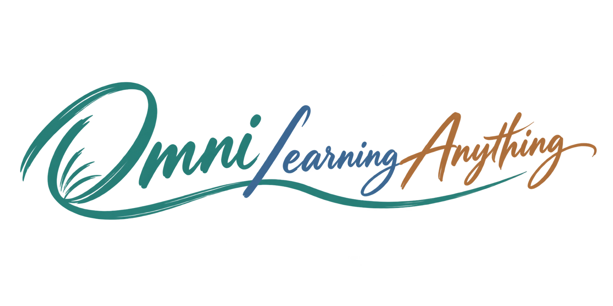
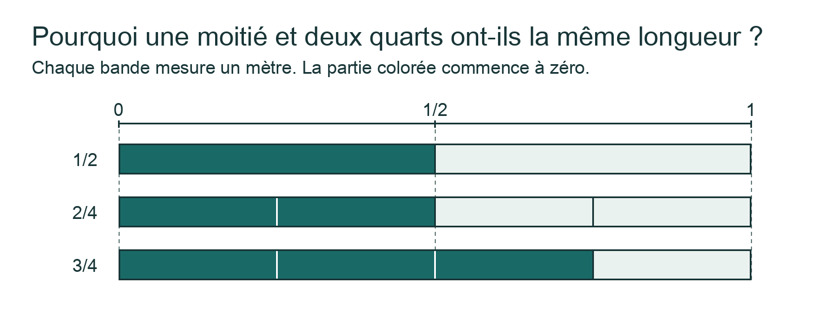
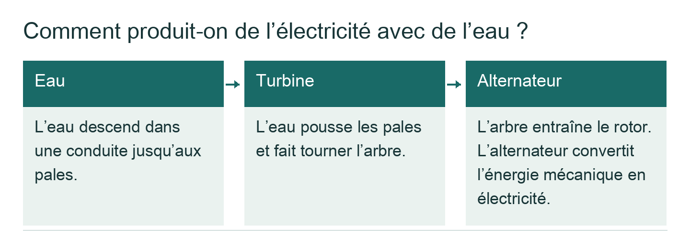
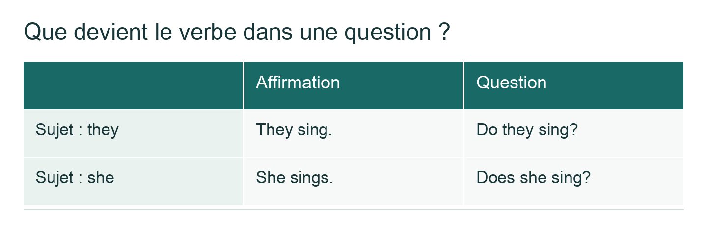

<div align="center">



# Omni Learning Anything

[](https://github.com/ShawnRen57/omni-learning-anything/releases/latest)
[](../../skills/omni-learning-anything/SKILL.md)
[](../../skills/omni-learning-anything/references/setup.md)
[](../../README.md#choose-your-learning-language)
[](../../skills/omni-learning-anything/references/setup.md)
[](../../LICENSE)
[](https://github.com/ShawnRen57/omni-learning-anything/releases)
[](https://github.com/ShawnRen57/omni-learning-anything/stargazers)

[](#output-destinations)
[](#output-destinations)
[](#output-destinations)
[](#output-destinations)

[](#output-destinations)
[](#output-destinations)
[](#output-destinations)
[](#output-destinations)
[](#output-destinations)

[English](../../README.md) · [简体中文](README_zh.md) · [日本語](README_ja.md) · [한국어](README_ko.md) · [Español](README_es.md) · [Français](README_fr.md) · [Deutsch](README_de.md) · [Português](README_pt.md) · [Русский](README_ru.md) · [العربية](README_ar.md)

**[Télécharger le ZIP de la compétence v5.0.0](https://github.com/ShawnRen57/omni-learning-anything/releases/download/v5.0.0/omni-learning-anything-skill-v5.0.0.zip)**

[skills.sh](https://skills.sh/shawnren57/omni-learning-anything/omni-learning-anything) · [Canaux d’installation](../../docs/distribution-channels.md)

</div>

**v5.0** · Choisissez parmi 135 ressources. Apprenez une langue étrangère dans votre langue maternelle avec des exercices et un corrigé séparé. Chaque schéma est accompagné d’une question qui guide la lecture. [Catalogue](../curated-learning-resources.md) · [Exemples de langues](../../examples/languages/README.md)

**Choisissez un cours universitaire ou apportez vos livres et articles. Apprenez à votre rythme, avec de courtes questions, des retours utiles et des révisions, dans des fichiers locaux ou des documents cloud.**

Choisissez un cours ouvert, un livre, un article ou une conférence, ou apportez vos propres documents. Précisez votre objectif et le temps disponible, puis vérifiez le programme avant la première leçon.

Essayez **« Je veux étudier la psychologie positive de Harvard »**. L’agent identifie le cours, réutilise les informations déjà fournies et ne demande que ce qui compte pour le plan.

| Fonction | Description |
| --- | --- |
| Parcours personnalisé | Transforme un intérêt ou un objectif en parcours adapté au niveau et au temps disponible. |
| Catalogue de sources | Il réunit 67 parcours et 68 ressources supplémentaires. Retrouvez les originaux et les conditions d’accès des cours, livres, articles et conférences. |
| Langues pour débutants | Apprenez des expressions adaptées à une situation concrète et entraînez-vous dans les deux sens. Les fiches de révision cumulative et les corrigés sont séparés. |
| Manuels scolaires chinois | Recherche parmi 1 949 entrées du primaire au lycée. Étudiez un volume, un chapitre, une notion ou une formule avec des explications adaptées et des illustrations d’origine. |
| Documents personnels | Choisissez des pages, chapitres ou passages dans des PDF, DOCX, EPUB, PPTX, HTML, Markdown, TXT, SRT ou VTT. |
| Sources et lectures | Retrouvez la page, le chapitre, le repère temporel ou la source web qui appuie une explication. |
| Validation du plan | Vérifiez les étapes et le temps estimé avant le début des leçons. |
| Lecture de schémas | Répondez à une question en lisant une échelle, en suivant une flèche ou en comparant deux exemples alignés. Chaque figure renvoie à sa source. |
| Dix langues | Choisissez la langue d’apprentissage indépendamment de la source. L’arabe est mis en page de droite à gauche. |
| Formats locaux | PDF, HTML hors ligne, DOCX et Markdown. |
| Destinations | Coffre Obsidian local ou connexions autorisées à Notion, Feishu, DingTalk et Tencent Docs. |
| Questions courtes | Répondez à une à trois questions dans le chat ou sur une carte compatible. Demandez un indice, passez ou reprenez. |
| Retour sur les réponses | Recevez des explications sourcées, révisez une réponse ou contestez un jugement. |
| Suivi et révision | Révisez dans le temps disponible, demandez un bilan, exportez ou supprimez vos réponses. |
| Ajustement du plan | Examinez les changements proposés selon vos objectifs ou réponses avant de créer une nouvelle version. |
| Anki | Exportez les questions de révision en CSV pour Anki. |
| Reprise et calendrier | Reprenez à la prochaine leçon. La programmation dépend des outils de l’agent. |
| Installation et mise à jour | Installez et vérifiez la détection dans un agent compatible, avec les cours dans un dossier distinct. |

<a id="examples"></a>

## Exemples de supports de cours

| Fractions équivalentes | Énergie hydraulique | Questions en anglais |
| --- | --- | --- |
| <a href="../assets/figures/equivalent-fractions-fr.png"></a> | <a href="../assets/figures/hydropower-fr.png"></a> | <a href="../assets/figures/present-simple-fr.png"></a> |
| Sur quelles barres la partie colorée s’arrête-t-elle au même endroit ? | Que transmet la turbine à l’alternateur ? | Que devient le -s de She sings quand on pose une question ? |
| [OpenStax](https://openstax.org/books/prealgebra-2e/pages/4-1-visualize-fractions) | [Département américain de l’Énergie](https://www.energy.gov/cmei/water/how-hydropower-works) | [British Council](https://learnenglish.britishcouncil.org/free-resources/grammar/english-grammar-reference/present-simple) |

| Domaine | Supports à essayer |
| --- | --- |
| Langues | [Japonais expliqué en chinois, parcours de trois jours](../../examples/languages/zh-ja/plan.md) · [Tâche finale de conversation](../../examples/languages/zh-ja/day03-task.md) · [Première leçon d’allemand expliquée en anglais](../../examples/languages/en-de/day01.md) · [Fiche d’exercices](../../examples/languages/en-de/worksheet.md) |
| École et université | [Cinq leçons en chinois tirées de manuels scolaires](../../examples/textbooks/README.md) · [Six cours en plusieurs langues](../../examples/university/README.md) · [Écoute musicale à Yale (PDF en français)](../../examples/university/listening-music-fr/Day01.pdf) · [Tous les exemples](../../examples/README.md) |
| Lire un schéma · leçons en chinois | [Filtrer des tarifs aériens selon un budget](../../examples/agent-product/pdf/Agent%E4%BA%A7%E5%93%81%E8%AE%BE%E8%AE%A1_%E6%AF%8F%E6%97%A5%E5%AD%A6%E4%B9%A0_Day01_%E4%BB%8E%E8%81%8A%E5%A4%A9%E5%9B%9E%E7%AD%94%E5%88%B0%E5%AE%8C%E6%88%90%E4%BB%BB%E5%8A%A1.pdf) · [Suivre la boucle de décision de l’agent](../../examples/agent-product/pdf/Agent%E4%BA%A7%E5%93%81%E8%AE%BE%E8%AE%A1_%E6%AF%8F%E6%97%A5%E5%AD%A6%E4%B9%A0_Day02_%E5%B7%A5%E4%BD%9C%E6%B5%81%E4%B8%8EAgent%E5%A6%82%E4%BD%95%E9%80%89%E6%8B%A9.pdf) · [Comparer un rouleau Ming à sa notice de musée](../../examples/ming-history/pdf/%E6%98%8E%E6%9C%9D%E5%8E%86%E5%8F%B2_%E6%AF%8F%E6%97%A5%E5%AD%A6%E4%B9%A0_Day01_%E6%97%B6%E9%97%B4%E7%BA%BF%E4%B8%8E%E5%8F%B2%E6%96%99%E5%A6%82%E4%BD%95%E4%BD%BF%E7%94%A8.pdf) · [Suivre la requête après la lecture d’un code](../../examples/technology/pdf/%E7%A7%91%E6%8A%80%E9%80%9A%E8%AF%86_%E6%AF%8F%E6%97%A5%E5%AD%A6%E4%B9%A0_Day01_%E4%BB%8E%E6%89%8B%E6%9C%BA%E7%9C%8B%E6%8A%80%E6%9C%AF%E7%B3%BB%E7%BB%9F.pdf) · [Comparer la proportion d’élèves souhaitant revenir](../../examples/university/positive-psychology-zh/Day01.pdf) |

<a href="../../examples/README.md"></a>

<a id="versions"></a>
## Guide des versions

| Version | Ce qu’elle apporte à l’apprentissage |
| --- | --- |
| **v5.0.0** | Cours de langues dans votre langue maternelle, schémas accompagnés de questions et de sources, et catalogue de 135 ressources. |
| **v4.0–4.2** | Recherchez un manuel par année ou dans sa dernière édition, étudiez les figures d’origine et appliquez les notions à une situation nouvelle. |
| **v3.0.0** | Choisir un parcours universitaire, vérifier son édition et voir de vrais documents multilingues. |
| **v2.3–v2.6** | Questions courtes, documents personnels, révisions et installation simplifiée. |
| **v2** | Dix langues, quatre formats locaux et documents connectés. |
| **v1** | Valider un plan personnel et recevoir des PDF illustrés avec exercices et lectures. |

<a id="university-courses"></a>
## Explorer les cours et les ressources du catalogue

Cherchez par titre, sujet ou organisme. Essayez **« Trouve une conférence TED sur le langage »** ou **« Prépare un programme à partir du cours Modern Poetry de Yale »**. Choisissez un chapitre, une séance ou une conférence, puis précisez votre langue de travail et le temps disponible. Vous pourrez relire le programme avant de commencer.

Chaque titre renvoie à la source d’origine. Si l’éditeur publie seulement la notice du livre, vous pouvez étudier les chapitres auxquels vous avez accès. [Éditions et enseignants](../course-catalog-sources.md) · [Conditions d’accès aux ressources](../curated-learning-resources.md)

<!-- catalog:start -->

| Université, organisme ou auteur | Cours et ressources (135) |
| --- | --- |
| Université Tsinghua | **Cours** [中国建筑史——史前至两宋辽金](https://higher.smartedu.cn/course/687eb7bf16c43a09c0e58c23) · [文物精品与文化中国](https://higher.smartedu.cn/course/6a5e9b52b44e493c768f8c9c) · [中国建筑史（下）（自主模式）](https://v1-www.xuetangx.com/courses/course-v1%3ATsinghuaX%2B80000901X_2%2Bsp/about) · [艺术的启示](https://higher.smartedu.cn/course/6786ec4c225d72705e5dc29e) · [校园风物与大学文化——以清华大学为例](https://higher.smartedu.cn/course/6a5e9b60b44e493c768f8cba) · [数据结构(上)](https://www.xuetangx.com/course/THU08091000384/) · [大学历史与文化](https://next.xuetangx.com/course/THU04011000284/29592783)<br>**Références ouvertes** [人工智能通识教育红皮书](https://aige.cs.tsinghua.edu.cn/redbook/) |
| Université de Pékin | **Cours** [经典昆曲欣赏](https://www.icourse163.org/course/PKU-1470426173?tid=1474265476) · [人工智能与信息社会](https://www.icourse163.org/course/PKU-1003471009?tid=1476756462) · [西方音乐欣赏](https://www.icourse163.org/course/PKU-1207132813?tid=1207476216) · [人工智能原理](https://www.icourse163.org/course/PKU-1002188003?tid=1472399493) · [语言学概论](https://www.icourse163.org/course/PKU-1205727813) · [古代汉语](https://www.icourse163.org/course/PKU-1205726807) · [生理学（上）](https://www.icourse163.org/course/PKU-1205915814) |
| Université Fudan | **Cours** [人工智能，语言与伦理](https://www.icourse163.org/course/FUDAN-1205951803?tid=1475942449) · [比较文化研究](https://umoocs.unipus.cn/course/7944/tasks) · [深度学习及其应用](https://higher.smartedu.cn/course/622ac9f0bee70ef79f419877) · [中华优秀传统文化](https://higher.smartedu.cn/course/63ffd464af1f1b5d3ecfd579) · [政治学原理](https://www.icourse163.org/course/FUDAN-1461787179?tid=1462604462) · [古典诗词鉴赏](https://www.icourse163.org/course/FUDAN-1205950804) |
| Université Jiao Tong de Shanghai | **Cours** [唐诗宋词人文解读](https://higher.smartedu.cn/course/69b0942995df98bb27ba19b4) · [数学的天空](https://higher.smartedu.cn/course/690530295345b68214577952) · [机器的征途：空天科技](https://higher.smartedu.cn/course/62354d7a9906eace0490b2aa) · [经济法](https://higher.smartedu.cn/course/67c2473d225d72705e7bb8c8) · [关爱生命——急救与自救技能](https://higher.smartedu.cn/course/69b0942695df98bb27ba19a1) · [建筑物理](https://www.icourse163.org/course/SJTU-1472028164) · [造型基础—设计素描](https://www.icourse163.org/course/SJTU-1206432804) · [设计创新的艺术](https://www.icourse163.org/course/SJTU-1207170808) |
| Université du Zhejiang | **Cours** [唐诗经典](https://higher.smartedu.cn/course/6982720195df98bb27cadb06) |
| Université normale de Pékin | **Cours** [书法欣赏](https://www.icourse163.org/course/BNU-1003240002?tid=1488313456) |
| Université Harvard | **Cours** [Positive Psychology](https://ppc.sas.upenn.edu/sites/default/files/ppsyllabusschachar.pdf) · [CS50’s Introduction to Computer Science](https://cs50.harvard.edu/x/2026/syllabus/) · [Justice](https://sandel.scholars.harvard.edu/justice) · [Rhetoric: The Art of Persuasive Writing and Public Speaking](https://pll.harvard.edu/course/rhetoric-art-persuasive-writing-and-public-speaking) · [CS50’s Introduction to Artificial Intelligence with Python](https://cs50.harvard.edu/ai/) · [Masterpieces of World Literature](https://www.edx.org/learn/literature/harvard-university-masterpieces-of-world-literature) · [Pyramids of Giza: Ancient Egyptian Art and Archaeology](https://giza.fas.harvard.edu/videos/) |
| Université Yale | **Cours** [Introduction to Psychology](https://oyc.yale.edu/introduction-psychology/psyc-110) · [Financial Markets](https://oyc.yale.edu/economics/econ-252) · [Game Theory](https://oyc.yale.edu/economics/econ-159) · [Death](https://oyc.yale.edu/death/phil-176) · [Listening to Music](https://oyc.yale.edu/music/musi-112/lecture-1) · [Roman Architecture](https://oyc.yale.edu/history-of-art/hsar-252) · [Introduction to Theory of Literature](https://oyc.yale.edu/english/engl-300) · [The Atmosphere, the Ocean, and Environmental Change](https://oyc.yale.edu/geology-and-geophysics/gg-140) · [European Civilization, 1648-1945](https://oyc.yale.edu/history/hist-202) · [Philosophy and the Science of Human Nature](https://oyc.yale.edu/philosophy/phil-181) · [Principles of Evolution, Ecology and Behavior](https://oyc.yale.edu/ecology-and-evolutionary-biology/eeb-122) · [Introduction to Ancient Greek History](https://oyc.yale.edu/classics/clcv-205) · [The American Revolution](https://oyc.yale.edu/history/hist-116) · [Modern Poetry](https://oyc.yale.edu/english/engl-310) · [Capitalism: Success, Crisis, and Reform](https://oyc.yale.edu/political-science/plsc-270) · [Frontiers and Controversies in Astrophysics](https://oyc.yale.edu/astronomy/astr-160) · [Fundamentals of Physics I](https://oyc.yale.edu/physics/phys-200) · [Frontiers of Biomedical Engineering](https://oyc.yale.edu/biomedical-engineering/beng-100) · [The Psychology, Biology and Politics of Food](https://oyc.yale.edu/psychology/psyc-123) · [Milton](https://oyc.yale.edu/english/engl-220) |
| MIT | **Cours** [Introduction to Computer Science and Programming in Python](https://ocw.mit.edu/courses/6-0001-introduction-to-computer-science-and-programming-in-python-fall-2016/video_galleries/lecture-videos/) · [Linear Algebra](https://ocw.mit.edu/courses/18-06-linear-algebra-spring-2010/pages/calendar/) · [Classical Mechanics](https://ocw.mit.edu/courses/8-01sc-classical-mechanics-fall-2016/) · [Introduction to Art History](https://ocw.mit.edu/courses/4-601-introduction-to-art-history-fall-2018/pages/calendar/) · [Principles of Microeconomics](https://ocw.mit.edu/courses/14-01-principles-of-microeconomics-fall-2023/pages/calendar/) · [Art Since 1940](https://ocw.mit.edu/courses/4-651-art-since-1940-fall-2010/pages/lecture-notes/) · [Philosophy of Film](https://ocw.mit.edu/courses/24-213-philosophy-of-film-fall-2004/pages/calendar/) · [Introduction to Deep Learning](https://introtodeeplearning.com/2026/index.html) · [Introduction to Sustainable Energy](https://ocw.mit.edu/courses/22-081j-introduction-to-sustainable-energy-fall-2010/pages/calendar/)<br>**Ouvrages universitaires · MIT Press** [Deep Learning](https://www.deeplearningbook.org/) · [Probabilistic Machine Learning: An Introduction](https://probml.github.io/pml-book/book1.html) · [Reinforcement Learning: An Introduction](https://mitpress.mit.edu/9780262039246/reinforcement-learning/) |
| Université Stanford | **Cours** [Machine Learning](https://cs229.stanford.edu/syllabus-autumn2018.html) · [Deep Learning for Computer Vision](https://cs231n.stanford.edu/2026/schedule.html)<br>**Ouvrages universitaires** [Speech and Language Processing](https://web.stanford.edu/~jurafsky/slp3/) · [Convex Optimization](https://web.stanford.edu/~boyd/cvxbook/) · [Introduction to Applied Linear Algebra – Vectors, Matrices, and Least Squares](https://web.stanford.edu/~boyd/vmls/)<br>**Articles · Stanford Encyclopedia of Philosophy** [Aesthetic Judgment](https://plato.stanford.edu/entries/aesthetic-judgment/) · [Scientific Method](https://plato.stanford.edu/entries/scientific-method/) · [Personal Identity](https://plato.stanford.edu/entries/identity-personal/) · [Justice](https://plato.stanford.edu/entries/justice/) · [Chinese Ethics](https://plato.stanford.edu/entries/ethics-chinese/) · [The Philosophy of Music](https://plato.stanford.edu/entries/music/) |
| Université d’Helsinki et MinnaLearn | **Cours** [Elements of AI: Introduction to AI](https://opin.fi/en/study-options/HY/elements-of-ai-introduction-to-ai/89eb0e79-873e-4d2a-aec5-d694d7762118) · [Elements of AI: Building AI](https://buildingai.elementsofai.com/) |
| OpenAI Academy | **Cours** [AI Foundations](https://academy.openai.com/public/courses/ai-foundations-dnq5w) · [Applied AI Foundations](https://academy.openai.com/public/courses/applied-ai-foundations-szsmv) · [Agents and Workflows](https://academy.openai.com/public/courses/agents-and-workflows-y0qoc) · [AI for College Students](https://academy.openai.com/public/courses/ai-for-college-students-gxgmr) |
| Anthropic · Claude Academy | **Cours** [AI Fluency: Framework and foundations](https://academy.claude.com/courses/ai-fluency-framework-foundations) · [AI Fluency for students](https://academy.claude.com/courses/ai-fluency-for-students) · [AI Fluency for educators](https://academy.claude.com/courses/ai-fluency-for-educators) |
| Hugging Face | **Cours** [AI Agents Course](https://huggingface.co/learn/agents-course/unit0/introduction) |
| Université de Californie à Berkeley | **Cours** [Introduction to Artificial Intelligence](https://inst.eecs.berkeley.edu/~cs188/sp26/) |
| DeepLearning.AI | **Cours** [AI For Everyone](https://www.coursera.org/learn/ai-for-everyone/) · [Generative AI for Everyone](https://www.coursera.org/learn/generative-ai-for-everyone/) |
| Microsoft | **Cours** [Generative AI for Beginners](https://github.com/microsoft/generative-ai-for-beginners/blob/79a4334e158147d4f36c27d805e0cb163c1e445b/README.md#-lessons) |
| Google | **Cours** [Google AI Essentials](https://grow.google/ai-essentials/) |
| Smarthistory | **Références ouvertes** [Reframing Art History](https://smarthistory.org/reframing-art-history/) |
| Université Rice · OpenStax | **Manuels** [Astronomy 2e](https://openstax.org/books/astronomy-2e/pages/preface) · [Biology 2e](https://openstax.org/books/biology-2e/pages/preface) · [Psychology 2e](https://openstax.org/books/psychology-2e/pages/preface) · [Introduction to Sociology 3e](https://openstax.org/books/introduction-sociology-3e/pages/preface) · [Principles of Economics 3e](https://openstax.org/books/principles-economics-3e/pages/preface) · [Chemistry 2e](https://openstax.org/books/chemistry-2e/pages/preface) · [University Physics Volume 1](https://openstax.org/books/university-physics-volume-1/pages/preface) · [Calculus Volume 1](https://openstax.org/books/calculus-volume-1/pages/preface) · [World History Volume 1, to 1500](https://openstax.org/books/world-history-volume-1/pages/preface) · [Introduction to Philosophy](https://openstax.org/books/introduction-philosophy/pages/preface) · [Introductory Statistics 2e](https://openstax.org/books/introductory-statistics-2e/pages/preface) · [Entrepreneurship](https://openstax.org/books/entrepreneurship/pages/preface) · [Business Ethics](https://openstax.org/books/business-ethics/pages/preface) |
| Auteurs de Dive into Deep Learning | **Ouvrages universitaires** [动手学深度学习](https://zh.d2l.ai/) |
| O’Reilly | **Ouvrages universitaires** [R for Data Science (2e)](https://r4ds.hadley.nz/) |
| Distill | **Articles** [Attention and Augmented Recurrent Neural Networks](https://distill.pub/2016/augmented-rnns/) · [How to Use t-SNE Effectively](https://distill.pub/2016/misread-tsne/) · [Feature Visualization](https://distill.pub/2017/feature-visualization/) · [Why Momentum Really Works](https://distill.pub/2017/momentum/) · [Deconvolution and Checkerboard Artifacts](https://distill.pub/2016/deconv-checkerboard/) · [A Gentle Introduction to Graph Neural Networks](https://distill.pub/2021/gnn-intro/) · [Computing Receptive Fields of Convolutional Neural Networks](https://distill.pub/2019/computing-receptive-fields/) · [A Visual Exploration of Gaussian Processes](https://distill.pub/2019/visual-exploration-gaussian-processes/) |
| Caltech | **Cycles de conférences** [The Feynman Lectures on Physics, Volume I](https://www.feynmanlectures.caltech.edu/I_toc.html) · [The Feynman Lectures on Physics, Volume II](https://www.feynmanlectures.caltech.edu/II_toc.html) · [The Feynman Lectures on Physics, Volume III](https://www.feynmanlectures.caltech.edu/III_toc.html) |
| Royal Institution | **Cycles de conférences** [The truth about AI](https://www.rigb.org/christmas-lectures/watch-2023-christmas-lectures)<br>**Conférences** [Growing up in the universe – Waking up in the universe (1991)](https://www.rigb.org/explore-science/explore/video/growing-universe-waking-universe-1991) |
| TED | **Conférences** [How language shapes the way we think](https://www.ted.com/talks/lera_boroditsky_how_language_shapes_the_way_we_think) · [The danger of a single story](https://www.ted.com/talks/chimamanda_ngozi_adichie_the_danger_of_a_single_story) · [The best stats you’ve ever seen](https://www.ted.com/talks/hans_rosling_the_best_stats_you_ve_ever_seen) · [Do schools kill creativity?](https://www.ted.com/talks/sir_ken_robinson_do_schools_kill_creativity) · [The power of introverts](https://www.ted.com/talks/susan_cain_the_power_of_introverts) · [Inside the mind of a master procrastinator](https://www.ted.com/talks/tim_urban_inside_the_mind_of_a_master_procrastinator) · [10 ways to have a better conversation](https://www.ted.com/talks/celeste_headlee_10_ways_to_have_a_better_conversation) · [How to speak so that people want to listen](https://www.ted.com/talks/julian_treasure_how_to_speak_so_that_people_want_to_listen) · [The power of vulnerability](https://www.ted.com/talks/brene_brown_the_power_of_vulnerability) · [We should all be feminists](https://www.ted.com/talks/chimamanda_ngozi_adichie_we_should_all_be_feminists) |

<!-- catalog:end -->

Dix minutes permettent une petite étape, pas une séance originale entière ni tout le cours. La charge de travail originale reste indiquée ; lectures longues, exercices et projets demandent du temps supplémentaire. Les sources et leur disponibilité peuvent évoluer. Ces parcours indépendants s’appuient sur des cours publics. Ils ne contiennent pas l’intégralité des enseignements et ne constituent ni une approbation universitaire ni un certificat.

## Apprendre avec vos documents

Utilisez PDF, TXT, Markdown, HTML, DOCX, EPUB, PPTX, SRT ou VTT. Choisissez chapitres, pages ou repères temporels, et autorisez ou non des compléments externes. Les explications et questions renvoient aux passages retenus. Les anciens DOC et RTF nécessitent une conversion préalable avec un outil fiable.

« Je voudrais comprendre un peu l’économie » suffit aussi. L’agent propose des orientations, précise ses hypothèses et ne pose que les questions qui influencent le plan. Un objectif précis mène directement à la planification.

<a id="choose-your-learning-language"></a>
## Choisir la langue d’apprentissage

**English · 简体中文 · 日本語 · 한국어 · Español · Français · Deutsch · Português · Русский · العربية**

Plans et leçons sont disponibles dans ces dix langues, indépendamment de celle des sources ou de cette page. Les documents arabes se lisent de droite à gauche.

<a id="output-destinations"></a>
## Choisir où conserver le cours

| Destination | Fonctionnement |
| --- | --- |
| PDF · HTML · DOCX · Markdown | Choisissez un dossier et PDF, HTML, DOCX ou Markdown. HTML intègre l’illustration dans un fichier hors ligne ; les liens externes nécessitent internet. |
| Notion | Connectez une page parente avec la CLI officielle `ntn`. |
| Obsidian | Choisissez un Vault local existant et un dossier ; aucune API Obsidian n’est utilisée. |
| Feishu / 飞书 | Connectez un dossier via la CLI officielle `lark` et l’autorisation utilisateur. |
| DingTalk / 钉钉 | Connectez un dossier via la CLI officielle `dws` ; un accord de votre organisation peut être requis. |
| Tencent Docs / 腾讯文档 | Choisissez une racine ou un dossier et suivez l’autorisation officielle OAuth/MCP. |

Indiquez la destination. L’agent vérifie les accès, guide la configuration manquante et réutilise votre connexion nommée. Ne collez pas de mots de passe ou de jetons dans le chat.

<a id="quick-start"></a>
## Installer et commencer

Demandez à l’agent d’installer la dernière version et de vérifier que ce client détecte la compétence. Conservez cours et connexions lors des mises à jour. Avec Node.js, exécutez :

```sh
npx skills@latest add ShawnRen57/omni-learning-anything --skill omni-learning-anything -g
```

Dans Claude Code, utilisez l’installateur de plugins :

```text
/plugin install omni-learning-anything --marketplace ShawnRen57/omni-learning-anything
```

Sans Node.js, téléchargez le ZIP ci-dessus et importez-le dans votre client, ou demandez l’aide de l’agent. `skills.sh` est disponible ; la version publiée sur SkillHub est actuellement v2.6.0. Consultez le guide des canaux pour les versions disponibles.

## Essayer votre premier cours

```text
Montre-moi les cours intégrés. Utilise Yale Listening to Music 2008.
Je débute. Enseigne-moi en français, 20 minutes par jour.
Conserve l’ordre des unités et indique la charge de travail originale.
Enregistre en HTML hors ligne et montre-moi d’abord le plan.
```

Essayez aussi : « Fais-moi étudier les deux premiers chapitres de mon EPUB en séances de 15 minutes », ou « Aide-moi à comprendre les institutions financières avec Yale Financial Markets 2011 ».

Validez le plan, puis demandez la première leçon. Pour reprendre : « Continue depuis la première leçon non livrée ». Vous pouvez mettre le cours en pause. La programmation exige un hôte compatible et un horaire avec fuseau convenu ; la génération commence alors, puis la livraison suit la recherche et la vérification.

## Questions, retours et révisions

À votre demande, recevez 1 à 3 questions courtes sous forme de cartes ou de texte, avec retours et indices fondés sur les sources. Une évaluation plus longue est possible sur demande. Le suivi se met à jour en arrière-plan pour préserver le fil de la lecture.

Demandez « Que réviser aujourd’hui ? » pour une courte révision dans le temps prévu, ou « Que montrent mes réponses cette semaine ? » pour un bilan étayé. Corrigez une appréciation, écartez un sujet ou préférez une nouvelle leçon. Les révisions ne créent aucun quiz automatique ou minuteur supplémentaire.

Validez les modifications des futures leçons avant une nouvelle version ; le plan et l’historique précédents restent disponibles. Les cartes Anki s’exportent en CSV à sens unique, sans synchronisation automatique.

[Démonstration des questions, retours et ajustements du plan dans WorkBuddy](../../README.md#workbuddy-demo)

## Guides et prérequis

[Installation et mises à jour](../../skills/omni-learning-anything/references/install.md) · [Formats et polices](../../skills/omni-learning-anything/references/setup.md) · [Connexion des documents](../../skills/omni-learning-anything/references/onboarding.md) · [État des canaux](../../docs/distribution-channels.md) · [Validation de v3.0.0](../../docs/release-validation-v3.0.0.md)

Cette Agent Skill utilise les outils de recherche, de documents et de programmation de l’hôte. Seul le PDF nécessite XeLaTeX. L’accès cloud, la synchronisation entre appareils et la livraison sans intervention dépendent de l’hôte, du compte et des autorisations. Le client actuel est vérifié ; la compatibilité universelle n’est pas présumée.

[MIT](../../LICENSE) · [Changelog](../../CHANGELOG.md) · [Attribution](../../ATTRIBUTION.md)
