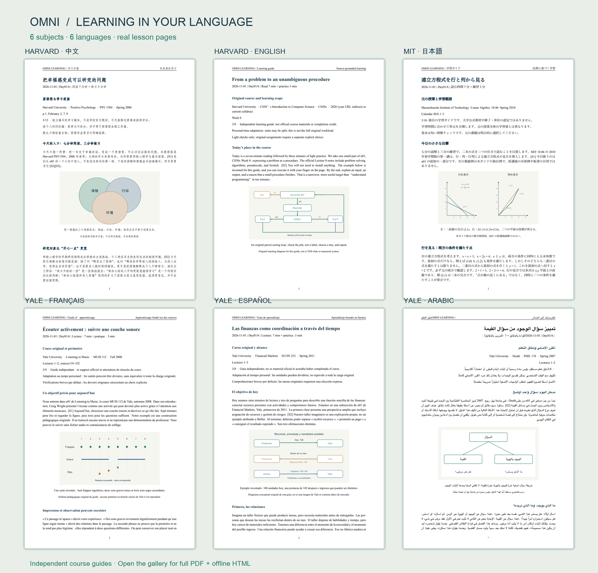

<a href="../../examples/university/README.md"></a>

<div align="center">


# Omni Learning Anything

[](https://github.com/ShawnRen57/omni-learning-anything/releases/latest)
[](../../skills/omni-learning-anything/SKILL.md)
[](../../skills/omni-learning-anything/references/setup.md)
[](../../README.md#choose-your-learning-language)
[](../../skills/omni-learning-anything/references/setup.md)
[](../../LICENSE)
[](https://github.com/ShawnRen57/omni-learning-anything/releases)
[](https://github.com/ShawnRen57/omni-learning-anything/stargazers)

[English](../../README.md) · [简体中文](README_zh.md) · [日本語](README_ja.md) · [한국어](README_ko.md) · [Español](README_es.md) · [Français](README_fr.md) · [Deutsch](README_de.md) · [Português](README_pt.md) · [Русский](README_ru.md) · [العربية](README_ar.md)

**[v3.0.0 スキルZIPをダウンロード](https://github.com/ShawnRen57/omni-learning-anything/releases/latest/download/omni-learning-anything-skill-v3.0.0.zip)**

[skills.sh](https://skills.sh/shawnren57/omni-learning-anything/omni-learning-anything) · [導入経路](../../docs/distribution-channels.md)

</div>

**大学の名講義から選ぶことも、自分の本や論文から始めることも。自分のペースで学び、短い確認問題・フィードバック・復習を通じて理解を深め、ローカルファイルやクラウド文書に保存できます。**

「学びたい」を、続けられる学習計画へ。公開資料に基づく12の大学講義の学習パス、個人の目標、手元の教材から始められます。授業を始める前に計画を確認します。

**「ハーバードのポジティブ心理学を学びたい」** の一言から始められます。Agent は元の授業を特定し、すでに伝えた情報を使い、計画に必要な点だけを確認します。

## v3.0.0 の新機能

- **12の大学講義の学習パス：** ハーバード、イェール、MIT、スタンフォードの公開資料を起点に、学習内容を選べます。
- **無理なく続くペース：** 元の単元順と資料との対応を保ち、使える時間に合わせて学習を分割します。
- **実際の多言語サンプル：** 6言語・6分野の計画と初日の学習ガイドを、PDFとHTMLで確認できます。
- **最初の一歩を案内：** インストール後や初回利用時、テーマが未定ならホストのエージェントが現在のチャットでコースを案内できます。スキル自体は新しいチャットを開けません。

<a id="university-courses"></a>
## 内蔵の大学講義を選ぶ

**「内蔵コースを見せて」**と伝えてください。講義、学習言語、使える時間を選ぶと、資料と対応する計画が提案されます。公開講義の資料に基づく独立した学習パスであり、講義の全内容は同梱していません。大学の公認や修了証を意味するものではありません。

| 大学 | 講義と原題 | 参照版 |
| --- | --- | --- |
| Harvard | [ポジティブ心理学 / Positive Psychology](https://ppc.sas.upenn.edu/sites/default/files/ppsyllabusschachar.pdf) | PSY 1504 · 2006年春学期 · Tal Ben-Shahar |
| Harvard | [コンピュータ科学入門 / CS50x: Introduction to Computer Science](https://cs50.harvard.edu/x/2026/syllabus/) | CS50x · 2026 · David Malan |
| Harvard | [正義 / Justice](https://sandel.scholars.harvard.edu/justice) | 公開講義シリーズ・全24回 · Michael Sandel |
| Yale | [心理学入門 / Introduction to Psychology](https://oyc.yale.edu/introduction-psychology/psyc-110) | PSYC 110 · 2007年春学期 · Paul Bloom |
| Yale | [金融市場 / Financial Markets](https://oyc.yale.edu/economics/econ-252) | ECON 252 · 2011年春学期 · Robert Shiller |
| Yale | [ゲーム理論 / Game Theory](https://oyc.yale.edu/economics/econ-159) | ECON 159 · 2007年秋学期 · Ben Polak |
| Yale | [死 / Death](https://oyc.yale.edu/death/phil-176) | PHIL 176 · 2007年春学期 · Shelly Kagan |
| Yale | [音楽鑑賞 / Listening to Music](https://oyc.yale.edu/music/musi-112) | MUSI 112 · 2008年秋学期 · Craig Wright |
| MIT | [コンピュータ科学とPythonプログラミング入門 / Introduction to Computer Science and Programming in Python](https://ocw.mit.edu/courses/6-0001-introduction-to-computer-science-and-programming-in-python-fall-2016/) | 6.0001 · 2016年秋学期 |
| MIT | [線形代数 / Linear Algebra](https://ocw.mit.edu/courses/18-06-linear-algebra-spring-2010/) | 18.06 · 2010年春学期 · Gilbert Strang |
| MIT | [古典力学 / Classical Mechanics](https://ocw.mit.edu/courses/8-01sc-classical-mechanics-fall-2016/) | 8.01SC · 2016年秋学期 |
| Stanford | [機械学習 / Machine Learning](https://cs229.stanford.edu/syllabus-autumn2018.html) | CS229 · 2018年秋学期 |

1日10分で進めるのは小さな学習単位です。元の講義1回分や全課程が10分で終わるわけではありません。元の学習量を明示し、長い読書・演習・プロジェクトには別途時間を見込みます。資料の内容や公開状況は変わることがあります。

## 自分の教材で学ぶ

PDF、TXT、Markdown、HTML、DOCX、EPUB、PPTX、SRT、VTTに対応。章・ページ・タイムスタンプを指定し、外部資料の補足を許可するかも選べます。説明や確認問題は元の箇所と対応づけます。旧形式のDOC・RTFは信頼できるツールで先に変換してください。

「経済学を少し知りたい」のような漠然とした希望からも始められます。エージェントは方向性と前提を示し、計画に関わることだけを尋ねます。具体的な目標があればそのまま計画へ進みます。

<a id="choose-your-learning-language"></a>
## 学習言語を選ぶ

**English · 简体中文 · 日本語 · 한국어 · Español · Français · Deutsch · Português · Русский · العربية**

計画とレッスンは上記10言語に対応します。資料やこのページの言語とは別に選べます。アラビア語文書は右から左のレイアウトです。

## コースの保存先を選ぶ

| 保存先 | 使い方 |
| --- | --- |
| PDF · HTML · DOCX · Markdown | フォルダとPDF・HTML・DOCX・Markdownを指定。HTMLは挿絵を1つのオフラインファイルに収めます。外部リンクには通信が必要です。 |
| Notion | 公式 `ntn` CLIで親ページに接続。 |
| Obsidian | 既存のローカルVaultと保存フォルダを指定。Obsidian APIは使いません。 |
| Feishu / 飞书 | 公式 `lark` CLIとユーザー認証で文書フォルダに接続。 |
| DingTalk / 钉钉 | 公式 `dws` CLIでフォルダに接続。組織の承認が必要な場合があります。 |
| Tencent Docs / 腾讯文档 | ルートまたはフォルダを選び、公式OAuth/MCP認証を行います。 |

保存先を伝えると、既存の権限を確認し、必要な設定を案内して、名前を付けた接続を再利用します。パスワードやトークンをチャットに貼らないでください。

<a id="quick-start"></a>
## インストールして始める

エージェントに最新版のインストールと、このクライアントからスキルを使えるかの確認を依頼します。更新時は既存のコースと接続を保持します。Node.jsがあれば次を実行します。

```sh
npx skills@latest add ShawnRen57/omni-learning-anything --skill omni-learning-anything -g
```

Claude Codeではプラグインインストーラーを使えます。

```text
/plugin install omni-learning-anything --marketplace ShawnRen57/omni-learning-anything
```

Node.jsがなくても、上のZIPをクライアントにアップロードするか、エージェントに導入を依頼できます。`skills.sh` は公開中、SkillHubの掲載版は現在v2.6.0です。各経路のバージョンは配布ガイドで確認してください。

## 最初のコースを試す

```text
内蔵コースを見せて。MIT 線形代数 18.06、2010年春を使いたいです。
初心者向けに、日本語で1日20分の計画を作ってください。
元の単元順と学習量を明示してください。
オフラインHTMLで保存し、まず計画を見せてください。
```

「このEPUBの最初の2章を1回15分で学びたい」「イェールの金融市場2011年版で金融機関を理解したい」からも始められます。

計画を承認したら最初のレッスンを依頼します。再開時は「最も早い未配信のレッスンから続けて」と伝えます。必要なら一時停止できます。予約実行はホストが対応し、時刻とタイムゾーンを合意した場合のみ利用できます。指定時刻に生成が始まり、調査・確認後に届きます。

## 確認問題・フィードバック・復習

理解を確かめたいときに、カードまたはテキストで1〜3問を依頼できます。資料に基づくフィードバックやヒントが返り、希望すれば長いテストも可能です。学習記録は裏側で更新し、読み進める流れを妨げません。

「今日は何を復習すればいい？」で、既存の時間枠に収まる短い復習を提案します。「今週の回答から何が分かる？」で根拠付きの振り返りも可能です。判断の修正、項目の除外、新しいレッスンの優先を選べます。自動の追加テストやタイマーは作りません。

今後のレッスン変更は承認後に新しい版として開始します。元の計画と履歴は残ります。Anki用CSVの一方向エクスポートも任意で利用でき、自動同期は行いません。

<a id="examples"></a>
## 6言語の実際のサンプル

上の画像から、6つの実際のサンプル集を開けます。各セットに部分的な6日間の計画と、単独でも読めるDay 01の学習ガイドをPDF・HTMLで収録しています。大学の全課程や公式教材ではありません。

| 言語 | サンプルのテーマ |
| --- | --- |
| 中国語 · 简体中文 | ハーバード ポジティブ心理学 |
| 英語 · English | ハーバード CS50 |
| 日本語 | MIT 線形代数 |
| フランス語 · Français | イェール 音楽鑑賞 |
| スペイン語 · Español | イェール 金融市場 |
| アラビア語 · العربية | イェール 死 |

[大学講義カタログとサンプルを開く](../../examples/university/README.md)

以前のPDFサンプルも引き続き閲覧できます。

[テクノロジー](../../examples/technology/) · [経済学](../../examples/economics/) · [音楽](../../examples/music/) · [エージェント製品](../../examples/agent-product/) · [建築](../../examples/architecture/) · [明朝史](../../examples/ming-history/)

<a id="versions"></a>
## バージョンガイド

| 版 | 学習へのメリット |
| --- | --- |
| **v3.0.0** | 大学講義のパスを選び、参照版と多言語文書の実例を確認。 |
| **v2.3–v2.6** | 短い確認問題、手元の教材、必要な復習、簡単な導入と更新。 |
| **v2** | 10言語・4形式と、接続した文書サービスへの保存。 |
| **v1** | 個人の計画を承認し、挿絵・練習・参考資料付きPDFで学習。 |

## ガイドと動作条件

[導入と更新](../../skills/omni-learning-anything/references/install.md) · [形式とフォント](../../skills/omni-learning-anything/references/setup.md) · [文書サービスとの接続](../../skills/omni-learning-anything/references/onboarding.md) · [配布状況](../../docs/distribution-channels.md) · [v3.0.0 検証記録](../../docs/release-validation-v3.0.0.md)

ホストの調査・文書作成・予約機能を使うAgent Skillです。PDFのみXeLaTeXが必要です。クラウドへのアクセス、端末間同期、無人配信はホスト・アカウント・権限に依存します。現在のクライアントを確認し、全環境での動作を前提にはしません。

[MIT](../../LICENSE) · [Changelog](../../CHANGELOG.md) · [Attribution](../../ATTRIBUTION.md)
