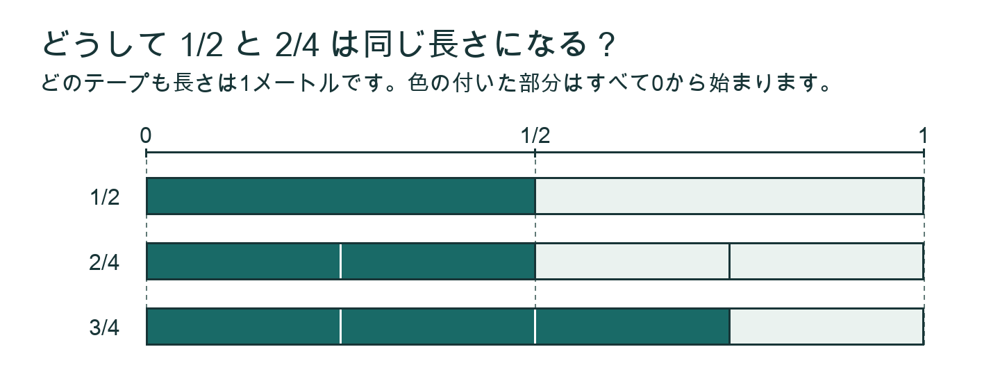
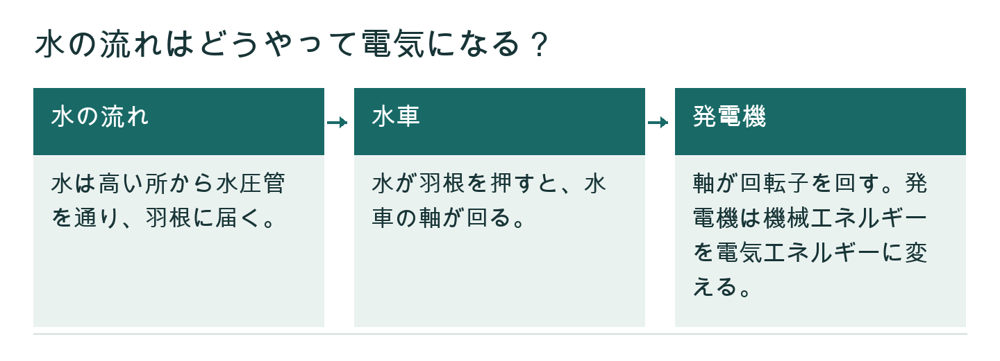
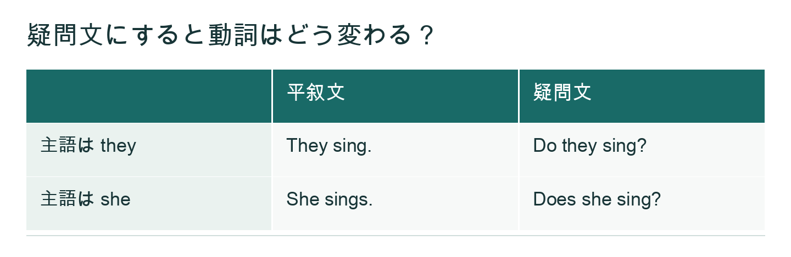

<div align="center">


# Omni Learning Anything

[](https://github.com/ShawnRen57/omni-learning-anything/releases/latest)
[](../../skills/omni-learning-anything/SKILL.md)
[](../../skills/omni-learning-anything/references/setup.md)
[](../../README.md#choose-your-learning-language)
[](../../skills/omni-learning-anything/references/setup.md)
[](../../LICENSE)
[](https://github.com/ShawnRen57/omni-learning-anything/releases)
[](https://github.com/ShawnRen57/omni-learning-anything/stargazers)

[](#output-destinations)
[](#output-destinations)
[](#output-destinations)
[](#output-destinations)

[](#output-destinations)
[](#output-destinations)
[](#output-destinations)
[](#output-destinations)
[](#output-destinations)

[English](../../README.md) · [简体中文](README_zh.md) · [日本語](README_ja.md) · [한국어](README_ko.md) · [Español](README_es.md) · [Français](README_fr.md) · [Deutsch](README_de.md) · [Português](README_pt.md) · [Русский](README_ru.md) · [العربية](README_ar.md)

**[v5.0.0 スキルZIPをダウンロード](https://github.com/ShawnRen57/omni-learning-anything/releases/download/v5.0.0/omni-learning-anything-skill-v5.0.0.zip)**

[skills.sh](https://skills.sh/shawnren57/omni-learning-anything/omni-learning-anything) · [導入経路](../../docs/distribution-channels.md)

</div>

**v5.0** · 135 件の学習リソースから選べます。母語で外国語を学び、解答を分けた練習問題を使えます。図には、どこを見て何を読み取るかを示す問いが付きます。 [資料一覧](../curated-learning-resources.md) · [語学学習の例](../../examples/languages/README.md)

**大学の名講義から選ぶことも、自分の本や論文から始めることも。自分のペースで学び、短い確認問題・フィードバック・復習を通じて理解を深め、ローカルファイルやクラウド文書に保存できます。**

公開講義、書籍、記事、講演から興味のある資料を選ぶか、手元の教材を持ち込めます。目標と使える時間を伝え、各日の計画を確認してから学習を始めます。

**「ハーバードのポジティブ心理学を学びたい」** の一言から始められます。Agent は元の授業を特定し、すでに伝えた情報を使い、計画に必要な点だけを確認します。

| 機能 | 概要 |
| --- | --- |
| 個別の学習計画 | 興味や目標を、前提知識と使える時間に合うコースにします。 |
| 学習リソース | 67 の学習パスに加え、68 件の講義、書籍、記事、講演を収録。出典と利用条件を確認できます。 |
| 母語で外国語を学ぶ | 場面ごとに表現を学び、意味から外国語を思い出す練習と、その逆の練習をします。復習用の問題と解答は別々に用意できます。 |
| 中国本土の教科書 | 小学校から高校まで 1,949 件を検索し、巻・章・概念・公式を指定。学年に合わせた説明と原図を収録します。 |
| 手持ちの資料 | PDF、DOCX、EPUB、PPTX、HTML、Markdown、TXT、SRT、VTT のページ・章・時間範囲を選びます。 |
| 出典と追加資料 | 要点から参照先のページ、章、時刻、ウェブ資料へたどれます。 |
| 計画の承認 | 各日の内容と所要時間を確認してから学習を開始します。 |
| 図を読み解く | 目盛り、矢印、対応する行を手掛かりに問いを解き、出典で確かめます。 |
| 10 言語 | 原典とは別に学習言語を選べます。アラビア語は右から左に表示します。 |
| ローカル形式 | PDF、オフライン HTML、DOCX、Markdown。 |
| 保存先 | ローカルの Obsidian、認可済みの Notion、Feishu、DingTalk、Tencent Docs。 |
| 短い確認問題 | 1～3 問。チャットまたは対応カードで回答し、ヒントや中断・再開もできます。 |
| 回答へのフィードバック | 根拠を示して良かった点と改善点を伝え、再回答や判断の訂正を受け付けます。 |
| 学習記録と復習 | 回答に基づいて短く復習し、振り返りや記録の出力・削除ができます。 |
| 計画の見直し | 目標や回答をもとに今後の計画を提案し、承認後に別のコース版を作ります。 |
| Anki | 復習問題を CSV で書き出せます。 |
| 再開と配信 | 未配信のレッスンから続けられます。定期配信はホストの機能を使います。 |
| インストールと更新 | 対応エージェントへの導入と認識確認。コースはインストール先と別に保存します。 |

<a id="examples"></a>

## 学習資料の実例

| 等しい分数 | 水力発電 | 英語の疑問文 |
| --- | --- | --- |
| <a href="../assets/figures/equivalent-fractions-ja.png"></a> | <a href="../assets/figures/hydropower-ja.png"></a> | <a href="../assets/figures/present-simple-ja.png"></a> |
| 色を塗った部分が同じ位置で終わるのは、どの 2 本ですか？ | 水車から発電機へ何が伝わりますか？ | She sings の -s は疑問文にするとどうなりますか？ |
| [OpenStax](https://openstax.org/books/prealgebra-2e/pages/4-1-visualize-fractions) | [米国エネルギー省](https://www.energy.gov/cmei/water/how-hydropower-works) | [British Council](https://learnenglish.britishcouncil.org/free-resources/grammar/english-grammar-reference/present-simple) |

| 学習テーマ | 開いて試せる資料 |
| --- | --- |
| 外国語 | [中国語で学ぶ日本語・3 日間の計画](../../examples/languages/zh-ja/plan.md) · [3 日目の会話課題](../../examples/languages/zh-ja/day03-task.md) · [英語で学ぶドイツ語・第 1 課](../../examples/languages/en-de/day01.md) · [練習問題](../../examples/languages/en-de/worksheet.md) |
| 学校・大学 | [中国語の教科書レッスン 5 件](../../examples/textbooks/README.md) · [大学講義の多言語サンプル](../../examples/university/README.md) · [MIT 線形代数（日本語 PDF）](../../examples/university/linear-algebra-ja/Day01.pdf) · [サンプル一覧](../../examples/README.md) |
| 図を読む教材（中国語） | [予算内の航空券を選ぶ](../../examples/agent-product/pdf/Agent%E4%BA%A7%E5%93%81%E8%AE%BE%E8%AE%A1_%E6%AF%8F%E6%97%A5%E5%AD%A6%E4%B9%A0_Day01_%E4%BB%8E%E8%81%8A%E5%A4%A9%E5%9B%9E%E7%AD%94%E5%88%B0%E5%AE%8C%E6%88%90%E4%BB%BB%E5%8A%A1.pdf) · [エージェントのフィードバック経路をたどる](../../examples/agent-product/pdf/Agent%E4%BA%A7%E5%93%81%E8%AE%BE%E8%AE%A1_%E6%AF%8F%E6%97%A5%E5%AD%A6%E4%B9%A0_Day02_%E5%B7%A5%E4%BD%9C%E6%B5%81%E4%B8%8EAgent%E5%A6%82%E4%BD%95%E9%80%89%E6%8B%A9.pdf) · [明代の絵巻と収蔵記録を照合する](../../examples/ming-history/pdf/%E6%98%8E%E6%9C%9D%E5%8E%86%E5%8F%B2_%E6%AF%8F%E6%97%A5%E5%AD%A6%E4%B9%A0_Day01_%E6%97%B6%E9%97%B4%E7%BA%BF%E4%B8%8E%E5%8F%B2%E6%96%99%E5%A6%82%E4%BD%95%E4%BD%BF%E7%94%A8.pdf) · [スマホの読み取りから応答までを追う](../../examples/technology/pdf/%E7%A7%91%E6%8A%80%E9%80%9A%E8%AF%86_%E6%AF%8F%E6%97%A5%E5%AD%A6%E4%B9%A0_Day01_%E4%BB%8E%E6%89%8B%E6%9C%BA%E7%9C%8B%E6%8A%80%E6%9C%AF%E7%B3%BB%E7%BB%9F.pdf) · [自習にまた参加したい人の割合を比べる](../../examples/university/positive-psychology-zh/Day01.pdf) |

<a href="../../examples/README.md"></a>

<a id="versions"></a>
## バージョンガイド

| 版 | 学習へのメリット |
| --- | --- |
| **v5.0.0** | 母語を使った外国語コース、出典と問いを添えた図解、135 件の学習リソースに対応。 |
| **v4.0–4.2** | 教科書の年版や最新版を検索し、原図付きで学習。新しい場面に知識を応用する確認問題を追加。 |
| **v3.0.0** | 大学講義のパスを選び、参照版と多言語文書の実例を確認。 |
| **v2.3–v2.6** | 短い確認問題、手元の教材、必要な復習、簡単な導入と更新。 |
| **v2** | 10言語・4形式と、接続した文書サービスへの保存。 |
| **v1** | 個人の計画を承認し、挿絵・練習・参考資料付きPDFで学習。 |

<a id="university-courses"></a>
## 講座・学習資料を探す

タイトル、テーマ、提供元で探せます。たとえば **「言語をテーマにした TED の講演を探して」** や **「イェール大学の Modern Poetry で学習計画を立てて」** と頼んでください。章や講演を選び、学習言語と使える時間を伝えて、始める前に計画を確認します。

タイトルから元の資料を開けます。出版社の書誌情報だけが公開されている場合は、自分が閲覧できる章を使います。 [講座の版と担当教員](../course-catalog-sources.md) · [資料の利用条件](../curated-learning-resources.md)

<!-- catalog:start -->

| 大学・機関・著者 | 講座と教材 (135) |
| --- | --- |
| 清華大学 | **講座** [中国建筑史——史前至两宋辽金](https://higher.smartedu.cn/course/687eb7bf16c43a09c0e58c23) · [文物精品与文化中国](https://higher.smartedu.cn/course/6a5e9b52b44e493c768f8c9c) · [中国建筑史（下）（自主模式）](https://v1-www.xuetangx.com/courses/course-v1%3ATsinghuaX%2B80000901X_2%2Bsp/about) · [艺术的启示](https://higher.smartedu.cn/course/6786ec4c225d72705e5dc29e) · [校园风物与大学文化——以清华大学为例](https://higher.smartedu.cn/course/6a5e9b60b44e493c768f8cba) · [数据结构(上)](https://www.xuetangx.com/course/THU08091000384/) · [大学历史与文化](https://next.xuetangx.com/course/THU04011000284/29592783)<br>**公開参考資料** [人工智能通识教育红皮书](https://aige.cs.tsinghua.edu.cn/redbook/) |
| 北京大学 | **講座** [经典昆曲欣赏](https://www.icourse163.org/course/PKU-1470426173?tid=1474265476) · [人工智能与信息社会](https://www.icourse163.org/course/PKU-1003471009?tid=1476756462) · [西方音乐欣赏](https://www.icourse163.org/course/PKU-1207132813?tid=1207476216) · [人工智能原理](https://www.icourse163.org/course/PKU-1002188003?tid=1472399493) · [语言学概论](https://www.icourse163.org/course/PKU-1205727813) · [古代汉语](https://www.icourse163.org/course/PKU-1205726807) · [生理学（上）](https://www.icourse163.org/course/PKU-1205915814) |
| 復旦大学 | **講座** [人工智能，语言与伦理](https://www.icourse163.org/course/FUDAN-1205951803?tid=1475942449) · [比较文化研究](https://umoocs.unipus.cn/course/7944/tasks) · [深度学习及其应用](https://higher.smartedu.cn/course/622ac9f0bee70ef79f419877) · [中华优秀传统文化](https://higher.smartedu.cn/course/63ffd464af1f1b5d3ecfd579) · [政治学原理](https://www.icourse163.org/course/FUDAN-1461787179?tid=1462604462) · [古典诗词鉴赏](https://www.icourse163.org/course/FUDAN-1205950804) |
| 上海交通大学 | **講座** [唐诗宋词人文解读](https://higher.smartedu.cn/course/69b0942995df98bb27ba19b4) · [数学的天空](https://higher.smartedu.cn/course/690530295345b68214577952) · [机器的征途：空天科技](https://higher.smartedu.cn/course/62354d7a9906eace0490b2aa) · [经济法](https://higher.smartedu.cn/course/67c2473d225d72705e7bb8c8) · [关爱生命——急救与自救技能](https://higher.smartedu.cn/course/69b0942695df98bb27ba19a1) · [建筑物理](https://www.icourse163.org/course/SJTU-1472028164) · [造型基础—设计素描](https://www.icourse163.org/course/SJTU-1206432804) · [设计创新的艺术](https://www.icourse163.org/course/SJTU-1207170808) |
| 浙江大学 | **講座** [唐诗经典](https://higher.smartedu.cn/course/6982720195df98bb27cadb06) |
| 北京師範大学 | **講座** [书法欣赏](https://www.icourse163.org/course/BNU-1003240002?tid=1488313456) |
| ハーバード大学 | **講座** [Positive Psychology](https://ppc.sas.upenn.edu/sites/default/files/ppsyllabusschachar.pdf) · [CS50’s Introduction to Computer Science](https://cs50.harvard.edu/x/2026/syllabus/) · [Justice](https://sandel.scholars.harvard.edu/justice) · [Rhetoric: The Art of Persuasive Writing and Public Speaking](https://pll.harvard.edu/course/rhetoric-art-persuasive-writing-and-public-speaking) · [CS50’s Introduction to Artificial Intelligence with Python](https://cs50.harvard.edu/ai/) · [Masterpieces of World Literature](https://www.edx.org/learn/literature/harvard-university-masterpieces-of-world-literature) · [Pyramids of Giza: Ancient Egyptian Art and Archaeology](https://giza.fas.harvard.edu/videos/) |
| イェール大学 | **講座** [Introduction to Psychology](https://oyc.yale.edu/introduction-psychology/psyc-110) · [Financial Markets](https://oyc.yale.edu/economics/econ-252) · [Game Theory](https://oyc.yale.edu/economics/econ-159) · [Death](https://oyc.yale.edu/death/phil-176) · [Listening to Music](https://oyc.yale.edu/music/musi-112/lecture-1) · [Roman Architecture](https://oyc.yale.edu/history-of-art/hsar-252) · [Introduction to Theory of Literature](https://oyc.yale.edu/english/engl-300) · [The Atmosphere, the Ocean, and Environmental Change](https://oyc.yale.edu/geology-and-geophysics/gg-140) · [European Civilization, 1648-1945](https://oyc.yale.edu/history/hist-202) · [Philosophy and the Science of Human Nature](https://oyc.yale.edu/philosophy/phil-181) · [Principles of Evolution, Ecology and Behavior](https://oyc.yale.edu/ecology-and-evolutionary-biology/eeb-122) · [Introduction to Ancient Greek History](https://oyc.yale.edu/classics/clcv-205) · [The American Revolution](https://oyc.yale.edu/history/hist-116) · [Modern Poetry](https://oyc.yale.edu/english/engl-310) · [Capitalism: Success, Crisis, and Reform](https://oyc.yale.edu/political-science/plsc-270) · [Frontiers and Controversies in Astrophysics](https://oyc.yale.edu/astronomy/astr-160) · [Fundamentals of Physics I](https://oyc.yale.edu/physics/phys-200) · [Frontiers of Biomedical Engineering](https://oyc.yale.edu/biomedical-engineering/beng-100) · [The Psychology, Biology and Politics of Food](https://oyc.yale.edu/psychology/psyc-123) · [Milton](https://oyc.yale.edu/english/engl-220) |
| マサチューセッツ工科大学 | **講座** [Introduction to Computer Science and Programming in Python](https://ocw.mit.edu/courses/6-0001-introduction-to-computer-science-and-programming-in-python-fall-2016/video_galleries/lecture-videos/) · [Linear Algebra](https://ocw.mit.edu/courses/18-06-linear-algebra-spring-2010/pages/calendar/) · [Classical Mechanics](https://ocw.mit.edu/courses/8-01sc-classical-mechanics-fall-2016/) · [Introduction to Art History](https://ocw.mit.edu/courses/4-601-introduction-to-art-history-fall-2018/pages/calendar/) · [Principles of Microeconomics](https://ocw.mit.edu/courses/14-01-principles-of-microeconomics-fall-2023/pages/calendar/) · [Art Since 1940](https://ocw.mit.edu/courses/4-651-art-since-1940-fall-2010/pages/lecture-notes/) · [Philosophy of Film](https://ocw.mit.edu/courses/24-213-philosophy-of-film-fall-2004/pages/calendar/) · [Introduction to Deep Learning](https://introtodeeplearning.com/2026/index.html) · [Introduction to Sustainable Energy](https://ocw.mit.edu/courses/22-081j-introduction-to-sustainable-energy-fall-2010/pages/calendar/)<br>**学術書 · MIT Press** [Deep Learning](https://www.deeplearningbook.org/) · [Probabilistic Machine Learning: An Introduction](https://probml.github.io/pml-book/book1.html) · [Reinforcement Learning: An Introduction](https://mitpress.mit.edu/9780262039246/reinforcement-learning/) |
| スタンフォード大学 | **講座** [Machine Learning](https://cs229.stanford.edu/syllabus-autumn2018.html) · [Deep Learning for Computer Vision](https://cs231n.stanford.edu/2026/schedule.html)<br>**学術書** [Speech and Language Processing](https://web.stanford.edu/~jurafsky/slp3/) · [Convex Optimization](https://web.stanford.edu/~boyd/cvxbook/) · [Introduction to Applied Linear Algebra – Vectors, Matrices, and Least Squares](https://web.stanford.edu/~boyd/vmls/)<br>**解説記事 · Stanford Encyclopedia of Philosophy** [Aesthetic Judgment](https://plato.stanford.edu/entries/aesthetic-judgment/) · [Scientific Method](https://plato.stanford.edu/entries/scientific-method/) · [Personal Identity](https://plato.stanford.edu/entries/identity-personal/) · [Justice](https://plato.stanford.edu/entries/justice/) · [Chinese Ethics](https://plato.stanford.edu/entries/ethics-chinese/) · [The Philosophy of Music](https://plato.stanford.edu/entries/music/) |
| ヘルシンキ大学・MinnaLearn | **講座** [Elements of AI: Introduction to AI](https://opin.fi/en/study-options/HY/elements-of-ai-introduction-to-ai/89eb0e79-873e-4d2a-aec5-d694d7762118) · [Elements of AI: Building AI](https://buildingai.elementsofai.com/) |
| OpenAI Academy | **講座** [AI Foundations](https://academy.openai.com/public/courses/ai-foundations-dnq5w) · [Applied AI Foundations](https://academy.openai.com/public/courses/applied-ai-foundations-szsmv) · [Agents and Workflows](https://academy.openai.com/public/courses/agents-and-workflows-y0qoc) · [AI for College Students](https://academy.openai.com/public/courses/ai-for-college-students-gxgmr) |
| Anthropic · Claude Academy | **講座** [AI Fluency: Framework and foundations](https://academy.claude.com/courses/ai-fluency-framework-foundations) · [AI Fluency for students](https://academy.claude.com/courses/ai-fluency-for-students) · [AI Fluency for educators](https://academy.claude.com/courses/ai-fluency-for-educators) |
| Hugging Face | **講座** [AI Agents Course](https://huggingface.co/learn/agents-course/unit0/introduction) |
| カリフォルニア大学バークレー校 | **講座** [Introduction to Artificial Intelligence](https://inst.eecs.berkeley.edu/~cs188/sp26/) |
| DeepLearning.AI | **講座** [AI For Everyone](https://www.coursera.org/learn/ai-for-everyone/) · [Generative AI for Everyone](https://www.coursera.org/learn/generative-ai-for-everyone/) |
| Microsoft | **講座** [Generative AI for Beginners](https://github.com/microsoft/generative-ai-for-beginners/blob/79a4334e158147d4f36c27d805e0cb163c1e445b/README.md#-lessons) |
| Google | **講座** [Google AI Essentials](https://grow.google/ai-essentials/) |
| Smarthistory | **公開参考資料** [Reframing Art History](https://smarthistory.org/reframing-art-history/) |
| ライス大学・OpenStax | **教科書** [Astronomy 2e](https://openstax.org/books/astronomy-2e/pages/preface) · [Biology 2e](https://openstax.org/books/biology-2e/pages/preface) · [Psychology 2e](https://openstax.org/books/psychology-2e/pages/preface) · [Introduction to Sociology 3e](https://openstax.org/books/introduction-sociology-3e/pages/preface) · [Principles of Economics 3e](https://openstax.org/books/principles-economics-3e/pages/preface) · [Chemistry 2e](https://openstax.org/books/chemistry-2e/pages/preface) · [University Physics Volume 1](https://openstax.org/books/university-physics-volume-1/pages/preface) · [Calculus Volume 1](https://openstax.org/books/calculus-volume-1/pages/preface) · [World History Volume 1, to 1500](https://openstax.org/books/world-history-volume-1/pages/preface) · [Introduction to Philosophy](https://openstax.org/books/introduction-philosophy/pages/preface) · [Introductory Statistics 2e](https://openstax.org/books/introductory-statistics-2e/pages/preface) · [Entrepreneurship](https://openstax.org/books/entrepreneurship/pages/preface) · [Business Ethics](https://openstax.org/books/business-ethics/pages/preface) |
| 『Dive into Deep Learning』著者チーム | **学術書** [动手学深度学习](https://zh.d2l.ai/) |
| O’Reilly | **学術書** [R for Data Science (2e)](https://r4ds.hadley.nz/) |
| Distill | **解説記事** [Attention and Augmented Recurrent Neural Networks](https://distill.pub/2016/augmented-rnns/) · [How to Use t-SNE Effectively](https://distill.pub/2016/misread-tsne/) · [Feature Visualization](https://distill.pub/2017/feature-visualization/) · [Why Momentum Really Works](https://distill.pub/2017/momentum/) · [Deconvolution and Checkerboard Artifacts](https://distill.pub/2016/deconv-checkerboard/) · [A Gentle Introduction to Graph Neural Networks](https://distill.pub/2021/gnn-intro/) · [Computing Receptive Fields of Convolutional Neural Networks](https://distill.pub/2019/computing-receptive-fields/) · [A Visual Exploration of Gaussian Processes](https://distill.pub/2019/visual-exploration-gaussian-processes/) |
| カリフォルニア工科大学 | **連続講演** [The Feynman Lectures on Physics, Volume I](https://www.feynmanlectures.caltech.edu/I_toc.html) · [The Feynman Lectures on Physics, Volume II](https://www.feynmanlectures.caltech.edu/II_toc.html) · [The Feynman Lectures on Physics, Volume III](https://www.feynmanlectures.caltech.edu/III_toc.html) |
| 英国王立研究所 | **連続講演** [The truth about AI](https://www.rigb.org/christmas-lectures/watch-2023-christmas-lectures)<br>**講演** [Growing up in the universe – Waking up in the universe (1991)](https://www.rigb.org/explore-science/explore/video/growing-universe-waking-universe-1991) |
| TED | **講演** [How language shapes the way we think](https://www.ted.com/talks/lera_boroditsky_how_language_shapes_the_way_we_think) · [The danger of a single story](https://www.ted.com/talks/chimamanda_ngozi_adichie_the_danger_of_a_single_story) · [The best stats you’ve ever seen](https://www.ted.com/talks/hans_rosling_the_best_stats_you_ve_ever_seen) · [Do schools kill creativity?](https://www.ted.com/talks/sir_ken_robinson_do_schools_kill_creativity) · [The power of introverts](https://www.ted.com/talks/susan_cain_the_power_of_introverts) · [Inside the mind of a master procrastinator](https://www.ted.com/talks/tim_urban_inside_the_mind_of_a_master_procrastinator) · [10 ways to have a better conversation](https://www.ted.com/talks/celeste_headlee_10_ways_to_have_a_better_conversation) · [How to speak so that people want to listen](https://www.ted.com/talks/julian_treasure_how_to_speak_so_that_people_want_to_listen) · [The power of vulnerability](https://www.ted.com/talks/brene_brown_the_power_of_vulnerability) · [We should all be feminists](https://www.ted.com/talks/chimamanda_ngozi_adichie_we_should_all_be_feminists) |

<!-- catalog:end -->

1日10分で進めるのは小さな学習単位です。元の講義1回分や全課程が10分で終わるわけではありません。元の学習量を明示し、長い読書・演習・プロジェクトには別途時間を見込みます。資料の内容や公開状況は変わることがあります。公開講義の資料に基づく独立した学習パスであり、講義の全内容は同梱していません。大学の公認や修了証を意味するものではありません。

## 自分の教材で学ぶ

PDF、TXT、Markdown、HTML、DOCX、EPUB、PPTX、SRT、VTTに対応。章・ページ・タイムスタンプを指定し、外部資料の補足を許可するかも選べます。説明や確認問題は元の箇所と対応づけます。旧形式のDOC・RTFは信頼できるツールで先に変換してください。

「経済学を少し知りたい」のような漠然とした希望からも始められます。エージェントは方向性と前提を示し、計画に関わることだけを尋ねます。具体的な目標があればそのまま計画へ進みます。

<a id="choose-your-learning-language"></a>
## 学習言語を選ぶ

**English · 简体中文 · 日本語 · 한국어 · Español · Français · Deutsch · Português · Русский · العربية**

計画とレッスンは上記10言語に対応します。資料やこのページの言語とは別に選べます。アラビア語文書は右から左のレイアウトです。

<a id="output-destinations"></a>
## コースの保存先を選ぶ

| 保存先 | 使い方 |
| --- | --- |
| PDF · HTML · DOCX · Markdown | フォルダとPDF・HTML・DOCX・Markdownを指定。HTMLは挿絵を1つのオフラインファイルに収めます。外部リンクには通信が必要です。 |
| Notion | 公式 `ntn` CLIで親ページに接続。 |
| Obsidian | 既存のローカルVaultと保存フォルダを指定。Obsidian APIは使いません。 |
| Feishu / 飞书 | 公式 `lark` CLIとユーザー認証で文書フォルダに接続。 |
| DingTalk / 钉钉 | 公式 `dws` CLIでフォルダに接続。組織の承認が必要な場合があります。 |
| Tencent Docs / 腾讯文档 | ルートまたはフォルダを選び、公式OAuth/MCP認証を行います。 |

保存先を伝えると、既存の権限を確認し、必要な設定を案内して、名前を付けた接続を再利用します。パスワードやトークンをチャットに貼らないでください。

<a id="quick-start"></a>
## インストールして始める

エージェントに最新版のインストールと、このクライアントからスキルを使えるかの確認を依頼します。更新時は既存のコースと接続を保持します。Node.jsがあれば次を実行します。

```sh
npx skills@latest add ShawnRen57/omni-learning-anything --skill omni-learning-anything -g
```

Claude Codeではプラグインインストーラーを使えます。

```text
/plugin install omni-learning-anything --marketplace ShawnRen57/omni-learning-anything
```

Node.jsがなくても、上のZIPをクライアントにアップロードするか、エージェントに導入を依頼できます。`skills.sh` は公開中、SkillHubの掲載版は現在v2.6.0です。各経路のバージョンは配布ガイドで確認してください。

## 最初のコースを試す

```text
内蔵コースを見せて。MIT 線形代数 18.06、2010年春を使いたいです。
初心者向けに、日本語で1日20分の計画を作ってください。
元の単元順と学習量を明示してください。
オフラインHTMLで保存し、まず計画を見せてください。
```

「このEPUBの最初の2章を1回15分で学びたい」「イェールの金融市場2011年版で金融機関を理解したい」からも始められます。

計画を承認したら最初のレッスンを依頼します。再開時は「最も早い未配信のレッスンから続けて」と伝えます。必要なら一時停止できます。予約実行はホストが対応し、時刻とタイムゾーンを合意した場合のみ利用できます。指定時刻に生成が始まり、調査・確認後に届きます。

## 確認問題・フィードバック・復習

理解を確かめたいときに、カードまたはテキストで1〜3問を依頼できます。資料に基づくフィードバックやヒントが返り、希望すれば長いテストも可能です。学習記録は裏側で更新し、読み進める流れを妨げません。

「今日は何を復習すればいい？」で、既存の時間枠に収まる短い復習を提案します。「今週の回答から何が分かる？」で根拠付きの振り返りも可能です。判断の修正、項目の除外、新しいレッスンの優先を選べます。自動の追加テストやタイマーは作りません。

今後のレッスン変更は承認後に新しい版として開始します。元の計画と履歴は残ります。Anki用CSVの一方向エクスポートも任意で利用でき、自動同期は行いません。

[WorkBuddy での確認問題・フィードバック・計画見直しの実演](../../README.md#workbuddy-demo)

## ガイドと動作条件

[導入と更新](../../skills/omni-learning-anything/references/install.md) · [形式とフォント](../../skills/omni-learning-anything/references/setup.md) · [文書サービスとの接続](../../skills/omni-learning-anything/references/onboarding.md) · [配布状況](../../docs/distribution-channels.md) · [v3.0.0 検証記録](../../docs/release-validation-v3.0.0.md)

ホストの調査・文書作成・予約機能を使うAgent Skillです。PDFのみXeLaTeXが必要です。クラウドへのアクセス、端末間同期、無人配信はホスト・アカウント・権限に依存します。現在のクライアントを確認し、全環境での動作を前提にはしません。

[MIT](../../LICENSE) · [Changelog](../../CHANGELOG.md) · [Attribution](../../ATTRIBUTION.md)
