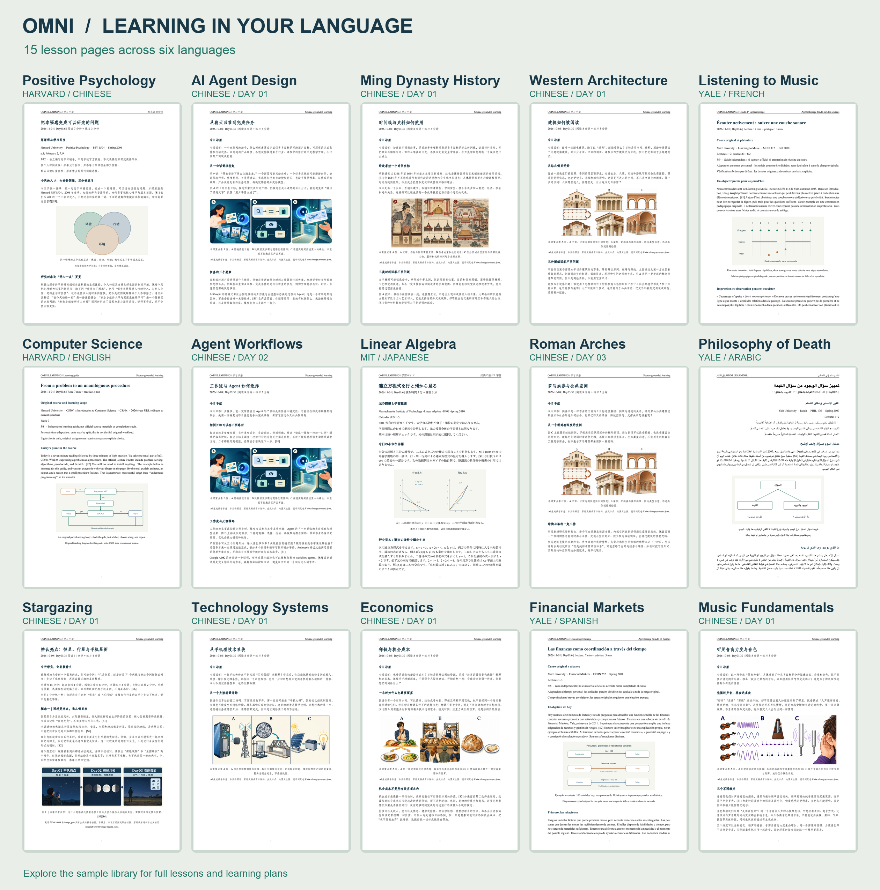

<div align="center">


# Omni Learning Anything

[](https://github.com/ShawnRen57/omni-learning-anything/releases/latest)
[](../../skills/omni-learning-anything/SKILL.md)
[](../../skills/omni-learning-anything/references/setup.md)
[](../../README.md#choose-your-learning-language)
[](../../skills/omni-learning-anything/references/setup.md)
[](../../LICENSE)
[](https://github.com/ShawnRen57/omni-learning-anything/releases)
[](https://github.com/ShawnRen57/omni-learning-anything/stargazers)

[](#output-destinations)
[](#output-destinations)
[](#output-destinations)
[](#output-destinations)

[](#output-destinations)
[](#output-destinations)
[](#output-destinations)
[](#output-destinations)
[](#output-destinations)

[English](../../README.md) · [简体中文](README_zh.md) · [日本語](README_ja.md) · [한국어](README_ko.md) · [Español](README_es.md) · [Français](README_fr.md) · [Deutsch](README_de.md) · [Português](README_pt.md) · [Русский](README_ru.md) · [العربية](README_ar.md)

**[v4.1.0 스킬 ZIP 다운로드](https://github.com/ShawnRen57/omni-learning-anything/releases/download/v4.1.0/omni-learning-anything-skill-v4.1.0.zip)**

[skills.sh](https://skills.sh/shawnren57/omni-learning-anything/omni-learning-anything) · [설치 채널](../../docs/distribution-channels.md)

</div>

**대학 명강의를 고르거나 내 책과 논문으로 시작하세요. 내 속도에 맞춰 배우고, 짧은 확인 문제와 피드백, 복습으로 이해를 다지며 로컬 파일이나 클라우드 문서에 저장하세요.**

“배우고 싶다”를 꾸준히 따라갈 수 있는 계획으로 바꿉니다. 출처가 확인된 67개 학습 경로, 개인 목표, 보유 자료 중에서 시작하고 수업 전에 계획을 확인합니다.

**“하버드 긍정심리학을 배우고 싶어요”** 한 문장으로 시작할 수 있습니다. Agent는 원 강좌를 찾고 이미 전달한 정보를 활용해 계획에 필요한 내용만 추가로 확인합니다.

| 기능 | 설명 |
| --- | --- |
| 맞춤 학습 과정 | 관심사나 목표를 수준과 학습 시간에 맞춘 과정으로 바꿉니다. |
| 내장 강좌 | 강좌 65개와 공개 참고 자료 2개에서 선택하고 원본 판본, 순서, 분량을 확인합니다. |
| 중국 본토 교과서 | 초등학교부터 고등학교까지 1,949개 항목을 검색합니다. 권·단원·개념·공식을 고르고 학년에 맞는 설명과 원본 삽화를 봅니다. |
| 내 자료로 학습 | PDF, DOCX, EPUB, PPTX, HTML, Markdown, TXT, SRT, VTT의 페이지, 장 또는 시간대를 선택합니다. |
| 출처와 더 읽기 | 핵심 설명을 원문 위치나 확인한 웹 출처로 추적할 수 있습니다. |
| 계획 승인 | 일별 주제와 예상 시간을 검토한 뒤 수업을 시작합니다. |
| 그림이 있는 수업 | 설명, 예시, 짧은 연습과 자가 점검을 담습니다. |
| 10개 학습 언어 | 원본 언어와 별도로 선택합니다. 아랍어는 오른쪽에서 왼쪽으로 배치합니다. |
| 로컬 형식 | PDF, 오프라인 HTML, DOCX, Markdown. |
| 저장 위치 | 로컬 Obsidian이나 연결을 승인한 Notion, Feishu, DingTalk, Tencent Docs에 저장합니다. |
| 짧은 확인 문제 | 1~3개를 채팅 또는 지원되는 카드로 답합니다. 힌트, 건너뛰기, 이어 풀기를 지원합니다. |
| 답변 피드백 | 근거와 함께 맞은 점과 보완점을 설명하고, 답변 수정이나 판단 정정을 받습니다. |
| 학습 기록과 복습 | 답변을 토대로 시간 안에서 복습하고 기록을 요약·내보내기·삭제할 수 있습니다. |
| 계획 조정 | 목표나 답변을 바탕으로 조정을 제안하고, 확인 후 별도의 과정 버전을 만듭니다. |
| Anki 내보내기 | 복습 문항을 CSV로 내보냅니다. |
| 이어 학습과 예약 | 미전달 수업을 이어갑니다. 예약은 호스트 기능을 사용합니다. |
| 설치와 업데이트 | 호환 에이전트에서 설치와 인식을 확인합니다. 과정은 설치 폴더 밖에 보관합니다. |

<a id="examples"></a>
<a href="../../examples/README.md"></a>

[중국어 교과서 수업 예시 5개](../../examples/textbooks/README.md)

<a id="versions"></a>
## 버전 안내

| 버전 | 학습에 주는 도움 |
| --- | --- |
| **v3.0.0** | 대학 강좌 경로를 선택하고 자료 버전과 실제 다국어 문서를 확인합니다. |
| **v2.3–v2.6** | 짧은 확인 문제, 개인 자료 학습, 필요한 복습, 편리한 설치와 업데이트. |
| **v2** | 10개 언어, 로컬 형식 4종과 연결된 문서 서비스 저장. |
| **v1** | 개인 계획을 승인하고 삽화, 연습, 추가 읽기가 담긴 PDF로 학습. |

<a id="university-courses"></a>
## 내장 강좌 선택

**“내장 강좌를 보여 줘”**라고 요청하세요. 강좌, 학습 언어, 가용 시간을 정하면 원자료와 연결된 계획을 제안합니다. 공개 강좌 자료를 바탕으로 만든 독립 학습 경로이며 전체 강의 내용은 포함하지 않습니다. 대학의 공식 인증이나 수료증을 뜻하지 않습니다.

[자료 버전 및 접근 조건](../../docs/course-catalog-sources.md)

| 대학·기관 | 강좌 및 공개 자료 |
| --- | --- |
| Tsinghua University | [中国建筑史——史前至两宋辽金](https://higher.smartedu.cn/course/687eb7bf16c43a09c0e58c23) · [文物精品与文化中国](https://higher.smartedu.cn/course/6a5e9b52b44e493c768f8c9c) · [中国建筑史（下）（自主模式）](https://v1-www.xuetangx.com/courses/course-v1%3ATsinghuaX%2B80000901X_2%2Bsp/about) · [艺术的启示](https://higher.smartedu.cn/course/6786ec4c225d72705e5dc29e) · [校园风物与大学文化——以清华大学为例](https://higher.smartedu.cn/course/6a5e9b60b44e493c768f8cba) · [人工智能通识教育红皮书](https://aige.cs.tsinghua.edu.cn/redbook/) *(공개 자료)* |
| Peking University | [经典昆曲欣赏](https://www.icourse163.org/course/PKU-1470426173?tid=1474265476) · [人工智能与信息社会](https://www.icourse163.org/course/PKU-1003471009?tid=1476756462) · [西方音乐欣赏](https://www.icourse163.org/course/PKU-1207132813?tid=1207476216) · [人工智能原理](https://www.icourse163.org/course/PKU-1002188003?tid=1472399493) |
| Fudan University | [人工智能，语言与伦理](https://www.icourse163.org/course/FUDAN-1205951803?tid=1475942449) · [比较文化研究](https://umoocs.unipus.cn/course/7944/tasks) · [深度学习及其应用](https://higher.smartedu.cn/course/622ac9f0bee70ef79f419877) · [中华优秀传统文化](https://higher.smartedu.cn/course/63ffd464af1f1b5d3ecfd579) · [政治学原理](https://www.icourse163.org/course/FUDAN-1461787179?tid=1462604462) |
| Shanghai Jiao Tong University | [唐诗宋词人文解读](https://higher.smartedu.cn/course/69b0942995df98bb27ba19b4) · [数学的天空](https://higher.smartedu.cn/course/690530295345b68214577952) · [机器的征途：空天科技](https://higher.smartedu.cn/course/62354d7a9906eace0490b2aa) · [经济法](https://higher.smartedu.cn/course/67c2473d225d72705e7bb8c8) · [关爱生命——急救与自救技能](https://higher.smartedu.cn/course/69b0942695df98bb27ba19a1) |
| Zhejiang University | [唐诗经典](https://higher.smartedu.cn/course/6982720195df98bb27cadb06) |
| Beijing Normal University | [书法欣赏](https://www.icourse163.org/course/BNU-1003240002?tid=1488313456) |
| Harvard University | [Positive Psychology](https://ppc.sas.upenn.edu/sites/default/files/ppsyllabusschachar.pdf) · [CS50’s Introduction to Computer Science](https://cs50.harvard.edu/x/2026/syllabus/) · [Justice](https://sandel.scholars.harvard.edu/justice) · [Rhetoric: The Art of Persuasive Writing and Public Speaking](https://pll.harvard.edu/course/rhetoric-art-persuasive-writing-and-public-speaking) · [CS50’s Introduction to Artificial Intelligence with Python](https://cs50.harvard.edu/ai/) · [Masterpieces of World Literature](https://www.edx.org/learn/literature/harvard-university-masterpieces-of-world-literature) · [Pyramids of Giza: Ancient Egyptian Art and Archaeology](https://giza.fas.harvard.edu/videos/) |
| Yale University | [Introduction to Psychology](https://oyc.yale.edu/introduction-psychology/psyc-110) · [Financial Markets](https://oyc.yale.edu/economics/econ-252) · [Game Theory](https://oyc.yale.edu/economics/econ-159) · [Death](https://oyc.yale.edu/death/phil-176) · [Listening to Music](https://oyc.yale.edu/music/musi-112/lecture-1) · [Roman Architecture](https://oyc.yale.edu/history-of-art/hsar-252) · [Introduction to Theory of Literature](https://oyc.yale.edu/english/engl-300) · [The Atmosphere, the Ocean, and Environmental Change](https://oyc.yale.edu/geology-and-geophysics/gg-140) · [European Civilization, 1648-1945](https://oyc.yale.edu/history/hist-202) · [Philosophy and the Science of Human Nature](https://oyc.yale.edu/philosophy/phil-181) · [Principles of Evolution, Ecology and Behavior](https://oyc.yale.edu/ecology-and-evolutionary-biology/eeb-122) |
| MIT | [Introduction to Computer Science and Programming in Python](https://ocw.mit.edu/courses/6-0001-introduction-to-computer-science-and-programming-in-python-fall-2016/video_galleries/lecture-videos/) · [Linear Algebra](https://ocw.mit.edu/courses/18-06-linear-algebra-spring-2010/pages/calendar/) · [Classical Mechanics](https://ocw.mit.edu/courses/8-01sc-classical-mechanics-fall-2016/) · [Introduction to Art History](https://ocw.mit.edu/courses/4-601-introduction-to-art-history-fall-2018/pages/calendar/) · [Principles of Microeconomics](https://ocw.mit.edu/courses/14-01-principles-of-microeconomics-fall-2023/pages/calendar/) · [Art Since 1940](https://ocw.mit.edu/courses/4-651-art-since-1940-fall-2010/pages/lecture-notes/) · [Philosophy of Film](https://ocw.mit.edu/courses/24-213-philosophy-of-film-fall-2004/pages/calendar/) · [Introduction to Deep Learning](https://introtodeeplearning.com/2026/index.html) · [Introduction to Sustainable Energy](https://ocw.mit.edu/courses/22-081j-introduction-to-sustainable-energy-fall-2010/pages/calendar/) |
| Stanford University | [Machine Learning](https://cs229.stanford.edu/syllabus-autumn2018.html) · [Deep Learning for Computer Vision](https://cs231n.stanford.edu/2026/schedule.html) |
| UC Berkeley | [Introduction to Artificial Intelligence](https://inst.eecs.berkeley.edu/~cs188/sp26/) |
| University of Helsinki & MinnaLearn | [Elements of AI: Introduction to AI](https://opin.fi/en/study-options/HY/elements-of-ai-introduction-to-ai/89eb0e79-873e-4d2a-aec5-d694d7762118) · [Elements of AI: Building AI](https://buildingai.elementsofai.com/) |
| OpenAI Academy | [AI Foundations](https://academy.openai.com/public/courses/ai-foundations-dnq5w) · [Applied AI Foundations](https://academy.openai.com/public/courses/applied-ai-foundations-szsmv) · [Agents and Workflows](https://academy.openai.com/public/courses/agents-and-workflows-y0qoc) · [AI for College Students](https://academy.openai.com/public/courses/ai-for-college-students-gxgmr) |
| Anthropic · Claude Academy | [AI Fluency: Framework and foundations](https://academy.claude.com/courses/ai-fluency-framework-foundations) · [AI Fluency for students](https://academy.claude.com/courses/ai-fluency-for-students) · [AI Fluency for educators](https://academy.claude.com/courses/ai-fluency-for-educators) |
| DeepLearning.AI | [AI For Everyone](https://www.coursera.org/learn/ai-for-everyone/) · [Generative AI for Everyone](https://www.coursera.org/learn/generative-ai-for-everyone/) |
| Google | [Google AI Essentials](https://grow.google/ai-essentials/) |
| Microsoft | [Generative AI for Beginners](https://github.com/microsoft/generative-ai-for-beginners/blob/79a4334e158147d4f36c27d805e0cb163c1e445b/README.md#-lessons) |
| Hugging Face | [AI Agents Course](https://huggingface.co/learn/agents-course/unit0/introduction) |
| Smarthistory | [Reframing Art History](https://smarthistory.org/reframing-art-history/) *(공개 자료)* |

하루 10분은 작은 학습 단계에 해당합니다. 원래 강의 한 회나 전체 과정을 10분에 마친다는 뜻이 아닙니다. 원래 학습량을 표시하고 긴 읽기, 문제 풀이, 프로젝트에는 별도 시간을 배정합니다. 자료와 공개 상태는 바뀔 수 있습니다.

## 내 자료로 학습

PDF, TXT, Markdown, HTML, DOCX, EPUB, PPTX, SRT, VTT를 사용할 수 있습니다. 장, 쪽수, 타임스탬프와 외부 보충 자료 허용 여부를 선택하세요. 설명과 확인 문제는 선택한 원문 위치에 연결됩니다. 구형 DOC와 RTF는 먼저 신뢰할 수 있는 도구로 변환해야 합니다.

“경제학을 조금 알고 싶어”처럼 막연해도 괜찮습니다. 에이전트가 방향과 가정을 제시하고 계획에 영향을 주는 것만 묻습니다. 목표가 구체적이면 곧바로 계획을 세웁니다.

<a id="choose-your-learning-language"></a>
## 학습 언어 선택

**English · 简体中文 · 日本語 · 한국어 · Español · Français · Deutsch · Português · Русский · العربية**

계획과 수업은 위 10개 언어를 지원합니다. 원자료나 이 페이지의 언어와 다르게 선택할 수 있습니다. 아랍어 문서는 오른쪽에서 왼쪽으로 표시됩니다.

<a id="output-destinations"></a>
## 강좌 저장 위치 선택

| 저장 위치 | 사용 방법 |
| --- | --- |
| PDF · HTML · DOCX · Markdown | 폴더와 PDF, HTML, DOCX 또는 Markdown을 선택합니다. HTML은 삽화를 하나의 오프라인 파일에 담고 외부 링크는 인터넷이 필요합니다. |
| Notion | 공식 `ntn` CLI로 상위 페이지를 연결합니다. |
| Obsidian | 기존 로컬 Vault와 강좌 폴더를 지정합니다. Obsidian API는 사용하지 않습니다. |
| Feishu / 飞书 | 공식 `lark` CLI와 사용자 인증으로 문서 폴더를 연결합니다. |
| DingTalk / 钉钉 | 공식 `dws` CLI로 폴더를 연결합니다. 조직 승인이 필요할 수 있습니다. |
| Tencent Docs / 腾讯文档 | 루트나 폴더를 고르고 공식 OAuth/MCP 인증을 진행합니다. |

저장할 곳을 알려 주면 기존 접근 권한을 확인하고 필요한 설정을 안내하며 이름을 붙인 연결을 재사용합니다. 비밀번호나 토큰을 채팅에 붙여 넣지 마세요.

<a id="quick-start"></a>
## 설치하고 시작하기

에이전트에게 최신 버전을 설치하고 현재 클라이언트가 스킬을 찾고 사용할 수 있는지 확인해 달라고 하세요. 업데이트 시 기존 강좌와 연결을 유지하세요. Node.js가 있다면 다음을 실행합니다.

```sh
npx skills@latest add ShawnRen57/omni-learning-anything --skill omni-learning-anything -g
```

Claude Code에서는 플러그인 설치기를 사용하세요.

```text
/plugin install omni-learning-anything --marketplace ShawnRen57/omni-learning-anything
```

Node.js가 없어도 위 ZIP을 클라이언트에 업로드하거나 에이전트에게 설치를 요청할 수 있습니다. `skills.sh`는 제공 중이고 SkillHub의 현재 등록 버전은 v2.6.0입니다. 채널별 버전은 배포 안내를 확인하세요.

## 첫 강좌 시작하기

```text
내장 강좌를 보여 줘. 하버드 CS50x 2026을 자료로 사용해 줘.
초보자에게 한국어로 하루 20분씩 가르쳐 줘.
원래 단원 순서와 학습량을 표시해 줘.
오프라인 HTML로 저장하고 먼저 계획을 보여 줘.
```

“이 EPUB의 첫 두 장을 15분씩 공부하게 해 줘” 또는 “예일 금융시장 2011 강좌로 금융기관을 이해하고 싶어”라고 해도 됩니다.

계획을 검토하고 승인한 뒤 첫 수업을 요청하세요. 돌아오면 “아직 받지 않은 가장 이른 수업부터 계속해 줘”라고 하고 필요하면 일시 중지하세요. 예약은 호스트가 지원하고 시간과 시간대를 합의한 경우에만 가능합니다. 예약 시각에 생성을 시작해 조사와 확인 후 전달합니다.

## 확인 문제, 피드백과 복습

원할 때 카드나 텍스트로 짧은 문제 1~3개를 요청하세요. 자료에 근거한 피드백과 힌트를 받고, 요청하면 긴 시험도 가능합니다. 학습 기록은 백그라운드에서 갱신되어 읽는 흐름을 방해하지 않습니다.

“오늘 뭘 복습할까?”라고 물으면 기존 시간 안에서 짧은 복습을 제안합니다. “이번 주 답변으로 무엇을 알 수 있어?”라고 물으면 근거와 함께 돌아봅니다. 판단을 수정하거나 주제를 제외하거나 새 수업을 우선할 수 있습니다. 별도의 자동 시험이나 타이머를 만들지 않습니다.

앞으로의 수업 변경은 승인한 뒤 새 버전으로 시작하며 기존 계획과 기록은 남습니다. Anki CSV는 선택적인 단방향 내보내기이며 자동 동기화는 하지 않습니다.

[WorkBuddy 확인 문제, 피드백 및 계획 조정 데모](../../README.md#workbuddy-demo)

## 사용 안내와 실행 조건

[설치와 업데이트](../../skills/omni-learning-anything/references/install.md) · [형식과 글꼴](../../skills/omni-learning-anything/references/setup.md) · [문서 연결](../../skills/omni-learning-anything/references/onboarding.md) · [배포 채널 상태](../../docs/distribution-channels.md) · [v3.0.0 검증 기록](../../docs/release-validation-v3.0.0.md)

호스트의 조사, 문서 작성, 예약 도구를 쓰는 Agent Skill입니다. PDF만 XeLaTeX가 필요합니다. 클라우드 접근, 기기 간 동기화, 무인 전달은 호스트, 계정, 권한에 따라 달라집니다. 현재 클라이언트의 기능을 확인하며 모든 플랫폼 지원을 전제하지 않습니다.

[MIT](../../LICENSE) · [Changelog](../../CHANGELOG.md) · [Attribution](../../ATTRIBUTION.md)
