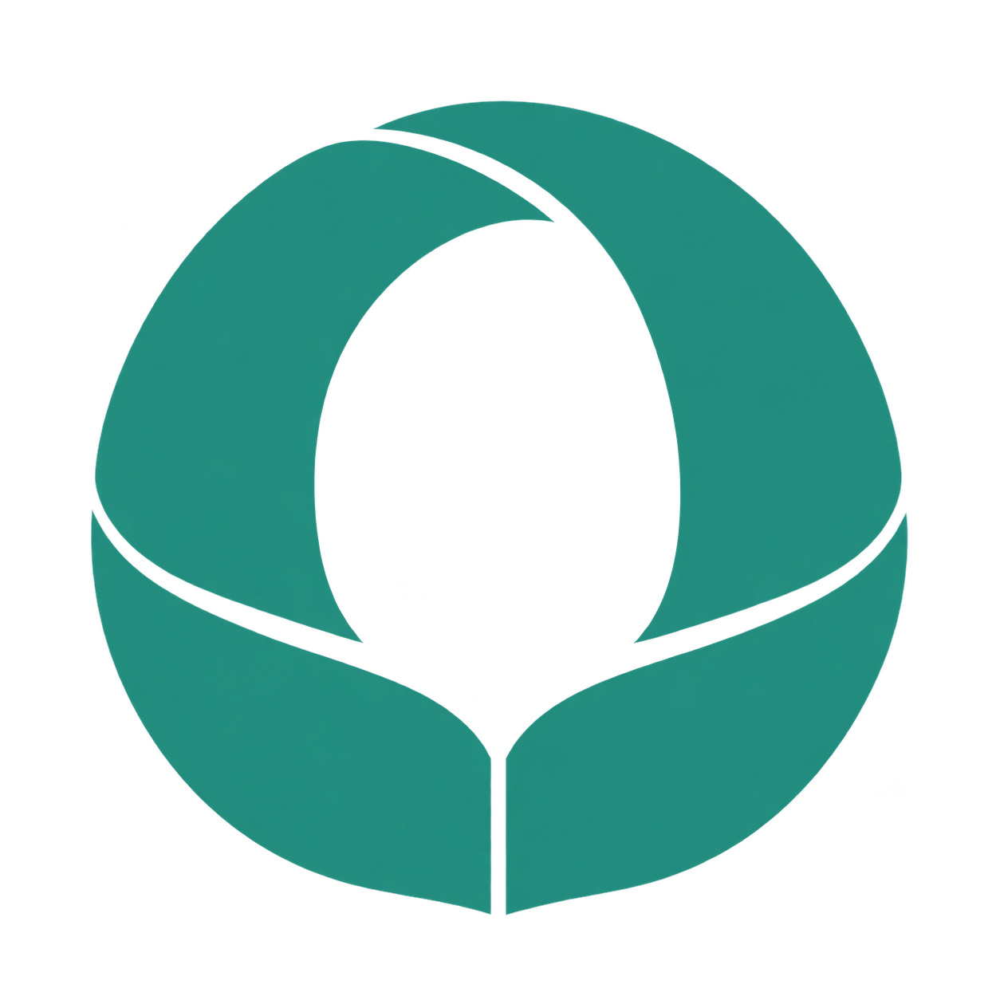

<div align="center">



# Omni Learning Anything

[](https://github.com/ShawnRen57/omni-learning-anything/releases) [](../../LICENSE)

[English](../../README.md) · [简体中文](README_zh.md) · [日本語](README_ja.md) · [한국어](README_ko.md) · [Español](README_es.md) · [Français](README_fr.md) · [Deutsch](README_de.md) · [Português](README_pt.md) · [Русский](README_ru.md) · [العربية](README_ar.md)

**[Skill ZIP 다운로드](https://github.com/ShawnRen57/omni-learning-anything/releases/latest/download/omni-learning-anything-skill-v2.2.0.zip)**

</div>

**“배우고 싶다”를 매일 이어 갈 수 있는 학습 과정으로.**

목표, 배경지식, 투자할 시간을 Agent 에게 알려 주세요. Omni 가 계획을 만들고, 그림과 출처, 연습, 자기 점검이 담긴 일일 자료로 학습을 돕습니다.

## 버전 안내

| 버전 | 할 수 있는 일 |
| --- | --- |
| **v1** | 나만의 PDF 과정. 계획을 승인한 뒤 그림, 연습, 추가 읽기 자료가 포함된 수업을 받습니다. |
| **v2** | 로컬 파일, Notion, Obsidian, Feishu, DingTalk, Tencent Docs 중 저장할 곳을 선택합니다. Agent 가 연결을 안내하고 선택한 위치를 기억합니다. |
| **v2.2.0** | 오프라인 단일 HTML 파일, 10개 언어의 과정, DingTalk 와 Tencent Docs 공식 인증 안내가 추가되었습니다. |

## 내 목표에 맞게 학습하기

- 여행, 업무, 면접, 취미 등 자신의 목적에 맞는 경로를 만듭니다.
- 매일 가능한 시간에 맞춰 설명, 그림, 연습과 정답 안내를 살펴봅니다.
- 본문 인용과 문서마다 최소 5개의 설명이 붙은 참고 링크로 근거를 확인합니다.
- 먼저 계획을 검토하고 승인합니다. 중단 후에는 아직 전달되지 않은 첫 수업부터 이어 갑니다.

## 학습 언어

**English · 简体中文 · 日本語 · 한국어 · Español · Français · Deutsch · Português · Русский · العربية**

계획과 일일 자료 모두 위 언어로 만들 수 있습니다. 주제, 출처, README 언어와 과정 언어는 달라도 됩니다. 아랍어는 오른쪽에서 왼쪽으로 배치합니다.

## 저장 위치 선택

| 저장할 곳 | Agent 에게 알려 줄 정보 |
| --- | --- |
| PDF · HTML · DOCX · Markdown | 과정 폴더와 형식. HTML 은 이미지를 포함한 단일 파일이며 외부 참고 링크를 열 때만 인터넷이 필요합니다. |
| Notion | 상위 페이지 링크와 사용할 워크스페이스. |
| Obsidian | 기존 로컬 Vault 와 과정 하위 폴더. API 키가 필요 없습니다. |
| Feishu | 과정 폴더 링크. 필요하면 공식 앱 설정과 사용자 인증을 완료합니다. |
| DingTalk | 문서 폴더 링크와 조직. 관리자가 CLI 접근을 허용해야 할 수 있습니다. |
| Tencent Docs | 홈 루트 또는 개인 폴더 링크. 공식 페이지에서 로그인하고 권한을 확인합니다. |

Agent 는 기존 인증을 확인하고 부족한 정보만 물어보며 설정을 안내합니다. 객체 ID 를 찾거나 설정 파일을 직접 쓸 필요가 없습니다. 비밀번호와 Token 을 대화에 붙여 넣지 마세요. 조직 승인에는 추가 단계가 필요할 수 있습니다.

## 대화로 시작하기

```text
https://github.com/ShawnRen57/omni-learning-anything 의 최신 Release 에서 Skill ZIP 을 설치해 주세요.
전체 폴더를 유지하고 Agent 가 스킬을 사용할 수 있는지 확인해 주세요.
```

```text
omni-learning-anything 으로 여행을 위한 건축사를 배우고 싶어요.
초보자용으로 30일, 하루 15분, 한국어로 계획해 주세요.
과정 폴더에 오프라인 HTML 로 저장하고 먼저 계획을 보여 주세요.
```

계획을 검토하고 승인하세요. Agent 가 예약 실행을 지원하면 시각과 시간대를 정하고, 그렇지 않으면 준비됐을 때 계속해 달라고 요청하세요. 예약 시각에 생성을 시작하며 조사와 검토 후 자료를 전달합니다.

```text
아직 전달되지 않은 첫 수업부터 계속해 주세요.
과정과 예약 실행을 일시 중지해 주세요.
기존 과정을 보존하고 새 목표에 맞는 계획을 제안해 주세요.
```

## 실제 과정 예시

기술, 경제학, 음악, Agent 제품 설계, 건축사, 명나라 역사의 계획과 일일 PDF 를 볼 수 있습니다. 보관된 예시에는 원래의 출처 확인 날짜가 유지됩니다.

| Technology | Economics | Music |
| :---: | :---: | :---: |
| [](../../examples/technology/) | [](../../examples/economics/) | [](../../examples/music/) |

| Agent products | Architecture | Ming history |
| :---: | :---: | :---: |
| [](../../examples/agent-product/) | [](../../examples/architecture/) | [](../../examples/ming-history/) |

## 설치와 안내

[Agent 에 설치하기](../../skills/omni-learning-anything/references/install.md) · [형식과 글꼴 설정](../../skills/omni-learning-anything/references/setup.md) · [문서 연결](../../skills/omni-learning-anything/references/onboarding.md) · [릴리스 검증](../../docs/release-validation-v2.2.0.md)

이 Agent Skill 은 Agent 의 검색, 문서, 예약 도구를 사용합니다. PDF 만 XeLaTeX 이 필요합니다. 클라우드 문서는 공식 API/CLI 로 쓰고 Obsidian 은 로컬 Vault 에 씁니다. 기기 간 동기화와 무인 실행은 호스트와 계정 조건에 따릅니다.

[MIT](../../LICENSE) · [Changelog](../../CHANGELOG.md)
