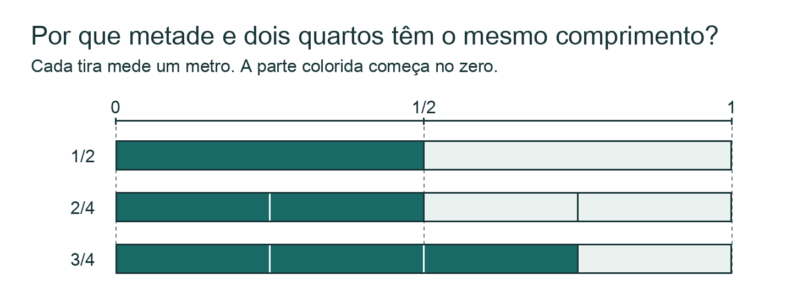
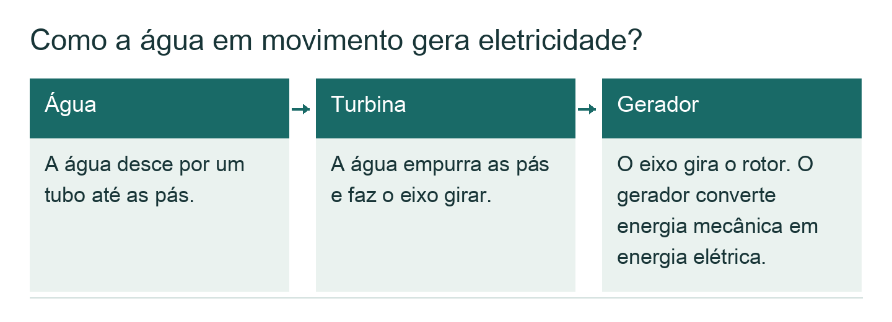
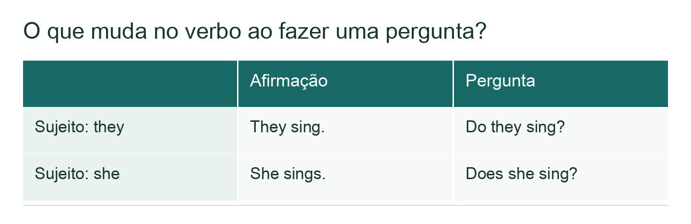

<div align="center">


# Omni Learning Anything

[](https://github.com/ShawnRen57/omni-learning-anything/releases/latest)
[](../../skills/omni-learning-anything/SKILL.md)
[](../../skills/omni-learning-anything/references/setup.md)
[](../../README.md#choose-your-learning-language)
[](../../skills/omni-learning-anything/references/setup.md)
[](../../LICENSE)
[](https://github.com/ShawnRen57/omni-learning-anything/releases)
[](https://github.com/ShawnRen57/omni-learning-anything/stargazers)

[](#output-destinations)
[](#output-destinations)
[](#output-destinations)
[](#output-destinations)

[](#output-destinations)
[](#output-destinations)
[](#output-destinations)
[](#output-destinations)
[](#output-destinations)

[English](../../README.md) · [简体中文](README_zh.md) · [日本語](README_ja.md) · [한국어](README_ko.md) · [Español](README_es.md) · [Français](README_fr.md) · [Deutsch](README_de.md) · [Português](README_pt.md) · [Русский](README_ru.md) · [العربية](README_ar.md)

**[Baixar ZIP da habilidade v5.0.0](https://github.com/ShawnRen57/omni-learning-anything/releases/download/v5.0.0/omni-learning-anything-skill-v5.0.0.zip)**

[skills.sh](https://skills.sh/shawnren57/omni-learning-anything/omni-learning-anything) · [Canais de instalação](../../docs/distribution-channels.md)

</div>

**v5.0** · Escolha entre 135 recursos. Aprenda uma língua estrangeira na sua língua materna com exercícios e respostas em separado. Cada nova ilustração inclui uma pergunta que orienta a leitura. [Catálogo](../curated-learning-resources.md) · [Exemplos de idiomas](../../examples/languages/README.md)

**Escolha um curso universitário ou traga seus livros e artigos. Aprenda no seu ritmo, com perguntas curtas, feedback útil e revisão, em arquivos locais ou documentos na nuvem.**

Escolha um curso aberto, um livro, um artigo ou uma palestra, ou comece com seus próprios materiais. Informe seu objetivo e o tempo disponível e confira o plano antes da primeira aula.

Experimente **«Quero estudar Psicologia Positiva de Harvard»**. O agente identifica o curso, aproveita as informações já fornecidas e pergunta apenas o necessário para preparar o plano.

| Função | O que faz |
| --- | --- |
| Percurso personalizado | Transforma um interesse ou objetivo em um curso adaptado ao seu nível e tempo. |
| Catálogo de fontes | Reúne 67 percursos e 68 fontes adicionais. Consulte a origem e as condições de acesso dos cursos, livros, artigos e palestras. |
| Idiomas do zero | Aprenda expressões para uma situação concreta e pratique nos dois sentidos. As fichas de revisão cumulativa e o gabarito vêm em arquivos separados. |
| Livros escolares chineses | Consulte 1.949 entradas do ensino fundamental e médio. Escolha volume, capítulo, conceito ou fórmula, com explicações para a faixa etária e imagens originais. |
| Materiais próprios | Selecione páginas, capítulos ou trechos de PDF, DOCX, EPUB, PPTX, HTML, Markdown, TXT, SRT ou VTT. |
| Fontes e leituras | Localize a página, capítulo, marca de tempo ou fonte web verificada. |
| Aprovação do plano | Revise o roteiro diário e o tempo estimado antes das aulas. |
| Leitura de diagramas | Responda a uma pergunta observando a escala, seguindo as setas ou comparando exemplos lado a lado. Cada figura indica a fonte. |
| Dez idiomas | Escolha o idioma de estudo independentemente da fonte. O árabe é diagramado da direita para a esquerda. |
| Formatos locais | PDF, HTML offline, DOCX e Markdown. |
| Destinos | Obsidian local ou conexões autorizadas com Notion, Feishu, DingTalk e Tencent Docs. |
| Perguntas breves | Responda de uma a três perguntas no chat ou em cartões compatíveis. Peça dicas, pule ou retome. |
| Feedback | Receba comentários com fontes, revise a resposta ou corrija uma avaliação. |
| Registro e revisão | Revise dentro do tempo disponível, peça um resumo e exporte ou remova respostas. |
| Ajuste do plano | Confira as mudanças propostas com base em objetivos ou respostas antes de criar outra versão do curso. |
| Anki | Exporte perguntas de revisão em CSV para o Anki. |
| Continuação e horário | Retome a próxima aula. A entrega agendada usa os recursos do agente. |
| Instalação e atualização | Instale e verifique a detecção em agentes compatíveis. Guarde os cursos em outra pasta. |

<a id="examples"></a>

## Exemplos de materiais de estudo

| Frações equivalentes | Energia hidrelétrica | Perguntas em inglês |
| --- | --- | --- |
| <a href="../assets/figures/equivalent-fractions-pt.png"></a> | <a href="../assets/figures/hydropower-pt.png"></a> | <a href="../assets/figures/present-simple-pt.png"></a> |
| Quais barras têm a mesma extensão colorida? | O que a turbina transmite ao gerador? | O que acontece com o -s de She sings quando a frase vira pergunta? |
| [OpenStax](https://openstax.org/books/prealgebra-2e/pages/4-1-visualize-fractions) | [Departamento de Energia dos EUA](https://www.energy.gov/cmei/water/how-hydropower-works) | [British Council](https://learnenglish.britishcouncil.org/free-resources/grammar/english-grammar-reference/present-simple) |

| Tema | Material para experimentar |
| --- | --- |
| Idiomas | [Japonês em chinês, plano de três dias](../../examples/languages/zh-ja/plan.md) · [Tarefa final de conversação](../../examples/languages/zh-ja/day03-task.md) · [Primeira aula de alemão em inglês](../../examples/languages/en-de/day01.md) · [Ficha de exercícios](../../examples/languages/en-de/worksheet.md) |
| Escola e universidade | [Cinco aulas em chinês baseadas em livros escolares](../../examples/textbooks/README.md) · [Seis cursos em vários idiomas](../../examples/university/README.md) · [Primeira aula de Harvard CS50x (PDF em inglês)](../../examples/university/cs50x-en/Day01.pdf) · [Todos os exemplos](../../examples/README.md) |

<a href="../../examples/README.md"></a>

<a id="versions"></a>
## Guia de versões

| Versão | Benefício para o estudo |
| --- | --- |
| **v5.0.0** | Cursos de idiomas com explicações na língua materna, diagramas com perguntas e fontes, e um catálogo de 135 recursos. |
| **v4.0–4.2** | Busque livros escolares por ano ou pela edição mais recente, estude as figuras originais e pratique em situações novas. |
| **v3.0.0** | Escolha uma trilha universitária, confira a edição e veja documentos multilíngues reais. |
| **v2.3–v2.6** | Perguntas curtas, fontes pessoais, revisão e instalação mais simples. |
| **v2** | Dez idiomas, quatro formatos locais e documentos conectados. |
| **v1** | Aprove um plano pessoal e receba PDFs ilustrados com exercícios e leituras. |

<a id="university-courses"></a>
## Explore os cursos e materiais do catálogo

Pesquise por título, assunto ou instituição. Experimente **“Encontre uma palestra TED sobre linguagem”** ou **“Monte um plano para estudar Modern Poetry, da Universidade Yale”**. Escolha um capítulo, uma aula ou uma palestra e indique o idioma e o tempo disponível. Confira o plano antes de começar.

Cada título leva à fonte original. Se a editora disponibilizar apenas a ficha do livro, use os capítulos aos quais você tem acesso. [Edições e docentes](../course-catalog-sources.md) · [Condições de acesso](../curated-learning-resources.md)

<!-- catalog:start -->

| Universidade, instituição ou autoria | Cursos e materiais (135) |
| --- | --- |
| Universidade Tsinghua | **Cursos** [中国建筑史——史前至两宋辽金](https://higher.smartedu.cn/course/687eb7bf16c43a09c0e58c23) · [文物精品与文化中国](https://higher.smartedu.cn/course/6a5e9b52b44e493c768f8c9c) · [中国建筑史（下）（自主模式）](https://v1-www.xuetangx.com/courses/course-v1%3ATsinghuaX%2B80000901X_2%2Bsp/about) · [艺术的启示](https://higher.smartedu.cn/course/6786ec4c225d72705e5dc29e) · [校园风物与大学文化——以清华大学为例](https://higher.smartedu.cn/course/6a5e9b60b44e493c768f8cba) · [数据结构(上)](https://www.xuetangx.com/course/THU08091000384/) · [大学历史与文化](https://next.xuetangx.com/course/THU04011000284/29592783)<br>**Referências abertas** [人工智能通识教育红皮书](https://aige.cs.tsinghua.edu.cn/redbook/) |
| Universidade de Pequim | **Cursos** [经典昆曲欣赏](https://www.icourse163.org/course/PKU-1470426173?tid=1474265476) · [人工智能与信息社会](https://www.icourse163.org/course/PKU-1003471009?tid=1476756462) · [西方音乐欣赏](https://www.icourse163.org/course/PKU-1207132813?tid=1207476216) · [人工智能原理](https://www.icourse163.org/course/PKU-1002188003?tid=1472399493) · [语言学概论](https://www.icourse163.org/course/PKU-1205727813) · [古代汉语](https://www.icourse163.org/course/PKU-1205726807) · [生理学（上）](https://www.icourse163.org/course/PKU-1205915814) |
| Universidade Fudan | **Cursos** [人工智能，语言与伦理](https://www.icourse163.org/course/FUDAN-1205951803?tid=1475942449) · [比较文化研究](https://umoocs.unipus.cn/course/7944/tasks) · [深度学习及其应用](https://higher.smartedu.cn/course/622ac9f0bee70ef79f419877) · [中华优秀传统文化](https://higher.smartedu.cn/course/63ffd464af1f1b5d3ecfd579) · [政治学原理](https://www.icourse163.org/course/FUDAN-1461787179?tid=1462604462) · [古典诗词鉴赏](https://www.icourse163.org/course/FUDAN-1205950804) |
| Universidade Jiao Tong de Xangai | **Cursos** [唐诗宋词人文解读](https://higher.smartedu.cn/course/69b0942995df98bb27ba19b4) · [数学的天空](https://higher.smartedu.cn/course/690530295345b68214577952) · [机器的征途：空天科技](https://higher.smartedu.cn/course/62354d7a9906eace0490b2aa) · [经济法](https://higher.smartedu.cn/course/67c2473d225d72705e7bb8c8) · [关爱生命——急救与自救技能](https://higher.smartedu.cn/course/69b0942695df98bb27ba19a1) · [建筑物理](https://www.icourse163.org/course/SJTU-1472028164) · [造型基础—设计素描](https://www.icourse163.org/course/SJTU-1206432804) · [设计创新的艺术](https://www.icourse163.org/course/SJTU-1207170808) |
| Universidade de Zhejiang | **Cursos** [唐诗经典](https://higher.smartedu.cn/course/6982720195df98bb27cadb06) |
| Universidade Normal de Pequim | **Cursos** [书法欣赏](https://www.icourse163.org/course/BNU-1003240002?tid=1488313456) |
| Universidade Harvard | **Cursos** [Positive Psychology](https://ppc.sas.upenn.edu/sites/default/files/ppsyllabusschachar.pdf) · [CS50’s Introduction to Computer Science](https://cs50.harvard.edu/x/2026/syllabus/) · [Justice](https://sandel.scholars.harvard.edu/justice) · [Rhetoric: The Art of Persuasive Writing and Public Speaking](https://pll.harvard.edu/course/rhetoric-art-persuasive-writing-and-public-speaking) · [CS50’s Introduction to Artificial Intelligence with Python](https://cs50.harvard.edu/ai/) · [Masterpieces of World Literature](https://www.edx.org/learn/literature/harvard-university-masterpieces-of-world-literature) · [Pyramids of Giza: Ancient Egyptian Art and Archaeology](https://giza.fas.harvard.edu/videos/) |
| Universidade Yale | **Cursos** [Introduction to Psychology](https://oyc.yale.edu/introduction-psychology/psyc-110) · [Financial Markets](https://oyc.yale.edu/economics/econ-252) · [Game Theory](https://oyc.yale.edu/economics/econ-159) · [Death](https://oyc.yale.edu/death/phil-176) · [Listening to Music](https://oyc.yale.edu/music/musi-112/lecture-1) · [Roman Architecture](https://oyc.yale.edu/history-of-art/hsar-252) · [Introduction to Theory of Literature](https://oyc.yale.edu/english/engl-300) · [The Atmosphere, the Ocean, and Environmental Change](https://oyc.yale.edu/geology-and-geophysics/gg-140) · [European Civilization, 1648-1945](https://oyc.yale.edu/history/hist-202) · [Philosophy and the Science of Human Nature](https://oyc.yale.edu/philosophy/phil-181) · [Principles of Evolution, Ecology and Behavior](https://oyc.yale.edu/ecology-and-evolutionary-biology/eeb-122) · [Introduction to Ancient Greek History](https://oyc.yale.edu/classics/clcv-205) · [The American Revolution](https://oyc.yale.edu/history/hist-116) · [Modern Poetry](https://oyc.yale.edu/english/engl-310) · [Capitalism: Success, Crisis, and Reform](https://oyc.yale.edu/political-science/plsc-270) · [Frontiers and Controversies in Astrophysics](https://oyc.yale.edu/astronomy/astr-160) · [Fundamentals of Physics I](https://oyc.yale.edu/physics/phys-200) · [Frontiers of Biomedical Engineering](https://oyc.yale.edu/biomedical-engineering/beng-100) · [The Psychology, Biology and Politics of Food](https://oyc.yale.edu/psychology/psyc-123) · [Milton](https://oyc.yale.edu/english/engl-220) |
| MIT | **Cursos** [Introduction to Computer Science and Programming in Python](https://ocw.mit.edu/courses/6-0001-introduction-to-computer-science-and-programming-in-python-fall-2016/video_galleries/lecture-videos/) · [Linear Algebra](https://ocw.mit.edu/courses/18-06-linear-algebra-spring-2010/pages/calendar/) · [Classical Mechanics](https://ocw.mit.edu/courses/8-01sc-classical-mechanics-fall-2016/) · [Introduction to Art History](https://ocw.mit.edu/courses/4-601-introduction-to-art-history-fall-2018/pages/calendar/) · [Principles of Microeconomics](https://ocw.mit.edu/courses/14-01-principles-of-microeconomics-fall-2023/pages/calendar/) · [Art Since 1940](https://ocw.mit.edu/courses/4-651-art-since-1940-fall-2010/pages/lecture-notes/) · [Philosophy of Film](https://ocw.mit.edu/courses/24-213-philosophy-of-film-fall-2004/pages/calendar/) · [Introduction to Deep Learning](https://introtodeeplearning.com/2026/index.html) · [Introduction to Sustainable Energy](https://ocw.mit.edu/courses/22-081j-introduction-to-sustainable-energy-fall-2010/pages/calendar/)<br>**Livros acadêmicos · MIT Press** [Deep Learning](https://www.deeplearningbook.org/) · [Probabilistic Machine Learning: An Introduction](https://probml.github.io/pml-book/book1.html) · [Reinforcement Learning: An Introduction](https://mitpress.mit.edu/9780262039246/reinforcement-learning/) |
| Universidade Stanford | **Cursos** [Machine Learning](https://cs229.stanford.edu/syllabus-autumn2018.html) · [Deep Learning for Computer Vision](https://cs231n.stanford.edu/2026/schedule.html)<br>**Livros acadêmicos** [Speech and Language Processing](https://web.stanford.edu/~jurafsky/slp3/) · [Convex Optimization](https://web.stanford.edu/~boyd/cvxbook/) · [Introduction to Applied Linear Algebra – Vectors, Matrices, and Least Squares](https://web.stanford.edu/~boyd/vmls/)<br>**Artigos · Stanford Encyclopedia of Philosophy** [Aesthetic Judgment](https://plato.stanford.edu/entries/aesthetic-judgment/) · [Scientific Method](https://plato.stanford.edu/entries/scientific-method/) · [Personal Identity](https://plato.stanford.edu/entries/identity-personal/) · [Justice](https://plato.stanford.edu/entries/justice/) · [Chinese Ethics](https://plato.stanford.edu/entries/ethics-chinese/) · [The Philosophy of Music](https://plato.stanford.edu/entries/music/) |
| Universidade de Helsinque e MinnaLearn | **Cursos** [Elements of AI: Introduction to AI](https://opin.fi/en/study-options/HY/elements-of-ai-introduction-to-ai/89eb0e79-873e-4d2a-aec5-d694d7762118) · [Elements of AI: Building AI](https://buildingai.elementsofai.com/) |
| OpenAI Academy | **Cursos** [AI Foundations](https://academy.openai.com/public/courses/ai-foundations-dnq5w) · [Applied AI Foundations](https://academy.openai.com/public/courses/applied-ai-foundations-szsmv) · [Agents and Workflows](https://academy.openai.com/public/courses/agents-and-workflows-y0qoc) · [AI for College Students](https://academy.openai.com/public/courses/ai-for-college-students-gxgmr) |
| Anthropic · Claude Academy | **Cursos** [AI Fluency: Framework and foundations](https://academy.claude.com/courses/ai-fluency-framework-foundations) · [AI Fluency for students](https://academy.claude.com/courses/ai-fluency-for-students) · [AI Fluency for educators](https://academy.claude.com/courses/ai-fluency-for-educators) |
| Hugging Face | **Cursos** [AI Agents Course](https://huggingface.co/learn/agents-course/unit0/introduction) |
| Universidade da Califórnia em Berkeley | **Cursos** [Introduction to Artificial Intelligence](https://inst.eecs.berkeley.edu/~cs188/sp26/) |
| DeepLearning.AI | **Cursos** [AI For Everyone](https://www.coursera.org/learn/ai-for-everyone/) · [Generative AI for Everyone](https://www.coursera.org/learn/generative-ai-for-everyone/) |
| Microsoft | **Cursos** [Generative AI for Beginners](https://github.com/microsoft/generative-ai-for-beginners/blob/79a4334e158147d4f36c27d805e0cb163c1e445b/README.md#-lessons) |
| Google | **Cursos** [Google AI Essentials](https://grow.google/ai-essentials/) |
| Smarthistory | **Referências abertas** [Reframing Art History](https://smarthistory.org/reframing-art-history/) |
| Universidade Rice · OpenStax | **Livros didáticos** [Astronomy 2e](https://openstax.org/books/astronomy-2e/pages/preface) · [Biology 2e](https://openstax.org/books/biology-2e/pages/preface) · [Psychology 2e](https://openstax.org/books/psychology-2e/pages/preface) · [Introduction to Sociology 3e](https://openstax.org/books/introduction-sociology-3e/pages/preface) · [Principles of Economics 3e](https://openstax.org/books/principles-economics-3e/pages/preface) · [Chemistry 2e](https://openstax.org/books/chemistry-2e/pages/preface) · [University Physics Volume 1](https://openstax.org/books/university-physics-volume-1/pages/preface) · [Calculus Volume 1](https://openstax.org/books/calculus-volume-1/pages/preface) · [World History Volume 1, to 1500](https://openstax.org/books/world-history-volume-1/pages/preface) · [Introduction to Philosophy](https://openstax.org/books/introduction-philosophy/pages/preface) · [Introductory Statistics 2e](https://openstax.org/books/introductory-statistics-2e/pages/preface) · [Entrepreneurship](https://openstax.org/books/entrepreneurship/pages/preface) · [Business Ethics](https://openstax.org/books/business-ethics/pages/preface) |
| Autores de Dive into Deep Learning | **Livros acadêmicos** [动手学深度学习](https://zh.d2l.ai/) |
| O’Reilly | **Livros acadêmicos** [R for Data Science (2e)](https://r4ds.hadley.nz/) |
| Distill | **Artigos** [Attention and Augmented Recurrent Neural Networks](https://distill.pub/2016/augmented-rnns/) · [How to Use t-SNE Effectively](https://distill.pub/2016/misread-tsne/) · [Feature Visualization](https://distill.pub/2017/feature-visualization/) · [Why Momentum Really Works](https://distill.pub/2017/momentum/) · [Deconvolution and Checkerboard Artifacts](https://distill.pub/2016/deconv-checkerboard/) · [A Gentle Introduction to Graph Neural Networks](https://distill.pub/2021/gnn-intro/) · [Computing Receptive Fields of Convolutional Neural Networks](https://distill.pub/2019/computing-receptive-fields/) · [A Visual Exploration of Gaussian Processes](https://distill.pub/2019/visual-exploration-gaussian-processes/) |
| Caltech | **Ciclos de palestras** [The Feynman Lectures on Physics, Volume I](https://www.feynmanlectures.caltech.edu/I_toc.html) · [The Feynman Lectures on Physics, Volume II](https://www.feynmanlectures.caltech.edu/II_toc.html) · [The Feynman Lectures on Physics, Volume III](https://www.feynmanlectures.caltech.edu/III_toc.html) |
| Royal Institution | **Ciclos de palestras** [The truth about AI](https://www.rigb.org/christmas-lectures/watch-2023-christmas-lectures)<br>**Palestras** [Growing up in the universe – Waking up in the universe (1991)](https://www.rigb.org/explore-science/explore/video/growing-universe-waking-universe-1991) |
| TED | **Palestras** [How language shapes the way we think](https://www.ted.com/talks/lera_boroditsky_how_language_shapes_the_way_we_think) · [The danger of a single story](https://www.ted.com/talks/chimamanda_ngozi_adichie_the_danger_of_a_single_story) · [The best stats you’ve ever seen](https://www.ted.com/talks/hans_rosling_the_best_stats_you_ve_ever_seen) · [Do schools kill creativity?](https://www.ted.com/talks/sir_ken_robinson_do_schools_kill_creativity) · [The power of introverts](https://www.ted.com/talks/susan_cain_the_power_of_introverts) · [Inside the mind of a master procrastinator](https://www.ted.com/talks/tim_urban_inside_the_mind_of_a_master_procrastinator) · [10 ways to have a better conversation](https://www.ted.com/talks/celeste_headlee_10_ways_to_have_a_better_conversation) · [How to speak so that people want to listen](https://www.ted.com/talks/julian_treasure_how_to_speak_so_that_people_want_to_listen) · [The power of vulnerability](https://www.ted.com/talks/brene_brown_the_power_of_vulnerability) · [We should all be feminists](https://www.ted.com/talks/chimamanda_ngozi_adichie_we_should_all_be_feminists) |

<!-- catalog:end -->

Uma sessão de 10 minutos cobre uma pequena etapa, não uma aula original inteira ou todo o curso. A carga original permanece visível; leituras longas, exercícios e projetos precisam de tempo adicional. As fontes e a disponibilidade podem mudar. São trilhas independentes baseadas em cursos públicos. Não incluem todo o conteúdo das aulas nem representam endosso universitário ou certificados.

## Aprenda com seus materiais

Use PDF, TXT, Markdown, HTML, DOCX, EPUB, PPTX, SRT ou VTT. Escolha capítulos, páginas ou marcações de tempo e permita ou não complementos externos. Explicações e perguntas apontam para os trechos originais. DOC e RTF antigos precisam de conversão prévia com ferramentas confiáveis.

“Quero entender um pouco de economia” também serve. O agente sugere caminhos, explica as suposições e pergunta apenas o que afeta o plano. Um objetivo específico leva diretamente ao planejamento.

<a id="choose-your-learning-language"></a>
## Escolha o idioma de estudo

**English · 简体中文 · 日本語 · 한국어 · Español · Français · Deutsch · Português · Русский · العربية**

Planos e aulas aceitam os dez idiomas acima, independentemente do idioma das fontes ou desta página. Documentos em árabe usam disposição da direita para a esquerda.

<a id="output-destinations"></a>
## Escolha onde guardar o curso

| Destino | Como funciona |
| --- | --- |
| PDF · HTML · DOCX · Markdown | Escolha pasta e PDF, HTML, DOCX ou Markdown. O HTML inclui a ilustração em um único arquivo offline; links externos precisam de internet. |
| Notion | Conecte uma página principal pela CLI oficial `ntn`. |
| Obsidian | Escolha um Vault local existente e uma pasta; não se usa API do Obsidian. |
| Feishu / 飞书 | Conecte uma pasta pela CLI oficial `lark` com autorização do usuário. |
| DingTalk / 钉钉 | Conecte uma pasta pela CLI oficial `dws`; pode ser necessária aprovação da organização. |
| Tencent Docs / 腾讯文档 | Escolha raiz ou pasta e conclua a autorização oficial OAuth/MCP. |

Informe onde salvar o curso. O agente verifica acessos, orienta a configuração que falta e reutiliza a conexão nomeada. Não cole senhas ou tokens no chat.

<a id="quick-start"></a>
## Instale e comece

Peça ao agente para instalar a versão mais recente e verificar se este cliente encontra a habilidade. Preserve cursos e conexões ao atualizar. Com Node.js, execute:

```sh
npx skills@latest add ShawnRen57/omni-learning-anything --skill omni-learning-anything -g
```

No Claude Code, use o instalador de plugins:

```text
/plugin install omni-learning-anything --marketplace ShawnRen57/omni-learning-anything
```

Sem Node.js, baixe o ZIP acima e importe no cliente ou peça ajuda ao agente. `skills.sh` está disponível; a versão publicada no SkillHub é atualmente v2.6.0. Consulte o guia de canais para verificar as versões.

## Experimente seu primeiro curso

```text
Mostre os cursos integrados. Use Harvard CS50x 2026 como fonte.
Sou iniciante. Ensine em português, 20 minutos por dia.
Mantenha a ordem das unidades e mostre a carga de trabalho original.
Salve como HTML offline e mostre primeiro o plano.
```

Ou tente: “Ensine os dois primeiros capítulos do meu EPUB em sessões de 15 minutos” ou “Use Yale Financial Markets 2011 para explicar as instituições financeiras”.

Revise e aprove o plano e peça a primeira aula. Para retomar: “Continue a partir da primeira aula ainda não entregue”. Você pode pausar. O agendamento exige suporte do anfitrião e acordo sobre horário e fuso; a geração começa nesse momento e a entrega ocorre após pesquisa e revisão.

## Perguntas, feedback e revisão

Quando quiser, peça de 1 a 3 perguntas curtas em cartões ou texto. Receba feedback e dicas com base nas fontes; avaliações longas estão disponíveis sob pedido. O registro de aprendizagem é atualizado em segundo plano para não interromper a leitura.

Pergunte “o que devo revisar hoje?” para uma revisão dentro do tempo previsto, ou “o que minhas respostas mostram nesta semana?” para um resumo com evidências. Corrija uma avaliação, ignore um assunto ou priorize uma aula nova. A revisão não cria testes automáticos ou temporizadores extras.

Aprove mudanças nas aulas futuras antes de iniciar uma nova versão; o plano e o histórico anteriores continuam disponíveis. Cartões Anki podem ser exportados em CSV em sentido único, sem sincronização automática.

[Demonstração de perguntas, feedback e ajuste do plano no WorkBuddy](../../README.md#workbuddy-demo)

## Guias e requisitos

[Instalação e atualizações](../../skills/omni-learning-anything/references/install.md) · [Formatos e fontes tipográficas](../../skills/omni-learning-anything/references/setup.md) · [Conectar documentos](../../skills/omni-learning-anything/references/onboarding.md) · [Estado dos canais](../../docs/distribution-channels.md) · [Validação da v3.0.0](../../docs/release-validation-v3.0.0.md)

Esta Agent Skill usa as ferramentas de pesquisa, documentos e agendamento do anfitrião. Só PDF precisa de XeLaTeX. Acesso à nuvem, sincronização entre dispositivos e entrega sem supervisão dependem do anfitrião, da conta e das autorizações. O cliente atual é verificado; não se presume suporte universal.

[MIT](../../LICENSE) · [Changelog](../../CHANGELOG.md) · [Attribution](../../ATTRIBUTION.md)
