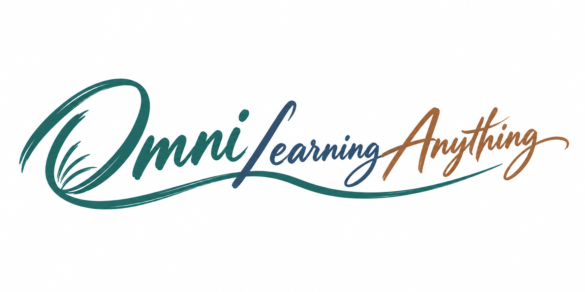

<div align="center">



# Omni Learning Anything

[](https://github.com/ShawnRen57/omni-learning-anything/releases) [](../../LICENSE)

[English](../../README.md) · [简体中文](README_zh.md) · [日本語](README_ja.md) · [한국어](README_ko.md) · [Español](README_es.md) · [Français](README_fr.md) · [Deutsch](README_de.md) · [Português](README_pt.md) · [Русский](README_ru.md) · [العربية](README_ar.md)

**[Descarregar Skill ZIP](https://github.com/ShawnRen57/omni-learning-anything/releases/latest/download/omni-learning-anything-skill-v2.2.0.zip)**

</div>

**Transforme «quero aprender…» num percurso para seguir todos os dias.**

Diga ao seu agente qual é o objetivo, a sua experiência e o tempo disponível. O Omni prepara um plano e aulas diárias com ilustrações, fontes, exercícios e autoavaliação.

## Guia de versões

| Versão | O que pode fazer |
| --- | --- |
| **v1** | Ter um curso pessoal em PDF: aprove o plano e receba aulas ilustradas com exercícios e leituras complementares. |
| **v2** | Guardar o curso em ficheiros locais, Notion, Obsidian, Feishu, DingTalk ou Tencent Docs. O agente orienta a ligação e recorda o destino escolhido. |
| **v2.2.0** | Ler HTML offline, criar cursos em 10 idiomas e autorizar DingTalk ou Tencent Docs com orientação do agente. |

## Aprender ao seu ritmo

- Prepare uma viagem, um projeto de trabalho, uma entrevista ou explore um interesse pessoal.
- Defina um tempo diário para explicações, ilustrações, prática e orientação sobre as respostas.
- Consulte as citações e pelo menos cinco ligações comentadas em cada documento.
- Reveja primeiro o plano e retome a primeira aula ainda não entregue após uma interrupção.

## Idiomas do curso

**English · 简体中文 · 日本語 · 한국어 · Español · Français · Deutsch · Português · Русский · العربية**

Os planos e as aulas podem ser escritos nestes idiomas. O idioma do curso é independente do tema, das fontes e do README. O árabe utiliza disposição da direita para a esquerda.

## Escolher onde guardar o curso

| Destino | O que indicar ao agente |
| --- | --- |
| PDF · HTML · DOCX · Markdown | Pasta do curso e formato. HTML inclui a imagem num único ficheiro offline; as ligações externas precisam de Internet. |
| Notion | Ligação à página principal e espaço de trabalho. |
| Obsidian | Vault local existente e subpasta. Não precisa de uma chave API. |
| Feishu | Ligação à pasta; configure a aplicação oficial e autorize o utilizador se necessário. |
| DingTalk | Pasta de documentos e organização. O administrador poderá ter de ativar o acesso CLI. |
| Tencent Docs | Raiz da página inicial ou pasta pessoal; inicie sessão e confira as permissões na página oficial. |

O agente verifica os acessos existentes, pergunta apenas pelo que falta e explica os passos. Não precisa de procurar identificadores nem de escrever ficheiros de configuração. Não cole palavras-passe ou tokens na conversa. As aprovações da organização podem exigir passos adicionais.

## Começar pela conversa

```text
Instala o Skill ZIP da última Release de https://github.com/ShawnRen57/omni-learning-anything.
Mantém a pasta completa e confirma que o agente encontra a competência.
```

```text
Usa omni-learning-anything para me ensinar história da arquitetura para viajar.
Sou principiante. Planeia 30 dias, 15 minutos por dia, em português.
Guarda o curso em HTML offline na minha pasta. Mostra primeiro o plano.
```

Reveja e aprove o plano. Se o agente suportar agendamento, combine a hora e o fuso horário; caso contrário, peça para continuar quando estiver pronto. A geração começa à hora marcada e a entrega segue-se à pesquisa e verificação.

```text
Continua a partir da primeira aula ainda não entregue.
Pausa este curso e o respetivo agendamento.
Preserva o curso anterior e propõe um plano para o meu novo objetivo.
```

## Explorar exemplos

Consulte planos e PDFs diários de tecnologia, economia, música, design de produtos Agent, arquitetura e história Ming. Os arquivos mantêm as datas originais de verificação das fontes.

| Technology | Economics | Music |
| :---: | :---: | :---: |
| [](../../examples/technology/) | [](../../examples/economics/) | [](../../examples/music/) |

| Agent products | Architecture | Ming history |
| :---: | :---: | :---: |
| [](../../examples/agent-product/) | [](../../examples/architecture/) | [](../../examples/ming-history/) |

## Instalação e guias

[Instalar no agente](../../skills/omni-learning-anything/references/install.md) · [Formatos e fontes](../../skills/omni-learning-anything/references/setup.md) · [Ligar documentos](../../skills/omni-learning-anything/references/onboarding.md) · [Validação da versão](../../docs/release-validation-v2.2.0.md)

Esta Agent Skill utiliza as ferramentas de pesquisa, documentos e agendamento do seu agente. Apenas PDF precisa de XeLaTeX. A nuvem usa APIs/CLIs oficiais; Obsidian escreve no Vault local. A sincronização e a execução autónoma dependem do sistema anfitrião e da conta.

[MIT](../../LICENSE) · [Changelog](../../CHANGELOG.md)
