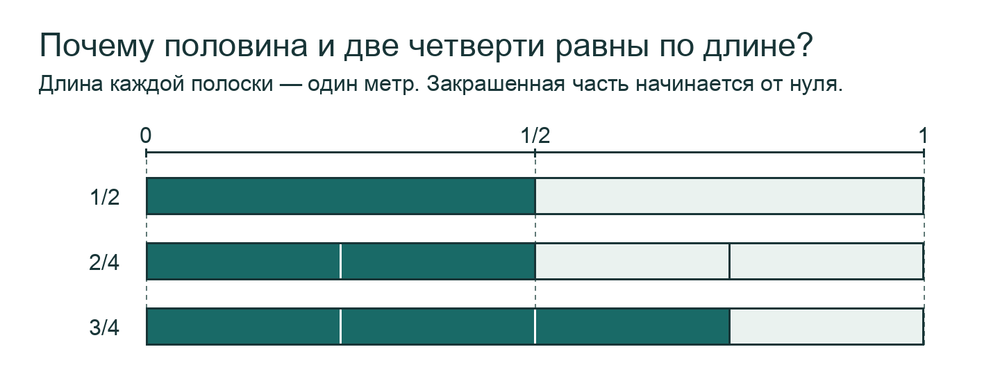
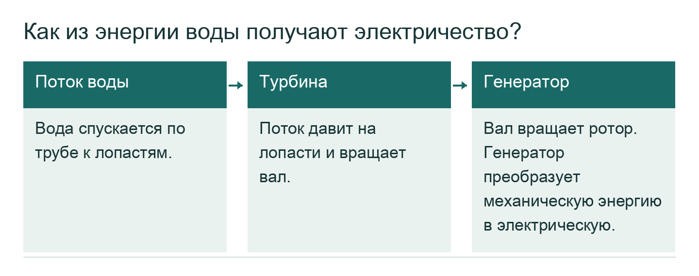
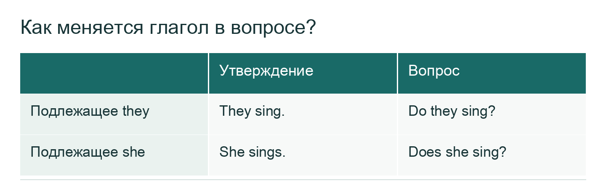

<div align="center">


# Omni Learning Anything

[](https://github.com/ShawnRen57/omni-learning-anything/releases/latest)
[](../../skills/omni-learning-anything/SKILL.md)
[](../../skills/omni-learning-anything/references/setup.md)
[](../../README.md#choose-your-learning-language)
[](../../skills/omni-learning-anything/references/setup.md)
[](../../LICENSE)
[](https://github.com/ShawnRen57/omni-learning-anything/releases)
[](https://github.com/ShawnRen57/omni-learning-anything/stargazers)

[](#output-destinations)
[](#output-destinations)
[](#output-destinations)
[](#output-destinations)

[](#output-destinations)
[](#output-destinations)
[](#output-destinations)
[](#output-destinations)
[](#output-destinations)

[English](../../README.md) · [简体中文](README_zh.md) · [日本語](README_ja.md) · [한국어](README_ko.md) · [Español](README_es.md) · [Français](README_fr.md) · [Deutsch](README_de.md) · [Português](README_pt.md) · [Русский](README_ru.md) · [العربية](README_ar.md)

**[Скачать ZIP навыка v5.0.0](https://github.com/ShawnRen57/omni-learning-anything/releases/download/v5.0.0/omni-learning-anything-skill-v5.0.0.zip)**

[skills.sh](https://skills.sh/shawnren57/omni-learning-anything/omni-learning-anything) · [Каналы установки](../../docs/distribution-channels.md)

</div>

**v5.0** · Выбирайте из 135 учебных источников. Изучайте иностранный язык с объяснениями на родном языке, упражнениями и отдельными ответами. Каждая новая иллюстрация сопровождается вопросом, который помогает заметить важные детали. [Каталог](../curated-learning-resources.md) · [Примеры языковых курсов](../../examples/languages/README.md)

**Выберите университетский курс или принесите свои книги и статьи. Учитесь в своём темпе, с короткими вопросами, полезной обратной связью и повторением, сохраняя материалы локально или в облачных документах.**

Выберите открытый курс, книгу, статью или лекцию либо начните со своих материалов. Укажите цель и сколько времени у вас есть. Просмотрите план до первого занятия.

Начните с **«Хочу изучать позитивную психологию Гарварда»**. Агент определит исходный курс, использует уже сообщённые сведения и уточнит лишь то, что влияет на план.

| Функция | Описание |
| --- | --- |
| Личный план обучения | Превращает интерес или цель в курс с учётом вашего уровня и времени. |
| Каталог источников | 67 учебных маршрутов и 68 дополнительных источников. Для курсов, книг, статей и лекций указаны ссылки на оригиналы и условия доступа. |
| Иностранный язык с нуля | Учите выражения для конкретной ситуации и тренируйтесь переводить их в обе стороны. Задания на повторение и ключ с ответами хранятся отдельно. |
| Китайские школьные учебники | Поиск по 1949 позициям от начальной до старшей школы. Выберите том, главу, понятие или формулу, с объяснениями по возрасту и рисунками из учебника. |
| Свои материалы | Выберите страницы, главы или интервалы в PDF, DOCX, EPUB, PPTX, HTML, Markdown, TXT, SRT или VTT. |
| Источники | Найдите исходную страницу, главу, временную метку или проверенную веб-страницу. |
| Утверждение плана | Просмотрите темы по дням и оценку времени до начала занятий. |
| Чтение схем | Ищите ответ на вопрос по шкале, стрелкам или расположению примеров. Для каждой схемы указан источник. |
| Десять языков | Выберите язык обучения независимо от источника. Арабский текст оформляется справа налево. |
| Локальные форматы | PDF, автономный HTML, DOCX и Markdown. |
| Места хранения | Локальное хранилище Obsidian или авторизованное подключение к Notion, Feishu, DingTalk и Tencent Docs. |
| Короткие задания | Отвечайте на 1–3 вопроса в чате или на поддерживаемых карточках. Можно запросить подсказку, пропустить или продолжить. |
| Обратная связь | Получайте комментарии со ссылками, уточняйте ответ или исправляйте оценку. |
| История и повторение | Повторяйте в рамках времени, запрашивайте сводку, выгружайте или удаляйте ответы. |
| Изменение плана | Проверьте предложенные изменения по целям и ответам перед созданием новой версии курса. |
| Anki | Выгружайте вопросы для повторения в CSV для Anki. |
| Продолжение и расписание | Возвращайтесь к следующему уроку. Расписание зависит от возможностей агента. |
| Установка и обновление | Проверяйте обнаружение навыка в совместимом агенте. Курсы хранятся отдельно. |

<a id="examples"></a>

## Примеры учебных материалов

| Равные дроби | Гидроэлектростанция | Вопросы в английском языке |
| --- | --- | --- |
| <a href="../assets/figures/equivalent-fractions-ru.png"></a> | <a href="../assets/figures/hydropower-ru.png"></a> | <a href="../assets/figures/present-simple-ru.png"></a> |
| У каких полосок закрашенная часть заканчивается в одной точке? | Что турбина передаёт генератору? | Что происходит с окончанием -s в She sings, когда задают вопрос? |
| [OpenStax](https://openstax.org/books/prealgebra-2e/pages/4-1-visualize-fractions) | [Министерство энергетики США](https://www.energy.gov/cmei/water/how-hydropower-works) | [British Council](https://learnenglish.britishcouncil.org/free-resources/grammar/english-grammar-reference/present-simple) |

| Тема | Что попробовать |
| --- | --- |
| Иностранные языки | [Японский с объяснениями на китайском, план на три дня](../../examples/languages/zh-ja/plan.md) · [Итоговое задание на диалог](../../examples/languages/zh-ja/day03-task.md) · [Первый урок немецкого с объяснениями на английском](../../examples/languages/en-de/day01.md) · [Упражнения](../../examples/languages/en-de/worksheet.md) |
| Школа и университет | [Пять уроков по школьным учебникам на китайском](../../examples/textbooks/README.md) · [Шесть курсов на разных языках](../../examples/university/README.md) · [Первый урок гарвардского курса CS50x (PDF на английском)](../../examples/university/cs50x-en/Day01.pdf) · [Все примеры](../../examples/README.md) |

<a href="../../examples/README.md"></a>

<a id="versions"></a>
## История версий

| Версия | Польза для обучения |
| --- | --- |
| **v5.0.0** | Изучение иностранного языка с опорой на родной, схемы с вопросами и источниками, каталог из 135 учебных ресурсов. |
| **v4.0–4.2** | Поиск школьных учебников по году или последнему изданию, занятия с оригинальными иллюстрациями и перенос знаний на новые ситуации. |
| **v3.0.0** | Выбор университетского маршрута, точной версии источника и просмотр многоязычных документов. |
| **v2.3–v2.6** | Короткие вопросы, личные источники, повторение и более простая установка. |
| **v2** | Десять языков, четыре локальных формата и подключённые документы. |
| **v1** | Согласование личного плана и PDF с иллюстрациями, упражнениями и чтением. |

<a id="university-courses"></a>
## Курсы и учебные материалы каталога

Ищите по названию, теме или организации. Например, попросите **«Найди выступление TED о языке»** или **«Составь план по курсу Йельского университета Modern Poetry»**. Выберите главу, лекцию или выступление, укажите язык занятий и доступное время. Перед началом занятий вы сможете проверить план.

Каждое название ведёт к оригиналу. Если издательство публикует только описание книги, для занятий подойдут главы, к которым у вас есть доступ. [Издания курсов и преподаватели](../course-catalog-sources.md) · [Условия доступа к материалам](../curated-learning-resources.md)

<!-- catalog:start -->

| Университет, организация или авторы | Курсы и материалы (135) |
| --- | --- |
| Университет Цинхуа | **Курсы** [中国建筑史——史前至两宋辽金](https://higher.smartedu.cn/course/687eb7bf16c43a09c0e58c23) · [文物精品与文化中国](https://higher.smartedu.cn/course/6a5e9b52b44e493c768f8c9c) · [中国建筑史（下）（自主模式）](https://v1-www.xuetangx.com/courses/course-v1%3ATsinghuaX%2B80000901X_2%2Bsp/about) · [艺术的启示](https://higher.smartedu.cn/course/6786ec4c225d72705e5dc29e) · [校园风物与大学文化——以清华大学为例](https://higher.smartedu.cn/course/6a5e9b60b44e493c768f8cba) · [数据结构(上)](https://www.xuetangx.com/course/THU08091000384/) · [大学历史与文化](https://next.xuetangx.com/course/THU04011000284/29592783)<br>**Открытые справочные материалы** [人工智能通识教育红皮书](https://aige.cs.tsinghua.edu.cn/redbook/) |
| Пекинский университет | **Курсы** [经典昆曲欣赏](https://www.icourse163.org/course/PKU-1470426173?tid=1474265476) · [人工智能与信息社会](https://www.icourse163.org/course/PKU-1003471009?tid=1476756462) · [西方音乐欣赏](https://www.icourse163.org/course/PKU-1207132813?tid=1207476216) · [人工智能原理](https://www.icourse163.org/course/PKU-1002188003?tid=1472399493) · [语言学概论](https://www.icourse163.org/course/PKU-1205727813) · [古代汉语](https://www.icourse163.org/course/PKU-1205726807) · [生理学（上）](https://www.icourse163.org/course/PKU-1205915814) |
| Фуданьский университет | **Курсы** [人工智能，语言与伦理](https://www.icourse163.org/course/FUDAN-1205951803?tid=1475942449) · [比较文化研究](https://umoocs.unipus.cn/course/7944/tasks) · [深度学习及其应用](https://higher.smartedu.cn/course/622ac9f0bee70ef79f419877) · [中华优秀传统文化](https://higher.smartedu.cn/course/63ffd464af1f1b5d3ecfd579) · [政治学原理](https://www.icourse163.org/course/FUDAN-1461787179?tid=1462604462) · [古典诗词鉴赏](https://www.icourse163.org/course/FUDAN-1205950804) |
| Шанхайский университет Цзяотун | **Курсы** [唐诗宋词人文解读](https://higher.smartedu.cn/course/69b0942995df98bb27ba19b4) · [数学的天空](https://higher.smartedu.cn/course/690530295345b68214577952) · [机器的征途：空天科技](https://higher.smartedu.cn/course/62354d7a9906eace0490b2aa) · [经济法](https://higher.smartedu.cn/course/67c2473d225d72705e7bb8c8) · [关爱生命——急救与自救技能](https://higher.smartedu.cn/course/69b0942695df98bb27ba19a1) · [建筑物理](https://www.icourse163.org/course/SJTU-1472028164) · [造型基础—设计素描](https://www.icourse163.org/course/SJTU-1206432804) · [设计创新的艺术](https://www.icourse163.org/course/SJTU-1207170808) |
| Чжэцзянский университет | **Курсы** [唐诗经典](https://higher.smartedu.cn/course/6982720195df98bb27cadb06) |
| Пекинский педагогический университет | **Курсы** [书法欣赏](https://www.icourse163.org/course/BNU-1003240002?tid=1488313456) |
| Гарвардский университет | **Курсы** [Positive Psychology](https://ppc.sas.upenn.edu/sites/default/files/ppsyllabusschachar.pdf) · [CS50’s Introduction to Computer Science](https://cs50.harvard.edu/x/2026/syllabus/) · [Justice](https://sandel.scholars.harvard.edu/justice) · [Rhetoric: The Art of Persuasive Writing and Public Speaking](https://pll.harvard.edu/course/rhetoric-art-persuasive-writing-and-public-speaking) · [CS50’s Introduction to Artificial Intelligence with Python](https://cs50.harvard.edu/ai/) · [Masterpieces of World Literature](https://www.edx.org/learn/literature/harvard-university-masterpieces-of-world-literature) · [Pyramids of Giza: Ancient Egyptian Art and Archaeology](https://giza.fas.harvard.edu/videos/) |
| Йельский университет | **Курсы** [Introduction to Psychology](https://oyc.yale.edu/introduction-psychology/psyc-110) · [Financial Markets](https://oyc.yale.edu/economics/econ-252) · [Game Theory](https://oyc.yale.edu/economics/econ-159) · [Death](https://oyc.yale.edu/death/phil-176) · [Listening to Music](https://oyc.yale.edu/music/musi-112/lecture-1) · [Roman Architecture](https://oyc.yale.edu/history-of-art/hsar-252) · [Introduction to Theory of Literature](https://oyc.yale.edu/english/engl-300) · [The Atmosphere, the Ocean, and Environmental Change](https://oyc.yale.edu/geology-and-geophysics/gg-140) · [European Civilization, 1648-1945](https://oyc.yale.edu/history/hist-202) · [Philosophy and the Science of Human Nature](https://oyc.yale.edu/philosophy/phil-181) · [Principles of Evolution, Ecology and Behavior](https://oyc.yale.edu/ecology-and-evolutionary-biology/eeb-122) · [Introduction to Ancient Greek History](https://oyc.yale.edu/classics/clcv-205) · [The American Revolution](https://oyc.yale.edu/history/hist-116) · [Modern Poetry](https://oyc.yale.edu/english/engl-310) · [Capitalism: Success, Crisis, and Reform](https://oyc.yale.edu/political-science/plsc-270) · [Frontiers and Controversies in Astrophysics](https://oyc.yale.edu/astronomy/astr-160) · [Fundamentals of Physics I](https://oyc.yale.edu/physics/phys-200) · [Frontiers of Biomedical Engineering](https://oyc.yale.edu/biomedical-engineering/beng-100) · [The Psychology, Biology and Politics of Food](https://oyc.yale.edu/psychology/psyc-123) · [Milton](https://oyc.yale.edu/english/engl-220) |
| Массачусетский технологический институт | **Курсы** [Introduction to Computer Science and Programming in Python](https://ocw.mit.edu/courses/6-0001-introduction-to-computer-science-and-programming-in-python-fall-2016/video_galleries/lecture-videos/) · [Linear Algebra](https://ocw.mit.edu/courses/18-06-linear-algebra-spring-2010/pages/calendar/) · [Classical Mechanics](https://ocw.mit.edu/courses/8-01sc-classical-mechanics-fall-2016/) · [Introduction to Art History](https://ocw.mit.edu/courses/4-601-introduction-to-art-history-fall-2018/pages/calendar/) · [Principles of Microeconomics](https://ocw.mit.edu/courses/14-01-principles-of-microeconomics-fall-2023/pages/calendar/) · [Art Since 1940](https://ocw.mit.edu/courses/4-651-art-since-1940-fall-2010/pages/lecture-notes/) · [Philosophy of Film](https://ocw.mit.edu/courses/24-213-philosophy-of-film-fall-2004/pages/calendar/) · [Introduction to Deep Learning](https://introtodeeplearning.com/2026/index.html) · [Introduction to Sustainable Energy](https://ocw.mit.edu/courses/22-081j-introduction-to-sustainable-energy-fall-2010/pages/calendar/)<br>**Научные книги · MIT Press** [Deep Learning](https://www.deeplearningbook.org/) · [Probabilistic Machine Learning: An Introduction](https://probml.github.io/pml-book/book1.html) · [Reinforcement Learning: An Introduction](https://mitpress.mit.edu/9780262039246/reinforcement-learning/) |
| Стэнфордский университет | **Курсы** [Machine Learning](https://cs229.stanford.edu/syllabus-autumn2018.html) · [Deep Learning for Computer Vision](https://cs231n.stanford.edu/2026/schedule.html)<br>**Научные книги** [Speech and Language Processing](https://web.stanford.edu/~jurafsky/slp3/) · [Convex Optimization](https://web.stanford.edu/~boyd/cvxbook/) · [Introduction to Applied Linear Algebra – Vectors, Matrices, and Least Squares](https://web.stanford.edu/~boyd/vmls/)<br>**Статьи · Stanford Encyclopedia of Philosophy** [Aesthetic Judgment](https://plato.stanford.edu/entries/aesthetic-judgment/) · [Scientific Method](https://plato.stanford.edu/entries/scientific-method/) · [Personal Identity](https://plato.stanford.edu/entries/identity-personal/) · [Justice](https://plato.stanford.edu/entries/justice/) · [Chinese Ethics](https://plato.stanford.edu/entries/ethics-chinese/) · [The Philosophy of Music](https://plato.stanford.edu/entries/music/) |
| Хельсинкский университет и MinnaLearn | **Курсы** [Elements of AI: Introduction to AI](https://opin.fi/en/study-options/HY/elements-of-ai-introduction-to-ai/89eb0e79-873e-4d2a-aec5-d694d7762118) · [Elements of AI: Building AI](https://buildingai.elementsofai.com/) |
| OpenAI Academy | **Курсы** [AI Foundations](https://academy.openai.com/public/courses/ai-foundations-dnq5w) · [Applied AI Foundations](https://academy.openai.com/public/courses/applied-ai-foundations-szsmv) · [Agents and Workflows](https://academy.openai.com/public/courses/agents-and-workflows-y0qoc) · [AI for College Students](https://academy.openai.com/public/courses/ai-for-college-students-gxgmr) |
| Anthropic · Claude Academy | **Курсы** [AI Fluency: Framework and foundations](https://academy.claude.com/courses/ai-fluency-framework-foundations) · [AI Fluency for students](https://academy.claude.com/courses/ai-fluency-for-students) · [AI Fluency for educators](https://academy.claude.com/courses/ai-fluency-for-educators) |
| Hugging Face | **Курсы** [AI Agents Course](https://huggingface.co/learn/agents-course/unit0/introduction) |
| Калифорнийский университет в Беркли | **Курсы** [Introduction to Artificial Intelligence](https://inst.eecs.berkeley.edu/~cs188/sp26/) |
| DeepLearning.AI | **Курсы** [AI For Everyone](https://www.coursera.org/learn/ai-for-everyone/) · [Generative AI for Everyone](https://www.coursera.org/learn/generative-ai-for-everyone/) |
| Microsoft | **Курсы** [Generative AI for Beginners](https://github.com/microsoft/generative-ai-for-beginners/blob/79a4334e158147d4f36c27d805e0cb163c1e445b/README.md#-lessons) |
| Google | **Курсы** [Google AI Essentials](https://grow.google/ai-essentials/) |
| Smarthistory | **Открытые справочные материалы** [Reframing Art History](https://smarthistory.org/reframing-art-history/) |
| Университет Райса · OpenStax | **Учебники** [Astronomy 2e](https://openstax.org/books/astronomy-2e/pages/preface) · [Biology 2e](https://openstax.org/books/biology-2e/pages/preface) · [Psychology 2e](https://openstax.org/books/psychology-2e/pages/preface) · [Introduction to Sociology 3e](https://openstax.org/books/introduction-sociology-3e/pages/preface) · [Principles of Economics 3e](https://openstax.org/books/principles-economics-3e/pages/preface) · [Chemistry 2e](https://openstax.org/books/chemistry-2e/pages/preface) · [University Physics Volume 1](https://openstax.org/books/university-physics-volume-1/pages/preface) · [Calculus Volume 1](https://openstax.org/books/calculus-volume-1/pages/preface) · [World History Volume 1, to 1500](https://openstax.org/books/world-history-volume-1/pages/preface) · [Introduction to Philosophy](https://openstax.org/books/introduction-philosophy/pages/preface) · [Introductory Statistics 2e](https://openstax.org/books/introductory-statistics-2e/pages/preface) · [Entrepreneurship](https://openstax.org/books/entrepreneurship/pages/preface) · [Business Ethics](https://openstax.org/books/business-ethics/pages/preface) |
| Авторы Dive into Deep Learning | **Научные книги** [动手学深度学习](https://zh.d2l.ai/) |
| O’Reilly | **Научные книги** [R for Data Science (2e)](https://r4ds.hadley.nz/) |
| Distill | **Статьи** [Attention and Augmented Recurrent Neural Networks](https://distill.pub/2016/augmented-rnns/) · [How to Use t-SNE Effectively](https://distill.pub/2016/misread-tsne/) · [Feature Visualization](https://distill.pub/2017/feature-visualization/) · [Why Momentum Really Works](https://distill.pub/2017/momentum/) · [Deconvolution and Checkerboard Artifacts](https://distill.pub/2016/deconv-checkerboard/) · [A Gentle Introduction to Graph Neural Networks](https://distill.pub/2021/gnn-intro/) · [Computing Receptive Fields of Convolutional Neural Networks](https://distill.pub/2019/computing-receptive-fields/) · [A Visual Exploration of Gaussian Processes](https://distill.pub/2019/visual-exploration-gaussian-processes/) |
| Калифорнийский технологический институт | **Циклы лекций** [The Feynman Lectures on Physics, Volume I](https://www.feynmanlectures.caltech.edu/I_toc.html) · [The Feynman Lectures on Physics, Volume II](https://www.feynmanlectures.caltech.edu/II_toc.html) · [The Feynman Lectures on Physics, Volume III](https://www.feynmanlectures.caltech.edu/III_toc.html) |
| Королевский институт Великобритании | **Циклы лекций** [The truth about AI](https://www.rigb.org/christmas-lectures/watch-2023-christmas-lectures)<br>**Выступления** [Growing up in the universe – Waking up in the universe (1991)](https://www.rigb.org/explore-science/explore/video/growing-universe-waking-universe-1991) |
| TED | **Выступления** [How language shapes the way we think](https://www.ted.com/talks/lera_boroditsky_how_language_shapes_the_way_we_think) · [The danger of a single story](https://www.ted.com/talks/chimamanda_ngozi_adichie_the_danger_of_a_single_story) · [The best stats you’ve ever seen](https://www.ted.com/talks/hans_rosling_the_best_stats_you_ve_ever_seen) · [Do schools kill creativity?](https://www.ted.com/talks/sir_ken_robinson_do_schools_kill_creativity) · [The power of introverts](https://www.ted.com/talks/susan_cain_the_power_of_introverts) · [Inside the mind of a master procrastinator](https://www.ted.com/talks/tim_urban_inside_the_mind_of_a_master_procrastinator) · [10 ways to have a better conversation](https://www.ted.com/talks/celeste_headlee_10_ways_to_have_a_better_conversation) · [How to speak so that people want to listen](https://www.ted.com/talks/julian_treasure_how_to_speak_so_that_people_want_to_listen) · [The power of vulnerability](https://www.ted.com/talks/brene_brown_the_power_of_vulnerability) · [We should all be feminists](https://www.ted.com/talks/chimamanda_ngozi_adichie_we_should_all_be_feminists) |

<!-- catalog:end -->

Десять минут — это небольшой учебный шаг, а не вся исходная лекция или полный курс. Исходная нагрузка указывается явно; длинные тексты, задачи и проекты требуют дополнительного времени. Содержание и доступность источников могут меняться. Это независимые учебные маршруты по открытым материалам. Полное содержание лекций не включено; одобрение университетов и выдача сертификатов не подразумеваются.

## Учитесь по своим материалам

Поддерживаются PDF, TXT, Markdown, HTML, DOCX, EPUB, PPTX, SRT и VTT. Выберите главы, страницы или временные отметки и разрешите либо запретите внешние дополнения. Объяснения и вопросы связаны с выбранными фрагментами. Старые DOC и RTF сначала нужно преобразовать надёжным инструментом.

Можно начать и с «хочу немного разобраться в экономике». Агент предложит направления, обозначит предположения и спросит только о том, что влияет на план. Конкретная цель сразу ведёт к планированию.

<a id="choose-your-learning-language"></a>
## Выберите язык обучения

**English · 简体中文 · 日本語 · 한국어 · Español · Français · Deutsch · Português · Русский · العربية**

Планы и занятия доступны на десяти перечисленных выше языках, независимо от языка источников или этой страницы. Арабские документы используют направление справа налево.

<a id="output-destinations"></a>
## Выберите место хранения курса

| Место хранения | Как подключить |
| --- | --- |
| PDF · HTML · DOCX · Markdown | Выберите папку и PDF, HTML, DOCX или Markdown. HTML хранит иллюстрацию в одном офлайн-файле; внешние ссылки требуют интернета. |
| Notion | Подключите родительскую страницу через официальную CLI `ntn`. |
| Obsidian | Укажите существующий локальный Vault и папку; API Obsidian не используется. |
| Feishu / 飞书 | Подключите папку через официальную CLI `lark` с пользовательской авторизацией. |
| DingTalk / 钉钉 | Подключите папку через официальную CLI `dws`; может понадобиться разрешение организации. |
| Tencent Docs / 腾讯文档 | Выберите корневой раздел или папку и пройдите официальную авторизацию OAuth/MCP. |

Скажите, куда сохранять курс. Агент проверит доступ, поможет с недостающими настройками и повторно использует именованное подключение. Не вставляйте пароли и токены в чат.

<a id="quick-start"></a>
## Установка и начало работы

Попросите агента установить свежую версию и убедиться, что текущий клиент обнаруживает навык. При обновлении сохраняйте курсы и подключения. Если установлен Node.js, выполните:

```sh
npx skills@latest add ShawnRen57/omni-learning-anything --skill omni-learning-anything -g
```

В Claude Code используйте установщик плагинов:

```text
/plugin install omni-learning-anything --marketplace ShawnRen57/omni-learning-anything
```

Без Node.js скачайте ZIP выше и загрузите его в клиент либо попросите агента помочь. `skills.sh` доступен; в SkillHub пока опубликована v2.6.0. Версии на площадках указаны в руководстве по каналам.

## Попробуйте первый курс

```text
Покажи встроенные курсы. Возьми за основу Harvard CS50x 2026.
Я новичок. Учи меня на русском по 20 минут в день.
Сохрани порядок разделов и укажи исходную учебную нагрузку.
Сохраняй в офлайн-HTML и сначала покажи план.
```

Или: «Разбери со мной первые две главы моего EPUB занятиями по 15 минут» либо «Помоги понять финансовые институты по Yale Financial Markets 2011».

Проверьте и утвердите план, затем запросите первое занятие. Для продолжения: «Начни с самого раннего ещё не полученного занятия». Можно поставить курс на паузу. Расписание требует поддержки хоста и согласованного времени с часовым поясом. В это время начинается генерация, доставка следует после исследования и проверки.

## Вопросы, обратная связь и повторение

По желанию запросите 1–3 коротких вопроса карточками или текстом. Получите обратную связь и подсказки по источникам; длинный тест доступен по запросу. Учебная запись обновляется в фоне, не прерывая чтение.

«Что повторить сегодня?» предложит небольшой обзор в пределах вашего времени. «Что показывают мои ответы за неделю?» даст обоснованные выводы. Можно исправить оценку, исключить тему или выбрать новое занятие. Повторение не создаёт дополнительных автоматических тестов и таймеров.

Изменения будущих занятий вступают в силу после вашего согласия в новой версии курса; старый план и история остаются. Карточки Anki можно экспортировать в CSV в одну сторону, без автоматической синхронизации.

[Пример вопросов, обратной связи и изменения плана в WorkBuddy](../../README.md#workbuddy-demo)

## Руководства и требования

[Установка и обновления](../../skills/omni-learning-anything/references/install.md) · [Форматы и шрифты](../../skills/omni-learning-anything/references/setup.md) · [Подключение документов](../../skills/omni-learning-anything/references/onboarding.md) · [Статус каналов](../../docs/distribution-channels.md) · [Проверка v3.0.0](../../docs/release-validation-v3.0.0.md)

Этот Agent Skill использует инструменты исследования, документов и расписания вашего хоста. Только PDF требует XeLaTeX. Доступ к облаку, синхронизация устройств и доставка без участия пользователя зависят от хоста, аккаунта и разрешений. Проверяется текущий клиент; поддержка любой платформы не предполагается.

[MIT](../../LICENSE) · [Changelog](../../CHANGELOG.md) · [Attribution](../../ATTRIBUTION.md)
