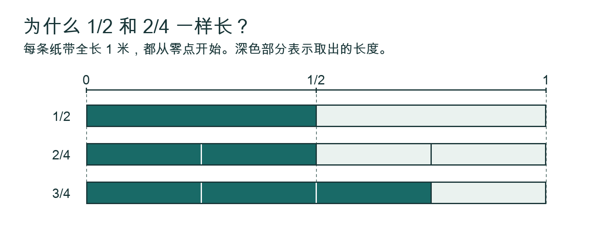
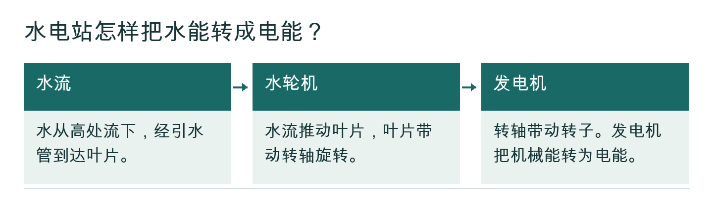
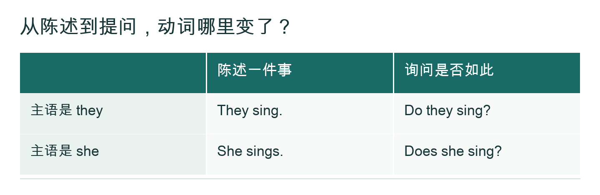
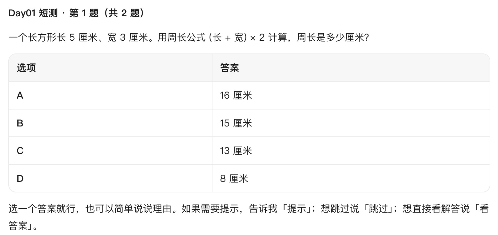
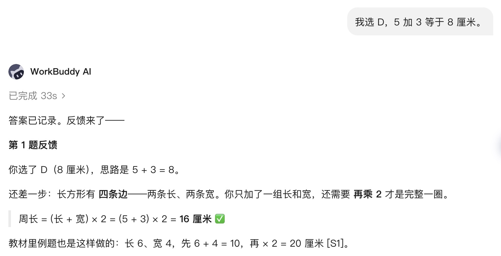
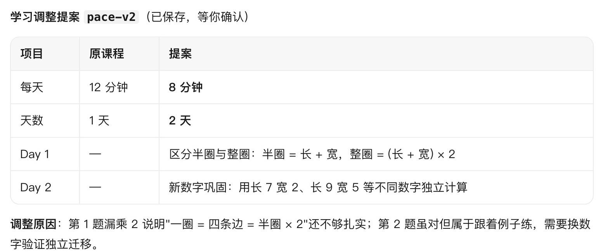

<div align="center">


# Omni Learning Anything

[](https://github.com/ShawnRen57/omni-learning-anything/releases/latest)
[](../../skills/omni-learning-anything/SKILL.md)
[](../../skills/omni-learning-anything/references/setup.md)
[](../../README.md#choose-your-learning-language)
[](../../skills/omni-learning-anything/references/setup.md)
[](../../LICENSE)
[](https://github.com/ShawnRen57/omni-learning-anything/releases)
[](https://github.com/ShawnRen57/omni-learning-anything/stargazers)

[](#output-destinations)
[](#output-destinations)
[](#output-destinations)
[](#output-destinations)

[](#output-destinations)
[](#output-destinations)
[](#output-destinations)
[](#output-destinations)
[](#output-destinations)

[English](../../README.md) · [简体中文](README_zh.md) · [日本語](README_ja.md) · [한국어](README_ko.md) · [Español](README_es.md) · [Français](README_fr.md) · [Deutsch](README_de.md) · [Português](README_pt.md) · [Русский](README_ru.md) · [العربية](README_ar.md)

**[下载 v5.0.0 技能 ZIP](https://github.com/ShawnRen57/omni-learning-anything/releases/download/v5.0.0/omni-learning-anything-skill-v5.0.0.zip)**

[skills.sh](https://skills.sh/shawnren57/omni-learning-anything/omni-learning-anything) · [安装渠道说明](../../docs/distribution-channels.md)

</div>

**用中文上第一节日语课，花一小时读懂一场 TED 演讲，或用一个月精读一本书。从你想学会的那件事开始。**

把“我想学……”变成走得下去的学习计划。你可以从 135 个内置来源中挑选，也可以拿自己的书、论文或学校教材来学。先确认计划，再开始每日学习。

试试 **“我日语零基础，用中文教我，目标是第一次上课时能自我介绍”**，或 **“找一场关于讲故事的 TED 演讲，带我用一小时读懂它”**。

| 功能名称 | 功能简介 |
| --- | --- |
| 个性化学习路径 | 从一句想学的主题或明确目标开始，按你的基础、用途和可投入时间规划。 |
| 内置学习资源库 | 67 条已有学习路径，加上 68 个新来源。可按机构、主题和资源类型查找公开课、教材、学术书、深度文章及演讲。[浏览新增资源](../../docs/curated-learning-resources.md) |
| 用母语从零学外语 | 按真实场景学表达，练习看外语懂意思、看母语说或写外语。练习卷与参考答案分开，可混入前几课的内容复习。听辨支持原声或本机合成语音。[查看两套样例](../../examples/languages/README.md) |
| 中国大陆中小学教材 | 检索小学到普通高中的 1,949 条教材索引，支持「最新版」「2025 版」等说法。索引无法确认时，Agent 会查上游仓库并联网找原书。找到可核验的原书后，可按章节、概念或公式学习，引用教材原图与页码。 |
| 用自己的材料学习 | 导入 PDF、DOCX、EPUB、PPTX、HTML、Markdown、TXT、SRT 或 VTT，选择页码、章节或时间段，以及是否补充外部资料。 |
| 来源与扩展阅读 | 关键讲解可回溯到原书页码、章节、时间戳，或有核验日期和链接的网络来源。 |
| 先看计划再开课 | 先审阅每天学什么、预计花多久，确认后再开始生成课程。 |
| 教学配图与读图练习 | 新图附读图问题、可定位的观察线索和来源。比较图看对应关系，流程图顺着箭头找变化，教材图可对照原页观察细节。 |
| 十种学习语言 | 学习计划和材料的语言可独立于原资料选择，阿拉伯语支持从右向左排版。 |
| 四种本地格式 | 输出 PDF、内嵌图片的离线 HTML、DOCX 或 Markdown。 |
| 本地与云端保存 | 保存到 Obsidian 本地库，或授权连接 Notion、飞书、钉钉和腾讯文档。 |
| 学习短测 | 学完主动发起 1–3 道小题，通过对话或宿主支持的卡片作答，可要提示、跳过或续答。 |
| 答题反馈 | 对照学习来源说明哪里答对、哪里需要补一步，并给出下一步。支持补答或纠正判断。 |
| 学习记录与复习 | 用答题证据安排时长内的小复习、按需回顾学习情况，并可导出或删除答题记录。 |
| 学习计划迭代 | 根据新目标、时间变化或答题证据提出后续调整，确认后创建独立的课程版本。 |
| Anki 导出 | 把选中的复习题导出为 CSV，供 Anki 单向导入。 |
| 继续、暂停与定时交付 | 接着最早未交付的一课学，也可暂停和恢复。定时交付使用宿主 Agent 的能力。 |
| 安装与升级 | 在兼容的 Agent 中安装和检查技能发现状态，升级时将课程档案保存在技能目录之外。 |

<a id="examples"></a>

## 讲义与练习样例

| 数学 · 看刻度 | 物理 · 顺着箭头读 | 英语 · 对照句子 |
| --- | --- | --- |
| <a href="../../examples/teaching-figures/equivalent-fractions.png"></a> | <a href="../../examples/teaching-figures/hydropower.png"></a> | <a href="../../examples/teaching-figures/present-simple.pdf"></a> |
| 哪两条纸带的深色部分停在同一刻度？第三条多出多少米？[OpenStax 教材原理](https://openstax.org/books/prealgebra-2e/pages/4-1-visualize-fractions) | 水流直接推动哪个部件？再沿第二支箭头看，转轴把什么传给了发电机？[美国能源部原理说明](https://www.energy.gov/cmei/water/how-hydropower-works) | 从 *She sings* 变成 *Does she sing?* 后，哪个词体现第三人称单数？点图可打开整页讲义。[英国文化教育协会语法说明](https://learnenglish.britishcouncil.org/free-resources/grammar/english-grammar-reference/present-simple) |

| 样例 | 打开就能学 |
| --- | --- |
| **外语学习** | 用中文学日语，跟着[三天计划](../../examples/languages/zh-ja/plan.md)练问候、请求重复和自我介绍。合上讲义，独立完成[读书会里的三轮对话](../../examples/languages/zh-ja/day03-task.md)，再看[参考回应](../../examples/languages/zh-ja/day03-task-key.md)。也可以试试英语学德语的[第一课](../../examples/languages/en-de/day01.md)和[双向回忆练习](../../examples/languages/en-de/worksheet.md)。 |
| 中小学教材 | 对照[人教版三年级数学讲义中的长方形原图](../../examples/textbooks/primary-math/Day01.pdf)，解释周长公式里为什么要乘 2。[五份教材样例](../../examples/textbooks/README.md) |
| 大学公开课 | 从哈佛[积极心理学中文讲义](../../examples/university/positive-psychology-zh/Day01.pdf)或耶鲁[音乐聆听法语讲义](../../examples/university/listening-music-fr/Day01.pdf)开始。[六组大学课程样例](../../examples/university/README.md) |
| 图解讲义 | [从机票报价中筛出可交付的候选](../../examples/agent-product/pdf/Agent%E4%BA%A7%E5%93%81%E8%AE%BE%E8%AE%A1_%E6%AF%8F%E6%97%A5%E5%AD%A6%E4%B9%A0_Day01_%E4%BB%8E%E8%81%8A%E5%A4%A9%E5%9B%9E%E7%AD%94%E5%88%B0%E5%AE%8C%E6%88%90%E4%BB%BB%E5%8A%A1.pdf) · [找出 Agent 的反馈回路](../../examples/agent-product/pdf/Agent%E4%BA%A7%E5%93%81%E8%AE%BE%E8%AE%A1_%E6%AF%8F%E6%97%A5%E5%AD%A6%E4%B9%A0_Day02_%E5%B7%A5%E4%BD%9C%E6%B5%81%E4%B8%8EAgent%E5%A6%82%E4%BD%95%E9%80%89%E6%8B%A9.pdf) · [对照画卷与馆藏记录](../../examples/ming-history/pdf/%E6%98%8E%E6%9C%9D%E5%8E%86%E5%8F%B2_%E6%AF%8F%E6%97%A5%E5%AD%A6%E4%B9%A0_Day01_%E6%97%B6%E9%97%B4%E7%BA%BF%E4%B8%8E%E5%8F%B2%E6%96%99%E5%A6%82%E4%BD%95%E4%BD%BF%E7%94%A8.pdf) · [沿手机扫码请求排查故障](../../examples/technology/pdf/%E7%A7%91%E6%8A%80%E9%80%9A%E8%AF%86_%E6%AF%8F%E6%97%A5%E5%AD%A6%E4%B9%A0_Day01_%E4%BB%8E%E6%89%8B%E6%9C%BA%E7%9C%8B%E6%8A%80%E6%9C%AF%E7%B3%BB%E7%BB%9F.pdf) · [比较两组学生继续参加自习的意愿](../../examples/university/positive-psychology-zh/Day01.pdf) |

<a href="../../examples/README.md"></a>

<a id="versions"></a>
## 版本指南

| 版本 | 对学习的帮助 |
| --- | --- |
| **[v5.0.0](../product-scope-v5.md)** | 支持母语学外语、双向练习与独立答案；用标注图帮助理解，并增加 68 个可选学习来源。 |
| **[v4.2.0](../../skills/omni-learning-anything/references/textbooks.md)** | 按版年或「最新版」查找教材。索引没有合适版本时，自动联网查找并核验原书。 |
| **[v4.1.0](../../skills/omni-learning-anything/references/assessment.md)** | 用新情境或辨错题检验能否举一反三。每题先回查原文，再验算或核对答案。 |
| **[v4.0.0](../../skills/omni-learning-anything/references/textbooks.md)** | 按中国大陆中小学教材生成分学段学习材料，支持章节、概念和公式，并标明原图页码。 |
| **v3.0.0** | 直接选择大学课程路径，核对来源版本，预览真实多语言学习文档。 |
| **v2.3–v2.6** | 按需轻量自测、使用个人材料、复习薄弱点，并更方便地安装与升级。 |
| **v2** | 十种学习语言、四种本地格式，或把课程保存在连接的文档平台中。 |
| **v1** | 先确认个人学习计划，再获取含配图、练习与延伸阅读的 PDF 课程。 |

<a id="university-courses"></a>
## 选择内置课程与学习资源

可以按标题、主题或机构找资料。试试 **“推荐一场关于语言的 TED 演讲”** 或 **“带我学耶鲁的《现代诗歌》”**。选好课程、章节或讲座，再告诉 Agent 学习语言和可用时间，就能先审阅计划。

点击标题可打开原始来源。若出版社仅提供书目介绍，可用自己有权阅读的章节来学。 [课程版本与授课者](../course-catalog-sources.md) · [资源获取说明](../curated-learning-resources.md)

<!-- catalog:start -->

| 学校、机构或作者 | 课程与资源 (135) |
| --- | --- |
| 清华大学 | **课程** [中国建筑史——史前至两宋辽金](https://higher.smartedu.cn/course/687eb7bf16c43a09c0e58c23) · [文物精品与文化中国](https://higher.smartedu.cn/course/6a5e9b52b44e493c768f8c9c) · [中国建筑史（下）（自主模式）](https://v1-www.xuetangx.com/courses/course-v1%3ATsinghuaX%2B80000901X_2%2Bsp/about) · [艺术的启示](https://higher.smartedu.cn/course/6786ec4c225d72705e5dc29e) · [校园风物与大学文化——以清华大学为例](https://higher.smartedu.cn/course/6a5e9b60b44e493c768f8cba) · [数据结构（上）](https://www.xuetangx.com/course/THU08091000384/ "数据结构(上)") · [大学历史与文化](https://next.xuetangx.com/course/THU04011000284/29592783)<br>**开放参考资料** [人工智能通识教育红皮书](https://aige.cs.tsinghua.edu.cn/redbook/) |
| 北京大学 | **课程** [经典昆曲欣赏](https://www.icourse163.org/course/PKU-1470426173?tid=1474265476) · [人工智能与信息社会](https://www.icourse163.org/course/PKU-1003471009?tid=1476756462) · [西方音乐欣赏](https://www.icourse163.org/course/PKU-1207132813?tid=1207476216) · [人工智能原理](https://www.icourse163.org/course/PKU-1002188003?tid=1472399493) · [语言学概论](https://www.icourse163.org/course/PKU-1205727813) · [古代汉语](https://www.icourse163.org/course/PKU-1205726807) · [生理学（上）](https://www.icourse163.org/course/PKU-1205915814) |
| 复旦大学 | **课程** [人工智能，语言与伦理](https://www.icourse163.org/course/FUDAN-1205951803?tid=1475942449) · [比较文化研究](https://umoocs.unipus.cn/course/7944/tasks) · [深度学习及其应用](https://higher.smartedu.cn/course/622ac9f0bee70ef79f419877) · [中华优秀传统文化](https://higher.smartedu.cn/course/63ffd464af1f1b5d3ecfd579) · [政治学原理](https://www.icourse163.org/course/FUDAN-1461787179?tid=1462604462) · [古典诗词鉴赏](https://www.icourse163.org/course/FUDAN-1205950804) |
| 上海交通大学 | **课程** [唐诗宋词人文解读](https://higher.smartedu.cn/course/69b0942995df98bb27ba19b4) · [数学的天空](https://higher.smartedu.cn/course/690530295345b68214577952) · [机器的征途：空天科技](https://higher.smartedu.cn/course/62354d7a9906eace0490b2aa) · [经济法](https://higher.smartedu.cn/course/67c2473d225d72705e7bb8c8) · [关爱生命——急救与自救技能](https://higher.smartedu.cn/course/69b0942695df98bb27ba19a1) · [建筑物理](https://www.icourse163.org/course/SJTU-1472028164) · [造型基础—设计素描](https://www.icourse163.org/course/SJTU-1206432804) · [设计创新的艺术](https://www.icourse163.org/course/SJTU-1207170808) |
| 浙江大学 | **课程** [唐诗经典](https://higher.smartedu.cn/course/6982720195df98bb27cadb06) |
| 北京师范大学 | **课程** [书法欣赏](https://www.icourse163.org/course/BNU-1003240002?tid=1488313456) |
| 哈佛大学 | **课程** [Positive Psychology](https://ppc.sas.upenn.edu/sites/default/files/ppsyllabusschachar.pdf) · [CS50’s Introduction to Computer Science](https://cs50.harvard.edu/x/2026/syllabus/) · [Justice](https://sandel.scholars.harvard.edu/justice) · [Rhetoric: The Art of Persuasive Writing and Public Speaking](https://pll.harvard.edu/course/rhetoric-art-persuasive-writing-and-public-speaking) · [CS50’s Introduction to Artificial Intelligence with Python](https://cs50.harvard.edu/ai/) · [Masterpieces of World Literature](https://www.edx.org/learn/literature/harvard-university-masterpieces-of-world-literature) · [Pyramids of Giza: Ancient Egyptian Art and Archaeology](https://giza.fas.harvard.edu/videos/) |
| 耶鲁大学 | **课程** [Introduction to Psychology](https://oyc.yale.edu/introduction-psychology/psyc-110) · [Financial Markets](https://oyc.yale.edu/economics/econ-252) · [Game Theory](https://oyc.yale.edu/economics/econ-159) · [Death](https://oyc.yale.edu/death/phil-176) · [Listening to Music](https://oyc.yale.edu/music/musi-112/lecture-1) · [Roman Architecture](https://oyc.yale.edu/history-of-art/hsar-252) · [Introduction to Theory of Literature](https://oyc.yale.edu/english/engl-300) · [The Atmosphere, the Ocean, and Environmental Change](https://oyc.yale.edu/geology-and-geophysics/gg-140) · [European Civilization, 1648-1945](https://oyc.yale.edu/history/hist-202) · [Philosophy and the Science of Human Nature](https://oyc.yale.edu/philosophy/phil-181) · [Principles of Evolution, Ecology and Behavior](https://oyc.yale.edu/ecology-and-evolutionary-biology/eeb-122) · [古希腊史导论](https://oyc.yale.edu/classics/clcv-205 "Introduction to Ancient Greek History") · [美国革命](https://oyc.yale.edu/history/hist-116 "The American Revolution") · [现代诗歌](https://oyc.yale.edu/english/engl-310 "Modern Poetry") · [资本主义的成功、危机与改革](https://oyc.yale.edu/political-science/plsc-270 "Capitalism: Success, Crisis, and Reform") · [天体物理前沿与争论](https://oyc.yale.edu/astronomy/astr-160 "Frontiers and Controversies in Astrophysics") · [基础物理一](https://oyc.yale.edu/physics/phys-200 "Fundamentals of Physics I") · [生物医学工程前沿](https://oyc.yale.edu/biomedical-engineering/beng-100 "Frontiers of Biomedical Engineering") · [饮食的心理、生物与政治](https://oyc.yale.edu/psychology/psyc-123 "The Psychology, Biology and Politics of Food") · [弥尔顿](https://oyc.yale.edu/english/engl-220 "Milton") |
| 麻省理工学院 | **课程** [Introduction to Computer Science and Programming in Python](https://ocw.mit.edu/courses/6-0001-introduction-to-computer-science-and-programming-in-python-fall-2016/video_galleries/lecture-videos/) · [Linear Algebra](https://ocw.mit.edu/courses/18-06-linear-algebra-spring-2010/pages/calendar/) · [Classical Mechanics](https://ocw.mit.edu/courses/8-01sc-classical-mechanics-fall-2016/) · [Introduction to Art History](https://ocw.mit.edu/courses/4-601-introduction-to-art-history-fall-2018/pages/calendar/) · [Principles of Microeconomics](https://ocw.mit.edu/courses/14-01-principles-of-microeconomics-fall-2023/pages/calendar/) · [Art Since 1940](https://ocw.mit.edu/courses/4-651-art-since-1940-fall-2010/pages/lecture-notes/) · [Philosophy of Film](https://ocw.mit.edu/courses/24-213-philosophy-of-film-fall-2004/pages/calendar/) · [Introduction to Deep Learning](https://introtodeeplearning.com/2026/index.html) · [Introduction to Sustainable Energy](https://ocw.mit.edu/courses/22-081j-introduction-to-sustainable-energy-fall-2010/pages/calendar/)<br>**学术书籍 · MIT Press** [深度学习（花书）](https://www.deeplearningbook.org/ "Deep Learning") · [概率机器学习导论](https://probml.github.io/pml-book/book1.html "Probabilistic Machine Learning: An Introduction") · [强化学习导论](https://mitpress.mit.edu/9780262039246/reinforcement-learning/ "Reinforcement Learning: An Introduction") |
| 斯坦福大学 | **课程** [Machine Learning](https://cs229.stanford.edu/syllabus-autumn2018.html) · [Deep Learning for Computer Vision](https://cs231n.stanford.edu/2026/schedule.html)<br>**学术书籍** [语音与语言处理](https://web.stanford.edu/~jurafsky/slp3/ "Speech and Language Processing") · [凸优化](https://web.stanford.edu/~boyd/cvxbook/ "Convex Optimization") · [应用线性代数导论](https://web.stanford.edu/~boyd/vmls/ "Introduction to Applied Linear Algebra – Vectors, Matrices, and Least Squares")<br>**深度文章 · Stanford Encyclopedia of Philosophy** [审美判断](https://plato.stanford.edu/entries/aesthetic-judgment/ "Aesthetic Judgment") · [科学方法](https://plato.stanford.edu/entries/scientific-method/ "Scientific Method") · [人格同一性](https://plato.stanford.edu/entries/identity-personal/ "Personal Identity") · [正义](https://plato.stanford.edu/entries/justice/ "Justice") · [中国伦理学](https://plato.stanford.edu/entries/ethics-chinese/ "Chinese Ethics") · [音乐哲学](https://plato.stanford.edu/entries/music/ "The Philosophy of Music") |
| 赫尔辛基大学与 MinnaLearn | **课程** [Elements of AI: Introduction to AI](https://opin.fi/en/study-options/HY/elements-of-ai-introduction-to-ai/89eb0e79-873e-4d2a-aec5-d694d7762118) · [Elements of AI: Building AI](https://buildingai.elementsofai.com/) |
| OpenAI Academy | **课程** [AI Foundations](https://academy.openai.com/public/courses/ai-foundations-dnq5w) · [Applied AI Foundations](https://academy.openai.com/public/courses/applied-ai-foundations-szsmv) · [Agents and Workflows](https://academy.openai.com/public/courses/agents-and-workflows-y0qoc) · [AI for College Students](https://academy.openai.com/public/courses/ai-for-college-students-gxgmr) |
| Anthropic · Claude Academy | **课程** [AI Fluency: Framework and foundations](https://academy.claude.com/courses/ai-fluency-framework-foundations) · [AI Fluency for students](https://academy.claude.com/courses/ai-fluency-for-students) · [AI Fluency for educators](https://academy.claude.com/courses/ai-fluency-for-educators) |
| Hugging Face | **课程** [AI Agents Course](https://huggingface.co/learn/agents-course/unit0/introduction) |
| 加州大学伯克利分校 | **课程** [Introduction to Artificial Intelligence](https://inst.eecs.berkeley.edu/~cs188/sp26/) |
| DeepLearning.AI | **课程** [AI For Everyone](https://www.coursera.org/learn/ai-for-everyone/) · [Generative AI for Everyone](https://www.coursera.org/learn/generative-ai-for-everyone/) |
| Microsoft | **课程** [Generative AI for Beginners](https://github.com/microsoft/generative-ai-for-beginners/blob/79a4334e158147d4f36c27d805e0cb163c1e445b/README.md#-lessons) |
| Google | **课程** [Google AI Essentials](https://grow.google/ai-essentials/) |
| Smarthistory | **开放参考资料** [Reframing Art History](https://smarthistory.org/reframing-art-history/) |
| 莱斯大学 · OpenStax | **教材** [天文学（第二版）](https://openstax.org/books/astronomy-2e/pages/preface "Astronomy 2e") · [生物学（第二版）](https://openstax.org/books/biology-2e/pages/preface "Biology 2e") · [心理学（第二版）](https://openstax.org/books/psychology-2e/pages/preface "Psychology 2e") · [社会学导论（第三版）](https://openstax.org/books/introduction-sociology-3e/pages/preface "Introduction to Sociology 3e") · [经济学原理（第三版）](https://openstax.org/books/principles-economics-3e/pages/preface "Principles of Economics 3e") · [化学（第二版）](https://openstax.org/books/chemistry-2e/pages/preface "Chemistry 2e") · [大学物理第一卷](https://openstax.org/books/university-physics-volume-1/pages/preface "University Physics Volume 1") · [微积分第一卷](https://openstax.org/books/calculus-volume-1/pages/preface "Calculus Volume 1") · [世界史第一卷：至1500年](https://openstax.org/books/world-history-volume-1/pages/preface "World History Volume 1, to 1500") · [哲学导论](https://openstax.org/books/introduction-philosophy/pages/preface "Introduction to Philosophy") · [统计学导论（第二版）](https://openstax.org/books/introductory-statistics-2e/pages/preface "Introductory Statistics 2e") · [创业学](https://openstax.org/books/entrepreneurship/pages/preface "Entrepreneurship") · [商业伦理](https://openstax.org/books/business-ethics/pages/preface "Business Ethics") |
| 《动手学深度学习》作者团队 | **学术书籍** [动手学深度学习](https://zh.d2l.ai/) |
| O’Reilly | **学术书籍** [R 数据科学（第二版）](https://r4ds.hadley.nz/ "R for Data Science (2e)") |
| Distill | **深度文章** [注意力与增强循环神经网络](https://distill.pub/2016/augmented-rnns/ "Attention and Augmented Recurrent Neural Networks") · [正确使用 t-SNE](https://distill.pub/2016/misread-tsne/ "How to Use t-SNE Effectively") · [特征可视化](https://distill.pub/2017/feature-visualization/ "Feature Visualization") · [动量法为什么有效](https://distill.pub/2017/momentum/ "Why Momentum Really Works") · [反卷积与棋盘伪影](https://distill.pub/2016/deconv-checkerboard/ "Deconvolution and Checkerboard Artifacts") · [图神经网络导论](https://distill.pub/2021/gnn-intro/ "A Gentle Introduction to Graph Neural Networks") · [卷积神经网络感受野](https://distill.pub/2019/computing-receptive-fields/ "Computing Receptive Fields of Convolutional Neural Networks") · [高斯过程的可视化探索](https://distill.pub/2019/visual-exploration-gaussian-processes/ "A Visual Exploration of Gaussian Processes") |
| 加州理工学院 | **系列讲座** [费曼物理学讲义第一卷](https://www.feynmanlectures.caltech.edu/I_toc.html "The Feynman Lectures on Physics, Volume I") · [费曼物理学讲义第二卷](https://www.feynmanlectures.caltech.edu/II_toc.html "The Feynman Lectures on Physics, Volume II") · [费曼物理学讲义第三卷](https://www.feynmanlectures.caltech.edu/III_toc.html "The Feynman Lectures on Physics, Volume III") |
| 英国皇家研究院 | **系列讲座** [人工智能的真相](https://www.rigb.org/christmas-lectures/watch-2023-christmas-lectures "The truth about AI")<br>**演讲** [在宇宙中成长：在宇宙中醒来（第一讲）](https://www.rigb.org/explore-science/explore/video/growing-universe-waking-universe-1991 "Growing up in the universe – Waking up in the universe (1991)") |
| TED | **演讲** [语言如何塑造思维](https://www.ted.com/talks/lera_boroditsky_how_language_shapes_the_way_we_think "How language shapes the way we think") · [单一故事的危险](https://www.ted.com/talks/chimamanda_ngozi_adichie_the_danger_of_a_single_story "The danger of a single story") · [你见过的最精彩的统计数据](https://www.ted.com/talks/hans_rosling_the_best_stats_you_ve_ever_seen "The best stats you’ve ever seen") · [学校会扼杀创造力吗](https://www.ted.com/talks/sir_ken_robinson_do_schools_kill_creativity "Do schools kill creativity?") · [内向者的力量](https://www.ted.com/talks/susan_cain_the_power_of_introverts "The power of introverts") · [拖延者的大脑](https://www.ted.com/talks/tim_urban_inside_the_mind_of_a_master_procrastinator "Inside the mind of a master procrastinator") · [更好交谈的十种方式](https://www.ted.com/talks/celeste_headlee_10_ways_to_have_a_better_conversation "10 ways to have a better conversation") · [怎样说话让人愿意听](https://www.ted.com/talks/julian_treasure_how_to_speak_so_that_people_want_to_listen "How to speak so that people want to listen") · [脆弱的力量](https://www.ted.com/talks/brene_brown_the_power_of_vulnerability "The power of vulnerability") · [我们都应该是女性主义者](https://www.ted.com/talks/chimamanda_ngozi_adichie_we_should_all_be_feminists "We should all be feminists") |

<!-- catalog:end -->

每天 10 分钟意味着完成一个小学习步骤，并不等于学完原课程的一整讲或整门课。原始学习量会明确标示，长篇阅读、习题和项目需要另留时间；来源内容与可访问性也可能变化。这些是依据公开课程来源编排的独立学习路径，不打包完整授课内容，不代表大学背书，也不提供大学证书。

## 用自己的材料学习

支持 PDF、TXT、Markdown、HTML、DOCX、EPUB、PPTX、SRT 和 VTT。可指定章节、页码或时间戳，并决定是否允许外部补充。讲解与自测会追溯到选定的原文位置。旧版 DOC、RTF 需先通过可信工具转换。

想法模糊也能开始，比如“我想懂一点经济学”。Agent 会提出可选方向，说明假设，只追问会影响课程的问题；目标清楚时则直接进入计划。

<a id="choose-your-learning-language"></a>
## 选择学习语言

**English · 简体中文 · 日本語 · 한국어 · Español · Français · Deutsch · Português · Русский · العربية**

学习计划与课程正文支持上述十种语言，可与原始材料或本页语言不同。阿拉伯语文档使用从右向左的排版。

<a id="output-destinations"></a>
## 选择课程保存位置

| 保存位置 | 使用方式 |
| --- | --- |
| PDF · HTML · DOCX · Markdown | 指定课程文件夹与 PDF、HTML、DOCX 或 Markdown 格式。HTML 把配图保存在同一个离线文件中，外部来源链接需联网。 |
| Notion | 通过官方 `ntn` CLI 连接父页面。 |
| Obsidian | 指定现有本地 Vault 与课程子目录，不调用 Obsidian API。 |
| Feishu / 飞书 | 通过官方 `lark` CLI 和用户授权连接文档文件夹。 |
| DingTalk / 钉钉 | 通过官方 `dws` CLI 连接文件夹，可能需要组织管理员批准。 |
| Tencent Docs / 腾讯文档 | 指定根目录或文件夹，通过官方 OAuth/MCP 完成授权。 |

告诉 Agent 想存在哪里，它会检查已有访问权限、引导补齐配置，并复用已命名的连接。请不要在聊天中粘贴密码或令牌。

<a id="quick-start"></a>
## 安装与开始

请 Agent 安装最新版本，并确认当前客户端能发现和使用技能。升级时保留已有课程与连接。已安装 Node.js 时可运行：

```sh
npx skills@latest add ShawnRen57/omni-learning-anything --skill omni-learning-anything -g
```

在 Claude Code 中使用插件安装器：

```text
/plugin install omni-learning-anything --marketplace ShawnRen57/omni-learning-anything
```

没有 Node.js，也可下载上方 ZIP，通过客户端技能上传或请 Agent 协助安装。`skills.sh` 已上线；SkillHub 当前上架版本为 v2.6.0。各渠道可用版本请查看渠道说明。

## 试着开始第一门课

```text
展示内置课程。以哈佛 CS50x 2026 为来源。
我是初学者，用中文教我，每天 20 分钟。
保留原单元顺序，标明原始学习量。
保存为课程文件夹中的离线 HTML，先让我确认计划。
```

也可以说：“用每天 15 分钟带我读这本 EPUB 的前两章”，或“用耶鲁《金融市场》2011 版帮我理解金融机构”。

确认计划后，请 Agent 开始第一课。回来时说“从最早未交付的一课继续”，需要时可暂停。只有宿主支持定时、且你确认时间与时区后才能安排自动执行；约定时间开始生成，完成检索与检查后交付。

## 轻量自测、反馈与复习

想检查理解时，可要 1–3 道卡片或纯文字小题。Agent 可以换一个情境、让你找出错误，或按学习目标选用原题和概念回忆。出题前会回查所选材料和页码，并重做一遍核对答案。可以说「用 Day01 教过的知识点给我一道新情境题，看看我能不能举一反三」。作答后可查看带出处的反馈和学习记录。

问“今天该复习什么”，可在已有时间预算内安排少量复习；问“这周的回答说明了什么”，可看到有依据的回顾。你能纠正判断、跳过主题，或优先学新课。复习不会额外创建自动测验或计时任务。

未来课程的调整先由你确认，再开启新版本；原计划与历史仍可查阅。还可按需单向导出 Anki CSV 卡片，不自动双向同步。

<a id="workbuddy-demo"></a>
### WorkBuddy 实测：短测、反馈与计划迭代

在 WorkBuddy AI 5.8.4 的演示中，模拟学习者把长和宽只加了一次。WorkBuddy 记录作答，解释为什么这只算了半圈，再根据错因提议两次更短的学习。确认调整后，客户端生成了独立的待审批计划，并保留教材原图。教材计划迭代使用了本仓库中的修复。

**1. 发起短测**



**2. 看懂错在哪里**



**3. 查看调整后的学习计划**



## 使用指南与运行条件

[安装与升级](../../skills/omni-learning-anything/references/install.md) · [格式与字体](../../skills/omni-learning-anything/references/setup.md) · [连接文档平台](../../skills/omni-learning-anything/references/onboarding.md) · [分发渠道状态](../../docs/distribution-channels.md) · [v4.0.0 版本验证](../../docs/release-validation-v4.0.0.md)

这是一个 Agent Skill，使用宿主提供的检索、文档与定时工具。仅 PDF 需要 XeLaTeX。云端访问、跨设备同步与无人值守交付取决于宿主、账号和授权条件；会检查当前客户端能力，不承诺所有平台通用。

[MIT](../../LICENSE) · [Changelog](../../CHANGELOG.md) · [Attribution](../../ATTRIBUTION.md)
