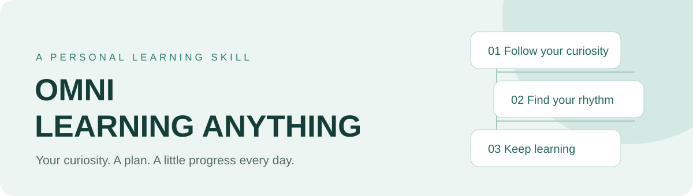

<div align="center">



# Omni Learning Anything

[](https://github.com/ShawnRen57/omni-learning-anything/releases) [](../../LICENSE)

[English](../../README.md) · [简体中文](README_zh.md) · [日本語](README_ja.md) · [한국어](README_ko.md) · [Español](README_es.md) · [Français](README_fr.md) · [Deutsch](README_de.md) · [Português](README_pt.md) · [Русский](README_ru.md) · [العربية](README_ar.md)

**[下载 Skill ZIP](https://github.com/ShawnRen57/omni-learning-anything/releases/latest/download/omni-learning-anything-skill-v2.2.0.zip)**

</div>

**把“我想学……”变成每天可以走下去的学习路径。**

告诉 Agent 你想学什么。Omni 会围绕你的目标、基础和可投入的时间安排课程，先给你学习计划，再带你阅读图文材料、练习、自检，并沿着来源继续探索。

<a id="versions"></a>
## 版本说明

| 版本 | 你可以怎么用 |
| --- | --- |
| **v1** | 拥有自己的 PDF 课程：先确认学习计划，再逐日收到带插图、练习和扩展阅读的学习材料。 |
| **v2** | 把课程放在你习惯学习的地方：本地文件、Notion、Obsidian、飞书、钉钉或腾讯文档。Agent 引导连接，并记住你选定的保存位置。 |
| **v2.2.0** | 新增可在浏览器离线阅读的 HTML；课程可使用 10 种语言；钉钉和腾讯文档也可以由 Agent 引导完成官方授权。 |

## 你可以怎么学

- 为旅行、工作项目、面试或个人兴趣，安排贴合目标的学习路线。
- 按每天可投入的时间学习，结合概念解释、插图、练习和参考要点。
- 知道知识从哪里来：文中附引用，每份文档至少有五个带说明的扩展阅读链接。
- 中断后接着上次的进度继续；先看计划、确认后再开始每日学习。

## 选择你的学习语言

**English · 简体中文 · 日本語 · 한국어 · Español · Français · Deutsch · Português · Русский · العربية**

学习计划与每日材料均可使用以下语言。主题、来源及 README 的语言不必与课程语言相同；阿拉伯语支持从右到左排版。

## 选择课程保存位置

| 保存到 | 告诉 Agent 什么 |
| --- | --- |
| 本地 PDF · HTML · DOCX · Markdown | 课程目录和文件格式。HTML 把图片放在同一个文件里，可离线阅读；扩展链接需要联网打开。 |
| Notion | 课程父页面链接，以及你想使用的工作区。 |
| Obsidian | 已有的本地 Vault 和课程子目录，无需 API key。 |
| Feishu / 飞书 | 课程文件夹链接；需要时按引导完成官方应用配置和用户授权。 |
| DingTalk / 钉钉 | 文档文件夹链接和组织；管理员可能需要为你启用 CLI 访问。 |
| Tencent Docs / 腾讯文档 | 首页根目录或个人文件夹链接；登录官方页面并核对授权。 |

你只需说清课程存在哪里。Agent 会检查已有授权，只询问缺少的信息，提供平台操作指引，并复用命名连接。无需查对象 ID、手写配置文件，也不要把密码或 Token 发到聊天里。组织审批等情况可能需要额外步骤。

<a id="quick-start"></a>
## 从对话开始

把这段话发送给你的 Agent：

```text
请安装 omni-learning-anything：https://github.com/ShawnRen57/omni-learning-anything
优先使用 Releases 最新的 Skill ZIP，完整保留技能文件夹。
确认当前客户端能够发现该技能，并告诉我如何开始。
```

然后，说出你想学什么：

```text
用 omni-learning-anything 带我学习旅行用的建筑史。
我是初学者，学 30 天，每天 15 分钟，中文。
保存为课程目录中的离线 HTML。先给我计划，等我确认。
```

先审阅计划，需要时提出调整，再确认开始。如果 Agent 支持定时任务，可约定执行时间和时区；否则在准备好时让它继续。定时时间是开始生成的时间，检索与检查完成后才会交付。

```text
继续这个 Omni Learning Anything 课程，从最早未交付的一课开始。
暂停这个课程和对应的定时任务。
请保留旧课程，为我的新目标提出一版新计划。
```

<a id="examples"></a>
## 看看课程长什么样

这里有科技、经济学、音乐、Agent 产品设计、西方建筑史和明朝历史的完整计划及每日 PDF。样例保留原始来源核验日期，你可以参考它们安排自己的课程。

| Technology | Economics | Music |
| :---: | :---: | :---: |
| [](../../examples/technology/) | [](../../examples/economics/) | [](../../examples/music/) |

| Agent products | Architecture | Ming history |
| :---: | :---: | :---: |
| [](../../examples/agent-product/) | [](../../examples/architecture/) | [](../../examples/ming-history/) |

## 安装与使用指南

[安装到你的 Agent](../../skills/omni-learning-anything/references/install.md) · [文件格式与字体配置](../../skills/omni-learning-anything/references/setup.md) · [连接云文档](../../skills/omni-learning-anything/references/onboarding.md) · [版本验证记录](../../docs/release-validation-v2.2.0.md)

这是一个 Agent Skill，使用你当前 Agent 的检索、文档和定时工具。仅 PDF 需要 XeLaTeX。云文档通过官方 API/CLI 写入，Obsidian 写入本地 Vault；跨设备同步和无人值守执行取决于客户端与账号条件。

[MIT](../../LICENSE) · [Changelog](../../CHANGELOG.md) · [Attribution](../../ATTRIBUTION.md)
