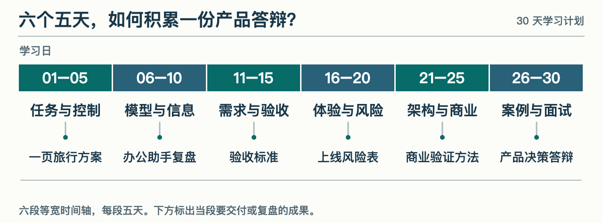

# Agent产品设计：30天学习计划

2026-11-25 | 学习计划 / 30 天

## 学习者与目标

适合：具备通用产品经验、AI技术基础有限的产品经理。

本轮目标：能定义Agent任务、权限和验收，并清楚说明产品取舍。30天用于建立入门框架与方法，不承诺掌握整个学科。除明确说明的基础外，不假设学习者的行业经历。原始启动句：“我想学习Agent产品设计，准备产品经理面试。”

## 学习方式与时间安排

每天预计10–15分钟：正文与读图约8分钟，回忆和练习约3分钟，可用余下时间复述。学习速度存在差异，时间为估计值；扩展阅读不计入必做量。每天10:00（Asia/Shanghai，含周末）开始生成，检查完成后交付。计划确认后可立即生成Day01。

本文件是公开演示样例：30天完整课纲，配套展示Day01–Day03；试跑不创建真实定时任务。

在六段时间轴下方，圈出本阶段结束时应该拿得出来的那份产物。

按五天分段的产品实作路线 哪一段开始把产品目标写成验收标准？ 第 11–15 天的「需求与验收」连接到验收标准，之后才进入风险评估与商业验证。 \[S1\] \[S3\]

原创课程进度图；编排结合任务设计与评估方法。

## 课程依据与学习成果

先从从聊天回答到完成任务进入，逐渐引入领域概念，再通过案例与复盘连接。来源[S1]和[S2]提供起点知识；其他链接扩展相关视角。课程排序是本项目的教学设计，不是来源机构为本项目背书。

完成时应能：写出任务完成条件；写出可执行的验收标准；完成一次有依据的产品答辩。每五天安排一次回顾或整合，检查能否脱离正文解释，不以“收到PDF”代替学会。

## 阶段1：任务与控制

Day01  从聊天回答到完成任务
目标：写出任务完成条件。

Day02  工作流与Agent如何选择
目标：依据不确定性选择控制方式。

Day03  工具权限与用户确认
目标：写出具体授权与确认点。

Day04  任务状态与失败恢复
目标：区分保存恢复和重新执行。

Day05  复盘旅行助手方案
目标：提交旅行助手一页方案。

## 阶段2：模型与信息

Day06  模型能力与上下文
目标：指出上下文遗漏的影响。

Day07  检索与知识来源
目标：设计来源与回答核对。

Day08  记忆与用户控制
目标：区分工作状态与长期偏好。

Day09  规划与停止条件
目标：定义停止与求助条件。

Day10  复盘办公助手
目标：复盘办公任务的失败路径。

## 阶段3：需求与验收

Day11  目标用户与任务价值
目标：确定目标用户和高价值任务。

Day12  选择第一批场景
目标：选择可验证的最小场景。

Day13  评估集与成功标准
目标：设计成功失败与边界样例。

Day14  轨迹与错误归因
目标：区分模型工具和环境错误。

Day15  复盘产品验收
目标：写出可执行的验收标准。

## 阶段4：体验与风险

Day16  延迟成本与体验
目标：权衡质量等待和单位成本。

Day17  信任与可解释反馈
目标：设计用户看得懂的进度。

Day18  人工接管设计
目标：明确接管触发与交接内容。

Day19  隐私与数据边界
目标：画出权限范围和数据流。

Day20  复盘上线风险
目标：列出上线前必须验证的问题。

## 阶段5：架构与商业

Day21  单Agent与多Agent
目标：解释何时增加协作收益。

Day22  工具生态与集成
目标：比较集成成本与覆盖价值。

Day23  商业模式与计费
目标：将计费单位对应用户价值。

Day24  留存与复用习惯
目标：区分一次体验和持续使用。

Day25  复盘商业闭环
目标：提出商业假设及验证方法。

## 阶段6：案例与面试

Day26  竞品比较方法
目标：按相同任务比较产品。

Day27  产品案例表达
目标：用问题取舍证据讲案例。

Day28  模拟面试与追问
目标：回答追问并承认未知。

Day29  完善一页方案
目标：补齐方案中的关键缺口。

Day30  结业：产品决策答辩
目标：完成一次有依据的产品答辩。

## 自测、调整与确认

每天先尝试作答，再看参考要点；答不出来时记录具体概念，不据此给自己贴能力标签。每五天用一张卡整理“已经能解释／仍不确定／需要查证”。若学习量过大，优先缩小每日范围并保留主线，不靠减小字体压缩材料。

真实使用时，请确认目标、基础、周期、每天用时、执行时间、时区与输出目录。批准当前计划后才创建任务；修改已开始的课程时保留旧档案并建立新版本。到期漏跑则继续最早未交付课程，不按日期跳课。

## 扩展学习（选读）

- [S1] [Building effective agents](https://www.anthropic.com/engineering/building-effective-agents): 读工作流与 Agent 的区分；用作架构框架，不把旧工具清单当最新。; Anthropic | 发布: 2024-12-19 | 核验: 2026-11-25

- [S2] [Writing effective tools for agents](https://www.anthropic.com/engineering/writing-tools-for-agents): 关注工具边界、返回结果和评价方法如何影响可用性。; Anthropic | 发布: 2025-09-11 | 核验: 2026-11-25

- [S3] [Demystifying evals for AI agents](https://www.anthropic.com/engineering/demystifying-evals-for-ai-agents): 理解结果评价与执行轨迹；为后续验收指标课程准备。; Anthropic | 发布: 2026-01-09 | 核验: 2026-11-25

- [S4] [Model Context Protocol specification](https://modelcontextprotocol.io/specification/2025-06-18): 阅读指定版本的用途和安全原则；不称其为最新版本。; MCP project | 发布: 2025-06-18（指定版本） | 核验: 2026-11-25

- [S5] [Agents in ADK](https://adk.dev/agents/): 比较 LLM Agent、工作流 Agent 与自定义 Agent 的分类。; Google ADK | 发布: 未标注 | 核验: 2026-11-25
