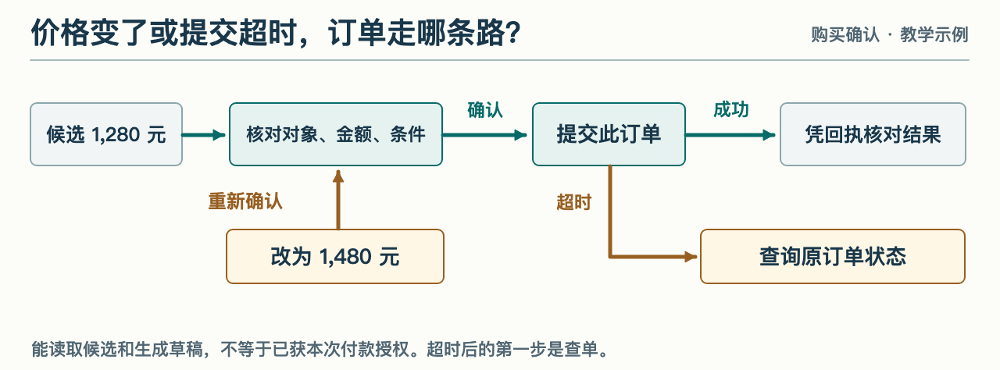

# 工具权限与用户确认

2026-11-25 | Day03/30 | 阅读 8 分钟 + 练习 3 分钟

## 今日导航

今天回答：用户说“帮我安排”，是否意味着可以直接支付？目标是区分能力、权限和本次授权，并设计一个具体的确认点。先回忆昨日混合方案：哪些步骤可以探索，哪些动作必须受到确定约束？

## 会调用不等于被允许调用

工具告诉系统怎样读取或改变外部状态；权限限定它可以访问的范围；本次授权说明用户具体要求做什么。拥有付款工具，不代表用户每次咨询都授权付款。一个工具描述再清楚，也不能替代产品侧的访问控制。

MCP 的指定版本规范讨论工具与资源的连接及安全原则；协议能帮助标准化连接，却不会自动保证业务动作正确。[S4] 这里引用的是明确版本的原则，不把它称为当前所有平台的统一实现。

分别追踪两条赭色箭头，找出需要用户再授权和需要系统查单的位置。

购买确认与超时后的恢复路径 价格变化与提交超时各自回到哪一步？ 左侧变价箭头返回确认环节；右侧超时箭头通往查询原订单状态，直接再次付款不在恢复路径内。 \[S2\] \[S3\] \[S4\]

原创教学流程；价格、订单及状态均为示例。

## 把读、准备与提交分开

查询候选通常读取信息；生成订单草稿准备改变状态；支付或发送会对外产生结果。这些动作的后果不同，适合不同的确认强度。工具设计资料强调明确的用途和返回信息，本课把它落实为用户可理解的动作边界。[S2]

图中「核对对象、金额、条件」位于候选与提交订单之间。确认应让用户看见具体对象、金额、时间、重要条件和即将发生的动作，而不是只问“是否继续”。如果确认后价格变化或对象更换，原确认不再完整覆盖新动作，应重新取得针对变化内容的同意。

可撤销不等于没有成本。取消订单可能产生费用，邮件撤回可能失败。设计权限时，应依据真实后果与用户意图，而不是仅依据界面是否有一个撤销按钮。

## 教学案例：避免重复购买

假设提交订单后网络超时，界面没有收到成功消息。此时不能直接推断购买失败并再提交一次。先查询订单状态，再决定恢复动作；若无法确认，向用户说明不确定性。这里讨论的是一般设计原则，不是具体支付接口实现。

用户看到的状态应区分“草稿已准备”“等待确认”“提交中”“结果未知”和“已确认完成”。这能让失败恢复有依据。最终验收既检查票是否符合要求，也检查是否在授权范围内、是否发生重复提交。评估框架要包含异常轨迹，而不能只测一路顺利的样例。[S3]

## 三分钟练习与面试自查

写一条具体的购买前确认文案，包含对象、总金额、日期与关键条件。再写网络超时后的第一步。

参考文案：“将购买10月12日某航班的指定席位，总额为已展示的金额；请核对旅客、时间和退改规则后确认付款。”真实产品必须填入实际核验值，不能保留“某航班”等占位。超时后先查订单状态。追问：用户先前确认过另一个价格怎么办？应说明变化，不能把旧确认挪用到新价格。

## 复盘与明日连接

可靠的 Agent 产品把能做、允许做和这次要做区分开。确认不是打断用户的固定仪式，而是让有后果的具体动作可审阅。明天把今天的状态区分展开，学习长任务如何保存进度并在失败后恢复。

## 扩展学习（选读）

- [S1] [Building effective agents](https://www.anthropic.com/engineering/building-effective-agents): 读工作流与 Agent 的区分；用作架构框架，不把旧工具清单当最新。; Anthropic | 发布: 2024-12-19 | 核验: 2026-11-25

- [S2] [Writing effective tools for agents](https://www.anthropic.com/engineering/writing-tools-for-agents): 关注工具边界、返回结果和评价方法如何影响可用性。; Anthropic | 发布: 2025-09-11 | 核验: 2026-11-25

- [S3] [Demystifying evals for AI agents](https://www.anthropic.com/engineering/demystifying-evals-for-ai-agents): 理解结果评价与执行轨迹；为后续验收指标课程准备。; Anthropic | 发布: 2026-01-09 | 核验: 2026-11-25

- [S4] [Model Context Protocol specification](https://modelcontextprotocol.io/specification/2025-06-18): 阅读指定版本的用途和安全原则；不称其为最新版本。; MCP project | 发布: 2025-06-18（指定版本） | 核验: 2026-11-25

- [S5] [Agents in ADK](https://adk.dev/agents/): 比较 LLM Agent、工作流 Agent 与自定义 Agent 的分类。; Google ADK | 发布: 未标注 | 核验: 2026-11-25
