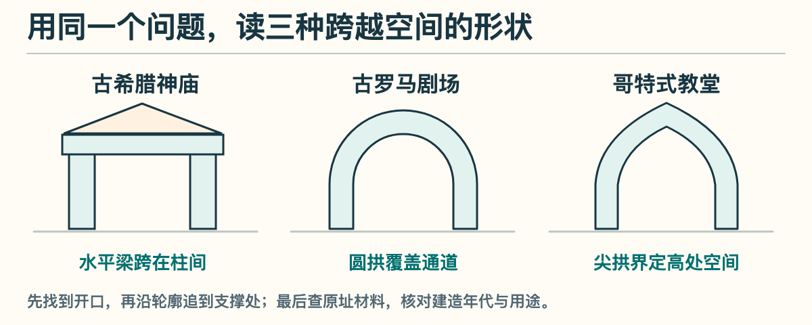

# 西方建筑史：30天学习计划

2026-11-25 | 学习计划 / 30 天

## 学习者与目标

适合：无建筑专业背景的旅行与文化爱好者。

本轮目标：能从空间、结构、用途和时代背景阅读建筑。30天用于建立入门框架与方法，不承诺掌握整个学科。除明确说明的基础外，不假设学习者的行业经历。原始启动句：“我想学习西方建筑史，旅行时能看懂建筑。”

## 学习方式与时间安排

每天预计10–15分钟：正文与读图约8分钟，回忆和练习约3分钟，可用余下时间复述。学习速度存在差异，时间为估计值；扩展阅读不计入必做量。每天10:00（Asia/Shanghai，含周末）开始生成，检查完成后交付。计划确认后可立即生成Day01。

本文件是公开演示样例：30天完整课纲，配套展示Day01–Day03；试跑不创建真实定时任务。

先看每个开口中央的上缘，再沿这条线找到两侧支撑。

用开口与支撑对照三类建筑。 哪个开口的顶部是水平的？另两个轮廓如何相遇？ 左图的梁跨过柱间；中图呈圆弧，右图的两段曲线在顶端交尖。形状可以帮助选资料，年代和用途仍需核实。 \[S1\] \[S2\] \[S5\]

原创轮廓示意；希腊、罗马及沙特尔案例据大都会和 UNESCO。

## 课程依据与学习成果

先从建筑如何被阅读进入，逐渐引入领域概念，再通过案例与复盘连接。来源[S1]和[S2]提供起点知识；其他链接扩展相关视角。课程排序是本项目的教学设计，不是来源机构为本项目背书。

完成时应能：区分平面立面和剖面；比较形式与赞助背景；完成有证据的建筑观察册。每五天安排一次回顾或整合，检查能否脱离正文解释，不以“收到PDF”代替学会。

## 阶段1：古典与观察方法

Day01  建筑如何被阅读
目标：区分平面立面和剖面。

Day02  希腊柱式与梁柱体系
目标：从构件关系理解柱式。

Day03  罗马拱券与公共空间
目标：关联拱券通道与公共活动。

Day04  巴西利卡与早期基督教
目标：说明空间类型与用途变化。

Day05  复盘古典建筑
目标：比较希腊和罗马观察方法。

## 阶段2：中世纪

Day06  拜占庭与穹顶
目标：辨认穹顶与空间组织。

Day07  罗曼式的空间
目标：观察墙体开口与体量。

Day08  哥特式的结构
目标：关联支撑采光和高度。

Day09  教堂与中世纪城市
目标：把单体放回城市网络。

Day10  复盘中世纪建筑
目标：制作中世纪建筑比较卡。

## 阶段3：文艺复兴到巴洛克

Day11  文艺复兴的比例
目标：观察比例与古典引用。

Day12  集中式与纵向空间
目标：比较两种空间组织。

Day13  帕拉第奥的古典语言
目标：识别古典语言的重新组合。

Day14  巴洛克的运动感
目标：描述路线和视觉运动。

Day15  复盘早期近代建筑
目标：比较形式与赞助背景。

## 阶段4：工业时代

Day16  新古典主义与公共建筑
目标：说明古典形式的公共含义。

Day17  工业材料与新跨度
目标：辨认材料对跨度的影响。

Day18  现代城市与基础设施
目标：把建筑放入交通卫生系统。

Day19  工艺美术与新艺术
目标：比较工艺与工业的关系。

Day20  复盘工业时代
目标：解释工业化的一项空间后果。

## 阶段5：现代建筑

Day21  现代主义的功能观
目标：区分功能宣言与使用实际。

Day22  包豪斯与设计教育
目标：关联教育材料与设计方法。

Day23  现代住宅与生活
目标：分析住宅里的生活假设。

Day24  粗野主义与公共性
目标：比较材料表达与公共用途。

Day25  复盘现代建筑
目标：评价现代建筑的一项取舍。

## 阶段6：比较与遗产

Day26  后现代与历史引用
目标：识别历史符号的再使用。

Day27  地域材料与气候
目标：用气候解释设计选择。

Day28  建筑遗产与修复
目标：区分保护修复和重建。

Day29  比较两栋建筑
目标：用同一框架比较两栋建筑。

Day30  结业：旅行建筑观察册
目标：完成有证据的建筑观察册。

## 自测、调整与确认

每天先尝试作答，再看参考要点；答不出来时记录具体概念，不据此给自己贴能力标签。每五天用一张卡整理“已经能解释／仍不确定／需要查证”。若学习量过大，优先缩小每日范围并保留主线，不靠减小字体压缩材料。

真实使用时，请确认目标、基础、周期、每天用时、执行时间、时区与输出目录。批准当前计划后才创建任务；修改已开始的课程时保留旧档案并建立新版本。到期漏跑则继续最早未交付课程，不按日期跳课。

## 扩展学习（选读）

- [S1] [Architecture in Ancient Greece](https://www.metmuseum.org/essays/architecture-in-ancient-greece): 观察柱式如何连接立柱与建筑其他部分，而非只认柱头。; The Metropolitan Museum of Art | 发布: 2003-10-01 | 核验: 2026-11-25

- [S2] [Theater and Amphitheater in the Roman World](https://www.metmuseum.org/essays/theater-and-amphitheater-in-the-roman-world): 了解拱券、看台、通道与社会秩序之间的关系。; The Metropolitan Museum of Art | 发布: 2006-10-01 | 核验: 2026-11-25

- [S3] [Acropolis, Athens](https://whc.unesco.org/en/list/404/): 结合雅典卫城原址资料，区分单栋建筑与建筑群。; UNESCO | 发布: 未标注 | 核验: 2026-11-25

- [S4] [Historic Centre of Rome](https://whc.unesco.org/en/list/91/): 观察城市历史叠加；不要把罗马城市归为单一风格。; UNESCO | 发布: 未标注 | 核验: 2026-11-25

- [S5] [Chartres Cathedral](https://whc.unesco.org/en/list/81/): 为后续哥特建筑预习，关注结构、空间与彩色玻璃。; UNESCO | 发布: 未标注 | 核验: 2026-11-25
