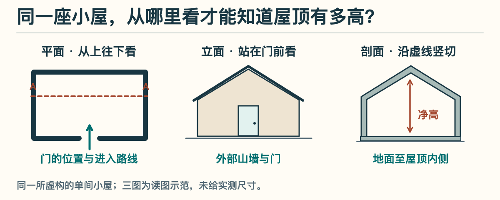

# 建筑如何被阅读

2026-11-25 | Day01/30 | 阅读 8 分钟 + 练习 3 分钟

## 今日导航

今天回答：面对一栋陌生建筑，除了说“漂亮”，还能看什么？目标是用空间、结构、用途和背景四个问题观察建筑，并区分平面、立面和剖面。课程以西方建筑史为主线，但不把它等同于全球建筑史。

## 从站在哪里开始

你在一座教堂门前拍照，看到的是正面形象；走进去后，尺度、光线和路线可能完全改变体验。照片能提供信息，也会受镜头、光线和站位影响。建筑是可进入的空间，不只是立面上的图案。第一步可以问：人从哪里进入，往哪里走，什么地方允许停留？

在平面上找到穿过小屋的 A—A 虚线，对照右侧剖面中这次竖切露出的高度。

同一座小屋的平面、正立面和横剖面。 要看从门口怎么走，或地面到屋顶内侧有多高，分别读哪幅图？ 左侧平面的箭头穿过门洞；右侧剖面的竖向箭头从地面指向屋顶内侧。正立面只给出门和山墙的外观。 \[S6\]

原创图例；视图定义参照约翰·索恩爵士博物馆图纸导读。

## 三种图纸回答不同问题

平面像在某个高度水平切开建筑后向下看，帮助辨认房间、柱墙与路线。立面表达从某一方向正看外部的形态。剖面则沿竖向切开，揭示层高、屋顶和空间之间的关系。图中三幅视图都来自同一座虚构小屋；比较门洞与切线可以判断图纸各自能回答什么。[S6]

再加四个观察问题：谁使用？怎样站得住？材料和施工怎样组织？在什么社会环境中形成？柱子可能承重，也可能参与装饰；大厅可能用于仪式，也可能用于公共活动。仅凭外形就断定用途或结构，需要额外证据。

## 用案例建立观察顺序

罗马剧场材料把看台支撑、通道和观众安排联系起来，说明建筑形式与活动及社会组织有关。[S2] 今天不必记具体尺寸，只要理解同一空间可以同时解决工程问题和秩序问题。

旅行时建议先看现场说明确认年代与用途，再画一条主要行走路线，最后观察墙、柱、开口和屋顶怎样关联。像罗马历史中心这样的城市包含多个时期的叠加，不能因为地点在罗马就认定每座建筑都是古罗马式。[S4] 现存外观还可能包含修缮或改建，日期应对应具体部分。

## 三分钟练习与自查

选择你熟悉的一座图书馆、商场或车站，写四句观察：进入路线、主要空间、可能的支撑方式、实际使用者。给不确定的判断加“需要核实”。

参考：“从广场进入大厅；大厅连接两条通道；屋顶似乎由边缘柱支撑，但需看剖面；使用者包括通勤者与商店顾客。”自查：是否把看见的事实和结构猜测分开？是否只描述了风格，没有考虑人在里面做什么？不会画专业图也不影响完成。

## 复盘与明日连接

平面看组织，立面看外部，剖面看内部高度与联系；再把用途、结构、材料和背景连起来。明天从希腊柱式进入历史主线，理解一套形式规则如何组织整栋建筑，而不是只背几种柱头。

## 扩展学习（选读）

- [S1] [Architecture in Ancient Greece](https://www.metmuseum.org/essays/architecture-in-ancient-greece): 观察柱式如何连接立柱与建筑其他部分，而非只认柱头。; The Metropolitan Museum of Art | 发布: 2003-10-01 | 核验: 2026-11-25

- [S2] [Theater and Amphitheater in the Roman World](https://www.metmuseum.org/essays/theater-and-amphitheater-in-the-roman-world): 了解拱券、看台、通道与社会秩序之间的关系。; The Metropolitan Museum of Art | 发布: 2006-10-01 | 核验: 2026-11-25

- [S3] [Acropolis, Athens](https://whc.unesco.org/en/list/404/): 结合雅典卫城原址资料，区分单栋建筑与建筑群。; UNESCO | 发布: 未标注 | 核验: 2026-11-25

- [S4] [Historic Centre of Rome](https://whc.unesco.org/en/list/91/): 观察城市历史叠加；不要把罗马城市归为单一风格。; UNESCO | 发布: 未标注 | 核验: 2026-11-25

- [S5] [Chartres Cathedral](https://whc.unesco.org/en/list/81/): 为后续哥特建筑预习，关注结构、空间与彩色玻璃。; UNESCO | 发布: 未标注 | 核验: 2026-11-25

- [S6] [Understanding Architectural Drawings](https://www.soane.org/understanding-architectural-drawings): 按馆方图纸导读区分平面、立面和剖面；本课用同一座虚构小屋示意。; Sir John Soane’s Museum | 发布: 未标注 | 核验: 2026-11-25
