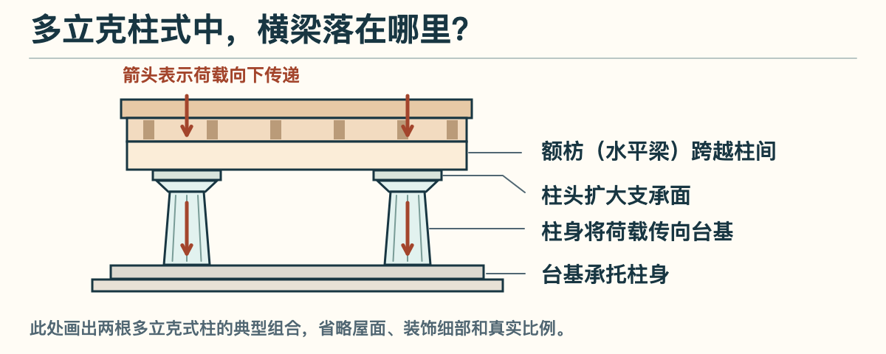

# 希腊柱式与梁柱体系

2026-11-25 | Day02/30 | 阅读 8 分钟 + 练习 3 分钟

## 今日导航

今天回答：为什么柱式不仅是柱头花样？目标是辨认希腊梁柱体系，并理解柱、梁及上部构件之间的比例关系。先回忆昨日：一张正面照片能回答哪些问题，又缺少哪些信息？

## 从支撑关系看神庙

水平的额枋跨在两根立柱之间，落在两端的柱头上。[S1] 图示帮助识别基本构成，不是某座神庙的考古复原。石材在不同受力方式下表现不同，水平跨越的构件需要相应尺度和支撑；实际结构分析比这幅简图复杂，今天不做受力计算。

把视线放在两柱正中上方，沿横梁移到一端，再顺赭色箭头向下。

从额枋、柱头到台基读取梁柱组合。 额枋跨在什么位置？从额枋往下，荷载依次经过哪些部分？ 水平额枋跨过柱间，落到两端较宽的柱头。随后沿柱身向下传到台基。 \[S1\]

原创多立克式构件示意，按大都会古希腊建筑导读绘制。

## 柱式是一套组合规则

大都会博物馆的概述指出，希腊柱式涉及建筑构件之间的整体关系；多立克和爱奥尼是古风与古典时期的重要类型，科林斯柱式后来更加常见。[S1] 因此“认柱头”只是入口，还要看柱身、柱础、柱间距和上部组织。

可以先记视觉线索：多立克显得较简洁，爱奥尼柱头常见卷涡，科林斯常见叶饰。但视觉印象不能替代年代与地区判断：后世建筑会引用这些形式，不是有古典柱就属于古希腊。也不要把今天看到的石色当作古代建筑从未有色彩的证明。

读柱式的更好方法是描述：从台基到柱子，再到水平构件和屋顶，形式怎样逐级连接？把“像什么”推进到“各部分怎样一起工作”，你就开始用建筑语言而非标签观察。

## 从单体走向卫城

UNESCO 的雅典卫城材料提供建筑群与历史环境的入口。[S3] 当你站在建筑群里，朝向、地形、路径和相邻建筑也参与体验。只截取一排柱子，会丢失这些关系。

教学观察任务：先在原址资料中选一张神庙照片，不急着叫出柱式；数清前后层次，寻找水平与竖直构件，再核对说明中的年代和名称。若只看到残存柱列，允许把屋顶形式留为未知。复原图可以帮助想象，但应检查绘图依据，不能自动当作现场原貌。

## 三分钟练习与自查

把“这栋楼有卷涡柱头，所以是古希腊建筑”改成一个更谨慎的判断。再说明还需要查哪两项资料。

参考：“它引用了与爱奥尼柱式相关的形式，但建造年代和用途尚待核实。”可查建造记录、原址说明或可靠测绘。自查有没有区分形式来源与建筑实际年代；有没有只看柱头而忽略其他部分。今天不要求凭一张照片作绝对分类。

## 复盘与明日连接

柱式把构件、比例与视觉秩序联系起来。它能跨越时代被重新使用，因此历史判断必须同时看形式和证据。明天进入罗马，观察拱券如何改变空间组织，并与公共活动和城市生活相连。

## 扩展学习（选读）

- [S1] [Architecture in Ancient Greece](https://www.metmuseum.org/essays/architecture-in-ancient-greece): 观察柱式如何连接立柱与建筑其他部分，而非只认柱头。; The Metropolitan Museum of Art | 发布: 2003-10-01 | 核验: 2026-11-25

- [S2] [Theater and Amphitheater in the Roman World](https://www.metmuseum.org/essays/theater-and-amphitheater-in-the-roman-world): 了解拱券、看台、通道与社会秩序之间的关系。; The Metropolitan Museum of Art | 发布: 2006-10-01 | 核验: 2026-11-25

- [S3] [Acropolis, Athens](https://whc.unesco.org/en/list/404/): 结合雅典卫城原址资料，区分单栋建筑与建筑群。; UNESCO | 发布: 未标注 | 核验: 2026-11-25

- [S4] [Historic Centre of Rome](https://whc.unesco.org/en/list/91/): 观察城市历史叠加；不要把罗马城市归为单一风格。; UNESCO | 发布: 未标注 | 核验: 2026-11-25

- [S5] [Chartres Cathedral](https://whc.unesco.org/en/list/81/): 为后续哥特建筑预习，关注结构、空间与彩色玻璃。; UNESCO | 发布: 未标注 | 核验: 2026-11-25
