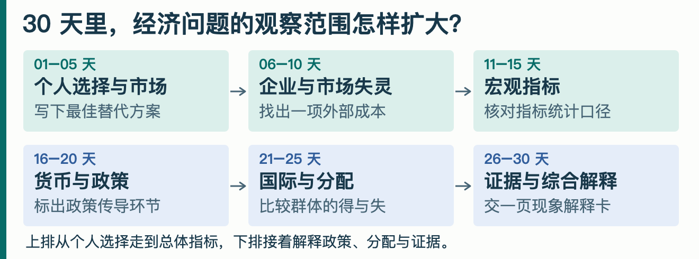

# 经济学：30天学习计划

2026-11-25 | 学习计划 / 30 天

## 学习者与目标

适合：未系统学习过经济学的成年人。

本轮目标：理解日常经济现象并识别模型假设。30天用于建立入门框架与方法，不承诺掌握整个学科。除明确说明的基础外，不假设学习者的行业经历。原始启动句：“我想从零学习经济学，理解日常经济现象。”

## 学习方式与时间安排

每天预计10–15分钟：正文与读图约8分钟，回忆和练习约3分钟，可用余下时间复述。学习速度存在差异，时间为估计值；扩展阅读不计入必做量。每天10:00（Asia/Shanghai，含周末）开始生成，检查完成后交付。计划确认后可立即生成Day01。

本文件是公开演示样例：30天完整课纲，配套展示Day01–Day03；试跑不创建真实定时任务。

沿日期从左到右读完上排，再读下排。比较两排最后一格要交出的成果。

从个人取舍，到一页经济现象解释卡。 第 15 天和第 30 天分别要交出什么观察结果？ 上排末格要求核对宏观指标的统计口径；下排末格用一页卡片整合机制和证据。 \[S1\] \[S2\]

依据本计划六阶段安排自绘；起点概念参见 OpenStax。

## 课程依据与学习成果

先从稀缺与机会成本进入，逐渐引入领域概念，再通过案例与复盘连接。来源[S1]和[S2]提供起点知识；其他链接扩展相关视角。课程排序是本项目的教学设计，不是来源机构为本项目背书。

完成时应能：确定最佳可行替代方案；按口径读一组指标；完成一页经济现象解释卡。每五天安排一次回顾或整合，检查能否脱离正文解释，不以“收到PDF”代替学会。

## 阶段1：个人选择与市场

Day01  稀缺与机会成本
目标：确定最佳可行替代方案。

Day02  价格如何协调供需
目标：区分供需条件与价格结果。

Day03  边际思维与沉没成本
目标：比较下一步的增量收益成本。

Day04  弹性与替代选择
目标：解释不同商品的价格反应。

Day05  复盘一次消费决策
目标：复盘一项真实选择。

## 阶段2：企业与市场失灵

Day06  企业成本与利润
目标：区分固定可变与机会成本。

Day07  竞争与市场力量
目标：解释竞争结构的影响。

Day08  外部性与公共物品
目标：辨认外部成本和公共物品。

Day09  信息不对称
目标：指出交易双方的信息差。

Day10  复盘市场失灵
目标：为案例提出政策与代价。

## 阶段3：宏观指标

Day11  GDP衡量什么
目标：说明GDP计入和遗漏什么。

Day12  价格指数与通胀
目标：比较总体物价与个别涨价。

Day13  就业与失业
目标：区分失业与不参与劳动。

Day14  增长与生产率
目标：解释增长来源与测量限制。

Day15  复盘一组宏观指标
目标：按口径读一组指标。

## 阶段4：货币与政策

Day16  货币与银行
目标：说明银行在资金流中的作用。

Day17  利率的传导
目标：画出利率影响行为的路径。

Day18  财政政策
目标：列出支出税收和时间滞后。

Day19  货币政策的边界
目标：说明政策传导的条件。

Day20  复盘政策新闻
目标：区分政策目标与实际效果。

## 阶段5：国际与分配

Day21  比较优势与贸易
目标：用机会成本解释比较优势。

Day22  汇率与国际收支
目标：区别汇率水平与变动因素。

Day23  全球供应链
目标：描述一次供应链冲击。

Day24  不平等与分配
目标：区分效率和分配判断。

Day25  复盘贸易争论
目标：陈述争论双方的假设。

## 阶段6：证据与综合解释

Day26  相关与因果
目标：指出一个混杂因素。

Day27  实验与自然实验
目标：识别对照与反事实。

Day28  模型假设与现实
目标：写出模型适用边界。

Day29  综合分析一个经济问题
目标：组织机制证据和替代解释。

Day30  结业：经济现象解释卡
目标：完成一页经济现象解释卡。

## 自测、调整与确认

每天先尝试作答，再看参考要点；答不出来时记录具体概念，不据此给自己贴能力标签。每五天用一张卡整理“已经能解释／仍不确定／需要查证”。若学习量过大，优先缩小每日范围并保留主线，不靠减小字体压缩材料。

真实使用时，请确认目标、基础、周期、每天用时、执行时间、时区与输出目录。批准当前计划后才创建任务；修改已开始的课程时保留旧档案并建立新版本。到期漏跑则继续最早未交付课程，不按日期跳课。

## 扩展学习（选读）

- [S1] [What Is Economics, and Why Is It Important?](https://openstax.org/books/principles-economics-3e/pages/1-1-what-is-economics-and-why-is-it-important): 从稀缺与分工建立课程起点；文中旧统计不作为现状。; OpenStax | 发布: 未标注 | 核验: 2026-11-25

- [S2] [Budget Constraint and Individual Choices](https://openstax.org/books/principles-economics-3e/pages/2-1-how-individuals-make-choices-based-on-their-budget-constraint): 重点读机会成本、预算约束与边际分析。; OpenStax | 发布: 未标注 | 核验: 2026-11-25

- [S3] [Production Possibilities Frontier](https://openstax.org/books/principles-economics-3e/pages/2-2-the-production-possibilities-frontier-and-social-choices): 把个人选择扩展为社会资源配置，观察模型假设。; OpenStax | 发布: 未标注 | 核验: 2026-11-25

- [S4] [Demand, Supply, and Equilibrium](https://openstax.org/books/principles-economics-3e/pages/3-1-demand-supply-and-equilibrium-in-markets-for-goods-and-services): 对照需求、供给和均衡的图形定义。; OpenStax | 发布: 未标注 | 核验: 2026-11-25

- [S5] [Shifts in Demand and Supply](https://openstax.org/books/principles-economics-3e/pages/3-2-shifts-in-demand-and-supply-for-goods-and-services): 区分价格变化引起的沿曲线移动与其他条件变化引起的曲线移动。; OpenStax | 发布: 未标注 | 核验: 2026-11-25
