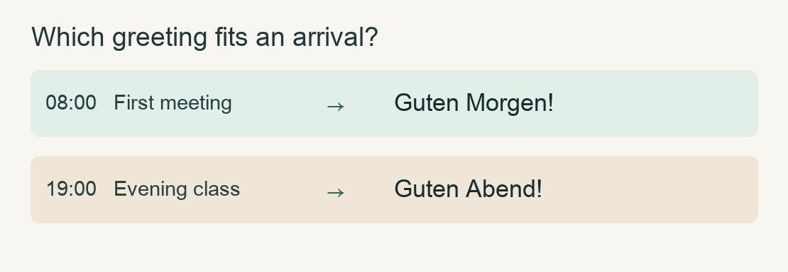

# Arriving in the morning or evening

2026-11-25 | Day01/3 | Read 7 min + practice 5 min

## Two arrivals

It is 8 am at a training centre. You meet your new colleague at the door. Imagine the same entrance at 7 pm. You want to start a conversation on both visits. The time changes just one part of the greeting.

## Pick a greeting

Guten Morgen! means Good morning! Guten Abend! means Good evening! Use both on arrival. The first word stays the same; the second names the time of day. A bedtime farewell serves a different purpose. [S1]

Read each row from the arrival time to the greeting\. Point to the word that changes\. Which greeting fits an arrival? The 08:00 and 19:00 rows both start with Guten\. The time cue changes the second word from Morgen to Abend\. \[S1\]

Original Omni learning diagram based on the Goethe-Institut chapter 1 phrase guide.

## Notice the spelling

German writes the nouns Morgen and Abend with capital letters. Cover the English meanings and look just at the first letter of the second word. Then cover the German and try writing each phrase. The Goethe posters offer a separate pronunciation aid. [S1] [S2]

## Use it

You arrive before the first morning meeting. Greet the receptionist. Later you arrive at an evening class. Change your greeting for your new teacher. Write both before checking the examples.

## Further reading (optional)

- [S1] [Chapter 1 German phrase guide](https://lernen.goethe.de/deutschonline/A1/PDF/DE/deutschonline_Redemittel_und_Grammatik_1.pdf): Printed page 3 distinguishes greetings and farewells by time of day.; Goethe-Institut | Published: — | Checked: 2026-11-25

- [S2] [First German class posters](https://www.goethe.de/prj/dlp/en/teachingmaterials/series/early_german/poster_first_german_class): Greeting and introduction posters include pronunciation aids.; Goethe-Institut | Published: — | Checked: 2026-11-25

- [S3] [English phrase guide](https://lernen.goethe.de/deutschonline/A1/PDF/EN/deutschonline_phrases_grammar_1-18.pdf): English explanations of the first-meeting expressions.; Goethe-Institut | Published: — | Checked: 2026-11-25

- [S4] [CEFR descriptors](https://www.coe.int/en/web/common-european-framework-reference-languages/cefr-descriptors): Optional background for selecting a specific communicative goal.; Council of Europe | Published: — | Checked: 2026-11-25

- [S5] [CEFR key concepts](https://www.coe.int/en/web/common-european-framework-reference-languages/key-concepts): Optional reading on interaction and action-oriented language use.; Council of Europe | Published: — | Checked: 2026-11-25

[Try the two-way recall sheet](worksheet.md)
