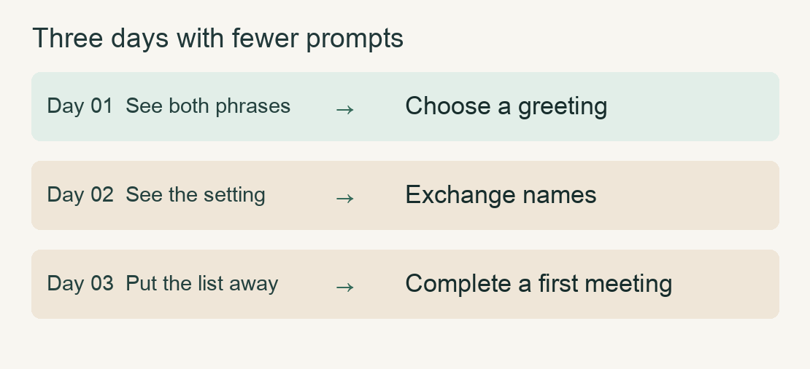

# Meeting a colleague in German

2026-11-25 | Learning plan / 3 days

## Three short sessions

Use 12 minutes a day. Start with the two arrival scenarios in chapter 1 of the Goethe-Institut phrase guide. On day two, reuse the greeting before introducing yourself. On day three, change the time and the person. [S1]

## Check the outcome

Write a brief first meeting from memory. Check whether the greeting, name exchange and closing fit the scenario. Choose a separate listening task if you have a verified recording.

Read across each row to see what you can use and what you will do\. Three days with fewer prompts Day one supplies the phrases\. Day three asks you to start, sustain and close a meeting without the list\. \[S1\]

Original study sequence based on the Goethe-Institut first-meeting expressions.

## Daily goals

Day01 · Arriving in the morning or evening
Choose a greeting for an arrival and write a different one from memory.

Day02 · Give a name and ask for one
Introduce yourself and ask for a name using the appropriate form of address.

Day03 · Make a first meeting work
Greet someone, exchange names and leave politely without a phrase bank.

## Further reading (optional)

- [S1] [Chapter 1 German phrase guide](https://lernen.goethe.de/deutschonline/A1/PDF/DE/deutschonline_Redemittel_und_Grammatik_1.pdf): Printed page 3 distinguishes greetings and farewells by time of day.; Goethe-Institut | Published: — | Checked: 2026-11-25

- [S2] [First German class posters](https://www.goethe.de/prj/dlp/en/teachingmaterials/series/early_german/poster_first_german_class): Greeting and introduction posters include pronunciation aids.; Goethe-Institut | Published: — | Checked: 2026-11-25

- [S3] [English phrase guide](https://lernen.goethe.de/deutschonline/A1/PDF/EN/deutschonline_phrases_grammar_1-18.pdf): English explanations of the first-meeting expressions.; Goethe-Institut | Published: — | Checked: 2026-11-25

- [S4] [CEFR descriptors](https://www.coe.int/en/web/common-european-framework-reference-languages/cefr-descriptors): Optional background for selecting a specific communicative goal.; Council of Europe | Published: — | Checked: 2026-11-25

- [S5] [CEFR key concepts](https://www.coe.int/en/web/common-european-framework-reference-languages/key-concepts): Optional reading on interaction and action-oriented language use.; Council of Europe | Published: — | Checked: 2026-11-25
