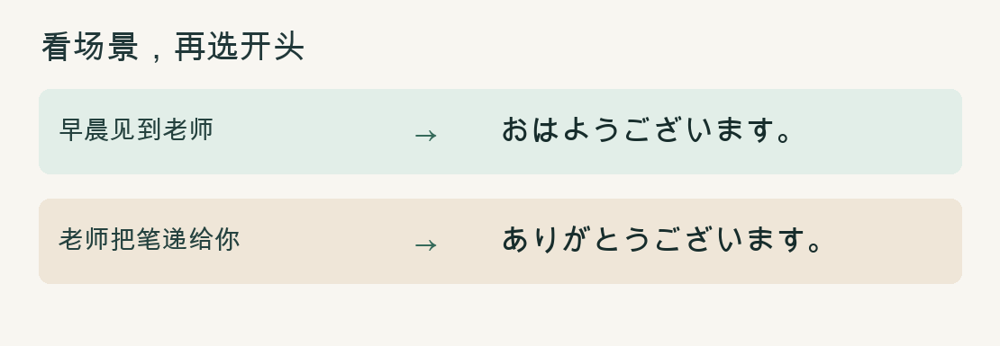

# 早上见面和收到帮助，各用哪一句？

2026-11-25 | Day01/3 | 阅读 7 分钟 + 练习 5 分钟

## 早晨走进教室

门口是刚认识的老师。先选一句能打开对话的话。到了讲台前，老师把落在门口的笔递给你。你要做的事情变了：现在要回应对方的帮助。

## 读懂两句话

早晨见到老师，可以说「おはようございます。」（早上好）。老师帮你捡起笔，可以说「ありがとうございます。」（谢谢您）。两句都以「ございます」结尾，遮住结尾看前半句，更容易区分意思。[S1]

从场景线索选表达。左侧先看发生了什么，再读同一行右侧的日语。 看场景，再选开头 上排从早晨见面连到「おはよう」开头，下排从老师帮忙连到「ありがとう」开头。 \[S1\]

Omni Learning Anything 原创学习图，例句用法依据《彩》入门第 1 课。

## 听清开头，再看写法

おはよう（ohayō）和 ありがとう（arigatō）都出现长音。罗马字上的横线提示把音延长；先按假名找出词尾的「う」，再听第 1 课的录音，比一比两个词的开头。先只听，再看原文。[S1] [S3]

## 换一个场景

清早进图书室，先向老师问候。几分钟后老师帮你找到桌上的书，你会换成哪句话？先写下来，再回到第二节检查开头。

[开始双向回忆](worksheet.md) · [播放听辨练习](audio/README.md)

## 扩展学习（选读）

- [S1] [《彩》入门第 1 课原文](https://www.irodori.jpf.go.jp/assets/data/starter/pdf/X_L01.pdf): L1-3 的问候、L1-13 的致谢对话和 L1-16 的长音练习。; 国际交流基金 | 发布: — | 核验: 2026-11-25

- [S2] [《彩》入门目录](https://www.irodori.jpf.go.jp/en/starter/pdf.html): 第 1–3 课依次涉及问候、请求澄清和自我介绍。; 国际交流基金 | 发布: — | 核验: 2026-11-25

- [S3] [第 1 课原声音轨](https://www.irodori.jpf.go.jp/en/starter/audio/lesson01.html): 选择问候与感谢的片段，先听再看原文。; 国际交流基金 | 发布: — | 核验: 2026-11-25

- [S4] [第 2 课音轨](https://www.irodori.jpf.go.jp/en/starter/audio/lesson02.html): 第二天试听请求澄清的课堂交谈。; 国际交流基金 | 发布: — | 核验: 2026-11-25

- [S5] [《彩》入门第 3 课](https://www.irodori.jpf.go.jp/assets/data/starter/pdf/X_L03.pdf): 第三天用于练习报名字和初次见面。; 国际交流基金 | 发布: — | 核验: 2026-11-25
