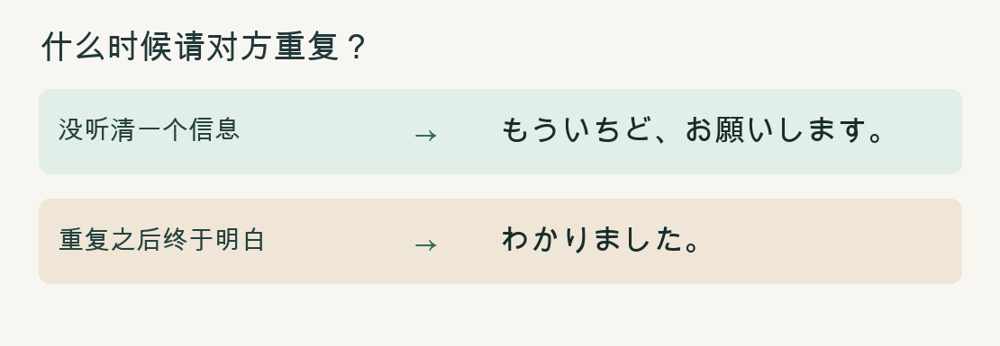

# 没听清时，请对方再说一遍

2026-11-25 | Day02/3 | 阅读 7 分钟 + 练习 5 分钟

## 先回到昨天的教室

闭上前一课。老师帮你找到笔时，用日语怎样回应？写下来，再翻昨天的答案核对。今天老师在门口告诉你教室号，你只听清最后一个音，得让信息再来一次。

## 漏听与听懂之间

你漏听时说「もういちど、お願いします。」（请再说一遍）。对方重复，等你确实明白了，再说「わかりました。」（我明白了）。前一句请对方做一个动作，后一句告诉对方这次交流有了结果。[S1]

两行是对话中不同的时刻。先找到自己现在的状态，再决定说哪句。 什么时候请对方重复？ 把手指从第一行移到第二行之前，对方先要重复，你也要真正理解了信息。 \[S1\]

原创学习图。用法核对自国际交流基金《彩》入门。

## 从写法找到声音

「お願いします」读作 おねがいします。把前半句 もういちど 和后半句连起来练。日语中的「もう」有长音。先用手指沿着假名慢慢读，再听 02-05；听第二遍时，留意老师何时重复了同一信息。[S1] [S4]

## 把场景换到前台

前台人员告诉你活动开始的时间，你没听清，先写下会怎样请求。对方重复后，你看见墙上的时刻表，终于确认无误。用另一句话把这个结果告诉对方。

[回忆练习](day02-worksheet.md) · [情境任务](day02-task.md)

## 扩展学习（选读）

- [S1] [《彩》入门第 2 课](https://www.irodori.jpf.go.jp/assets/data/starter/pdf/X_L02.pdf): L2-1 给出请求重复的表达，L2-2、L2-3 给出听懂后的回应。; 国际交流基金 | 发布: — | 核验: 2026-11-25

- [S2] [《彩》入门第 3 课](https://www.irodori.jpf.go.jp/assets/data/starter/pdf/X_L03.pdf): L3-2 和 L3-3 区分首次见面的开场、姓名和结束语。; 国际交流基金 | 发布: — | 核验: 2026-11-25

- [S3] [《彩》入门第 1 课](https://www.irodori.jpf.go.jp/assets/data/starter/pdf/X_L01.pdf): L1-3 的早晨问候和 L1-13 的礼貌致谢用于复习。; 国际交流基金 | 发布: — | 核验: 2026-11-25

- [S4] [第 2 课录音](https://www.irodori.jpf.go.jp/en/starter/audio/lesson02.html): 02-05、02-06 是询问教室信息时请求重复或放慢的示范。; 国际交流基金 | 发布: — | 核验: 2026-11-25

- [S5] [第 3 课录音](https://www.irodori.jpf.go.jp/en/starter/audio/lesson03.html): 03-06 示范首次见面时的自我介绍。; 国际交流基金 | 发布: — | 核验: 2026-11-25
