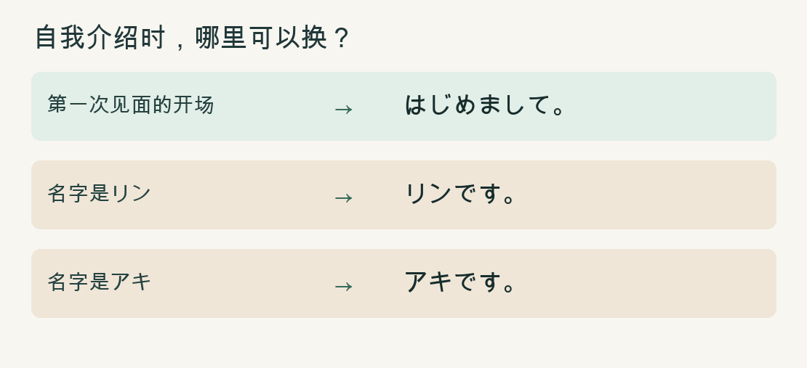

# 介绍自己，连成一次见面交流

2026-11-25 | Day03/3 | 阅读 5 分钟 + 练习 7 分钟

## 三个时刻，三个动作

今天你第一次走进社区日语教室。先见到人，再介绍自己，随后老师会交代一件事情。拿一张纸留三行，各写一个你想完成的动作。

## 报出自己的名字

第一次正式见面，可以先说「はじめまして。」（初次见面）。假设你在日语课上的名字是「リン」（琳）。接着说「リンです。」（我叫琳）。把リン换成自己的名字，保留后面的 です。中文常用“我叫……”，这句日语可以从名字直接开始。课本用别的名字示范同一结构。[S2]

从上到下读，先找到开场，再对照两位学习者报名字的方式。 自我介绍时，哪里可以换？ 对照最后两行，リン和アキ占同一个位置。后面的 です 保留，就能把句子换成自己的名字。 \[S2\]

原创学习图。用法核对自国际交流基金《彩》入门。

## 把两天学过的回应接回来

早晨开场可以说「おはようございます。」；别人帮你时，用「ありがとうございます。」。[S3] 如果对方刚才的信息漏听了，先说「もういちど、お願いします。」；对方重复且你听懂后，可以用「わかりました。」确认。[S1]

## 从套用到独立回应

先在纸上写一段两句的自我介绍，再只留自己的名字，盖住其他部分重写一次。你可以播放 03-06，对照原声听停顿在哪儿。最后收起本页与三天的练习单，做单独的结课任务。文字作答观察选词、顺序与用途。[S2] [S5]

[回忆练习](day03-worksheet.md) · [情境任务](day03-task.md)

## 扩展学习（选读）

- [S1] [《彩》入门第 2 课](https://www.irodori.jpf.go.jp/assets/data/starter/pdf/X_L02.pdf): L2-1 给出请求重复的表达，L2-2、L2-3 给出听懂后的回应。; 国际交流基金 | 发布: — | 核验: 2026-11-25

- [S2] [《彩》入门第 3 课](https://www.irodori.jpf.go.jp/assets/data/starter/pdf/X_L03.pdf): L3-2 和 L3-3 区分首次见面的开场、姓名和结束语。; 国际交流基金 | 发布: — | 核验: 2026-11-25

- [S3] [《彩》入门第 1 课](https://www.irodori.jpf.go.jp/assets/data/starter/pdf/X_L01.pdf): L1-3 的早晨问候和 L1-13 的礼貌致谢用于复习。; 国际交流基金 | 发布: — | 核验: 2026-11-25

- [S4] [第 2 课录音](https://www.irodori.jpf.go.jp/en/starter/audio/lesson02.html): 02-05、02-06 是询问教室信息时请求重复或放慢的示范。; 国际交流基金 | 发布: — | 核验: 2026-11-25

- [S5] [第 3 课录音](https://www.irodori.jpf.go.jp/en/starter/audio/lesson03.html): 03-06 示范首次见面时的自我介绍。; 国际交流基金 | 发布: — | 核验: 2026-11-25
