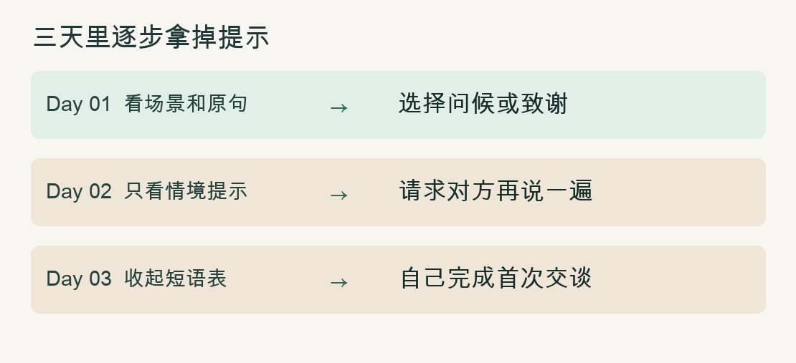

# 参加日语课的第一次交谈

2026-11-25 | 学习计划 / 3 天

## 这三天怎样练

每天 12 分钟。前两天先认场景，再遮住原句写出合适的话。第三天把前两天的表达接到一段自我介绍里。《彩》入门第 1–3 课提供对应初级场景和音轨。[S2]

## 怎么检验

第三天拿走短语表，尝试主动问候、介绍自己，并在没有听清时请求重复。文字任务观察用词和语境；可单独听原声音轨测听辨。

从左到右读每一天：提示逐渐减少，完成的对话逐渐变长。 三天里逐步拿掉提示 第一行提供原句；第三行收起短语表，再把问候、自我介绍和澄清接在一起。 \[S2\]

原创学习安排，场景参考国际交流基金《彩》入门第 1–3 课。

## 逐日目标

Day01 · 早上见面和收到帮助，各用哪一句？
能识别一个礼貌问候，再用日语对帮助表示感谢。

Day02 · 没听清时，请对方再说一遍
能用一句话请求重复，并认出对方正在重复。

Day03 · 介绍自己，连成一次见面交流
能问候、报上名字，并根据对方的回应选择致谢或请求重复。

## 扩展学习（选读）

- [S1] [《彩》入门第 1 课原文](https://www.irodori.jpf.go.jp/assets/data/starter/pdf/X_L01.pdf): L1-3 的问候、L1-13 的致谢对话和 L1-16 的长音练习。; 国际交流基金 | 发布: — | 核验: 2026-11-25

- [S2] [《彩》入门目录](https://www.irodori.jpf.go.jp/en/starter/pdf.html): 第 1–3 课依次涉及问候、请求澄清和自我介绍。; 国际交流基金 | 发布: — | 核验: 2026-11-25

- [S3] [第 1 课原声音轨](https://www.irodori.jpf.go.jp/en/starter/audio/lesson01.html): 选择问候与感谢的片段，先听再看原文。; 国际交流基金 | 发布: — | 核验: 2026-11-25

- [S4] [第 2 课音轨](https://www.irodori.jpf.go.jp/en/starter/audio/lesson02.html): 第二天试听请求澄清的课堂交谈。; 国际交流基金 | 发布: — | 核验: 2026-11-25

- [S5] [《彩》入门第 3 课](https://www.irodori.jpf.go.jp/assets/data/starter/pdf/X_L03.pdf): 第三天用于练习报名字和初次见面。; 国际交流基金 | 发布: — | 核验: 2026-11-25
