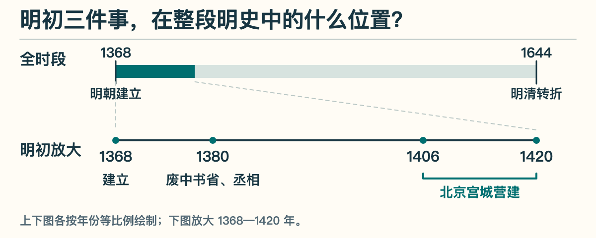

# 明朝历史：30天学习计划

2026-11-25 | 学习计划 / 30 天

## 学习者与目标

适合：希望建立框架、尚未系统读史的成年人。

本轮目标：按时间、制度与证据理解明代重要事件。30天用于建立入门框架与方法，不承诺掌握整个学科。除明确说明的基础外，不假设学习者的行业经历。原始启动句：“我想系统学习明朝历史，理解重要制度和事件。”

## 学习方式与时间安排

每天预计10–15分钟：正文与读图约8分钟，回忆和练习约3分钟，可用余下时间复述。学习速度存在差异，时间为估计值；扩展阅读不计入必做量。每天10:00（Asia/Shanghai，含周末）开始生成，检查完成后交付。计划确认后可立即生成Day01。

本文件是公开演示样例：30天完整课纲，配套展示Day01–Day03；试跑不创建真实定时任务。

沿总轴上的深色段读到放大轴，按先后找出废相和宫城营建。

从王朝时间线放大观察明初。 废相发生在北京宫城营建之前还是之后？ 1380 年标记在 1406—1420 年区间左侧；上方色段显示这些事件集中在明初。 \[S1\] \[S2\] \[S3\]

原创比例时间轴；年代据大都会、故宫与 UNESCO。

## 课程依据与学习成果

先从时间线与史料如何使用进入，逐渐引入领域概念，再通过案例与复盘连接。来源[S1]和[S2]提供起点知识；其他链接扩展相关视角。课程排序是本项目的教学设计，不是来源机构为本项目背书。

完成时应能：区分史实解释和证据缺口；为经济变化列证据与边界；写一篇区分事实与解释的短论。每五天安排一次回顾或整合，检查能否脱离正文解释，不以“收到PDF”代替学会。

## 阶段1：明初与读史方法

Day01  时间线与史料如何使用
目标：区分史实解释和证据缺口。

Day02  洪武废相与治理难题
目标：关联权力归属与事务处理。

Day03  永乐宫城与皇权表达
目标：判断建筑材料能说明什么。

Day04  靖难之役与继承问题
目标：比较继承规则与事件叙述。

Day05  复盘明初政治
目标：建立明初事件关系图。

## 阶段2：国家制度

Day06  内阁如何形成
目标：追踪辅助政务机制的变化。

Day07  科举与官僚社会
目标：说明选官与社会流动的关系。

Day08  地方治理与基层
目标：区分制度规定与地方实践。

Day09  卫所与军事组织
目标：理解军事组织的资源条件。

Day10  复盘国家运转
目标：解释国家运转的一个瓶颈。

## 阶段3：经济生活

Day11  赋役与土地
目标：区分土地税役与实际负担。

Day12  白银与财政
目标：解释货币变化影响的渠道。

Day13  商业与城市
目标：以区域差异观察商业。

Day14  海贸与海禁
目标：区分政策文本与实际贸易。

Day15  复盘经济生活
目标：为经济变化列证据与边界。

## 阶段4：社会文化

Day16  士人与思想
目标：区分思想文本与社会影响。

Day17  出版与知识传播
目标：说明媒介如何影响知识流通。

Day18  艺术与日常物质
目标：从器物提出生活史问题。

Day19  宗族与家庭
目标：辨认家族材料的代表性。

Day20  复盘社会文化
目标：比较不同群体的经验。

## 阶段5：中后期变化

Day21  边疆与周边关系
目标：以多方材料观察边疆关系。

Day22  土木之变
目标：区分事件过程与归因。

Day23  张居正改革
目标：分析改革目标措施和约束。

Day24  万历时期的政治
目标：比较制度安排与政治实践。

Day25  复盘中后期变化
目标：画出中后期因果候选图。

## 阶段6：转折与综合论证

Day26  辽东与战争负担
目标：关联战争与资源动员。

Day27  灾害财政与社会压力
目标：避免用单一因素解释危机。

Day28  1644与明清转折
目标：区分王朝转折与社会延续。

Day29  比较两种兴亡解释
目标：比较两种解释的证据。

Day30  结业：有证据的历史短论
目标：写一篇区分事实与解释的短论。

## 自测、调整与确认

每天先尝试作答，再看参考要点；答不出来时记录具体概念，不据此给自己贴能力标签。每五天用一张卡整理“已经能解释／仍不确定／需要查证”。若学习量过大，优先缩小每日范围并保留主线，不靠减小字体压缩材料。

真实使用时，请确认目标、基础、周期、每天用时、执行时间、时区与输出目录。批准当前计划后才创建任务；修改已开始的课程时保留旧档案并建立新版本。到期漏跑则继续最早未交付课程，不按日期跳课。

## 扩展学习（选读）

- [S1] [Ming Dynasty (1368–1644)](https://www.metmuseum.org/essays/ming-dynasty-1368-1644): 从文物与艺术观察明代，避免把宫廷与文人经验视为全部社会。; The Metropolitan Museum of Art | 发布: 2002-10-01 | 核验: 2026-11-25

- [S2] [中书省](https://www.dpm.org.cn/court/system/236406.html): 核对洪武时期机构调整，并把制度事实与作者的因果解释区分开。; 故宫博物院 | 发布: 未标注 | 核验: 2026-11-25

- [S3] [Imperial Palaces of the Ming and Qing Dynasties](https://whc.unesco.org/en/list/439/): 查看北京宫殿营建时间、轴线与礼仪空间；注意明清长期改建。; UNESCO | 发布: 未标注 | 核验: 2026-11-25

- [S4] [Imperial Tombs of the Ming and Qing Dynasties](https://whc.unesco.org/en/list/1004/): 从陵寝空间理解皇权表达，与宫殿材料交叉观察。; UNESCO | 发布: 未标注 | 核验: 2026-11-25

- [S5] [Arts of the Ming Dynasty](https://www.metmuseum.org/exhibitions/listings/2009/arts-of-the-ming-dynasty): 旧展览档案用于认识作品种类，不代表展览仍在开放。; The Metropolitan Museum of Art | 发布: 未标注 | 核验: 2026-11-25
