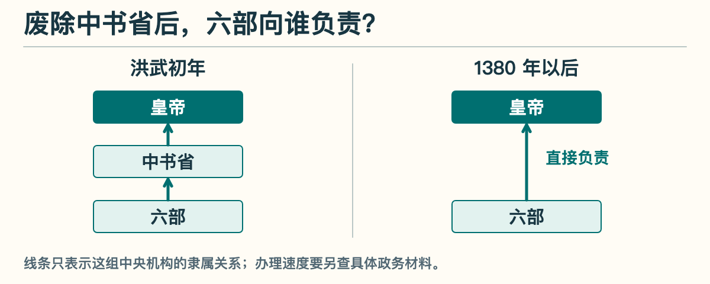

# 洪武废相与治理难题

2026-11-25 | Day02/30 | 阅读 8 分钟 + 练习 3 分钟

## 今日导航

今天回答：取消一个重要职位，是否就消除了它处理的问题？目标是理解洪武时期中央机构调整，并用“权力归属与事务处理”两条线分析。先回忆昨天：哪种说法是制度事实，哪种只是我们对后果的推论？

## 先核对发生了什么

故宫博物院的中书省资料介绍，明初沿用中书省制度，洪武时期逐步调整，1380年罢中书省、废丞相，相关权力分给六部等机构。[S2] 今天保留这个核心事实，不要求记全部官名。还应注意：这一过程不是简单把现代公司的组织图套进古代国家，机构职责和政治关系有自己的历史背景。

分别从两幅图下方的“六部”往上走，数一数中途经过哪个机构。

1380 年前后，六部与皇帝之间的隶属关系。 从六部向上读，哪一个中间环节消失了？ 左侧两支箭头经中书省通向皇帝，右侧一支箭头直接连到皇帝。图示能判断隶属关系，不能据此测定办事效率。 \[S2\]

原创制度关系简图，依据故宫博物院《中书省》。

## 权力集中与信息处理

从权力归属看，皇帝减少了一个强势的中间枢纽；从事务处理看，奏章、协调和执行并不会因职位消失而自动消失。后一个判断是本课根据组织问题提出的分析视角，需要结合具体史料检验，不能冒充某位当事人的原话。

故宫的介绍也讨论了废相后辅助政务机制的变化。[S2] 学习时可以区分“制度规定谁有权”和“实际工作怎样被处理”。两者相关，却不是同一个问题。只说“皇权加强”会遗漏日常运转，只说“效率下降”又可能过早作出没有充分证据的评价。

比较两组隶属关系时，只追踪六部与皇帝之间的这条线；若要判断实际办事速度，仍要查每件文书的流转过程。[S2]

## 用双栏法理解变化

在纸上写两栏：左栏“谁决定”，右栏“谁处理”。把你读到的调整分别放进去；遇到两栏都受影响的变化，在中间画连接。这样能避免认为权力越集中，所有具体事务就一定越容易处理。

一个教学类比是团队负责人取消中间协调角色后，需要重新分配信息汇总和跨部门协调。但类比只帮助发现问题，不证明古代官员像现代员工一样行动。判断历史后果还要看不同皇帝、时期和机构如何实际运作。不要用一个看似通顺的组织学故事解释整个明代。

## 三分钟练习与自查

请用三句话回答：发生了什么制度变化？它可能改变哪一种权力关系？它留下什么需要进一步研究的运行问题？

参考：第一句写1380年废中书省及丞相这一核心调整；第二句说明决策权更加向皇帝集中；第三句追问信息汇总和机构协调如何承担。自查第三句是否仍保留为问题，而不是写成“因此必然导致明亡”。从明初制度直跳数百年后的结果，缺少了大量中间证据。

## 复盘与明日连接

历史中的制度既分配权力，也安排事务。认识变化要同时看规则、实际运行与后续调整，不用单一原因包办兴亡。明天从宫城空间观察另一种皇权表达：宏大的礼仪秩序与日常治理怎样联系，又怎样不同？

## 扩展学习（选读）

- [S1] [Ming Dynasty (1368–1644)](https://www.metmuseum.org/essays/ming-dynasty-1368-1644): 从文物与艺术观察明代，避免把宫廷与文人经验视为全部社会。; The Metropolitan Museum of Art | 发布: 2002-10-01 | 核验: 2026-11-25

- [S2] [中书省](https://www.dpm.org.cn/court/system/236406.html): 核对洪武时期机构调整，并把制度事实与作者的因果解释区分开。; 故宫博物院 | 发布: 未标注 | 核验: 2026-11-25

- [S3] [Imperial Palaces of the Ming and Qing Dynasties](https://whc.unesco.org/en/list/439/): 查看北京宫殿营建时间、轴线与礼仪空间；注意明清长期改建。; UNESCO | 发布: 未标注 | 核验: 2026-11-25

- [S4] [Imperial Tombs of the Ming and Qing Dynasties](https://whc.unesco.org/en/list/1004/): 从陵寝空间理解皇权表达，与宫殿材料交叉观察。; UNESCO | 发布: 未标注 | 核验: 2026-11-25

- [S5] [Arts of the Ming Dynasty](https://www.metmuseum.org/exhibitions/listings/2009/arts-of-the-ming-dynasty): 旧展览档案用于认识作品种类，不代表展览仍在开放。; The Metropolitan Museum of Art | 发布: 未标注 | 核验: 2026-11-25
