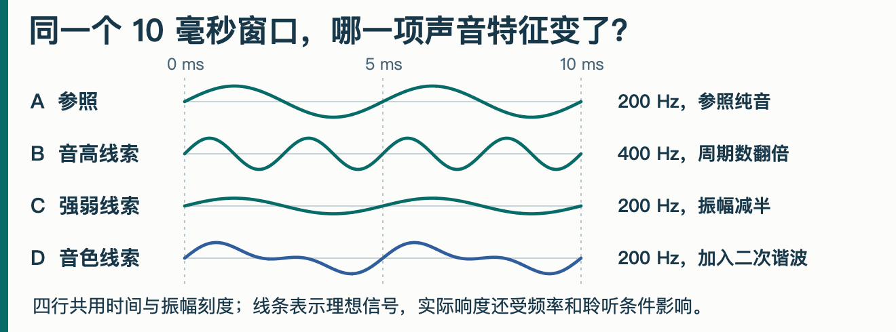

# 听见音高力度与音色

2026-11-25 | Day01/30 | 阅读 8 分钟 + 练习 3 分钟

## 今日导航

今天回答：说一段音乐“很有力量”，具体听到了什么？目标是分开描述音高、力度和音色。你不需要识谱或拥有乐器。准备一段自己熟悉的音乐，或直接用轻声哼唱完成练习；避免为了辨认细节提高到不舒适的音量。

## 先描述声音，再表达喜欢

“好听”“悲伤”“高级”表达体验，却不容易让别人知道你听到了哪里。试着换成“人声逐渐升高，伴奏更响，弦乐变得密集”。这些描述并不否认情绪，而是为感受增加可讨论的线索。第一天只做观察，不急着给作品定风格，也不假定人人会听出同一种情绪。

固定观察窗口，逐行与 A 比较。先数周期，再量波峰离中线的高度，最后看周期内部的形状。

从同长的波形片段中分辨周期数、振幅与形状。 比对 A 行，哪一行只增加了周期数？哪一行保留基频却改变了波形？ B 在相同时间内有四个周期，A 只有两个。D 的整体形状同样重复两次，但加入谐波后每个周期的形状改变。 \[S1\] \[S6\]

原创合成信号，未使用乐器录音；频率与音色依据 OpenStax《Physics》。

## 三个不同维度

音高是我们对声音高低的感受，通常与振动频率密切相关。频率更高的纯音通常听起来更高；这不等于声音更大。[S1] 力度讨论演奏中的强弱及其变化，响度感受还受频率、音色与环境影响，因此图中振幅只能作简化提示。

音色帮助我们分辨“是谁在发声”：同一个音高由人声和小提琴发出，听感仍有差别。起音方式、泛音组成与声音随时间的变化都会影响音色。今天不要求记频谱术语，只要能说出尖锐、柔和、气声、拨弦等具体特征，同时承认这些描述有主观成分。

三个维度可以分别变化。轻声唱高音，音高升高而力度未必增加；同一音高逐渐唱强，力度变化却不必改变音高。实际演奏常把多项一起改变，因此观察时每次只追踪一个维度更容易。

## 读图与聆听方法

波形图中，B 的周期数增加，C 的振幅缩小，D 在同一基频上加入谐波。音色会受到各频率成分的影响。[S6]先哼一个舒适的音，再换到稍高的音，尽量保持强弱相近。接着固定音高，轻轻变强再变弱。若一开始做不到完全分离，很正常，目的在于意识到两种变化不同。

听熟悉歌曲前30秒，第一遍只跟人声高低，第二遍只听整体强弱，第三遍找一种伴奏声音。把结果写成三句话。即使不确定乐器名称，也可以写“短促、颗粒感的声音”，比猜一个专业名词更诚实。

## 三分钟练习与自查

从三句描述中指出主要维度：“唱得越来越高”“同一个音逐渐变响”“钢琴换成人声唱同一段”。再描述你的短片段，每句话只写一个维度。

参考分别是音高、力度、音色。自查：有没有把高音等同于大声？有没有从音色直接断言某种情绪？若听不到明确人声，可以选一条持续的乐器线。今天不要求识别绝对音名，也没有标准审美答案。

## 复盘与明日连接

欣赏音乐可以从可听见的变化开始：高低、强弱、声音质感。五线谱中的音符位置和时值只是记录部分信息的方式，不能把记谱当作声音本身。[S2] 明天把注意力从“什么声音”转向“声音何时发生”，学习节拍、节奏和速度。

## 扩展学习（选读）

- [S1] [Speed of Sound, Frequency, and Wavelength](https://openstax.org/books/physics/pages/14-1-speed-of-sound-frequency-and-wavelength): 选读声音频率与音高的关系，公式推导可跳过。; OpenStax | 发布: 未标注 | 核验: 2026-11-25

- [S2] [Basic notation](https://openmusictheory.github.io/basicNotation.html): 认识音符、谱表和变音记号；本课不要求记住全部符号。; Open Music Theory | 发布: 未标注 | 核验: 2026-11-25

- [S3] [Rhythmic values](https://openmusictheory.github.io/rhythmicValues.html): 观察长短时值和休止符如何表达时间。; Open Music Theory | 发布: 未标注 | 核验: 2026-11-25

- [S4] [Meter and time signatures](https://openmusictheory.github.io/meter.html): 选看拍子分组与聆听示例；部分嵌入播放器可能需要额外登录。; Open Music Theory | 发布: 未标注 | 核验: 2026-11-25

- [S5] [Intervals and dyads](https://openmusictheory.github.io/intervals.html): 重点看半音数与音程度数不是同一种计数方法。; Open Music Theory | 发布: 未标注 | 核验: 2026-11-25

- [S6] [Sound Intensity and Sound Level](https://openstax.org/books/physics/pages/14-2-sound-intensity-and-sound-level): 参见 pitch、loudness 与 timbre 的区分，以及声源的频率成分如何影响音色。; OpenStax | 发布: 未标注 | 核验: 2026-11-25
