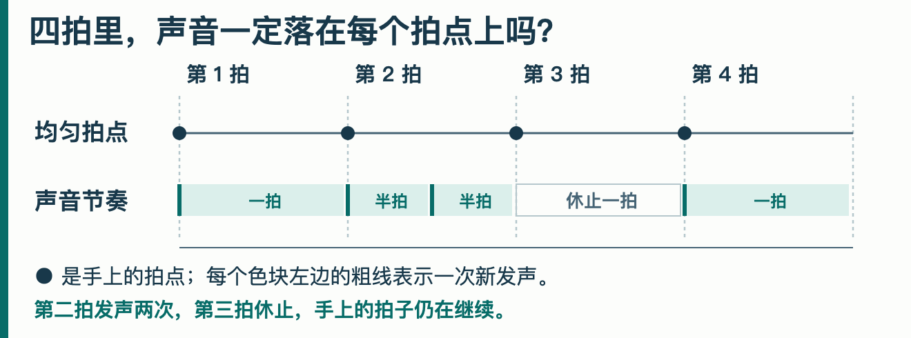

# 节拍节奏与速度

2026-11-25 | Day02/30 | 阅读 8 分钟 + 练习 3 分钟

## 今日导航

今天回答：跟着歌打拍子，是否等于跟着所有音符？目标是把稳定脉冲、具体节奏和快慢区分开。先回忆昨天：同一节奏可以用不同音高、不同力度演奏，这意味着时间组织值得单独观察。

## 用身体找到时间参照

均匀地轻拍桌面八次，把它当作参照脉冲。保持轻拍，嘴里念一句熟悉的短句：字不一定恰好落在每次拍击上，也可能一拍里有两个字或没有字。这里用日常语言做教学类比，不意味着说话天然符合某一种音乐拍号。

节奏指声音与停顿在时间中的具体组织；节拍提供组织和预期。公开乐理教材把音符时值与休止分开标记，提醒我们停顿也是时间结构的一部分。[S3]

手跟着上排四个点打拍，嘴在每个色块的左边缘发声；第三拍手仍拍下，嘴保持安静。

将拍点、发声起点和休止放在同一条四拍时间线上。 为什么上下两排都是四个起点，却无法一一对齐？ 第二拍内有两个发声起点，第三拍整拍休止。这一次拍数和发声次数恰好相等，起点位置却不同。 \[S3\] \[S4\]

原创节奏设例；时值、休止及节拍概念依据 Open Music Theory。

## 拍子分组与速度

速度描述脉冲进行的快慢。拍子分组则描述你怎样感到周期性的重心，例如两拍或三拍一组。二者可以独立：三拍子的音乐既可能缓慢，也可能轻快。教材讨论西方常见节拍时，还区分每拍二分或三分的方式；这些属于进一步的结构，不是今天必须背下的全部分类。[S4]

不要从“听起来很快”直接推断拍号。音符很密而基本拍速不变，也会显得忙碌。反过来，拍子较快但长音很多，表层可能显得平稳。遇到自由节奏、复杂重音或不熟悉的传统时，允许先说“我暂时没有找到稳定参照”，而不是强行数成四拍。

## 对齐拍点与发声起点

上排的点等间隔，表示稳定参照；下排用色块的左边缘表示发声起点，空框表示休止。先沿上排点轻拍，再试着在下排每个色块的起点发声。重点是让脚下或手上的脉冲继续，而不是每出现一个声音就改变拍速。

教学设例：在四个均匀拍点中，第一拍发声，第二拍发两次短声，第三拍静默，第四拍发声。总共是四拍，这个例子也恰好发声四次，但两者的落点不一一对应。若把“事件数量”等同于“拍数”，你会越数越乱。实际作品中的停顿并不意味着内在脉冲一定消失。

## 三分钟练习与自查

先均匀拍八次；然后每两拍把第一拍拍得稍重，最后改成每三拍一组，允许最后一组不完整。保持拍速大致相同。再回答：你改变的是速度还是分组？

参考：主要改变分组。若每组都想在同样时间内完成，就会无意改变拍速；重新用连续均匀的拍点检查。可选读 [S4] 中的聆听示例，不要求今天打开所有播放器；若访问受限，用本页身体练习也能完成目标。

## 复盘与明日连接

节拍是参照与组织，节奏是具体事件，速度是快慢。三者相互关联，却不能互相替代。明天把时间与高低结合起来：为什么不同起点的一段旋律仍可能被认作同一首歌？

## 扩展学习（选读）

- [S1] [Speed of Sound, Frequency, and Wavelength](https://openstax.org/books/physics/pages/14-1-speed-of-sound-frequency-and-wavelength): 选读声音频率与音高的关系，公式推导可跳过。; OpenStax | 发布: 未标注 | 核验: 2026-11-25

- [S2] [Basic notation](https://openmusictheory.github.io/basicNotation.html): 认识音符、谱表和变音记号；本课不要求记住全部符号。; Open Music Theory | 发布: 未标注 | 核验: 2026-11-25

- [S3] [Rhythmic values](https://openmusictheory.github.io/rhythmicValues.html): 观察长短时值和休止符如何表达时间。; Open Music Theory | 发布: 未标注 | 核验: 2026-11-25

- [S4] [Meter and time signatures](https://openmusictheory.github.io/meter.html): 选看拍子分组与聆听示例；部分嵌入播放器可能需要额外登录。; Open Music Theory | 发布: 未标注 | 核验: 2026-11-25

- [S5] [Intervals and dyads](https://openmusictheory.github.io/intervals.html): 重点看半音数与音程度数不是同一种计数方法。; Open Music Theory | 发布: 未标注 | 核验: 2026-11-25
