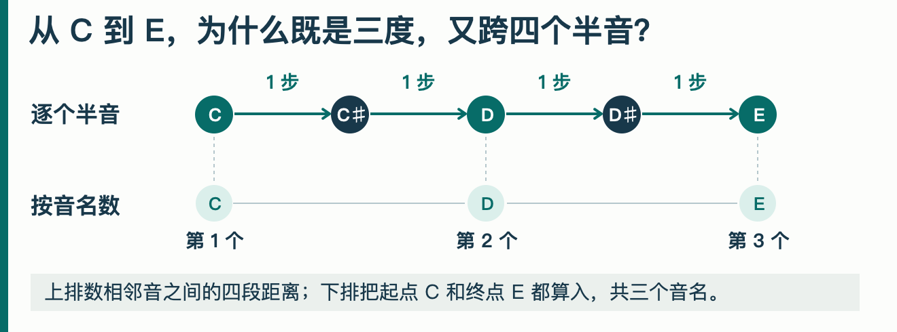

# 旋律走向与音程

2026-11-25 | Day03/30 | 阅读 8 分钟 + 练习 3 分钟

## 今日导航

今天回答：同一首歌换一个人唱，整体变高了，为什么仍能认出来？目标是描述旋律走向，并理解音程是两个音高之间的关系。先用一分钟复习：如果节奏保持不变，只改变整体音高，哪些线索仍然存在？

## 从音名转向关系

旋律可以看作随时间展开的音高组织。初学时先画轮廓：向上、向下、重复，哪里跳得大，哪里移动小。轮廓会遗漏具体距离，但比只写“很好听”更有信息，也不要求绝对音高能力。

音程描述两个音高之间的距离。公开乐理教材区分半音数与按音名计数的度数；它们回答不同问题。[S5] 今天先理解关系，不要求一次掌握所有音程名称。

用手指依次跳过上排的四支箭头，再点下排的三个圆；两次计数的对象不同。

同一对起止音，分别数半音的步数与音名的个数。 从 C 到 E，上排数几段距离？下排数几个带字母的位置？ 上排 C、C♯、D、D♯、E 之间有四段半音；下排 C、D、E 连同起止共三个音名，得到三度。 \[S5\]

原创音程图，依据 Open Music Theory 的 C4–E4 示例。

## 为什么“第三个”不等于“三个半音”

以西方常用音名为例，从 C 到 E，按 C、D、E 连起止音一起计数，是三度；在十二平均律的键盘半音计数中则跨四个半音。[S5] 度数表达音名位置关系，半音数表达另一种距离。把两个计数法混用，会出现“为什么三度不是三个半音”的疑惑。

本课用西方常见乐理作为入门工具，不把它当作所有音乐文化的唯一标准。其他调律、装饰音和连续滑音不能全部用钢琴键之间的距离概括。图中取同一八度里的 C 和 E，用两排标记对应这两种计数方法。

## 一个不需要识谱的实验

轻声哼三次同一个音，再哼“低—高—低”三个音，最后哼“低—更高—低”。第一组以重复为主，后两组轮廓相同，但跨度可以不同。听起来相似不代表完全相同。

把你熟悉的一句旋律整体提高或降低到舒适位置，尽量保持各音之间的关系和时值。你仍能认出它，说明旋律识别依赖关系；但音色、节奏、歌词与记忆也有贡献，不能凭这个小实验得出“认歌只靠音程”的结论。它是观察练习，不是心理声学实验。

## 三分钟练习与自查

选一个不超过十秒的熟悉乐句，用上箭头、下箭头、横线画出大致轮廓，并圈出你觉得跨度最大的位置。然后用一句话说明轮廓图没有记录什么。

参考：轮廓图没有准确记录每个音的高度、音程大小、节奏、音色或力度。能主动指出遗漏，比把草图当完整乐谱更重要。若你愿意扩展，可以对照 [S2] 的记谱入门，看看谱表如何补充一部分信息；今天无需学完整读谱规则。

## 复盘与明日连接

旋律不仅由单个音构成，也由相邻声音的关系和时间展开构成。先听走向，再细看距离，能降低入门负担。明天学习乐句与呼吸：旋律在哪里像一句话结束，哪些停顿只是暂时悬念？

## 扩展学习（选读）

- [S1] [Speed of Sound, Frequency, and Wavelength](https://openstax.org/books/physics/pages/14-1-speed-of-sound-frequency-and-wavelength): 选读声音频率与音高的关系，公式推导可跳过。; OpenStax | 发布: 未标注 | 核验: 2026-11-25

- [S2] [Basic notation](https://openmusictheory.github.io/basicNotation.html): 认识音符、谱表和变音记号；本课不要求记住全部符号。; Open Music Theory | 发布: 未标注 | 核验: 2026-11-25

- [S3] [Rhythmic values](https://openmusictheory.github.io/rhythmicValues.html): 观察长短时值和休止符如何表达时间。; Open Music Theory | 发布: 未标注 | 核验: 2026-11-25

- [S4] [Meter and time signatures](https://openmusictheory.github.io/meter.html): 选看拍子分组与聆听示例；部分嵌入播放器可能需要额外登录。; Open Music Theory | 发布: 未标注 | 核验: 2026-11-25

- [S5] [Intervals and dyads](https://openmusictheory.github.io/intervals.html): 重点看半音数与音程度数不是同一种计数方法。; Open Music Theory | 发布: 未标注 | 核验: 2026-11-25
