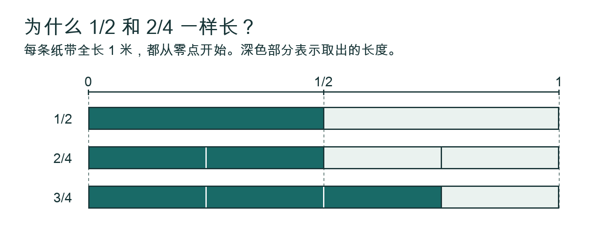
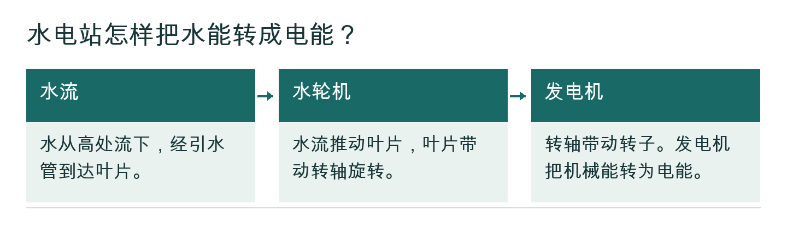
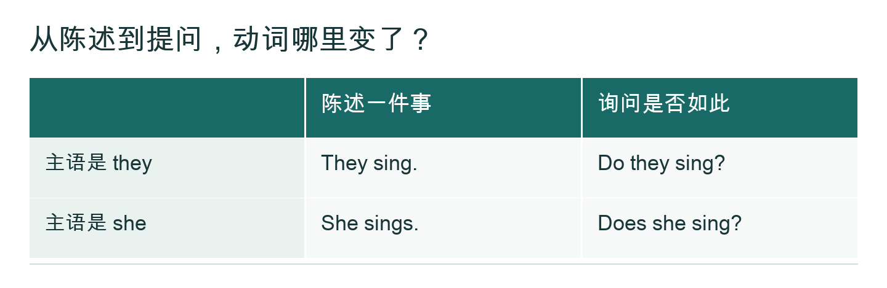

# 教学配图样例

## 数学 · 同样长的两段纸带

**读图问题**　沿着 1/2 刻度向下看。哪两条纸带的深色部分刚好停在这里？第三条多了多少米？

第一条取两格中的一格，第二条取四格中的两格，深色部分的终点重合。最后一条向右再伸出一个四等分的小格，多出 1/4 米。[OpenStax 等值分数模型](https://openstax.org/books/prealgebra-2e/pages/4-1-visualize-fractions) · [生成图示的 JSON](equivalent-fractions.json)

## 理科 · 水电站的能量转换

**读图问题**　顺着两支箭头看，水流直接推动哪个部件？从水轮机传到发电机的又是什么？

第一支箭头表示水流推动水轮机叶片。第二支箭头表示旋转的轴把机械能传给发电机。读到最后，发电机完成了从机械能到电能的转换。[美国能源部原理说明](https://www.energy.gov/cmei/water/how-hydropower-works) · [生成图示的 JSON](hydropower.json)

## 外语 · 英语一般疑问句

**读图问题**　沿着 she 一行从左向右读。变成问句时，哪个词体现了主语是第三人称单数？

陈述句里是 sings，问句开头用 Does，后面的动词变回 sing。对照上一行的 Do，可以看到问句把主语的区别体现在助动词上。[British Council 语法说明](https://learnenglish.britishcouncil.org/free-resources/grammar/english-grammar-reference/present-simple) · [完整课程页 PDF](present-simple.pdf) · [生成图示的 JSON](present-simple.json)
