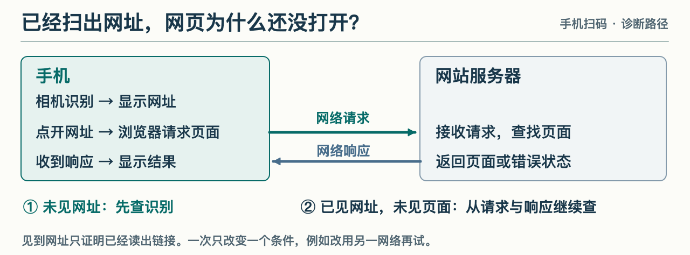

# 从手机看技术系统

2026-11-25 | Day01/30 | 阅读 8 分钟 + 练习 3 分钟

## 今日导航

今天回答：一部手机为什么不能只用“芯片很强”来解释？学完后，你应能把熟悉的设备拆成输入、处理、输出和支撑条件，并指出一个系统瓶颈。先用一分钟回想昨天使用手机时最不顺畅的一件事。今天不用记器件型号，也不比较品牌。

## 从一个失败场景开始

假设你在车站扫描二维码，页面迟迟打不开。第一反应可能是“手机太慢”。但相机已经识别图案，失败也可能发生在网络传输、服务器响应或身份验证。这里的场景是教学设例。分析技术的第一步，是明确任务在哪里开始、在哪里算完成，而不是立刻给某个部件下结论。

先找左框里已经可见的状态，再沿两支方向相反的箭头查找下一条证据。[S6]

一次扫码的设备边界与往返消息 手机已经显示网址，为什么还要检查网络与服务器？ 左框内识别完成之后，浏览器仍需向右发请求，并收到向左返回的响应。显示网址无法证明这两步都已完成。 \[S6\]

原创诊断案例；请求与响应的方向依据 MDN。

## 核心概念：系统、接口和瓶颈

系统是一组互相配合以完成目标的部分。手机拍照包含镜头与传感器接收光、计算处理、存储和屏幕呈现；电池为过程供能。可以先画框，再问每个框接收什么、输出什么。不同任务会改变你关心的边界：如果目标是把照片发给朋友，通信网络和对方设备也进入系统。

接口是部分之间交换信息或作用的约定。插头能接上不意味着文件能读懂，文件能打开也不意味着内容正确。硬件连接、数据格式和业务规则解决的是不同层次的问题。NASA 的波谱资料说明，无线通信与可见光同属电磁现象，但频段与用途不同，不能因为同属一种物理现象就假定能力相同。[S2]

瓶颈是当前条件下限制整体任务的环节。晶体管与集成电路的发展提供了计算能力的重要基础，但系统体验还依赖其他环节。[S5] 只有当处理能力是主要限制时，换更快的芯片才可能明显缩短等待。这不是说芯片不重要，而是先定位限制再选择改进。

## 读图与案例：扫码迟缓的排查

图中左右两框分别是手机和网站服务器，跨框箭头表示请求与响应。[S6]

做一个小型诊断表：相机无法对焦，对应输入环节；二维码能识别而网页打不开，对应传输或服务环节；网页已打开但无法登录，对应身份或业务环节。同一个“打不开”的感受，可能对应不同证据。每次只改变一个条件，例如换网络后重试；如果同时换设备、网络和账号，即使恢复正常，也难判断哪个因素起作用。

## 三分钟练习与自查

选择电梯、导航或洗衣机中的一个，写下“用户目标—三个组成部分—一个接口—一个可能瓶颈”。用两分钟完成，再花一分钟自查。

参考：导航的目标是到达目的地；组成包括定位、地图与路线计算；接口包括位置数据进入路线模块；地铁内定位误差可能成为瓶颈。自查时确认你写的是可观察的问题，而非“AI不够聪明”这类不可直接验证的评价。答案不唯一，但必须能说明如何取得证据。

## 带走的判断与明日连接

今天把技术对象从名词拆成了完成任务的系统。下次遇到“性能翻倍”的新闻，先问测的是什么任务、哪个环节、在什么条件下。NIST 对 AI 的测量工作也把可靠性等维度与准确性并列，这说明单一指标不能描述全部能力。[S4] 明天继续学习：什么样的证据能支持一个技术判断？

## 扩展学习（选读）

- [S1] [Physics: Definitions and Applications](https://openstax.org/books/physics/pages/1-1-physics-definitions-and-applications): 从物理学与技术的关系入手，区分解释自然和解决实际问题。; OpenStax | 发布: 未标注 | 核验: 2026-11-25

- [S2] [The Electromagnetic Spectrum](https://science.nasa.gov/ems/): 查看波谱教学材料，理解通信与成像共享的物理基础。; NASA | 发布: 未标注 | 核验: 2026-11-25

- [S3] [Electricity 101](https://www.energy.gov/oe/electricity-101): 只读发电、输电、配电与 kWh 的基础解释；历史统计不作当前数据。; 美国能源部 | 发布: 未标注 | 核验: 2026-11-25

- [S4] [AI measurement and evaluation](https://www.nist.gov/ai-measurement-and-evaluation): 观察准确性之外的可靠性与可解释性维度，为后续技术评估做准备。; NIST | 发布: 未标注 | 核验: 2026-11-25

- [S5] [The Silicon Engine](https://www.computerhistory.org/siliconengine/): 沿晶体管与集成电路历史观察技术如何通过多项改进进入系统。; Computer History Museum | 发布: 未标注 | 核验: 2026-11-25

- [S6] [What is a web server?](https://developer.mozilla.org/en-US/docs/Learn_web_development/Howto/Web_mechanics/What_is_a_web_server): 参见 Summary 下浏览器发出 HTTP 请求及服务器返回响应的说明。; MDN Web Docs | 发布: 未标注 | 核验: 2026-11-25
