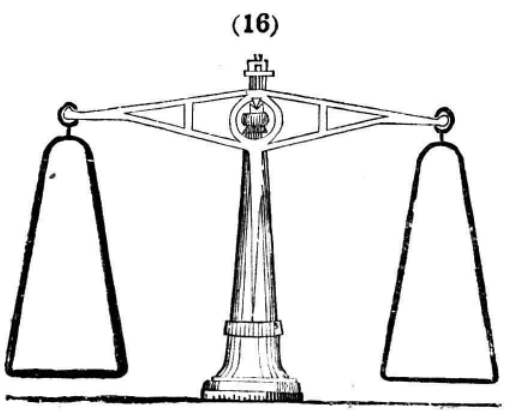

# 杠杆平衡：从天平看力臂

初中物理 · 约 8 分钟 · 历史教材原图观察

把同样重的物体挂在支点两侧，为什么挂得更远的一侧更容易往下转？

教材原图来自王季烈编《共和國教科書・物理學・中學校用》，商务印书馆，1921 年，PDF 第 35 页、印刷页 24，图 16 局部。 [原书扫描件及权利标注](https://commons.wikimedia.org/wiki/File:SSID-13337873_共和國教科書_共和國教科書_物理學_中學校用.pdf)

## 从原图找三个位置

先找横梁中间的支点，再找左、右两端的悬挂点。两边的拉力都竖直向下，但它们让横梁转动的方向相反。支点到力的作用线的垂直距离叫**力臂**。图中横梁水平、拉力竖直，力臂就是支点到悬挂点的水平距离。

## 用一个例子算清楚

忽略横梁自重对转动的影响，左右转动效果相抵时，满足 **左侧力 × 左侧力臂 = 右侧力 × 右侧力臂**。

如果左侧力是 2 N，力臂是 6 cm，转动效果是 12 N·cm。右侧力臂只有 3 cm，需要 4 N 才能平衡。力臂缩短一半，所需力就变成两倍。

## 自己试一题

左侧是 3 N、4 cm。右侧仍用 3 N，应挂在离支点多远的位置？如果把右侧挂点移到 8 cm，右侧应换成多大的力？

自查：第一问是 4 cm。第二问是 1.5 N。两次都让右侧的「力 × 力臂」等于 12 N·cm。
