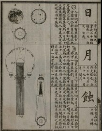

# 看图识字：日和月

小学低年级 · 约 5 分钟 · 历史教材原图观察

今天先认两个字，再用它们各说一句话。

教材原图来自《澄衷蒙學堂字課圖說》第 2 册，1901 年石印本，PDF 第 4 页右页局部。 [原书与公有领域说明](https://commons.wikimedia.org/wiki/File:NLC892-312002096115-328149_澄衷蒙學堂字課圖說_四卷_上海順成書局清光緒二十七年石印本_第2冊.pdf)

## 找一找

从图的右边往下看。先找到「日」，再找到「月」。用手指指给身边的人看。

「日」在这里和太阳有关。可以说「日出的时候，天慢慢亮了」。「月」在这里和月亮有关。可以说「今晚，我看见了月亮」。

## 看一看，再说一说

两个字里面都有短横。仔细看外面的轮廓，再想一想哪个是「日」、哪个是「月」。古书把字竖着排，我们今天说话时还是用熟悉的词就好。

## 试一试

1. 「___出的时候，天慢慢亮了。」空格里该填「日」还是「月」？
2. 「我看见弯弯的___亮。」空格里该填什么字？
3. 读一读「日出」和「月亮」，然后用其中一个词造句。

自查：第 1 题填「日」，合起来是「日出」。第 2 题填「月」，合起来是「月亮」。第 3 题可以说「我和家人一起看日出」。
