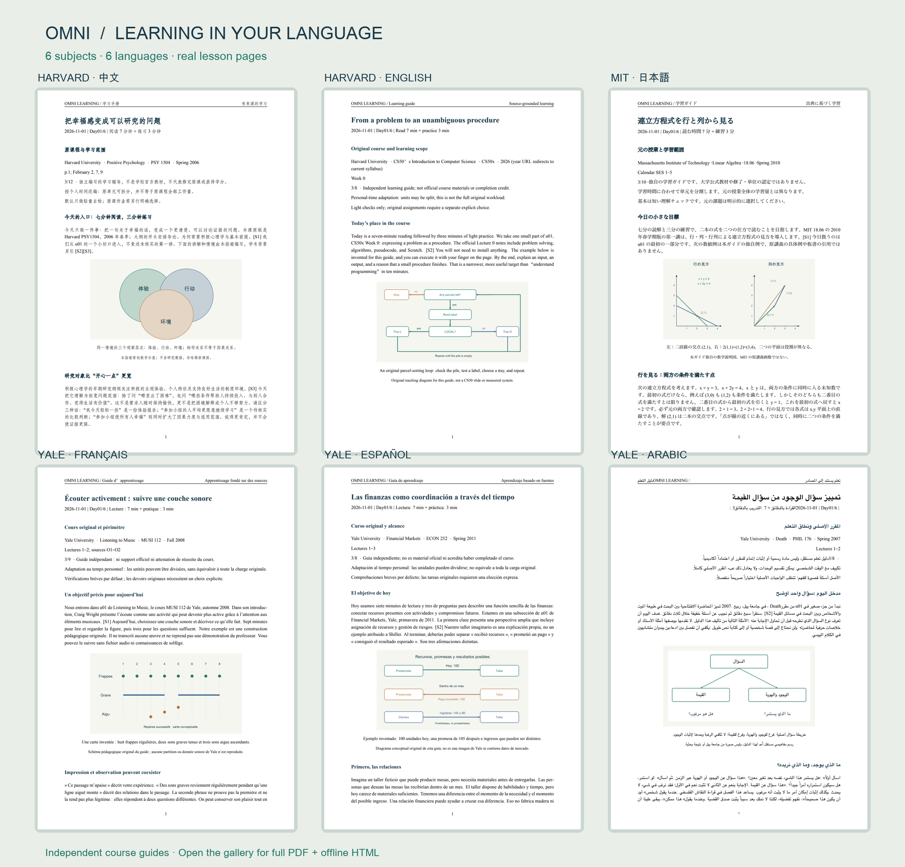

# University pathways: real multilingual samples

These are independent learning guides generated with Omni Learning Anything v3.0.0. Each set contains a **partial six-day plan and Day01**, in PDF and offline single-file HTML. The six days introduce selected ideas from the first three catalog groups; they do not complete those groups or the original university course. Original lecture, reading and assignment time is separate.

| Language | Original course | Learning plan | Day01 |
| --- | --- | --- | --- |
| 简体中文 | Harvard Positive Psychology · PSY 1504 · Spring 2006 | [PDF](positive-psychology-zh/plan.pdf) · [HTML](positive-psychology-zh/plan.html?raw=true) | [PDF](positive-psychology-zh/Day01.pdf) · [HTML](positive-psychology-zh/Day01.html?raw=true) |
| English | Harvard CS50x · 2026 source edition | [PDF](cs50x-en/plan.pdf) · [HTML](cs50x-en/plan.html?raw=true) | [PDF](cs50x-en/Day01.pdf) · [HTML](cs50x-en/Day01.html?raw=true) |
| 日本語 | MIT Linear Algebra · 18.06 · Spring 2010 | [PDF](linear-algebra-ja/plan.pdf) · [HTML](linear-algebra-ja/plan.html?raw=true) | [PDF](linear-algebra-ja/Day01.pdf) · [HTML](linear-algebra-ja/Day01.html?raw=true) |
| Français | Yale Listening to Music · MUSI 112 · Fall 2008 | [PDF](listening-music-fr/plan.pdf) · [HTML](listening-music-fr/plan.html?raw=true) | [PDF](listening-music-fr/Day01.pdf) · [HTML](listening-music-fr/Day01.html?raw=true) |
| Español | Yale Financial Markets · ECON 252 · Spring 2011 | [PDF](financial-markets-es/plan.pdf) · [HTML](financial-markets-es/plan.html?raw=true) | [PDF](financial-markets-es/Day01.pdf) · [HTML](financial-markets-es/Day01.html?raw=true) |
| العربية | Yale Death · PHIL 176 · Spring 2007 | [PDF](death-ar/plan.pdf) · [HTML](death-ar/plan.html?raw=true) | [PDF](death-ar/Day01.pdf) · [HTML](death-ar/Day01.html?raw=true) |

Download an HTML file and open it in your browser. Its diagram is embedded; no web server or extra image file is needed. Original-source links need internet. GitHub may show HTML source rather than render it inside the repository.

Each folder also contains the source `plan.json`, `Day01.json`, selected `config.json` pathway snapshot, original teaching diagram and `provenance.json`. There are no credentials, real learner records, assessment results or live schedules. Sample approvals were simulated only for this explicitly requested demonstration. Diagrams are code-drawn teaching aids, not measured data or original university slides. The top collage uses actual rendered PDF pages.

Harvard's 2006 syllabus supports its outline and rhythm, not unverified lecture transcripts. CS50's year-specific links currently redirect to its live course pages. MIT's Spring 2010 package includes lecture recordings identified as Fall 1999. Yale's music homepage was unavailable during verification; its individual official lecture pages were accessible. These distinctions are retained in the documents. See the [source ledger](../../docs/v300-sample-sources.md), [full built-in catalog sources](../../docs/course-catalog-sources.md), and [release validation](../../docs/release-validation-v3.0.0.md).

中文：每组均为局部六天计划与第一课样张，不代表完成原课。下载 HTML 后可直接离线阅读，原资料链接需联网。图示为本项目原创教学示意，不是学校原课截图；顶部拼图来自实际 PDF 页面。
